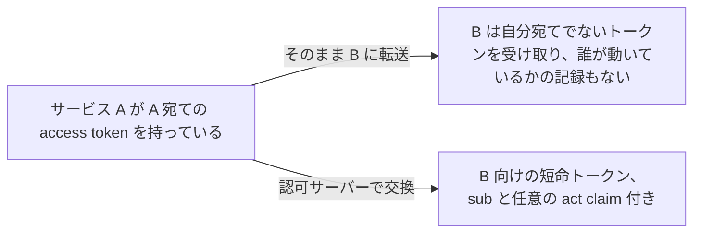
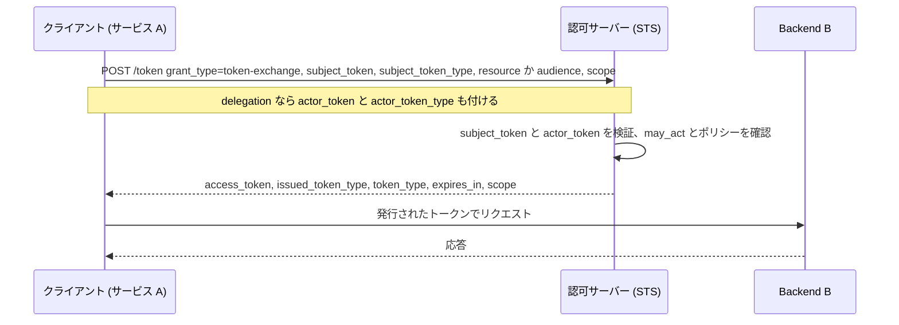

# Token Exchange

> 一言で言うと: クライアントが手元のトークンをトークンエンドポイントに差し出し、別のトークンを受け取る仕組み。ユーザーに代わって別のサービスへ行くときや、あるサービスが別のサービスの代理で動くときに使う。

## どういうときに使うか

- **呼び出し元のアイデンティティを保ったまま backend API を呼びたいリソースサーバー**: 受け取った access token をそのまま転送する代わりに、backend 向けに scope を絞った短命のトークンへ交換する (Section 2.3)。
- **ユーザーの代理で動くサービスで、backend に両者を見せたい**: delegation では `sub` にユーザーを残し、サービスを `act` claim に記録する。backend は「誰が誰のために」呼んでいるかを判別できる (Section 1.1, Appendix A.2)。
- **サービスがユーザーそのものとして振る舞う必要がある**: impersonation ではユーザーだけを名指しするトークンを発行し、そのトークンの範囲では保持者と subject を区別しない (Section 1.1, Appendix A.1)。
- **手元のものとは別の種類のトークンが要るクライアント**: SAML assertion や ID token を JWT に交換する。たとえば別の認可サーバーで認可グラントとして使うための JWT。結果が access token でなければ `token_type` は `N_A` (Section 2.2.1, Section 3)。

## 解決する問題

あるサービスが、自分を audience とする access token 付きのリクエストを受け取る。そこから第二のサービスを呼ぶには、第二のサービスが受け付けるトークンが要る。元のトークンを横流しすると、第二のサービスは自分宛てに発行されていない credential を受け取ることになり、どのサービスが代理で動いているかの記録も失われる。RFC 8693 は認可サーバーを Security Token Service にする。クライアントが `subject_token` (と任意の `actor_token`) を提示すると、目的の `resource` や `audience` 向けの新しいトークンを受け取り、委任の連鎖はトークン自体に書き込まれる (Section 1, Section 4.1)。

## 仕組み

クライアントは `grant_type=urn:ietf:params:oauth:grant-type:token-exchange` を送り、手元のトークンを `subject_token`、その種類を `subject_token_type` に入れ、宛先を `resource` (URI) か `audience` (論理名) で指定する。delegation なら `actor_token` を添える。認可サーバーはリクエスト中のトークンをすべて検証し、何を発行するか決め、`access_token` と、返ってきたトークンの種類を示す `issued_token_type` を返す。delegation トークンなら `sub` は元の subject のままで、`act` が現在の actor を示し、以前の actor はその中に入れ子で残る (Section 2.1, Section 2.2.1, Section 4.1)。

## 仕様が求めること

- `grant_type` は `urn:ietf:params:oauth:grant-type:token-exchange` でなければならない。`subject_token` と `subject_token_type` は REQUIRED。`actor_token_type` は `actor_token` があるとき REQUIRED で、ないときは含めてはならない (Section 2.1)。
- 認可サーバーは `subject_token` と、あれば `actor_token` を、それぞれの種類に応じて検証しなければならない (Section 2.1)。
- `resource` は絶対 URI でフラグメントを含んではならない。`audience` はその認可サーバー内で一意な論理名。どちらも複数指定でき、併用もできる (Section 2.1)。
- 応答には `access_token`、`issued_token_type`、`token_type` が必須。発行したトークンが access token でなければ `token_type` は `N_A`。`scope` は要求と異なるときに REQUIRED (Section 2.2.1)。
- 不正なリクエストや拒否されたトークンには `invalid_request` を返さなければならない。要求された `resource` や `audience` 向けに発行できないときは `invalid_target` を返すべき (Section 2.2.2)。
- `act` claim 付きトークンの消費者は、アクセス制御の判断でトップレベルの claim と現在の actor だけを考慮しなければならない。以前の actor は参考情報 (Section 4.1)。
- トークン内の `may_act` claim は、その subject の actor になることを許された当事者を示す (Section 4.4)。

## 注意点

- クライアント認証は認可サーバーの裁量。認証なしではトークンを持つ誰もが交換できる。誰が impersonation や delegation を受けられるかを決める手段が認証になる (Section 2.1)。
- 交換は一回きりの出来事。入力トークンを更新しても出力は延びず、入力の失効も配備側で仕組みを足さない限り伝播しない (Section 2.1)。
- 宛先を一度にたくさん要求すると拒否されやすい。実効的なアクセスは全宛先にわたる scope の積になるので、要求は絞る (Section 2.1.1)。
- delegation も impersonation も、ある principal が別の principal の権限を行使できるようにする。`scope` claim で委任された権限の適用先を限定し、トークンの寿命を短くする (Section 5)。
- トークンは機微な情報を含みうるので暗号化された経路でしか送ってはならない。クライアントから隠す必要があれば、受け取り手向けに暗号化する (Section 6)。

## 出典

- [RFC 8693, Section 1](https://www.rfc-editor.org/rfc/rfc8693#section-1)
- [RFC 8693, Section 1.1](https://www.rfc-editor.org/rfc/rfc8693#section-1.1)
- [RFC 8693, Section 2.1](https://www.rfc-editor.org/rfc/rfc8693#section-2.1)
- [RFC 8693, Section 2.1.1](https://www.rfc-editor.org/rfc/rfc8693#section-2.1.1)
- [RFC 8693, Section 2.2.1](https://www.rfc-editor.org/rfc/rfc8693#section-2.2.1)
- [RFC 8693, Section 2.2.2](https://www.rfc-editor.org/rfc/rfc8693#section-2.2.2)
- [RFC 8693, Section 2.3](https://www.rfc-editor.org/rfc/rfc8693#section-2.3)
- [RFC 8693, Section 3](https://www.rfc-editor.org/rfc/rfc8693#section-3)
- [RFC 8693, Section 4.1](https://www.rfc-editor.org/rfc/rfc8693#section-4.1)
- [RFC 8693, Section 4.4](https://www.rfc-editor.org/rfc/rfc8693#section-4.4)
- [RFC 8693, Section 5](https://www.rfc-editor.org/rfc/rfc8693#section-5)
- [RFC 8693, Section 6](https://www.rfc-editor.org/rfc/rfc8693#section-6)
- [RFC 8693, Appendix A.1](https://www.rfc-editor.org/rfc/rfc8693#appendix-A.1)
- [RFC 8693, Appendix A.2](https://www.rfc-editor.org/rfc/rfc8693#appendix-A.2)
