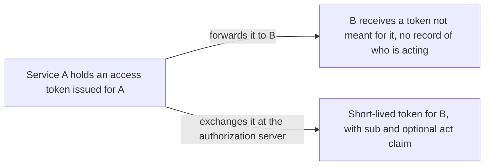
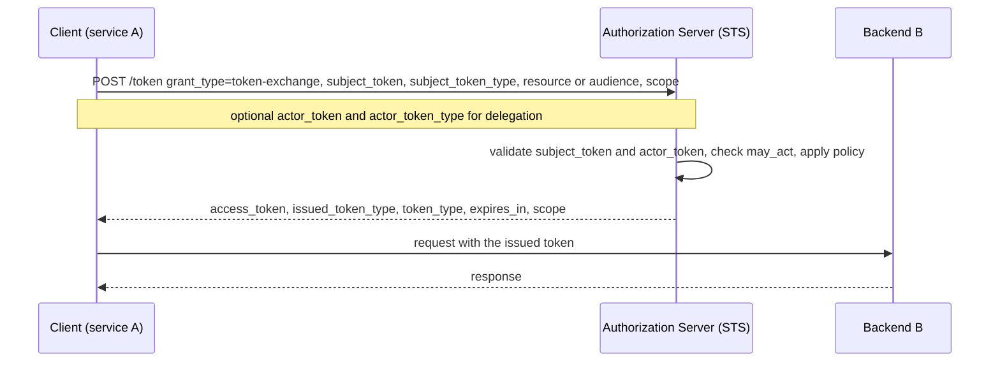

# Token Exchange

> In one line: a client posts a token it already holds to the token endpoint and gets a different token back, so it can act for the user towards another service, or let one service act on behalf of another.

## When you reach for it

- **A resource server that must call a backend API with the caller's identity**: instead of forwarding the access token it received, it exchanges that token for a short-lived one scoped to the backend (Section 2.3).
- **A service acting for a user where the backend must see both parties**: delegation keeps the user as `sub` and records the service in an `act` claim, so the backend can tell who is calling for whom (Section 1.1, Appendix A.2).
- **A service that has to look exactly like the user**: impersonation issues a token that names only the user, so the holder is indistinguishable from the subject within that token's scope (Section 1.1, Appendix A.1).
- **A client that needs a different kind of token than the one it holds**: trade a SAML assertion or ID token for a JWT, for example one to use as an authorization grant at another authorization server, with `token_type` set to `N_A` when the result is not an access token (Section 2.2.1, Section 3).

## The problem it solves

A service receives a request carrying an access token whose audience is that service. To call a second service it needs a token the second service accepts. Passing the original token along gives the second service a credential that was never issued for it, and it loses any record of which service is acting. RFC 8693 makes the authorization server a Security Token Service: a client presents a `subject_token` (and optionally an `actor_token`) and receives a new token for the intended `resource` or `audience`, with the delegation chain written into the token itself (Section 1, Section 4.1).

## How it works

The client sends `grant_type=urn:ietf:params:oauth:grant-type:token-exchange` with the token it holds in `subject_token` and its type in `subject_token_type`, naming the target with `resource` (a URI) or `audience` (a logical name). For delegation it adds an `actor_token`. The authorization server validates every token in the request, decides what it will issue, and returns it in `access_token` together with `issued_token_type`, which says what kind of token came back. If the result is a delegation token, its `sub` is the original subject and `act` identifies the current actor, with earlier actors nested inside (Section 2.1, Section 2.2.1, Section 4.1).

## What the spec requires

- `grant_type` MUST be `urn:ietf:params:oauth:grant-type:token-exchange`; `subject_token` and `subject_token_type` are REQUIRED; `actor_token_type` is REQUIRED when `actor_token` is present and MUST NOT be included otherwise (Section 2.1).
- The authorization server MUST validate the `subject_token`, and the `actor_token` if present, according to their types (Section 2.1).
- `resource` is an absolute URI that MUST NOT include a fragment; `audience` is a logical name unique within the authorization server; both may repeat and may be combined (Section 2.1).
- The response MUST include `access_token`, `issued_token_type` and `token_type`; `token_type` is `N_A` when the issued token is not an access token; `scope` is REQUIRED when it differs from what was requested (Section 2.2.1).
- `invalid_request` MUST be returned for invalid requests or rejected tokens; `invalid_target` SHOULD be returned when the server cannot issue a token for a requested `resource` or `audience` (Section 2.2.2).
- Consumers of a token with an `act` claim MUST consider only the top-level claims and the current actor when making access-control decisions; prior actors are informational (Section 4.1).
- A `may_act` claim in a token states which party is authorized to become the actor for that token's subject (Section 4.4).

## Watch out

- Client authentication is left to the authorization server. Without it, anyone holding a token can exchange it, so authentication is what lets the server decide which entities may impersonate or receive delegations (Section 2.1).
- An exchange is a one-time event. Renewing the input token does not extend the output, and revocation of the input is not propagated unless the deployment adds that (Section 2.1).
- Requesting many targets at once makes rejection more likely; the effective access is the product of the requested scopes across all targets, so keep requests narrow (Section 2.1.1).
- Delegation and impersonation let one principal exercise another's rights. Use the `scope` claim to restrict where delegated rights apply and keep token lifetimes short (Section 5).
- Tokens may carry sensitive data and MUST be sent only over encrypted channels; if the content must be hidden from the client, encrypt the token to its intended recipient (Section 6).

## Sources

- [RFC 8693, Section 1](https://www.rfc-editor.org/rfc/rfc8693#section-1)
- [RFC 8693, Section 1.1](https://www.rfc-editor.org/rfc/rfc8693#section-1.1)
- [RFC 8693, Section 2.1](https://www.rfc-editor.org/rfc/rfc8693#section-2.1)
- [RFC 8693, Section 2.1.1](https://www.rfc-editor.org/rfc/rfc8693#section-2.1.1)
- [RFC 8693, Section 2.2.1](https://www.rfc-editor.org/rfc/rfc8693#section-2.2.1)
- [RFC 8693, Section 2.2.2](https://www.rfc-editor.org/rfc/rfc8693#section-2.2.2)
- [RFC 8693, Section 2.3](https://www.rfc-editor.org/rfc/rfc8693#section-2.3)
- [RFC 8693, Section 3](https://www.rfc-editor.org/rfc/rfc8693#section-3)
- [RFC 8693, Section 4.1](https://www.rfc-editor.org/rfc/rfc8693#section-4.1)
- [RFC 8693, Section 4.4](https://www.rfc-editor.org/rfc/rfc8693#section-4.4)
- [RFC 8693, Section 5](https://www.rfc-editor.org/rfc/rfc8693#section-5)
- [RFC 8693, Section 6](https://www.rfc-editor.org/rfc/rfc8693#section-6)
- [RFC 8693, Appendix A.1](https://www.rfc-editor.org/rfc/rfc8693#appendix-A.1)
- [RFC 8693, Appendix A.2](https://www.rfc-editor.org/rfc/rfc8693#appendix-A.2)
