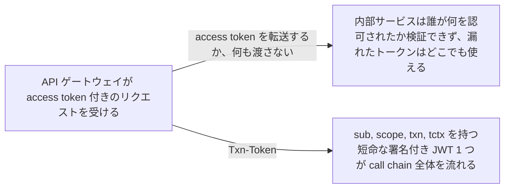
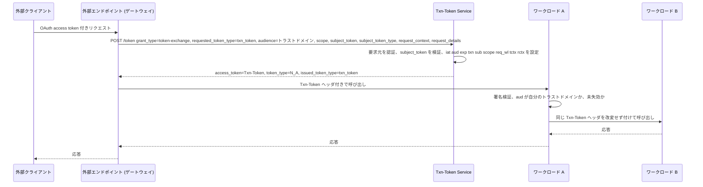

# Transaction Tokens

> 一言で言うと: 外部エンドポイントがリクエストを受けたとき、呼び出し元の credential を短命な署名付き JWT に交換し、call chain の内部ワークロードがそれを改変せず転送して検証する。ユーザーとリクエストの文脈が途中で失われたり書き換えられたりしなくなる。

## どういうときに使うか

- **有効な外部トランザクションなしで呼び出せてしまう内部ワークロード**: 1 つのトランザクションに結び付いた `txn` id と短い `exp` を持つ Txn-Token が、実際の外部リクエストが call chain を始めたことを証明する (Section 1, Section 7)。
- **マイクロサービス間での impersonation やパラメータ改竄**: subject と認可の詳細は、Txn-Token Service が発行時に固定した署名付きの `sub`、`scope`、`tctx` claim に入るので、途中のホップが書き換えられない (Section 1, Section 9.2)。
- **盗まれた OAuth access token がメッシュ内に広がる**: 外部の access token はエッジに留まる。Txn-Token にそれを含めてはならず、Txn-Token を access token として使ってもならない (Section 13.4, Section 13.13)。
- **スケジュールジョブのような、受信トークンのない内部起点の処理**: ワークロードは自己署名 JWT を `subject_token` として提示し、chain 用の Txn-Token を得る (Section 5.1, Section 8.2, Section 11.2.1)。

## 解決する問題

API への外部リクエストは、内部ワークロード呼び出しの連鎖に広がる。トラストドメインの中で各ワークロードは動いてよいか判断しなければならないが、ふつう見えるのは直前のホップだけ。そこから、有効なトランザクションなしのワークロード呼び出し、ユーザーやワークロードの impersonation、chain 途中でのパラメータ改変、認可の文脈を運ぶ access token の窃取が起きうる。Txn-Token は、ユーザーかワークロードのアイデンティティ、認可の文脈、リクエストの文脈を、トランザクションに結び付いた短命な署名付き JWT に固定し、call chain を通して運ぶ。下流の各ワークロードは同じ不変の事実に対して自分の認可判断を下せる (Section 1, Section 4)。

## 仕組み

外部エンドポイントは Txn-Token Service に RFC 8693 の token exchange を要求する。`requested_token_type=urn:ietf:params:oauth:token-type:txn_token`、`audience` にトラストドメイン名、`scope` に目的、`subject_token` に受信した credential、そして RECOMMENDED の `request_context` と `request_details` のオブジェクトを付ける。サービスは `typ` が `txntoken+jwt` の JWT を発行し、claim として `iat`、`aud`、`exp`、`txn`、`sub`、`scope`、`req_wl` に加え、不変の認可詳細を `tctx`、リクエスト環境を `rctx` に入れる。各ワークロードはトークンを `Txn-Token` HTTP ヘッダに載せ、受信時に検証し、受け取ったままの形で次へ渡す (Section 9.1, Section 9.2, Section 11.1, Section 12)。

## 仕様が求めること

- トラストドメインごとに論理的な Txn-Token Service はちょうど 1 つでなければならず、RFC 8693 の token exchange エンドポイントをプロファイルする (Section 3, Section 10)。
- JWT ヘッダの `typ` は `txntoken+jwt` でなければならない。`iat`、`aud`、`exp`、`txn`、`sub`、`scope`、`req_wl` は REQUIRED、`tctx` と `rctx` は RECOMMENDED、`iss` は OPTIONAL。受信者は理解できない claim を無視しなければならない (Section 9.1, Section 9.2)。
- リクエストの `grant_type` は `urn:ietf:params:oauth:grant-type:token-exchange`、`audience` はトラストドメイン名、`requested_token_type` は `urn:ietf:params:oauth:token-type:txn_token` でなければならず、`scope` は REQUIRED (Section 11.1)。
- 応答の `token_type` は `N_A`、`access_token` は Txn-Token、`issued_token_type` は txn_token の URN でなければならず、refresh token を含めてはならない (Section 11.4)。
- 要求元ワークロードと Txn-Token Service は相互に認証しなければならない (Section 11.5)。
- HTTP で別のワークロードを呼ぶときは `Txn-Token` ヘッダにちょうど 1 つの Txn-Token を送らなければならず、`Authorization` ヘッダを使ってはならない。受信側は署名、`aud` が自分のトラストドメインであること、未失効であることを検証し、改変せず転送しなければならない (Section 12, Section 12.1, Section 12.2)。

## 注意点

- Txn-Token はリプレイ耐性がない。寿命は分かそれ以下の短さに保たなければならず、提示された credential がすでに失効していれば発行してはならない (Section 6, Section 13.1)。
- refresh token で Txn-Token を要求してはならず、提示された access token を Txn-Token に埋め込んではならない (Section 13.3, Section 13.4)。
- 要求された scope は subject token の scope と同じかそれより狭くなければならない。scope を判定できないときは、無制限とみなさず拒否しなければならない (Section 13.6, Section 13.14)。
- Txn-Token をワークロードの認証に使ってはならず、OAuth access token として使ってもならない (Section 13.12, Section 13.13)。
- Txn-Token から発行する置き換えトークンは、許可範囲を広げてはならず、`txn`、`sub`、`aud` を変えてはならず、失効したトークンから発行してもならない (Section 13.15)。
- Txn-Token 全体をそのままログに書いてはならない。ハッシュか、署名を除いたペイロードを記録する (Section 15.2)。

## 出典

- [draft-ietf-oauth-transaction-tokens, Section 1](https://datatracker.ietf.org/doc/html/draft-ietf-oauth-transaction-tokens#section-1)
- [draft-ietf-oauth-transaction-tokens, Section 3](https://datatracker.ietf.org/doc/html/draft-ietf-oauth-transaction-tokens#section-3)
- [draft-ietf-oauth-transaction-tokens, Section 4](https://datatracker.ietf.org/doc/html/draft-ietf-oauth-transaction-tokens#section-4)
- [draft-ietf-oauth-transaction-tokens, Section 5.1](https://datatracker.ietf.org/doc/html/draft-ietf-oauth-transaction-tokens#section-5.1)
- [draft-ietf-oauth-transaction-tokens, Section 6](https://datatracker.ietf.org/doc/html/draft-ietf-oauth-transaction-tokens#section-6)
- [draft-ietf-oauth-transaction-tokens, Section 7](https://datatracker.ietf.org/doc/html/draft-ietf-oauth-transaction-tokens#section-7)
- [draft-ietf-oauth-transaction-tokens, Section 8.2](https://datatracker.ietf.org/doc/html/draft-ietf-oauth-transaction-tokens#section-8.2)
- [draft-ietf-oauth-transaction-tokens, Section 9.1](https://datatracker.ietf.org/doc/html/draft-ietf-oauth-transaction-tokens#section-9.1)
- [draft-ietf-oauth-transaction-tokens, Section 9.2](https://datatracker.ietf.org/doc/html/draft-ietf-oauth-transaction-tokens#section-9.2)
- [draft-ietf-oauth-transaction-tokens, Section 10](https://datatracker.ietf.org/doc/html/draft-ietf-oauth-transaction-tokens#section-10)
- [draft-ietf-oauth-transaction-tokens, Section 11.1](https://datatracker.ietf.org/doc/html/draft-ietf-oauth-transaction-tokens#section-11.1)
- [draft-ietf-oauth-transaction-tokens, Section 11.2.1](https://datatracker.ietf.org/doc/html/draft-ietf-oauth-transaction-tokens#section-11.2.1)
- [draft-ietf-oauth-transaction-tokens, Section 11.4](https://datatracker.ietf.org/doc/html/draft-ietf-oauth-transaction-tokens#section-11.4)
- [draft-ietf-oauth-transaction-tokens, Section 11.5](https://datatracker.ietf.org/doc/html/draft-ietf-oauth-transaction-tokens#section-11.5)
- [draft-ietf-oauth-transaction-tokens, Section 12](https://datatracker.ietf.org/doc/html/draft-ietf-oauth-transaction-tokens#section-12)
- [draft-ietf-oauth-transaction-tokens, Section 12.1](https://datatracker.ietf.org/doc/html/draft-ietf-oauth-transaction-tokens#section-12.1)
- [draft-ietf-oauth-transaction-tokens, Section 12.2](https://datatracker.ietf.org/doc/html/draft-ietf-oauth-transaction-tokens#section-12.2)
- [draft-ietf-oauth-transaction-tokens, Section 13.1](https://datatracker.ietf.org/doc/html/draft-ietf-oauth-transaction-tokens#section-13.1)
- [draft-ietf-oauth-transaction-tokens, Section 13.3](https://datatracker.ietf.org/doc/html/draft-ietf-oauth-transaction-tokens#section-13.3)
- [draft-ietf-oauth-transaction-tokens, Section 13.4](https://datatracker.ietf.org/doc/html/draft-ietf-oauth-transaction-tokens#section-13.4)
- [draft-ietf-oauth-transaction-tokens, Section 13.6](https://datatracker.ietf.org/doc/html/draft-ietf-oauth-transaction-tokens#section-13.6)
- [draft-ietf-oauth-transaction-tokens, Section 13.12](https://datatracker.ietf.org/doc/html/draft-ietf-oauth-transaction-tokens#section-13.12)
- [draft-ietf-oauth-transaction-tokens, Section 13.13](https://datatracker.ietf.org/doc/html/draft-ietf-oauth-transaction-tokens#section-13.13)
- [draft-ietf-oauth-transaction-tokens, Section 13.14](https://datatracker.ietf.org/doc/html/draft-ietf-oauth-transaction-tokens#section-13.14)
- [draft-ietf-oauth-transaction-tokens, Section 13.15](https://datatracker.ietf.org/doc/html/draft-ietf-oauth-transaction-tokens#section-13.15)
- [draft-ietf-oauth-transaction-tokens, Section 15.2](https://datatracker.ietf.org/doc/html/draft-ietf-oauth-transaction-tokens#section-15.2)
