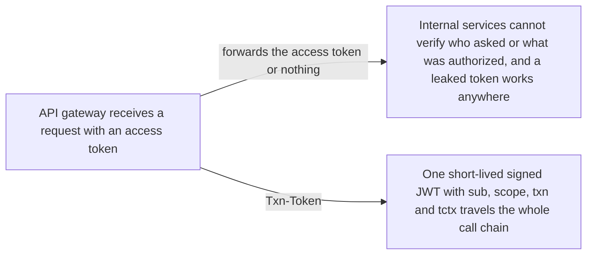
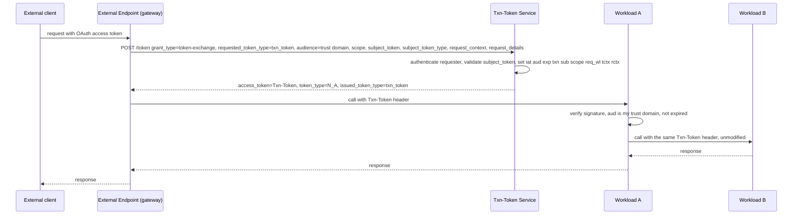

# Transaction Tokens

> In one line: when an external endpoint accepts a request, it trades the caller's credential for a short-lived signed JWT that every internal workload in the call chain forwards unchanged and verifies, so the user and request context cannot be lost or altered on the way.

## When you reach for it

- **Internal workloads that can be invoked without a valid external transaction**: a Txn-Token bound to one transaction, with a `txn` id and a short `exp`, proves that a real external request started the call chain (Section 1, Section 7).
- **Impersonation or parameter tampering between microservices**: the subject and authorization details sit in signed `sub`, `scope` and `tctx` claims fixed by the Txn-Token Service at issuance, so no hop can rewrite them (Section 1, Section 9.2).
- **Stolen OAuth access tokens spreading through the mesh**: the external access token stays at the edge; the Txn-Token MUST NOT contain it, and a Txn-Token MUST NOT be used as an access token (Section 13.4, Section 13.13).
- **Internally initiated work with no inbound token, such as a scheduled job**: the workload presents a self-signed JWT as `subject_token` and still gets a Txn-Token for the chain (Section 5.1, Section 8.2, Section 11.2.1).

## The problem it solves

An external API request fans out into a chain of internal workload calls, and each workload usually sees only the previous hop. That opens the door to invoking workloads without a valid transaction, impersonating users or workloads, modifying parameters mid-chain, and stealing the access tokens that carry authorization context. Txn-Tokens fix the identity, authorization context and request context in a short-lived signed JWT bound to the transaction and carried through the call chain, so every downstream workload applies its own authorization decision to the same immutable facts (Section 1, Section 4).

## How it works

The external endpoint sends an RFC 8693 token exchange request to the Txn-Token Service with `requested_token_type=urn:ietf:params:oauth:token-type:txn_token`, the trust domain name in `audience`, the intended purpose in `scope`, the incoming credential as `subject_token`, and the RECOMMENDED `request_context` and `request_details` objects. The service mints a JWT with `typ` `txntoken+jwt` and the claims `iat`, `aud`, `exp`, `txn`, `sub`, `scope`, `req_wl`, plus `tctx` for immutable authorization details and `rctx` for the request environment. Every workload puts the token in the `Txn-Token` HTTP header, verifies it on receipt, and passes it on exactly as received (Section 9.1, Section 9.2, Section 11.1, Section 12).

## What the spec requires

- Each trust domain MUST have exactly one logical Txn-Token Service, which profiles the RFC 8693 token exchange endpoint (Section 3, Section 10).
- The JWT header `typ` MUST be `txntoken+jwt`; `iat`, `aud`, `exp`, `txn`, `sub`, `scope` and `req_wl` are REQUIRED, `tctx` and `rctx` are RECOMMENDED, `iss` is OPTIONAL, and recipients MUST ignore claims they do not understand (Section 9.1, Section 9.2).
- In the request, `grant_type` MUST be `urn:ietf:params:oauth:grant-type:token-exchange`, `audience` MUST be the trust domain name, `requested_token_type` MUST be `urn:ietf:params:oauth:token-type:txn_token`, and `scope` is REQUIRED (Section 11.1).
- The response `token_type` MUST be `N_A`, `access_token` MUST be the Txn-Token, `issued_token_type` MUST be the txn_token URN, and the response MUST NOT include a refresh token (Section 11.4).
- The requesting workload and the Txn-Token Service MUST authenticate each other (Section 11.5).
- A workload calling another over HTTP MUST send exactly one Txn-Token in the `Txn-Token` header and MUST NOT use the `Authorization` header for it; receivers MUST verify the signature, that `aud` is their trust domain and that the token is not expired, and MUST forward it unmodified (Section 12, Section 12.1, Section 12.2).

## Watch out

- Txn-Tokens are not replay-resistant, so lifetimes MUST stay short, on the order of minutes or less, and the service MUST NOT issue one when the presented credential has already expired (Section 6, Section 13.1).
- Refresh tokens MUST NOT be used to request Txn-Tokens, and the presented access token MUST NOT be embedded in the Txn-Token (Section 13.3, Section 13.4).
- The requested scope MUST be equal to or narrower than the scope of the subject token; if that scope cannot be determined the request MUST be rejected rather than treated as unconstrained (Section 13.6, Section 13.14).
- A Txn-Token MUST NOT be used to authenticate a workload and MUST NOT be used as an OAuth access token (Section 13.12, Section 13.13).
- Replacement tokens issued from a Txn-Token MUST NOT expand what is permitted, MUST NOT change `txn`, `sub` or `aud`, and MUST NOT be issued from an expired token (Section 13.15).
- Complete Txn-Tokens MUST NOT be logged verbatim; log a hash or the payload without the signature (Section 15.2).

## Sources

- [draft-ietf-oauth-transaction-tokens, Section 1](https://datatracker.ietf.org/doc/html/draft-ietf-oauth-transaction-tokens#section-1)
- [draft-ietf-oauth-transaction-tokens, Section 3](https://datatracker.ietf.org/doc/html/draft-ietf-oauth-transaction-tokens#section-3)
- [draft-ietf-oauth-transaction-tokens, Section 4](https://datatracker.ietf.org/doc/html/draft-ietf-oauth-transaction-tokens#section-4)
- [draft-ietf-oauth-transaction-tokens, Section 5.1](https://datatracker.ietf.org/doc/html/draft-ietf-oauth-transaction-tokens#section-5.1)
- [draft-ietf-oauth-transaction-tokens, Section 6](https://datatracker.ietf.org/doc/html/draft-ietf-oauth-transaction-tokens#section-6)
- [draft-ietf-oauth-transaction-tokens, Section 7](https://datatracker.ietf.org/doc/html/draft-ietf-oauth-transaction-tokens#section-7)
- [draft-ietf-oauth-transaction-tokens, Section 8.2](https://datatracker.ietf.org/doc/html/draft-ietf-oauth-transaction-tokens#section-8.2)
- [draft-ietf-oauth-transaction-tokens, Section 9.1](https://datatracker.ietf.org/doc/html/draft-ietf-oauth-transaction-tokens#section-9.1)
- [draft-ietf-oauth-transaction-tokens, Section 9.2](https://datatracker.ietf.org/doc/html/draft-ietf-oauth-transaction-tokens#section-9.2)
- [draft-ietf-oauth-transaction-tokens, Section 10](https://datatracker.ietf.org/doc/html/draft-ietf-oauth-transaction-tokens#section-10)
- [draft-ietf-oauth-transaction-tokens, Section 11.1](https://datatracker.ietf.org/doc/html/draft-ietf-oauth-transaction-tokens#section-11.1)
- [draft-ietf-oauth-transaction-tokens, Section 11.2.1](https://datatracker.ietf.org/doc/html/draft-ietf-oauth-transaction-tokens#section-11.2.1)
- [draft-ietf-oauth-transaction-tokens, Section 11.4](https://datatracker.ietf.org/doc/html/draft-ietf-oauth-transaction-tokens#section-11.4)
- [draft-ietf-oauth-transaction-tokens, Section 11.5](https://datatracker.ietf.org/doc/html/draft-ietf-oauth-transaction-tokens#section-11.5)
- [draft-ietf-oauth-transaction-tokens, Section 12](https://datatracker.ietf.org/doc/html/draft-ietf-oauth-transaction-tokens#section-12)
- [draft-ietf-oauth-transaction-tokens, Section 12.1](https://datatracker.ietf.org/doc/html/draft-ietf-oauth-transaction-tokens#section-12.1)
- [draft-ietf-oauth-transaction-tokens, Section 12.2](https://datatracker.ietf.org/doc/html/draft-ietf-oauth-transaction-tokens#section-12.2)
- [draft-ietf-oauth-transaction-tokens, Section 13.1](https://datatracker.ietf.org/doc/html/draft-ietf-oauth-transaction-tokens#section-13.1)
- [draft-ietf-oauth-transaction-tokens, Section 13.3](https://datatracker.ietf.org/doc/html/draft-ietf-oauth-transaction-tokens#section-13.3)
- [draft-ietf-oauth-transaction-tokens, Section 13.4](https://datatracker.ietf.org/doc/html/draft-ietf-oauth-transaction-tokens#section-13.4)
- [draft-ietf-oauth-transaction-tokens, Section 13.6](https://datatracker.ietf.org/doc/html/draft-ietf-oauth-transaction-tokens#section-13.6)
- [draft-ietf-oauth-transaction-tokens, Section 13.12](https://datatracker.ietf.org/doc/html/draft-ietf-oauth-transaction-tokens#section-13.12)
- [draft-ietf-oauth-transaction-tokens, Section 13.13](https://datatracker.ietf.org/doc/html/draft-ietf-oauth-transaction-tokens#section-13.13)
- [draft-ietf-oauth-transaction-tokens, Section 13.14](https://datatracker.ietf.org/doc/html/draft-ietf-oauth-transaction-tokens#section-13.14)
- [draft-ietf-oauth-transaction-tokens, Section 13.15](https://datatracker.ietf.org/doc/html/draft-ietf-oauth-transaction-tokens#section-13.15)
- [draft-ietf-oauth-transaction-tokens, Section 15.2](https://datatracker.ietf.org/doc/html/draft-ietf-oauth-transaction-tokens#section-15.2)
