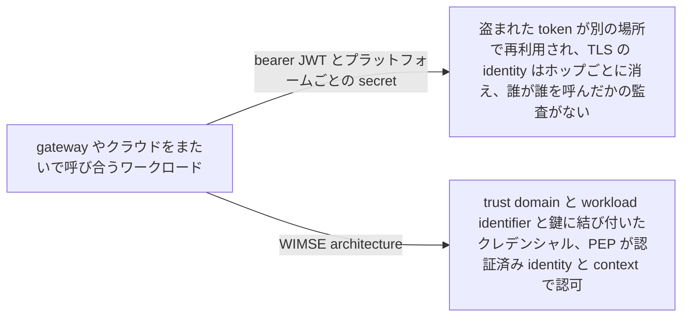
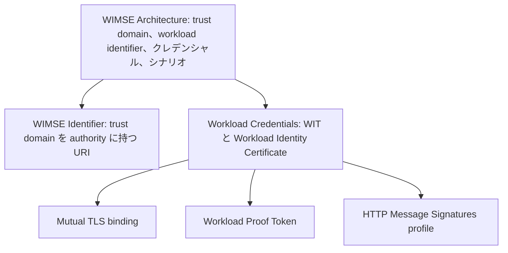
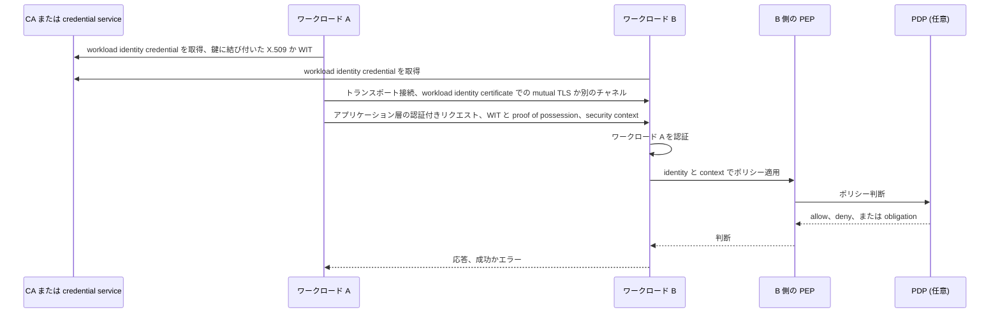

# WIMSE Architecture

> 一言で言うと: ワークロードがどうやって identity (trust domain、workload identifier、鍵に結び付いたクレデンシャル) を得て、ゲートウェイやクラウドをまたいで相互認証し、security context を呼び出しの連鎖に沿って運ぶかを描いた IETF の地図。WIMSE のクレデンシャルとプロトコルの各 draft が共有する語彙になる。

## どういうときに使うか

- **ingress gateway の裏にいる 2 つのマイクロサービスが、gateway だけでなく互いを認証したい**: 基本シナリオでは、ワークロードが CA/credential service からクレデンシャルを取り、gateway は転送前にワークロードを認証し、ワークロード 3 はワークロード 1 の認証済み identity でどの API を呼んでよいかを決め、監査ログにも紐付ける (Section 3.2.1)。
- **service mesh の sidecar やロードバランサが TLS を終端し、宛先が本当の呼び出し元を見られない**: 階層化された認証では TLS ホップに workload identity certificate を、呼び出し元の証明にアプリケーション層の Workload Identity Token と proof of possession を使う。宛先はポリシーが定めない限り 2 つの identity を同一視してはならない (Section 3.4.3)。
- **ワークロードが別の trust domain のサービスやクラウド事業者のインフラを呼ぶ**: クロスドメインのシナリオでは、ワークロードが自分のクレデンシャルで token service に認証し、外部で使える token を得て、外部の token service で access token に交換する (Section 3.2.3)。
- **AI agent がユーザーの代理で他の agent や下流サービスを呼ぶ**: アーキテクチャは agent を委任されたワークロードとして扱い、上流の security context を伝搬させ、自律的な行動を委任された行動と区別し、agent の連鎖の各ホップで context を再スコープ・再バインドすることを求める (Section 3.4.11)。

## 解決する問題

ワークロードは何も持たずに始まり、動く前に identity、trust anchor、context を必要とする。動き出した後も、外部エンドポイントへの 1 リクエストは内部の複数のワークロードを経由することが多く、エッジで検査した認可はその連鎖を生き延びなければならない (Section 1)。JWT の bearer token がよくある答えであり、同時に弱点でもある。何にも結び付いていないので、ログや proxy から読み取られた token は誰でも提示できる (Section 3.1.3、Section 4.4)。

アーキテクチャは 3 つの構成要素を固定する。証明書と token を発行する権限の単位である trust domain (完全修飾ドメイン名で識別)。その trust domain にスコープされた URI である workload identifier。そして公開鍵を identifier に結び付けるクレデンシャル。提示には秘密鍵の所持証明が要る (Section 3.1)。

## 仕組み

両方のワークロードは呼び出しの前に trust domain の CA/credential service からクレデンシャルを得る。このライフサイクルはリクエストより遅い周期で回る (Section 3.3)。トランスポート接続は workload identity certificate を使った mutual TLS でもよい。リクエストにはアプリケーション層で Workload Identity Token と proof of possession を足せるので、相手の認証はトランスポート層、アプリケーション層、その両方のどこでも起こりうる。呼ばれた側は Policy Enforcement Point で認可し、必要なら Policy Decision Point に問い合わせる。アーキテクチャはポリシー言語も PEP と PDP の間のプロトコルも定めない (Section 3.3)。security context は、gateway が context service から得た transaction token のような token としてリクエストに同伴し、workload identifier に結び付けることで受け手はどのワークロードが起点かを知れる (Section 3.2.2、Section 3.4.6)。

## 仕様が求めること

- trust domain は定義する組織の完全修飾ドメイン名で識別するのが SHOULD。trust domain から trust anchor と WIT 検証用 JWK Set へのマッピングは、真正性・完全性・鮮度を保証する仕組みで取得しなければならない (Section 3.1.1)。
- workload identifier は trust domain を示す authority を MUST で含む URI。relying party は発行 trust domain の identity semantics に従って解釈しなければならず、trust domain だけが違う 2 つの identifier は別のエンティティ (Section 3.1.1、Section 3.1.2)。
- workload identity credential は、公開鍵を含む署名済み構造と、決して提示されない秘密鍵の組。デプロイメントは有限のクレデンシャル寿命と自動更新を使うのが SHOULD (Section 3.1.3)。
- 宛先ワークロードは、中間者が認証したトランスポート層の identity をアプリケーション層の呼び出し元と同一視してはならない (プロトコルかポリシーがその関係を定める場合を除く)。監査記録は両方の identity を残すのが SHOULD (Section 3.4.3)。
- 認可は通常は呼ばれた側が行う。呼ばれた側が細粒度の判断を下せず、呼ぶ側に十分な context がある場合は呼ぶ側が行ってもよい (Section 3.4.4)。
- 認証されたすべてのリクエストは検証可能な痕跡を残さなければならず、監査ログに bearer token、秘密鍵、パスワードを書いてはならない。ログは改ざん検知可能にするのが SHOULD (Section 3.4.5)。
- AI の自律的な行動は委任された行動と MUST で区別し、agent 間の連鎖の各ホップで security context を明示的にスコープし再バインドしなければならない (Section 3.4.11)。

## 注意点

- TLS は隣接するエンドポイント間しか守らない。終端するロードバランサ、gateway、proxy は機密性・完全性・identity の受け渡しを保証しない (Section 4.1)。
- ログや可観測性ツールは漏洩経路になる。bearer JWT、ユーザー名、メールアドレスを含む HTTP ヘッダが、アクセス制御の緩いシステムに流れる (Section 4.2)。
- bearer クレデンシャルは最も盗まれやすく replay されやすい。鍵に結び付いたクレデンシャルは安全側だが、鍵にもライフサイクル管理、クレデンシャル寿命の制限、ローテーション、侵害が疑われたときの失効が要る (Section 4.4)。
- 有効なクレデンシャルは鍵の制御と信頼された発行者による発行を証明するだけ。認証を暗黙の認可として扱うのは誤り (Section 4.5)。
- SSRF などで侵害されたワークロードはそのワークロードの権限を引き継ぐ。ワークロード間の認可で最小権限を適用する (Section 4.6)。

## 出典

- [draft-ietf-wimse-arch, Section 1](https://datatracker.ietf.org/doc/html/draft-ietf-wimse-arch#section-1)
- [draft-ietf-wimse-arch, Section 3.1](https://datatracker.ietf.org/doc/html/draft-ietf-wimse-arch#section-3.1)
- [draft-ietf-wimse-arch, Section 3.1.1](https://datatracker.ietf.org/doc/html/draft-ietf-wimse-arch#section-3.1.1)
- [draft-ietf-wimse-arch, Section 3.1.2](https://datatracker.ietf.org/doc/html/draft-ietf-wimse-arch#section-3.1.2)
- [draft-ietf-wimse-arch, Section 3.1.3](https://datatracker.ietf.org/doc/html/draft-ietf-wimse-arch#section-3.1.3)
- [draft-ietf-wimse-arch, Section 3.2.1](https://datatracker.ietf.org/doc/html/draft-ietf-wimse-arch#section-3.2.1)
- [draft-ietf-wimse-arch, Section 3.2.2](https://datatracker.ietf.org/doc/html/draft-ietf-wimse-arch#section-3.2.2)
- [draft-ietf-wimse-arch, Section 3.2.3](https://datatracker.ietf.org/doc/html/draft-ietf-wimse-arch#section-3.2.3)
- [draft-ietf-wimse-arch, Section 3.3](https://datatracker.ietf.org/doc/html/draft-ietf-wimse-arch#section-3.3)
- [draft-ietf-wimse-arch, Section 3.4.3](https://datatracker.ietf.org/doc/html/draft-ietf-wimse-arch#section-3.4.3)
- [draft-ietf-wimse-arch, Section 3.4.4](https://datatracker.ietf.org/doc/html/draft-ietf-wimse-arch#section-3.4.4)
- [draft-ietf-wimse-arch, Section 3.4.5](https://datatracker.ietf.org/doc/html/draft-ietf-wimse-arch#section-3.4.5)
- [draft-ietf-wimse-arch, Section 3.4.6](https://datatracker.ietf.org/doc/html/draft-ietf-wimse-arch#section-3.4.6)
- [draft-ietf-wimse-arch, Section 3.4.11](https://datatracker.ietf.org/doc/html/draft-ietf-wimse-arch#section-3.4.11)
- [draft-ietf-wimse-arch, Section 4.1](https://datatracker.ietf.org/doc/html/draft-ietf-wimse-arch#section-4.1)
- [draft-ietf-wimse-arch, Section 4.2](https://datatracker.ietf.org/doc/html/draft-ietf-wimse-arch#section-4.2)
- [draft-ietf-wimse-arch, Section 4.4](https://datatracker.ietf.org/doc/html/draft-ietf-wimse-arch#section-4.4)
- [draft-ietf-wimse-arch, Section 4.5](https://datatracker.ietf.org/doc/html/draft-ietf-wimse-arch#section-4.5)
- [draft-ietf-wimse-arch, Section 4.6](https://datatracker.ietf.org/doc/html/draft-ietf-wimse-arch#section-4.6)
