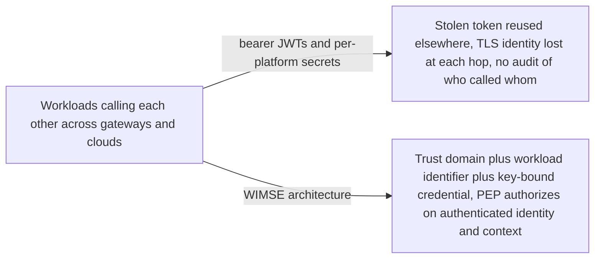
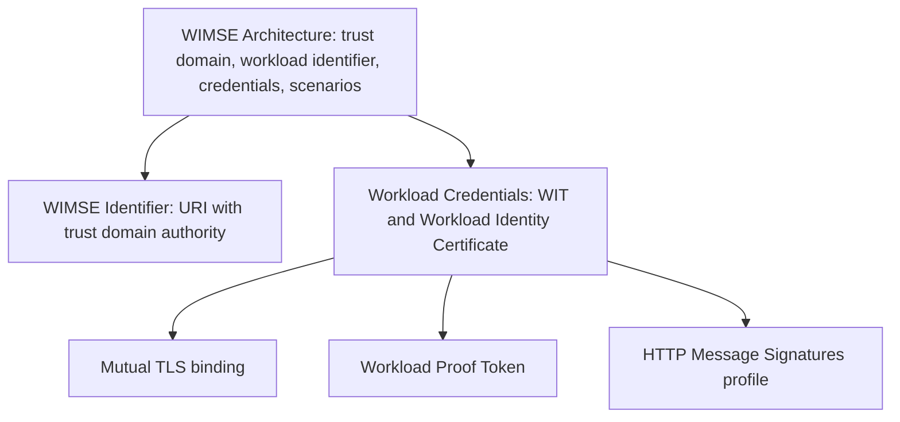
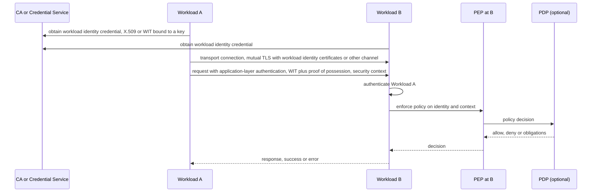

# WIMSE Architecture

> In one line: the IETF's map of how workloads get an identity (a trust domain, a workload identifier, and a key-bound credential), authenticate each other across gateways and clouds, and carry security context down a call chain, so that the WIMSE credential and protocol drafts have a shared vocabulary.

## When you reach for it

- **Two microservices behind an ingress gateway must authenticate each other, not just the gateway**: the basic scenario has workloads fetch credentials from a CA/credential service, the gateway authenticate workloads before forwarding, and workload 3 use workload 1's authenticated identity to decide which APIs it may call and to tag audit logs (Section 3.2.1).
- **A service mesh sidecar or load balancer terminates TLS, so the destination cannot see who really called**: layered authentication uses a workload identity certificate for the TLS hop and an application-layer Workload Identity Token with proof of possession for the caller, and the destination MUST NOT equate the two identities unless policy says so (Section 3.4.3).
- **A workload must call a service in another trust domain or a cloud provider's infrastructure**: the cross-domain scenario has the workload authenticate to a token service with its workload credential, obtain an externally usable token, and exchange it at the external token service for an access token (Section 3.2.3).
- **An AI agent calls other agents and downstream services on a user's behalf**: the architecture treats agents as delegated workloads that propagate the upstream security context, requires autonomous actions to be distinguished from delegated ones, and requires each hop in an agent chain to re-scope and re-bind the context (Section 3.4.11).

## The problem it solves

Workloads start with nothing and need an identity, trust anchors and context before they can act. Once they do act, a request to an external endpoint often has to pass through several internal workloads, and the authorization that was checked at the edge has to survive that chain (Section 1). JWT bearer tokens are the common answer and are also the weak point: they are not bound to anything, so a token read from a log or a proxy can be presented by anyone (Section 3.1.3, Section 4.4).

The architecture fixes three building blocks. A trust domain, identified by a fully qualified domain name, under whose authority certificates and tokens are issued. A workload identifier, a URI scoped to that trust domain. And a credential that binds a public key to the identifier, so presenting it requires proving possession of the private key (Section 3.1).

## How it works

Both workloads obtain credentials from the trust domain's CA/credential service before any call; that lifecycle is slower than request traffic (Section 3.3). The transport connection may use mutual TLS with workload identity certificates. The request may add a Workload Identity Token and proof of possession at the application layer, so peer authentication can happen at the transport layer, the application layer, or both. The callee authorizes through a Policy Enforcement Point, which may consult a Policy Decision Point; the architecture defines neither a policy language nor the PEP to PDP protocol (Section 3.3). The security context travels with the request as a token, such as a transaction token obtained by the gateway from a context service, and may be bound to a workload identifier so the receiver knows which workload originated it (Section 3.2.2, Section 3.4.6).

## What the spec requires

- Trust domains SHOULD be identified by a fully qualified domain name of the defining organization; the mapping from trust domain to trust anchors and to a JWK Set for WIT validation MUST come through a mechanism that guarantees authenticity, integrity and freshness (Section 3.1.1).
- A workload identifier is a URI that MUST include an authority naming the trust domain; relying parties MUST interpret it according to the identity semantics of the issuing trust domain, and two identifiers that differ only by trust domain are different entities (Section 3.1.1, Section 3.1.2).
- Workload identity credentials pair a signed structure containing a public key with a private key that is never presented; deployments SHOULD use bounded credential lifetimes and automated renewal (Section 3.1.3).
- A destination workload MUST NOT assume that a transport-layer identity authenticated by an intermediary equals the application-layer caller unless protocol or policy establishes that relationship, and audit records SHOULD capture both identities (Section 3.4.3).
- Authorization is normally performed by the callee; it MAY be performed by the caller when the callee cannot enforce fine-grained decisions and the caller has enough context (Section 3.4.4).
- Every authenticated request MUST leave a verifiable trace, and audit logs MUST NOT contain bearer tokens, private keys or passwords; logs SHOULD be tamper-evident (Section 3.4.5).
- Autonomous AI actions MUST be distinguished from delegated ones, and each hop in an agent-to-agent chain MUST explicitly scope and re-bind the security context (Section 3.4.11).

## Watch out

- TLS protects only between adjacent endpoints; load balancers, gateways and proxies that terminate it give no guarantee of confidentiality, integrity or identity passthrough (Section 4.1).
- Logs and observability tooling leak: HTTP headers with bearer JWTs, user names and email addresses end up in systems with weaker access control (Section 4.2).
- Bearer credentials are the easiest to steal and replay; key-bound credentials are safer but keys still need lifecycle management, limited lifetimes, rotation and revocation on suspected compromise (Section 4.4).
- A valid credential proves control of a key and issuance by a trusted issuer, nothing more; treating authentication as implicit authorization is an error (Section 4.5).
- A compromised workload, for example through server-side request forgery, inherits that workload's privileges, so apply least privilege through authorization between workloads (Section 4.6).

## Sources

- [draft-ietf-wimse-arch, Section 1](https://datatracker.ietf.org/doc/html/draft-ietf-wimse-arch#section-1)
- [draft-ietf-wimse-arch, Section 3.1](https://datatracker.ietf.org/doc/html/draft-ietf-wimse-arch#section-3.1)
- [draft-ietf-wimse-arch, Section 3.1.1](https://datatracker.ietf.org/doc/html/draft-ietf-wimse-arch#section-3.1.1)
- [draft-ietf-wimse-arch, Section 3.1.2](https://datatracker.ietf.org/doc/html/draft-ietf-wimse-arch#section-3.1.2)
- [draft-ietf-wimse-arch, Section 3.1.3](https://datatracker.ietf.org/doc/html/draft-ietf-wimse-arch#section-3.1.3)
- [draft-ietf-wimse-arch, Section 3.2.1](https://datatracker.ietf.org/doc/html/draft-ietf-wimse-arch#section-3.2.1)
- [draft-ietf-wimse-arch, Section 3.2.2](https://datatracker.ietf.org/doc/html/draft-ietf-wimse-arch#section-3.2.2)
- [draft-ietf-wimse-arch, Section 3.2.3](https://datatracker.ietf.org/doc/html/draft-ietf-wimse-arch#section-3.2.3)
- [draft-ietf-wimse-arch, Section 3.3](https://datatracker.ietf.org/doc/html/draft-ietf-wimse-arch#section-3.3)
- [draft-ietf-wimse-arch, Section 3.4.3](https://datatracker.ietf.org/doc/html/draft-ietf-wimse-arch#section-3.4.3)
- [draft-ietf-wimse-arch, Section 3.4.4](https://datatracker.ietf.org/doc/html/draft-ietf-wimse-arch#section-3.4.4)
- [draft-ietf-wimse-arch, Section 3.4.5](https://datatracker.ietf.org/doc/html/draft-ietf-wimse-arch#section-3.4.5)
- [draft-ietf-wimse-arch, Section 3.4.6](https://datatracker.ietf.org/doc/html/draft-ietf-wimse-arch#section-3.4.6)
- [draft-ietf-wimse-arch, Section 3.4.11](https://datatracker.ietf.org/doc/html/draft-ietf-wimse-arch#section-3.4.11)
- [draft-ietf-wimse-arch, Section 4.1](https://datatracker.ietf.org/doc/html/draft-ietf-wimse-arch#section-4.1)
- [draft-ietf-wimse-arch, Section 4.2](https://datatracker.ietf.org/doc/html/draft-ietf-wimse-arch#section-4.2)
- [draft-ietf-wimse-arch, Section 4.4](https://datatracker.ietf.org/doc/html/draft-ietf-wimse-arch#section-4.4)
- [draft-ietf-wimse-arch, Section 4.5](https://datatracker.ietf.org/doc/html/draft-ietf-wimse-arch#section-4.5)
- [draft-ietf-wimse-arch, Section 4.6](https://datatracker.ietf.org/doc/html/draft-ietf-wimse-arch#section-4.6)
