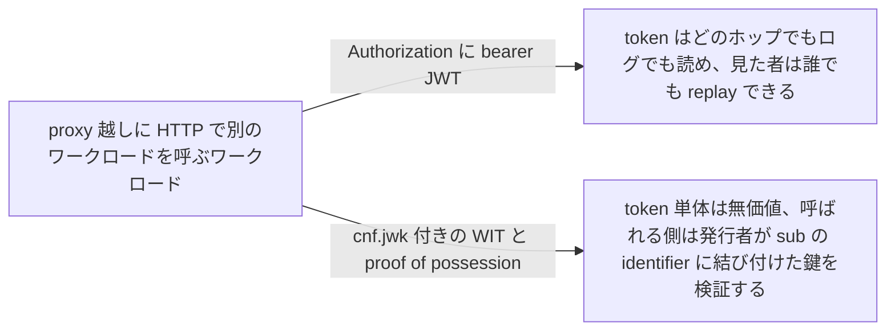
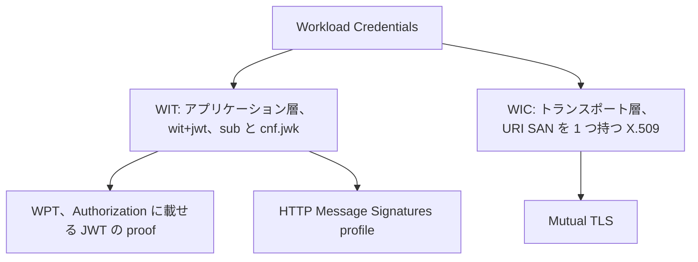
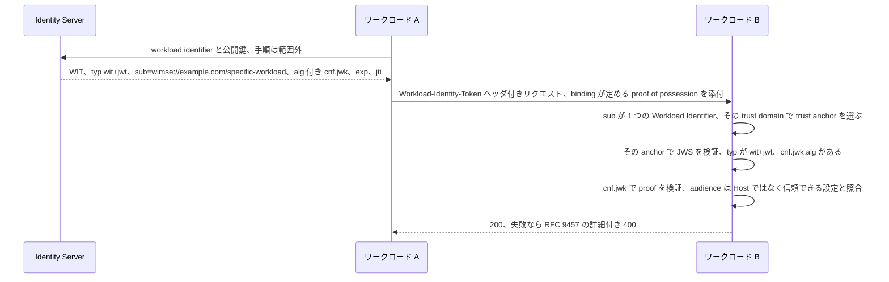

# WIMSE Workload Credentials

> 一言で言うと: ワークロードの identifier を鍵に結び付ける 2 つのクレデンシャル。アプリケーション層プロトコル向けの Workload Identity Token (`cnf.jwk` に鍵を持つ `wit+jwt`) と、mutual TLS 向けの Workload Identity Certificate (URI SAN を 1 つ持つ X.509 証明書)。加えて検証者が従うべき trust anchor のルールを定める。

## どういうときに使うか

- **サービス間の通信が TLS を終端する proxy を経由し、end-to-end のトランスポート保護が組めない**: WIT は `Workload-Identity-Token` ヘッダで運ばれ、秘密鍵なしでは役に立たないので、proxy で複製されても bearer token としては提示できない。残るのは、複製された proof をその短い有効期間内に replay されるリスクだけ (Section 5、Section 5.1、Section 9.3、Section 9.6)。
- **サービス identity を bearer JWT から移行したい**: WIT は新しいヘッダを使うので、移行期間中はワークロードが呼び出し元ごとに bearer token と WIT の両方を受け付け、最後にポリシーで bearer token を無効化できる (Section 5.4)。
- **呼ばれる側が、どの trust domain かだけでなくどのワークロードが呼んでいるかを知る必要がある**: trust anchor での検証が所属を証明し、`sub` claim か URI SAN がワークロードを名指しし、proof of possession の audience がこの呼ばれる側宛てであることを証明する (Section 1.2、Section 9.2)。
- **gateway がサービス identity とエンドユーザーの context を同時に扱う**: WIT は呼び出し元ワークロードを識別してどの API を呼べるかを決め、別ヘッダの transaction token がどのリソースにアクセスできるかを決める (Section 5.4)。

## 解決する問題

workload identity credential は受け手の 2 つの問いに答える必要がある。どの trust domain がこの相手を保証しているのか、そしてその中のどのワークロードなのか。bearer JWT はどちらにも答えるが、複製した者なら誰でも提示できる。この文書は公開鍵を運び、提示者に対応する秘密鍵の所持証明を求めるクレデンシャルを定義する。証明そのものは mutual TLS、Workload Proof Token、HTTP Message Signatures の各 binding が定める (Section 1)。

検証の手順も固定する。trust anchor は trust domain ごとに事前設定され、out-of-band で配布される。クレデンシャルは自身の identifier に書かれた trust domain の anchor に対してのみ検証する。token の `iss` から鍵を解決する検証者は、発行者を運用できる者なら誰の token でも受け入れてしまう (Section 3、Section 9.1)。

## 仕組み

Identity Server が WIT を発行する。これは JWS 署名付きの JWT で、`sub` が Workload Identifier、`cnf.jwk` がワークロードの公開鍵で、必須の `alg` が proof に使うアルゴリズムを固定する (Section 5.1)。ワークロード A はこれを `Workload-Identity-Token` ヘッダで送る。`Authorization` 向けではない。proof of possession を同伴させる (Section 5.1、Section 5.1.1)。ワークロード B は Section 5.1.3 に従って WIT を検証し、proof の audience を中間者が書き換えうるリクエストのフィールドではなく自分の信頼できる設定と照合し (Section 5.2)、`sub` を認可、課金、監査に使う (Section 7)。トランスポート層では同じ identifier を Workload Identity Certificate の唯一の URI SAN から読む (Section 6.1、Section 7)。

## 仕様が求めること

- WIT は `alg` (非対称 JWS アルゴリズム、`none` は禁止)、`wit+jwt` の `typ`、ちょうど 1 つの Workload Identifier を持つ `sub`、`exp`、そして `alg` を含む `jwk` を持つ `cnf` を MUST で含む。`cnf.jwk.alg` に対称鍵や暗号化アルゴリズムは使えず、汎用実装は `ES256` を MUST でサポートする。`iss` は RECOMMENDED、`jti` は OPTIONAL (Section 5.1)。
- 各クレデンシャルは Workload Identifier をちょうど 1 つ運ぶ。WIT なら `sub` claim、WIC なら単一の URI SubjectAltName。WIC は Workload Identifier を載せた URI SAN を 2 つ以上含んではならない (Section 4、Section 6.1)。
- 消費者は各 trust domain を事前設定の発行者と trust anchor に結び付け、その対応は安全な out-of-band で配布しなければならない。クレデンシャルは Workload Identifier の trust domain の anchor に対してのみ検証する (Section 3)。
- WIT の検証では、単一の compact serialization の JWS であること、`sub` が 1 つの Workload Identifier であること、`typ` が `wit+jwt` であること、trust domain の anchor で署名が検証できること、`cnf.jwk.alg` があることを MUST で確認する。未知の claim は無視する (Section 5.1.3)。
- WIT を bearer token として使ってはならず、`Authorization` ヘッダ向けではない。WIT と proof は別の安全なチャネルがない限りサーバー認証済みの TLS 接続で送らなければならない (Section 5.1、Section 9.6)。
- 受け手は proof の audience が自分を指すことを、`Host` などのリクエストフィールドではなく信頼できる設定で MUST で検証する (Section 5.2)。
- WIT 検証に失敗したらエラーを返す。通常は 400。401 は `WWW-Authenticate` で提示できる仕組みがあるときだけ (Section 5.3)。

## 注意点

- trust domain への所属は workload identity ではない。anchor での検証は相手がその domain にいることを言うだけで、どのワークロードかは Section 1.2 の呼ぶ側と呼ばれる側の照合が決める。proof of possession はその照合の代わりにならない (Section 9.2)。
- ワークロードを廃止しても既存の WIT や WIC は無効にならない。relying party が失効させない限り `exp` と clock skew まで認証に使えるので、クレデンシャルの寿命が残存リスクを決める (Section 9.2)。
- WIT はオンデマンドで失効できない。寿命は MUST で有限、SHOULD で短命 (時間単位)。status list や `jti` の deny-list を運用するなら全 WIT に `jti` を MUST で入れるが、それでも寿命の要件は緩まない (Section 9.3.1)。
- 証明書も同じ立場。短い寿命が主要な緩和策で、CRL と OCSP は defense in depth。anchor 自身の寿命がその下のすべてを制約する (Section 9.4.1)。
- 秘密鍵は秘密のまま、単一の identifier に結び付け、期限切れ後は使わず、non-exportable でハードウェアに結び付いている場合を除きクレデンシャルごとに再生成するのが SHOULD。検証者はクレデンシャルだけからそうした保護を推定してはならない (Section 9.5)。
- クライアント証明書認証は handshake の時点でクライアントの workload identity をサーバーに開示する。ワークロードが特定のユーザーに対応する場合、WIT や証明書でユーザーを追跡できないか評価する (Section 10)。

## 出典

- [draft-ietf-wimse-workload-creds, Section 1](https://datatracker.ietf.org/doc/html/draft-ietf-wimse-workload-creds#section-1)
- [draft-ietf-wimse-workload-creds, Section 1.2](https://datatracker.ietf.org/doc/html/draft-ietf-wimse-workload-creds#section-1.2)
- [draft-ietf-wimse-workload-creds, Section 3](https://datatracker.ietf.org/doc/html/draft-ietf-wimse-workload-creds#section-3)
- [draft-ietf-wimse-workload-creds, Section 4](https://datatracker.ietf.org/doc/html/draft-ietf-wimse-workload-creds#section-4)
- [draft-ietf-wimse-workload-creds, Section 5](https://datatracker.ietf.org/doc/html/draft-ietf-wimse-workload-creds#section-5)
- [draft-ietf-wimse-workload-creds, Section 5.1](https://datatracker.ietf.org/doc/html/draft-ietf-wimse-workload-creds#section-5.1)
- [draft-ietf-wimse-workload-creds, Section 5.1.1](https://datatracker.ietf.org/doc/html/draft-ietf-wimse-workload-creds#section-5.1.1)
- [draft-ietf-wimse-workload-creds, Section 5.1.3](https://datatracker.ietf.org/doc/html/draft-ietf-wimse-workload-creds#section-5.1.3)
- [draft-ietf-wimse-workload-creds, Section 5.2](https://datatracker.ietf.org/doc/html/draft-ietf-wimse-workload-creds#section-5.2)
- [draft-ietf-wimse-workload-creds, Section 5.3](https://datatracker.ietf.org/doc/html/draft-ietf-wimse-workload-creds#section-5.3)
- [draft-ietf-wimse-workload-creds, Section 5.4](https://datatracker.ietf.org/doc/html/draft-ietf-wimse-workload-creds#section-5.4)
- [draft-ietf-wimse-workload-creds, Section 6.1](https://datatracker.ietf.org/doc/html/draft-ietf-wimse-workload-creds#section-6.1)
- [draft-ietf-wimse-workload-creds, Section 7](https://datatracker.ietf.org/doc/html/draft-ietf-wimse-workload-creds#section-7)
- [draft-ietf-wimse-workload-creds, Section 9.1](https://datatracker.ietf.org/doc/html/draft-ietf-wimse-workload-creds#section-9.1)
- [draft-ietf-wimse-workload-creds, Section 9.2](https://datatracker.ietf.org/doc/html/draft-ietf-wimse-workload-creds#section-9.2)
- [draft-ietf-wimse-workload-creds, Section 9.3](https://datatracker.ietf.org/doc/html/draft-ietf-wimse-workload-creds#section-9.3)
- [draft-ietf-wimse-workload-creds, Section 9.3.1](https://datatracker.ietf.org/doc/html/draft-ietf-wimse-workload-creds#section-9.3.1)
- [draft-ietf-wimse-workload-creds, Section 9.4.1](https://datatracker.ietf.org/doc/html/draft-ietf-wimse-workload-creds#section-9.4.1)
- [draft-ietf-wimse-workload-creds, Section 9.5](https://datatracker.ietf.org/doc/html/draft-ietf-wimse-workload-creds#section-9.5)
- [draft-ietf-wimse-workload-creds, Section 9.6](https://datatracker.ietf.org/doc/html/draft-ietf-wimse-workload-creds#section-9.6)
- [draft-ietf-wimse-workload-creds, Section 10](https://datatracker.ietf.org/doc/html/draft-ietf-wimse-workload-creds#section-10)
