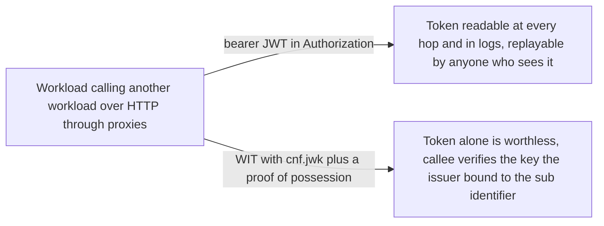
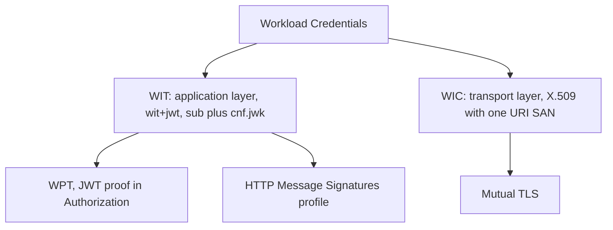
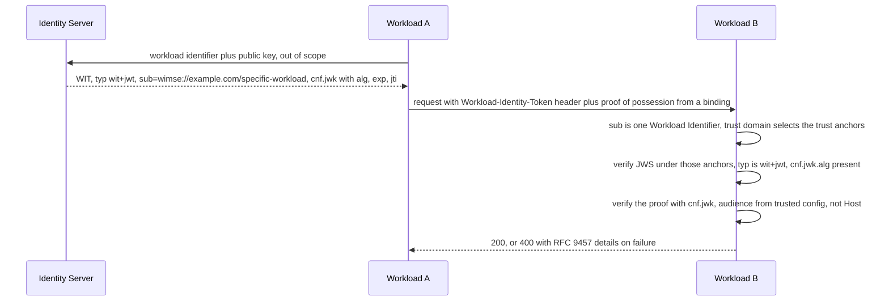

# WIMSE Workload Credentials

> In one line: two credentials that bind a workload's identifier to a key, the Workload Identity Token (a `wit+jwt` with the key in `cnf.jwk`) for application-layer protocols and the Workload Identity Certificate (an X.509 certificate with one URI SAN) for mutual TLS, plus the trust-anchor rules a verifier must follow.

## When you reach for it

- **Services talk through TLS-terminating proxies, so end-to-end transport security is impossible**: the WIT travels in the `Workload-Identity-Token` header and is useless without the private key, so a copy captured at a proxy cannot be presented as a bearer token; what remains is replay of a captured proof inside its own short lifetime (Section 5, Section 5.1, Section 9.3, Section 9.6).
- **You are migrating off bearer JWTs for service identity**: the WIT uses a new header, so a workload can accept both bearer tokens and WITs per caller during a transition, then switch bearer tokens off by policy (Section 5.4).
- **A callee must know which specific workload is calling, not just which trust domain it belongs to**: trust-anchor validation proves membership, the `sub` claim or the URI SAN names the workload, and the proof-of-possession audience proves the request was meant for this callee (Section 1.2, Section 9.2).
- **A gateway needs service identity and end-user context at once**: the WIT identifies the calling workload for deciding which APIs it may call, while a transaction token in its own header decides which resources (Section 5.4).

## The problem it solves

A workload identity credential has to answer two questions for the receiver: which trust domain vouches for this peer, and which workload inside it is this. A bearer JWT answers both but can be presented by anyone who copies it. This document defines credentials that carry a public key and require the presenter to prove it holds the matching private key; the proof itself is defined in the mutual TLS, Workload Proof Token and HTTP Message Signatures bindings (Section 1).

It also pins down verification. Trust anchors are preconfigured per trust domain and distributed out of band; a credential is validated only against the anchors of the trust domain named in its own identifier. A verifier that instead resolved keys from the token's `iss` would accept tokens from anyone able to run an issuer (Section 3, Section 9.1).

## How it works

The Identity Server issues the WIT, a JWS-signed JWT whose `sub` is the Workload Identifier and whose `cnf.jwk` is the workload's public key with a mandatory `alg` that fixes which algorithm the proof must use (Section 5.1). Workload A sends it in the `Workload-Identity-Token` header, not in `Authorization`, together with a proof of possession (Section 5.1, Section 5.1.1). Workload B validates the WIT per Section 5.1.3, checks the proof's audience against its own trusted configuration rather than request fields that intermediaries may rewrite (Section 5.2), and then uses `sub` for authorization, accounting and auditing (Section 7). At the transport layer the same identifier is read from the single URI SAN of the Workload Identity Certificate (Section 6.1, Section 7).

## What the spec requires

- A WIT MUST carry `alg` (an asymmetric JWS algorithm, never `none`), `typ` of `wit+jwt`, `sub` set to exactly one Workload Identifier, `exp`, and `cnf` with a `jwk` that includes `alg`. Symmetric and encryption algorithms are forbidden in `cnf.jwk.alg`, and `ES256` MUST be supported by general-purpose implementations. `iss` is RECOMMENDED and `jti` OPTIONAL (Section 5.1).
- Each credential carries exactly one Workload Identifier: the `sub` claim for a WIT, a single URI SubjectAltName for a WIC; a WIC MUST NOT contain more than one URI SAN carrying a Workload Identifier (Section 4, Section 6.1).
- Consumers MUST associate each trust domain with preconfigured issuers and trust anchors distributed securely out of band, and MUST validate a credential only against the anchors of the trust domain in its Workload Identifier (Section 3).
- To validate a WIT the recipient MUST check it is a single compact-serialized JWS, `sub` is one Workload Identifier, `typ` is `wit+jwt`, the signature verifies under the trust domain's anchors, and `cnf.jwk.alg` is present; unknown claims are ignored (Section 5.1.3).
- The WIT MUST NOT be used as a bearer token and is not intended for the `Authorization` header; the WIT and its proof MUST be sent over a server-authenticated TLS connection unless another secure channel exists (Section 5.1, Section 9.6).
- The recipient MUST verify the proof's audience refers to itself using trusted configuration, not request fields such as `Host` (Section 5.2).
- On WIT validation failure, return an error, typically 400; 401 only when a `WWW-Authenticate` mechanism can be offered (Section 5.3).

## Watch out

- Trust-domain membership is not workload identity. Anchor validation says the peer is in the domain; the caller and callee comparison in Section 1.2 says which workload it is, and proof of possession does not substitute for that check (Section 9.2).
- Deprovisioning a workload does not invalidate its WITs or WICs; they authenticate until `exp` plus clock skew unless relying parties revoke them, so credential lifetime sets the residual exposure (Section 9.2).
- WITs are not revocable on demand; they MUST have a limited lifetime and SHOULD be short-lived, on the order of hours. A deployment that runs a status list or `jti` deny-list MUST put `jti` in every WIT, and still cannot relax the lifetime rule (Section 9.3.1).
- Certificates get the same stance: short lifetimes are the primary mitigation, CRLs and OCSP are defense in depth, and the anchor's own lifetime bounds everything beneath it (Section 9.4.1).
- The private key MUST stay private, be bound to a single identifier, never be used after expiry, and SHOULD be regenerated per credential unless it is non-exportable and hardware-bound; verifiers must not infer such protections from the credential alone (Section 9.5).
- Client-certificate authentication reveals the client's workload identity during the handshake; evaluate whether WITs or certificates could track a user where a workload maps to one (Section 10).

## Sources

- [draft-ietf-wimse-workload-creds, Section 1](https://datatracker.ietf.org/doc/html/draft-ietf-wimse-workload-creds#section-1)
- [draft-ietf-wimse-workload-creds, Section 1.2](https://datatracker.ietf.org/doc/html/draft-ietf-wimse-workload-creds#section-1.2)
- [draft-ietf-wimse-workload-creds, Section 3](https://datatracker.ietf.org/doc/html/draft-ietf-wimse-workload-creds#section-3)
- [draft-ietf-wimse-workload-creds, Section 4](https://datatracker.ietf.org/doc/html/draft-ietf-wimse-workload-creds#section-4)
- [draft-ietf-wimse-workload-creds, Section 5](https://datatracker.ietf.org/doc/html/draft-ietf-wimse-workload-creds#section-5)
- [draft-ietf-wimse-workload-creds, Section 5.1](https://datatracker.ietf.org/doc/html/draft-ietf-wimse-workload-creds#section-5.1)
- [draft-ietf-wimse-workload-creds, Section 5.1.1](https://datatracker.ietf.org/doc/html/draft-ietf-wimse-workload-creds#section-5.1.1)
- [draft-ietf-wimse-workload-creds, Section 5.1.3](https://datatracker.ietf.org/doc/html/draft-ietf-wimse-workload-creds#section-5.1.3)
- [draft-ietf-wimse-workload-creds, Section 5.2](https://datatracker.ietf.org/doc/html/draft-ietf-wimse-workload-creds#section-5.2)
- [draft-ietf-wimse-workload-creds, Section 5.3](https://datatracker.ietf.org/doc/html/draft-ietf-wimse-workload-creds#section-5.3)
- [draft-ietf-wimse-workload-creds, Section 5.4](https://datatracker.ietf.org/doc/html/draft-ietf-wimse-workload-creds#section-5.4)
- [draft-ietf-wimse-workload-creds, Section 6.1](https://datatracker.ietf.org/doc/html/draft-ietf-wimse-workload-creds#section-6.1)
- [draft-ietf-wimse-workload-creds, Section 7](https://datatracker.ietf.org/doc/html/draft-ietf-wimse-workload-creds#section-7)
- [draft-ietf-wimse-workload-creds, Section 9.1](https://datatracker.ietf.org/doc/html/draft-ietf-wimse-workload-creds#section-9.1)
- [draft-ietf-wimse-workload-creds, Section 9.2](https://datatracker.ietf.org/doc/html/draft-ietf-wimse-workload-creds#section-9.2)
- [draft-ietf-wimse-workload-creds, Section 9.3](https://datatracker.ietf.org/doc/html/draft-ietf-wimse-workload-creds#section-9.3)
- [draft-ietf-wimse-workload-creds, Section 9.3.1](https://datatracker.ietf.org/doc/html/draft-ietf-wimse-workload-creds#section-9.3.1)
- [draft-ietf-wimse-workload-creds, Section 9.4.1](https://datatracker.ietf.org/doc/html/draft-ietf-wimse-workload-creds#section-9.4.1)
- [draft-ietf-wimse-workload-creds, Section 9.5](https://datatracker.ietf.org/doc/html/draft-ietf-wimse-workload-creds#section-9.5)
- [draft-ietf-wimse-workload-creds, Section 9.6](https://datatracker.ietf.org/doc/html/draft-ietf-wimse-workload-creds#section-9.6)
- [draft-ietf-wimse-workload-creds, Section 10](https://datatracker.ietf.org/doc/html/draft-ietf-wimse-workload-creds#section-10)
