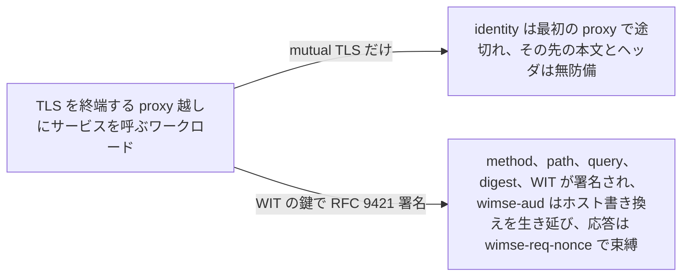
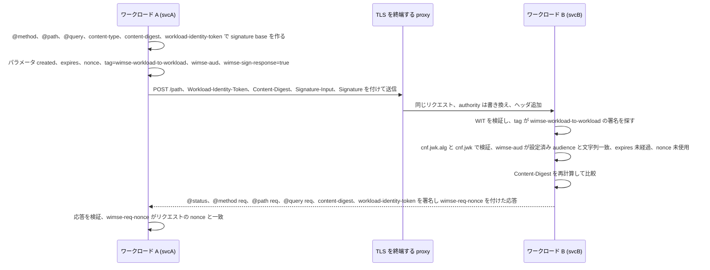

# WIMSE HTTP Message Signatures

> 一言で言うと: RFC 9421 のプロファイル。ワークロードが Workload Identity Token の裏にある秘密鍵で HTTP リクエスト (任意で応答も) に署名し、method、path、query、content digest、WIT ヘッダを覆う。宛先は書き換えられうる authority ではなく、署名された `wimse-aud` パラメータで運ぶ。

## どういうときに使うか

- **リクエストが TLS を再終端してホストを書き換える L7 proxy やロードバランサを通る**: 署名は意図的に `@authority` を含めず、宛先の束縛を `wimse-aud` で運ぶので、authority が書き換えられても宛先で検証できる (Section 3、Section 3.2、Section 5.2)。
- **mutual TLS 用の CA を運用できない、あるいは経路に TLS ホップが複数ある**: これはそうしたホップを越えて end-to-end のメッセージ完全性を与えるアプリケーション層の選択肢 (Section 1)。
- **middlebox がリクエストの本文やヘッダを改変しうるので検知したい**: 本文があれば `Content-Digest` が必須で、`Content-Type`、`Authorization`、`Txn-Token`、`Workload-Identity-Token` は存在すれば署名される。Appendix C はこれを Workload Proof Token に対する完全性面の利点として挙げる (Section 3、Appendix C)。
- **クライアントが、受け取った応答が自分のリクエストに対するサーバーの答えだと確信したい**: `wimse-sign-response` を true にすると、サーバーはリクエストの nonce を `wimse-req-nonce` に写した署名付き応答を返すか、エラーを返す (Section 3.3、Section 3.4、Section 3.5)。

## 解決する問題

mutual TLS はワークロードを次の TLS エンドポイントに対してしか認証しない。gateway や sidecar のある配備では、宛先が見るのは proxy の identity であって呼び出し元のものではなく、proxy が変えたものは気付かれない (Section 1、Section 5.2)。Workload Identity Token に結び付いた鍵で HTTP メッセージに署名すれば、認証はアプリケーション層に移り、覆われた要素は改ざん検知可能になる。proof of possession は署名そのもので、WIT の `cnf.jwk` に対応する秘密鍵の保持者だけが作れる (Section 3、Section 5.1)。

このプロファイルは、相互運用性や安全性を損なう RFC 9421 の自由度も削る。覆う要素の固定、固定の `tag`、鍵とアルゴリズムは WIT から来るので `keyid` と `alg` パラメータは不使用、proxy が書き換える authority の代わりに署名された `wimse-aud` audience (Section 3、Section 3.1、Section 3.2)。

## 仕組み

ワークロード A は派生コンポーネント `@method`、`@path`、`@query` と、存在する所定のヘッダで RFC 9421 の signature base を組み、本文の `Content-Digest` を含め、必須の署名パラメータを設定する。`created`、短い `expires`、64 ビット以上のランダムな `nonce`、値が `wimse-workload-to-workload` の `tag`、宛先を名指す `wimse-aud` (Section 3、Section 3.2)。WIT を `Workload-Identity-Token` で、署名を `Signature-Input` と `Signature` で送る。ワークロード B はまず WIT を検証し、`tag` で WIMSE の署名を選び、WIT の `cnf.jwk` のアルゴリズムと鍵で検証し、`wimse-aud` を設定済み audience と単純文字列比較で照合し、digest を再計算してから初めてリクエストを処理する (Section 3、Section 3.1、Section 3.2)。リクエストが求めていれば、B は応答に署名し `wimse-req-nonce` でリクエストに束縛する (Section 3.4、Section 3.5)。

## 仕様が求めること

- リクエストは `@method`、`@path`、`@query` を MUST で署名する (`@authority` は含めない。CONNECT だけは `@method` と `@authority` に置き換える)。存在すれば `Content-Type`、`Content-Digest`、`Authorization`、`Txn-Token`、`Workload-Identity-Token` も署名する。本文があれば `Content-Digest` が必要で、受け手は MUST で再計算する (Section 3)。
- 署名パラメータ `created`、`expires` (短く、分単位)、`nonce` (暗号学的乱数、64 ビット以上、96 ビット推奨)、値が `wimse-workload-to-workload` の `tag` は MUST。リクエストでは `wimse-aud`、署名付き応答では `wimse-req-nonce` が MUST。`keyid` と `alg` は MUST NOT (Section 3)。
- 署名アルゴリズムは WIT の `cnf.jwk` の `alg`。受け手はそれで検証し、相手の trust domain で許容されないアルゴリズムなら MUST で拒否する (Section 3.1)。
- 受け手は WIMSE の署名を label ではなく `tag` で特定し、その tag を持つ署名が 2 つ以上あるメッセージは MUST で拒否する (Section 3)。
- `wimse-aud` は RFC 3986 の Simple String Comparison で設定済み audience と MUST で一致させる。受け手は `Host` のような信頼できないフィールドから audience を導いてはならない (Section 3.2)。
- 受け手は署名より先に WIT を検証し、両方の検証が終わるまでメッセージを処理してはならない。WIT と署名は、TLS と同等の機密性とサーバー認証を別の経路が提供しない限り、ホスト名検証付きのサーバー認証済み TLS で送らなければならない (Section 3)。
- `wimse-sign-response` が true なら、サーバーは応答に署名するかエラーを返さなければならず、クライアントは署名のない応答を MUST で拒否する。署名付き応答はリクエストの `nonce` と等しい `wimse-req-nonce` を MUST で持つ (Section 3.3、Section 3.4、Section 3.5)。
- 認証失敗は problem type `wimse-signature-invalid` 付きの 400 を返し、サーバーは WIT と署名のどちらが失敗したかを明かしてはならない。401 は NOT RECOMMENDED。応答署名が未対応なら 501 (Section 3.6)。

## 注意点

- 覆われるのは列挙された要素だけ。プロファイル外のヘッダは中間者が検知されずに変更や削除でき、中間者は自分の署名をメッセージに足せる (Section 5.2、Appendix A.3)。
- replay cache は MAY で、検証者間の共有も求められていない。別のクラスタメンバーへの replay は通りうる (Section 3、Section 5.1)。
- サーバーのローカルポリシーによる応答署名は opportunistic。`wimse-sign-response` なしでは、クライアントは剥がされた署名と未署名の応答を区別できず、受け入れなければならない。リクエストと応答の組の削除を検知できるのは、クライアントが署名付き応答を要求したときだけ (Section 3.5、Appendix A.4)。
- `Accept-Signature` は希望を表すだけで、署名付き応答を義務付けない。このプロファイルより弱いカバレッジを求めるのに使ってはならない (Section 3.5)。
- 末尾のスラッシュや明示的なデフォルトポートのように正規化だけが違う audience 文字列は一致しない。受け入れる変種をそれぞれ設定する (Section 3.2)。

## 出典

- [draft-ietf-wimse-http-signature, Section 1](https://datatracker.ietf.org/doc/html/draft-ietf-wimse-http-signature#section-1)
- [draft-ietf-wimse-http-signature, Section 3](https://datatracker.ietf.org/doc/html/draft-ietf-wimse-http-signature#section-3)
- [draft-ietf-wimse-http-signature, Section 3.1](https://datatracker.ietf.org/doc/html/draft-ietf-wimse-http-signature#section-3.1)
- [draft-ietf-wimse-http-signature, Section 3.2](https://datatracker.ietf.org/doc/html/draft-ietf-wimse-http-signature#section-3.2)
- [draft-ietf-wimse-http-signature, Section 3.3](https://datatracker.ietf.org/doc/html/draft-ietf-wimse-http-signature#section-3.3)
- [draft-ietf-wimse-http-signature, Section 3.4](https://datatracker.ietf.org/doc/html/draft-ietf-wimse-http-signature#section-3.4)
- [draft-ietf-wimse-http-signature, Section 3.5](https://datatracker.ietf.org/doc/html/draft-ietf-wimse-http-signature#section-3.5)
- [draft-ietf-wimse-http-signature, Section 3.6](https://datatracker.ietf.org/doc/html/draft-ietf-wimse-http-signature#section-3.6)
- [draft-ietf-wimse-http-signature, Section 5.1](https://datatracker.ietf.org/doc/html/draft-ietf-wimse-http-signature#section-5.1)
- [draft-ietf-wimse-http-signature, Section 5.2](https://datatracker.ietf.org/doc/html/draft-ietf-wimse-http-signature#section-5.2)
- [draft-ietf-wimse-http-signature, Appendix A.3](https://datatracker.ietf.org/doc/html/draft-ietf-wimse-http-signature#appendix-A.3)
- [draft-ietf-wimse-http-signature, Appendix A.4](https://datatracker.ietf.org/doc/html/draft-ietf-wimse-http-signature#appendix-A.4)
- [draft-ietf-wimse-http-signature, Appendix C](https://datatracker.ietf.org/doc/html/draft-ietf-wimse-http-signature#appendix-C)
