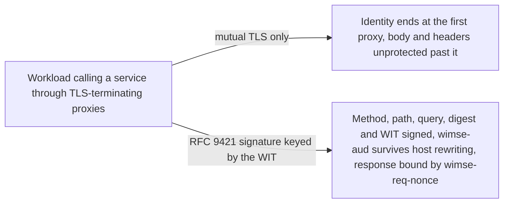
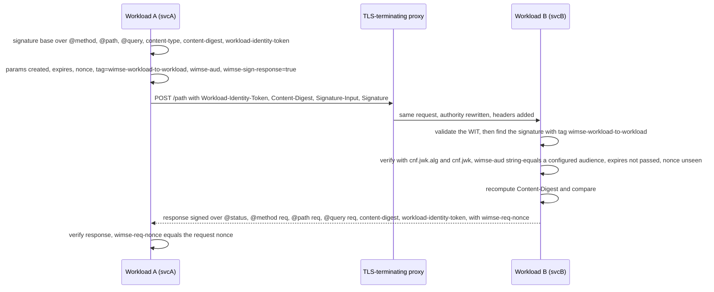

# WIMSE HTTP Message Signatures

> In one line: a profile of RFC 9421 where a workload signs its HTTP request (and optionally the response) with the private key behind its Workload Identity Token, covering method, path, query, content digest and the WIT header, with the intended recipient carried in a signed `wimse-aud` parameter instead of the rewritable authority.

## When you reach for it

- **Requests cross an L7 proxy or load balancer that re-terminates TLS and rewrites the host**: the signature deliberately omits `@authority` and carries recipient binding in `wimse-aud`, so it still verifies at the destination after the authority is rewritten (Section 3, Section 3.2, Section 5.2).
- **You cannot run a CA for mutual TLS, or the path has several TLS hops**: this is the application-layer option that gives message integrity end to end through those hops (Section 1).
- **A middlebox could alter the request body or headers and you need to detect it**: `Content-Digest` is mandatory when there is a body, and `Content-Type`, `Authorization`, `Txn-Token` and `Workload-Identity-Token` are signed whenever present, which Appendix C names as the integrity advantage over the Workload Proof Token (Section 3, Appendix C).
- **The client must be sure the response it got is the server's answer to its own request**: set `wimse-sign-response` to true, and the server either signs the response with `wimse-req-nonce` echoing the request nonce or returns an error (Section 3.3, Section 3.4, Section 3.5).

## The problem it solves

Mutual TLS authenticates the workload only to the next TLS endpoint. In a deployment with gateways and sidecars the destination sees the proxy's identity, not the caller's, and anything the proxy changes goes unnoticed (Section 1, Section 5.2). Signing the HTTP message with the key bound in the Workload Identity Token moves authentication to the application layer and makes the covered components tamper-evident. The proof of possession is the signature itself: only the holder of the private key matching the WIT's `cnf.jwk` can produce it (Section 3, Section 5.1).

The profile also removes the choices RFC 9421 leaves open where they would hurt interoperability or security: fixed covered components, a fixed `tag`, no `keyid` or `alg` parameters because the key and algorithm come from the WIT, and a signed `wimse-aud` audience instead of the authority component that proxies rewrite (Section 3, Section 3.1, Section 3.2).

## How it works

Workload A builds an RFC 9421 signature base over the derived components `@method`, `@path` and `@query` plus the listed headers that exist, includes a `Content-Digest` for the body, and sets the required signature parameters: `created`, a short `expires`, a random `nonce` of at least 64 bits, the `tag` value `wimse-workload-to-workload`, and `wimse-aud` naming the recipient (Section 3, Section 3.2). It sends the WIT in `Workload-Identity-Token` and the signature in `Signature-Input` and `Signature`. Workload B validates the WIT first, selects the WIMSE signature by `tag`, verifies it with the algorithm and key from the WIT's `cnf.jwk`, compares `wimse-aud` to its configured audiences by simple string comparison, recomputes the digest, and only then processes the request (Section 3, Section 3.1, Section 3.2). If the request asked for it, B signs the response and binds it to the request with `wimse-req-nonce` (Section 3.4, Section 3.5).

## What the spec requires

- Requests MUST sign `@method`, `@path` and `@query` (never `@authority`, except for CONNECT where `@method` and `@authority` replace them) and, when present, `Content-Type`, `Content-Digest`, `Authorization`, `Txn-Token` and `Workload-Identity-Token`; a body requires `Content-Digest`, which the receiver MUST recompute (Section 3).
- Signature parameters `created`, `expires` (short, minutes), `nonce` (cryptographically random, at least 64 bits, 96 recommended) and `tag` with value `wimse-workload-to-workload` MUST be present; `wimse-aud` MUST be present on requests and `wimse-req-nonce` on signed responses; `keyid` and `alg` MUST NOT be used (Section 3).
- The signature algorithm is the `alg` of `cnf.jwk` in the WIT; recipients MUST verify with it and MUST reject the message if it is unacceptable for the peer's trust domain (Section 3.1).
- The recipient identifies the WIMSE signature by `tag`, never by label, and MUST reject a message with more than one signature carrying that tag (Section 3).
- `wimse-aud` MUST match a configured audience under RFC 3986 Simple String Comparison; the recipient MUST NOT derive an audience from untrusted fields such as `Host` (Section 3.2).
- Recipients MUST validate the WIT before the signature and MUST NOT process the message further until both are validated; the WIT and signature MUST be sent over server-authenticated TLS with hostname validation, unless another channel provides comparable confidentiality and server authentication (Section 3).
- When `wimse-sign-response` is true the server MUST sign the response or return an error, and the client MUST reject an unsigned response; a signed response MUST carry `wimse-req-nonce` equal to the request `nonce` (Section 3.3, Section 3.4, Section 3.5).
- Failed authentication returns 400 with the `wimse-signature-invalid` problem type, and the server MUST NOT reveal whether the WIT or the signature failed; 401 is NOT RECOMMENDED. Unsupported response signing returns 501 (Section 3.6).

## Watch out

- Only the listed components are covered. Headers outside the profile can be changed or dropped by an intermediary without detection, and an intermediary may add its own signature to the message (Section 5.2, Appendix A.3).
- Replay caches are a MAY and are not required to be shared across validators; replay to a different cluster member can still succeed (Section 3, Section 5.1).
- Server-side local-policy response signing is opportunistic: without `wimse-sign-response` the client cannot tell a stripped signature from an unsigned response and MUST accept it. Deletion of a request and response pair is detectable only when the client required a signed response (Section 3.5, Appendix A.4).
- `Accept-Signature` expresses a preference only; it does not mandate a signed response and MUST NOT be used to request weaker coverage than this profile (Section 3.5).
- Audience strings that differ only by normalization, such as a trailing slash or an explicit default port, do not match; configure each accepted variant (Section 3.2).

## Sources

- [draft-ietf-wimse-http-signature, Section 1](https://datatracker.ietf.org/doc/html/draft-ietf-wimse-http-signature#section-1)
- [draft-ietf-wimse-http-signature, Section 3](https://datatracker.ietf.org/doc/html/draft-ietf-wimse-http-signature#section-3)
- [draft-ietf-wimse-http-signature, Section 3.1](https://datatracker.ietf.org/doc/html/draft-ietf-wimse-http-signature#section-3.1)
- [draft-ietf-wimse-http-signature, Section 3.2](https://datatracker.ietf.org/doc/html/draft-ietf-wimse-http-signature#section-3.2)
- [draft-ietf-wimse-http-signature, Section 3.3](https://datatracker.ietf.org/doc/html/draft-ietf-wimse-http-signature#section-3.3)
- [draft-ietf-wimse-http-signature, Section 3.4](https://datatracker.ietf.org/doc/html/draft-ietf-wimse-http-signature#section-3.4)
- [draft-ietf-wimse-http-signature, Section 3.5](https://datatracker.ietf.org/doc/html/draft-ietf-wimse-http-signature#section-3.5)
- [draft-ietf-wimse-http-signature, Section 3.6](https://datatracker.ietf.org/doc/html/draft-ietf-wimse-http-signature#section-3.6)
- [draft-ietf-wimse-http-signature, Section 5.1](https://datatracker.ietf.org/doc/html/draft-ietf-wimse-http-signature#section-5.1)
- [draft-ietf-wimse-http-signature, Section 5.2](https://datatracker.ietf.org/doc/html/draft-ietf-wimse-http-signature#section-5.2)
- [draft-ietf-wimse-http-signature, Appendix A.3](https://datatracker.ietf.org/doc/html/draft-ietf-wimse-http-signature#appendix-A.3)
- [draft-ietf-wimse-http-signature, Appendix A.4](https://datatracker.ietf.org/doc/html/draft-ietf-wimse-http-signature#appendix-A.4)
- [draft-ietf-wimse-http-signature, Appendix C](https://datatracker.ietf.org/doc/html/draft-ietf-wimse-http-signature#appendix-C)
