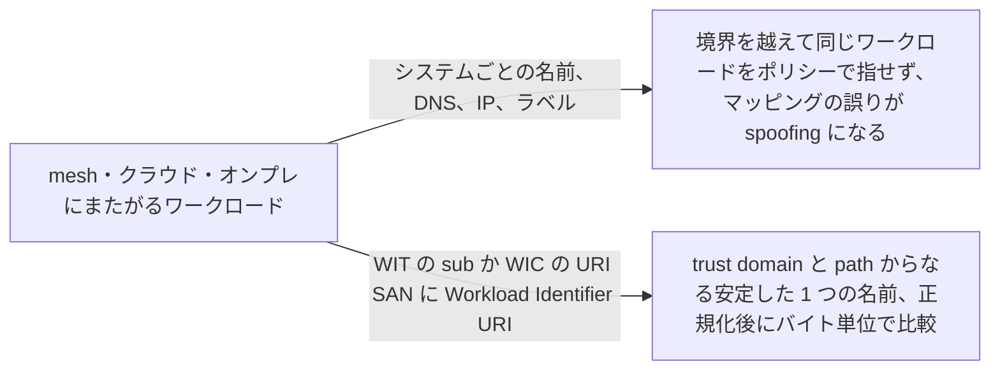
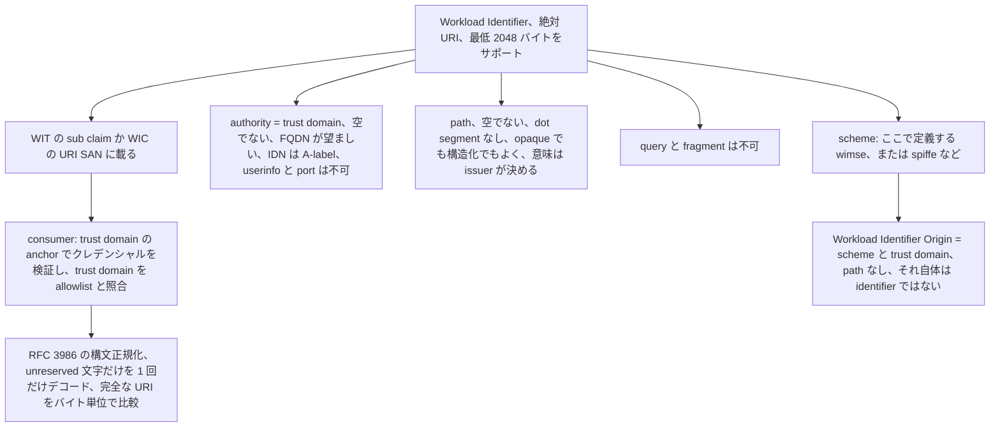

# Workload Identifier

> 一言で言うと: trust domain 内のワークロードを名指しする 1 つの URI `scheme://trust-domain/path`。URI に何を含めてよいか、どう正規化して比較するかを厳密に決め、検証済みのクレデンシャルの中で届くまでは何も証明しないと釘を刺す。

## どういうときに使うか

- **サービスが mesh・2 つのクラウド・オンプレにまたがり、システムごとに名前の付け方が違う**: authority に trust domain、path に配備側で決めた値を持つ 1 つの URI 形式で、同じ論理ワークロードやインスタンスをどこでも同じ名前で指せる (Section 1、Section 4.2)。
- **WIT や X.509 のワークロード証明書を発行していて、`sub` や URI SAN に何を入れるか決めたい**: Workload Identifier がそのクレデンシャルに載る値で、クレデンシャル形式側は構文をこの文書に委ねている (Section 3、Section 6)。
- **認可ポリシーが `spiffe://example.org/ns/db/` のような prefix でマッチしている**: 仕様は、ポリシーが明示的に許さない限り prefix や wildcard でのマッチをすべきでなく (SHOULD NOT)、正規化した完全な URI で比較しなければならない (MUST) と言う (Section 4.3、Section 7.6)。
- **ヘッダに workload id が入った要求が来て、つい信じたくなる**: 平文の identifier を認証済みとして扱ってはならない (MUST NOT)。暗号的に検証されたクレデンシャルから取り出したものだけが有効 (Section 7.2)。

## 解決する問題

システムが trust domain・管理境界・異種基盤にまたがって拡大すると、ワークロードには安全な通信・アクセス制御・監査のために暗号的に検証できる identity が要り、その前にまず一貫した identifier 形式が要る (Section 1)。この文書が定義するのは identifier だけだ。構文、一意性の保証、trust domain との関係。発行や検証の方法はクレデンシャル仕様と trust domain のポリシーに委ねる (Section 1、Section 6)。

セキュリティ上の重みは parsing と比較のルールにある。port・userinfo・dot segment・percent-encode された slash が紛れ込んだ URI は 2 つのコンポーネントで別々に読まれ得て、その不一致が認可チェックをすり抜ける道になる。だから仕様はそれらの要素を禁止し、正規化の前に検証することを求め、正規化と比較の手順を固定し、consumer が identifier を何から導いてよいか、よくないかを定める (Section 4.1、Section 5、Section 7.1)。

## 仕組み

Workload Identifier は、trust domain を示す空でない authority と空でない path を持つ絶対 URI で、例えば `spiffe://incubation.example.org/ns/experimental/analytics/ingest` や `wimse://trust.corp.example.com/workload/af3e86cb-7013-4e33-b717-11c4edd25679` のような形だ (Section 4.1)。trust domain はその範囲内の identifier の発行・検証・管理に責任を持ち、path の意味は issuer が決める。opaque な UUID でも、アプリケーションのロールでも、ロールの特定インスタンスでもよい (Section 4.2、Section 4.3)。`wimse` scheme は `wimse://<trust-domain>/<path>` の形で、共通要件以上のものは足さない (Section 4.4)。origin は scheme と trust domain から path を除いたもので、相手が提示し得る identifier の範囲を示すヒントに使う (Section 4.6)。consumer はクレデンシャルを受け取ると、その trust domain の trust anchor で検証し、URI 全体を正規化して比較する (Section 4.3、Section 7.3)。DNS 名やサービス名から identifier へのマッピングは配備側のポリシーで、証明書は SAN に DNS 名と Workload Identifier の両方を持てるので consumer は両方を確認できる (Section 5)。

## 仕様が求めること

- Workload Identifier は空でない authority と空でない path を持つ絶対 URI でなければならず (MUST)、query・fragment・user information・port を含んではならず (MUST NOT)、`.` や `..` の path segment を、そのままでも percent-encode された unreserved 文字をデコードした後でも含んではならない (MUST NOT)。consumer は dot-segment 除去の前にそうした identifier を拒否しなければならない (MUST) (Section 4.1)。
- 実装は少なくとも 2048 バイトの identifier をサポートしなければならず (MUST)、identifier は 2048 バイトを超えるべきでない (SHOULD NOT)。2048 バイト以下で他は妥当な identifier を長さを理由に拒否してはならない (MUST NOT) (Section 4.1、Section 7.1)。
- trust domain は組織が所有する FQDN であるべきで (SHOULD)、IP アドレスはレガシー互換の場合を除き使うべきでない (SHOULD NOT)。国際化ラベルは A-label でなければならず (MUST)、U-label やその percent-encode された UTF-8 を使ってはならない (MUST NOT) (Section 4.3)。
- consumer は完全な URI で比較・認可しなければならず (MUST)、RFC 3986 の構文正規化を適用してからバイト単位で比較する。percent-encode された unreserved 文字は大文字小文字の正規化の前にデコードしなければならない (MUST)。scheme が異なる identifier は別物で、正規化で無効な identifier を有効にしてはならない (MUST NOT) (Section 4.3)。
- 各 trust domain は全 issuer にまたがって割り当てを調整し、異なるワークロードに異なる identifier が付くようにしなければならない (MUST)。identifier は trust domain のポリシーが意図しない限り再割り当てすべきでない (SHOULD NOT) (Section 4.3、Section 4.5)。
- consumer は、検証済みのマッピングなしに IP アドレス・DNS 名・request path から identifier を導けると想定してはならない (MUST NOT) (Section 5)。

## 注意点

- 検証は、正規化が禁止構文の痕跡を消す前に行う。percent-decode は unreserved 文字に限り、繰り返し適用してはならない (MUST NOT)。`%2F` は比較中もエンコードされたままでなければならず (MUST)、検証と認可に関わる全コンポーネントが同じ規則を適用しなければならない (MUST) (Section 7.1)。
- identifier が認証済みと言えるのは、その形式の規則と配備ポリシーに従って検証されたクレデンシャルから得たときだけ。要求中の文字列は違う (Section 7.2)。
- FQDN の trust domain はドメインの所有を証明しない。consumer は trust domain を期待値か allowlist と照合し (MUST)、そのドメインの正規 issuer の anchor で検証しなければならない (MUST)。allowlist の照合は ASCII 表現で行わなければならず (MUST)、見た目が似た Unicode 名は同値ではない (Section 7.3)。
- 説明的な path はトポロジーを漏らす。配備は開示のトレードオフを評価し、consumer に見せるつもりのない詳細を晒すのを避けるべき (SHOULD) (Section 7.5)。
- identifier を無関係な entity に再割り当てすると権限昇格や監査証跡の混乱を招く。consumer は予期しない再利用を疑うべき (SHOULD) (Section 7.4)。

## 出典

- [draft-ietf-wimse-identifier, Section 1](https://datatracker.ietf.org/doc/html/draft-ietf-wimse-identifier#section-1)
- [draft-ietf-wimse-identifier, Section 3](https://datatracker.ietf.org/doc/html/draft-ietf-wimse-identifier#section-3)
- [draft-ietf-wimse-identifier, Section 4.1](https://datatracker.ietf.org/doc/html/draft-ietf-wimse-identifier#section-4.1)
- [draft-ietf-wimse-identifier, Section 4.2](https://datatracker.ietf.org/doc/html/draft-ietf-wimse-identifier#section-4.2)
- [draft-ietf-wimse-identifier, Section 4.3](https://datatracker.ietf.org/doc/html/draft-ietf-wimse-identifier#section-4.3)
- [draft-ietf-wimse-identifier, Section 4.4](https://datatracker.ietf.org/doc/html/draft-ietf-wimse-identifier#section-4.4)
- [draft-ietf-wimse-identifier, Section 4.5](https://datatracker.ietf.org/doc/html/draft-ietf-wimse-identifier#section-4.5)
- [draft-ietf-wimse-identifier, Section 4.6](https://datatracker.ietf.org/doc/html/draft-ietf-wimse-identifier#section-4.6)
- [draft-ietf-wimse-identifier, Section 5](https://datatracker.ietf.org/doc/html/draft-ietf-wimse-identifier#section-5)
- [draft-ietf-wimse-identifier, Section 6](https://datatracker.ietf.org/doc/html/draft-ietf-wimse-identifier#section-6)
- [draft-ietf-wimse-identifier, Section 7.1](https://datatracker.ietf.org/doc/html/draft-ietf-wimse-identifier#section-7.1)
- [draft-ietf-wimse-identifier, Section 7.2](https://datatracker.ietf.org/doc/html/draft-ietf-wimse-identifier#section-7.2)
- [draft-ietf-wimse-identifier, Section 7.3](https://datatracker.ietf.org/doc/html/draft-ietf-wimse-identifier#section-7.3)
- [draft-ietf-wimse-identifier, Section 7.4](https://datatracker.ietf.org/doc/html/draft-ietf-wimse-identifier#section-7.4)
- [draft-ietf-wimse-identifier, Section 7.5](https://datatracker.ietf.org/doc/html/draft-ietf-wimse-identifier#section-7.5)
- [draft-ietf-wimse-identifier, Section 7.6](https://datatracker.ietf.org/doc/html/draft-ietf-wimse-identifier#section-7.6)
