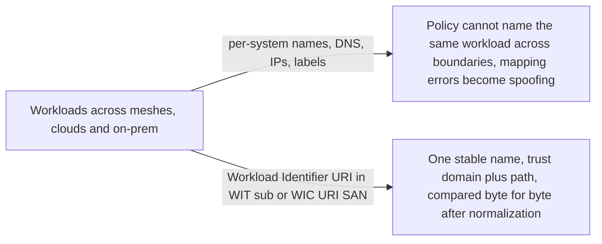
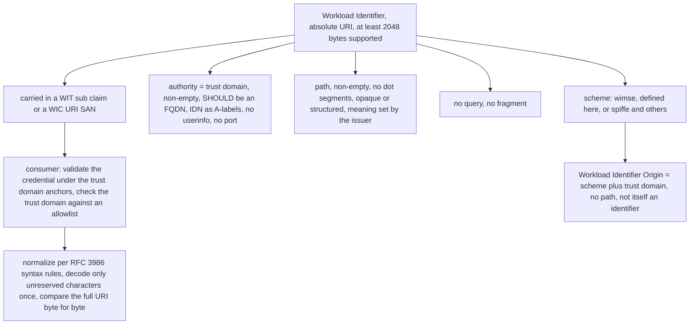

# Workload Identifier

> In one line: one URI, `scheme://trust-domain/path`, that names a workload inside a trust domain, with hard rules on what the URI may contain, how to normalize and compare it, and the warning that it proves nothing until it arrives inside a validated credential.

## When you reach for it

- **Services span a mesh, two clouds and on-premises hosts and every system names them differently**: a single URI format with the trust domain in the authority and a deployment-defined path identifies the same logical workload or instance everywhere (Section 1, Section 4.2).
- **You are issuing WITs or X.509 workload certificates and need to know what goes in `sub` or the URI SAN**: the Workload Identifier is the value those credentials carry, and the credential formats defer to this document for its syntax (Section 3, Section 6).
- **An authorization policy matches on a prefix like `spiffe://example.org/ns/db/`**: the spec says consumers SHOULD NOT do prefix or wildcard matching unless policy explicitly allows it, and MUST compare the complete normalized URI (Section 4.3, Section 7.6).
- **A request arrives with a workload id in a header and the service is tempted to trust it**: a plaintext identifier MUST NOT be treated as authenticated; only one taken from a cryptographically verified credential counts (Section 7.2).

## The problem it solves

As systems scale across trust domains, administrative boundaries and heterogeneous platforms, workloads need cryptographically verifiable identities for secure communication, access control and auditability, and that needs a consistent identifier format first (Section 1). The document defines only the identifier: its syntax, its uniqueness guarantees and its relationship to trust domains. How identifiers are issued and verified is left to the credential specifications and the trust domain's policy (Section 1, Section 6).

The security weight is in the parsing and comparison rules. A URI that sneaks in a port, userinfo, a dot segment or a percent-encoded slash can be read differently by two components, and inconsistent processing is how an authorization check gets bypassed. So the spec forbids those components, requires validation before normalization, fixes the normalization and comparison procedure, and says what a consumer may and may not derive an identifier from (Section 4.1, Section 5, Section 7.1).

## How it works

A Workload Identifier is an absolute URI with a non-empty authority that names the trust domain and a non-empty path, for example `spiffe://incubation.example.org/ns/experimental/analytics/ingest` or `wimse://trust.corp.example.com/workload/af3e86cb-7013-4e33-b717-11c4edd25679` (Section 4.1). The trust domain is responsible for issuing, validating and managing identifiers within its scope, and the path means whatever the issuer decides: an opaque UUID, an application role, or a specific instance of a role (Section 4.2, Section 4.3). The `wimse` scheme has the form `wimse://<trust-domain>/<path>` and adds nothing beyond the common requirements (Section 4.4). An origin is the scheme plus trust domain with no path, used as a hint about which identifiers a peer may present (Section 4.6). When a consumer receives a credential, it validates it under the trust anchors of that trust domain, then normalizes and compares the whole URI (Section 4.3, Section 7.3). Mapping from a DNS name or service name to an identifier is deployment policy, and a certificate may carry both a DNS name and a Workload Identifier in its SAN so the consumer can check both (Section 5).

## What the spec requires

- A Workload Identifier MUST be an absolute URI with a non-empty authority and a non-empty path, MUST NOT contain a query, fragment, user information or port, and MUST NOT contain a `.` or `..` path segment, literally or after decoding percent-encoded unreserved characters; consumers MUST reject such identifiers before dot-segment removal (Section 4.1).
- Implementations MUST support identifiers of at least 2048 bytes, and identifiers SHOULD NOT exceed that length; an otherwise valid identifier of at most 2048 bytes MUST NOT be rejected on length (Section 4.1, Section 7.1).
- The trust domain SHOULD be a fully qualified domain name owned by the organization; IP addresses SHOULD NOT be used except for legacy compatibility; internationalized labels MUST be A-labels, and U-labels or their percent-encoded UTF-8 MUST NOT be used (Section 4.3).
- Consumers MUST compare and authorize using the complete URI, applying RFC 3986 syntax-based normalization and then byte-for-byte comparison; percent-encoded unreserved characters MUST be decoded before case normalization; identifiers with different schemes are distinct; normalization MUST NOT make an invalid identifier acceptable (Section 4.3).
- Each trust domain MUST coordinate assignment across all its issuers so different workloads get distinct identifiers; an identifier SHOULD NOT be reassigned unless the trust domain's policy intends it (Section 4.3, Section 4.5).
- Consumers MUST NOT assume an identifier can be derived from IP address, DNS name or request path without a validated mapping (Section 5).

## Watch out

- Validation must happen before normalization can hide prohibited syntax. Percent-decoding is limited to unreserved characters and MUST NOT be applied repeatedly; `%2F` MUST stay encoded during comparison; every component involved in validation and authorization MUST apply the same rules (Section 7.1).
- An identifier is authenticated only when it comes from a credential validated under the rules of its format and the deployment policy; a string in a request is not (Section 7.2).
- An FQDN trust domain proves nothing about domain ownership. Consumers MUST check the trust domain against an expected or allowlisted value, MUST validate against anchors of authorized issuers for that domain, and allowlist matching MUST use the ASCII form because visually similar Unicode names are not equivalent (Section 7.3).
- Descriptive paths leak topology. Deployments SHOULD weigh the disclosure trade-off and avoid exposing details not meant for consumers (Section 7.5).
- Reassigning an identifier to an unrelated entity can escalate privilege or confuse audit trails; consumers SHOULD treat unexpected reuse with suspicion (Section 7.4).

## Sources

- [draft-ietf-wimse-identifier, Section 1](https://datatracker.ietf.org/doc/html/draft-ietf-wimse-identifier#section-1)
- [draft-ietf-wimse-identifier, Section 3](https://datatracker.ietf.org/doc/html/draft-ietf-wimse-identifier#section-3)
- [draft-ietf-wimse-identifier, Section 4.1](https://datatracker.ietf.org/doc/html/draft-ietf-wimse-identifier#section-4.1)
- [draft-ietf-wimse-identifier, Section 4.2](https://datatracker.ietf.org/doc/html/draft-ietf-wimse-identifier#section-4.2)
- [draft-ietf-wimse-identifier, Section 4.3](https://datatracker.ietf.org/doc/html/draft-ietf-wimse-identifier#section-4.3)
- [draft-ietf-wimse-identifier, Section 4.4](https://datatracker.ietf.org/doc/html/draft-ietf-wimse-identifier#section-4.4)
- [draft-ietf-wimse-identifier, Section 4.5](https://datatracker.ietf.org/doc/html/draft-ietf-wimse-identifier#section-4.5)
- [draft-ietf-wimse-identifier, Section 4.6](https://datatracker.ietf.org/doc/html/draft-ietf-wimse-identifier#section-4.6)
- [draft-ietf-wimse-identifier, Section 5](https://datatracker.ietf.org/doc/html/draft-ietf-wimse-identifier#section-5)
- [draft-ietf-wimse-identifier, Section 6](https://datatracker.ietf.org/doc/html/draft-ietf-wimse-identifier#section-6)
- [draft-ietf-wimse-identifier, Section 7.1](https://datatracker.ietf.org/doc/html/draft-ietf-wimse-identifier#section-7.1)
- [draft-ietf-wimse-identifier, Section 7.2](https://datatracker.ietf.org/doc/html/draft-ietf-wimse-identifier#section-7.2)
- [draft-ietf-wimse-identifier, Section 7.3](https://datatracker.ietf.org/doc/html/draft-ietf-wimse-identifier#section-7.3)
- [draft-ietf-wimse-identifier, Section 7.4](https://datatracker.ietf.org/doc/html/draft-ietf-wimse-identifier#section-7.4)
- [draft-ietf-wimse-identifier, Section 7.5](https://datatracker.ietf.org/doc/html/draft-ietf-wimse-identifier#section-7.5)
- [draft-ietf-wimse-identifier, Section 7.6](https://datatracker.ietf.org/doc/html/draft-ietf-wimse-identifier#section-7.6)
