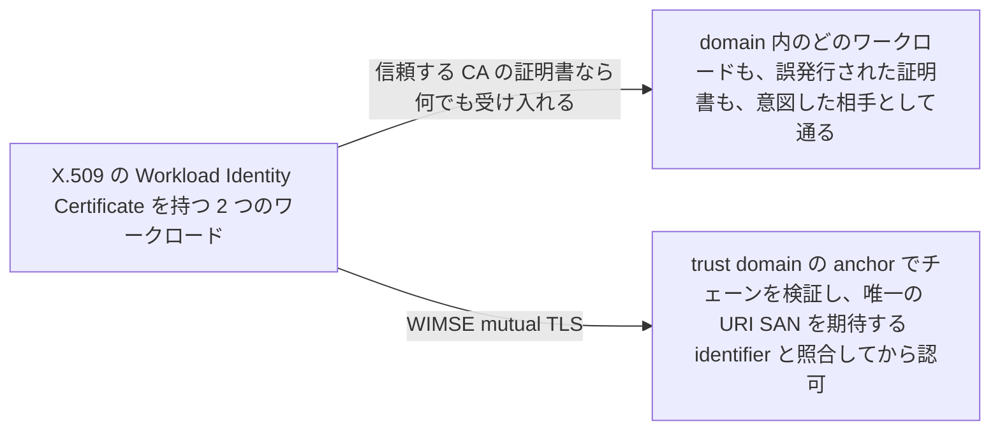
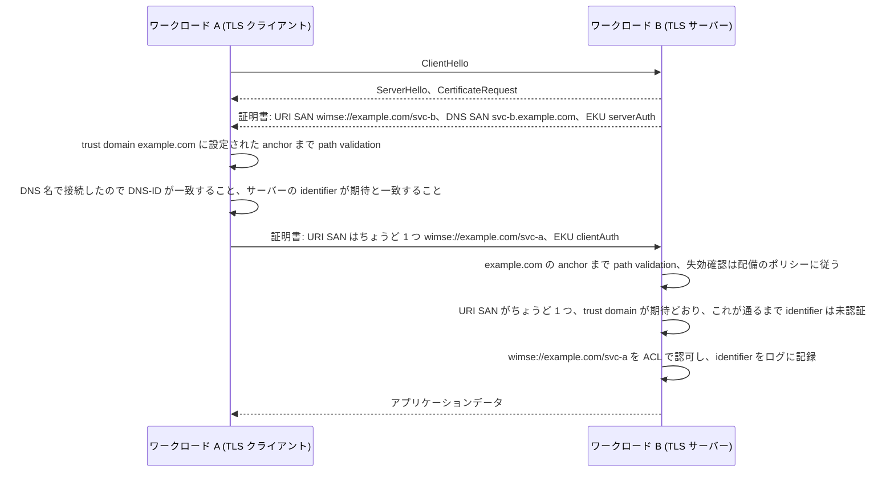

# WIMSE Mutual TLS

> 一言で言うと: 2 つのワークロードが TLS handshake で Workload Identity Certificate を使って相互認証する方法。どの trust anchor で検証するか、クライアントがサーバーの名前をどう確認するか、サーバーが唯一の URI SAN を読んでクライアントをどう認可するかを定める。

## どういうときに使うか

- **ワークロード同士が TLS で直接話し、PKI をすでに運用している**: トランスポート層での保護はこの文書が扱う理想形。片側か両側が WIMSE 証明書を提示し、identity は handshake から得られる (Section 1、Section 3)。
- **クライアントは DNS 名でサーバーに到達するが、サーバー証明書には workload identifier がある**: クライアントは引き続き RFC 9525 の標準的なホスト名検証を DNS-ID に対して MUST で行い、workload identifier が検証できても DNS-ID が一致しなければ接続を拒否する (Section 3.2.1)。
- **クライアントがホスト名ではなく workload identifier で特定のワークロードに接続するよう設定されている**: クライアントは接続を受け入れる前に、サーバーの workload identifier が期待と一致するか、最低でも trust domain を確認する (Section 3.2.1)。
- **サーバーは CA の証明書を持つ誰かではなく、呼び出し元のワークロードを認可しなければならない**: 1 つの URI SAN を読み、チェーン、EKU、trust domain、identifier を検証してから ACL と監査を適用する (Section 3.3、Section 5.1)。

## 解決する問題

X.509 と TLS はすでに相互認証を提供するが、証明書チェーンが relying party に教えるのは、どこかの CA が何かに署名したことだけだ。workload identity にはそれ以上が要る。その CA が証明書内に書かれた trust domain に設定された CA であること、証明書が workload identifier をちょうど 1 つ運ぶこと、その identifier がこの相手に期待するものであること、そしてこれらが `spiffe://` や `wimse://` の URI には当てはまらないホスト名検査で置き換えられていないこと (Section 3.2、Section 3.2.1、Section 5.1)。

この文書は TLS にできることの境界も引く。gateway、mesh、その他の middlebox が TLS を終端して張り直す場合、アプリケーションのエンドポイントは遠くのワークロードに対して認証されていない。配備は HTTP Message Signatures や Workload Proof Token のようなアプリケーション層の WIMSE 機構を足すべきだ (Section 1、Section 5.3)。

## 仕組み

サーバーは Workload Identity Certificate を提示し、クライアント証明書を要求する。workload identity でクライアントを認可するサーバーは handshake でクライアント証明書認証を MUST で要求するからだ (Section 3.2)。クライアントは、設定が証明書の trust domain に対応付ける trust anchor までチェーンを検証し、接続の仕方に合った名前検査をする。ホスト名で接続したなら RFC 9525 の DNS-ID 検証、identifier で設定されていたなら期待する workload identifier (最低でも trust domain) との照合 (Section 3.2.1)。サーバーも同じ方法でクライアントのチェーンを検証し、workload identifier を運ぶ URI SAN がちょうど 1 つあることを確認し、その identifier を認可、課金、監査に使う。path は常に trust domain の中で解釈する (Section 3.3)。

## 仕様が求めること

- relying party は trust domain から trust anchor へのローカル設定のマッピングを MUST で使い、workload identifier の trust domain に設定された anchor まで path が検証できない証明書を拒否し、検証が成功するまで identifier を認証済みとして扱ってはならない (Section 3.2)。
- path validation は RFC 5280 Section 6 に従い、失効状態は RFC 5280 Section 6.1.3 に従って、CRL、OCSP、out-of-band の情報のうち配備が選ぶ手段で MUST で判定する (Section 3.2)。
- TLS クライアントもサーバーも、相手の workload identifier の trust domain が期待する trust domain と一致することを MUST で検証する (Section 3.2)。
- サーバー証明書は `id-kp-serverAuth`、クライアント証明書は `id-kp-clientAuth` を持つのが SHOULD。1 つの証明書が両方を持ってもよい (Section 3.2)。
- DNS ホスト名で接続するクライアントは RFC 9525 のホスト名検証を MUST で行い、一致する DNS-ID がなければ接続を拒否する。WIMSE サーバーを期待するクライアントはサーバーの workload identifier を期待 (最低でも trust domain) と MUST で照合する。identifier の authority はホスト名ではなく trust domain (Section 3.2.1)。
- クライアント証明書は workload identifier を運ぶ URI SAN をちょうど 1 つ MUST で含む。0 個や複数は MUST で拒否し、path は常に trust domain のスコープで読む (Section 3.3)。

## 注意点

- trust domain と使った anchor を考慮せずに identifier の path やサブ要素だけを検証すると、ある trust domain が別の trust domain のワークロードになりすませる (Section 5.1)。
- 信頼する workload CA の証明書を、意図したサーバーを名指しているか、認証済みクライアントがその操作を許可されているかを確認せずに受け入れると、なりすましと意図しないアクセスを許す (Section 5.1)。
- 証明書の寿命はワークロードの環境に見合ったものにし、identity、認可、実行時の状態が変わったら速やかに失効か差し替えができるようにするのが SHOULD。寿命の長い証明書は鍵侵害の影響を広げる。trust anchor の鍵が侵害されると、leaf の寿命に関係なく anchor が信頼される限りなりすましが可能。秘密鍵を無関係なワークロードインスタンス間で共有してはならず、可能なら、ネットワーク越しに配るのではなくワークロードの実行環境か専用の鍵保護機構で生成、保持するのが SHOULD (Section 5.2)。
- TLS が中間者で終端される場合、認可は証明書が相手のワークロードを表すのか中間者を表すのかを考慮する必要がある。end-to-end の identity には HTTP Message Signatures か Workload Proof Token を足す (Section 5.3)。
- 認可に使う identity は検証済み証明書から MUST で取り、認証されていない HTTP ヘッダから取ってはならない (Section 5.4)。
- クライアント証明書認証は handshake の時点でクライアントの workload identifier をサーバーに開示する。identifier に機微な情報を入れない (Section 6)。

## 出典

- [draft-ietf-wimse-mutual-tls, Section 1](https://datatracker.ietf.org/doc/html/draft-ietf-wimse-mutual-tls#section-1)
- [draft-ietf-wimse-mutual-tls, Section 3](https://datatracker.ietf.org/doc/html/draft-ietf-wimse-mutual-tls#section-3)
- [draft-ietf-wimse-mutual-tls, Section 3.2](https://datatracker.ietf.org/doc/html/draft-ietf-wimse-mutual-tls#section-3.2)
- [draft-ietf-wimse-mutual-tls, Section 3.2.1](https://datatracker.ietf.org/doc/html/draft-ietf-wimse-mutual-tls#section-3.2.1)
- [draft-ietf-wimse-mutual-tls, Section 3.3](https://datatracker.ietf.org/doc/html/draft-ietf-wimse-mutual-tls#section-3.3)
- [draft-ietf-wimse-mutual-tls, Section 5.1](https://datatracker.ietf.org/doc/html/draft-ietf-wimse-mutual-tls#section-5.1)
- [draft-ietf-wimse-mutual-tls, Section 5.2](https://datatracker.ietf.org/doc/html/draft-ietf-wimse-mutual-tls#section-5.2)
- [draft-ietf-wimse-mutual-tls, Section 5.3](https://datatracker.ietf.org/doc/html/draft-ietf-wimse-mutual-tls#section-5.3)
- [draft-ietf-wimse-mutual-tls, Section 5.4](https://datatracker.ietf.org/doc/html/draft-ietf-wimse-mutual-tls#section-5.4)
- [draft-ietf-wimse-mutual-tls, Section 6](https://datatracker.ietf.org/doc/html/draft-ietf-wimse-mutual-tls#section-6)
