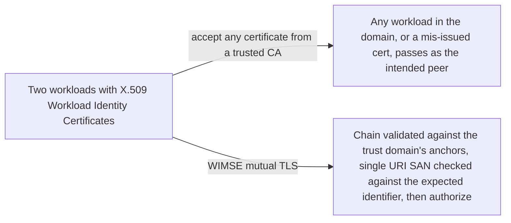
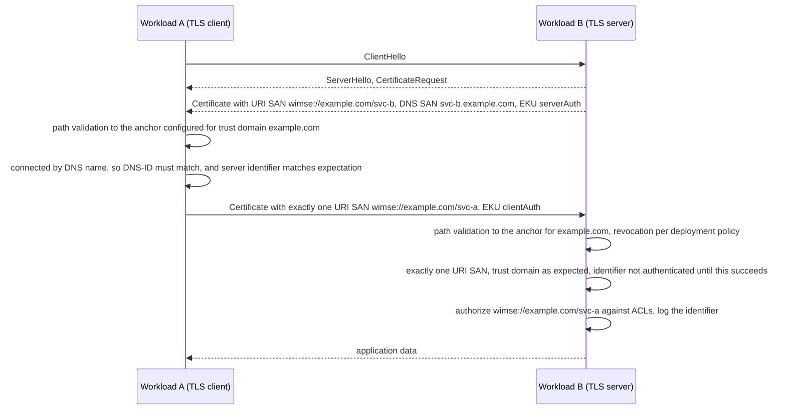

# WIMSE Mutual TLS

> In one line: how two workloads authenticate each other in the TLS handshake with Workload Identity Certificates, which trust anchors to validate against, how a client checks the server's name, and how the server reads the single URI SAN to authorize the client.

## When you reach for it

- **Workloads talk directly over TLS and you already run a PKI**: transport-level protection is the ideal case this document covers; either side or both present WIMSE certificates and the identity comes out of the handshake (Section 1, Section 3).
- **A client reaches a server by DNS name but the server's certificate carries a workload identifier**: the client MUST still do standard RFC 9525 hostname validation against a DNS-ID, and must reject the connection if none matches, even when the workload identifier validates (Section 3.2.1).
- **A client is configured to reach a specific workload, by workload identifier rather than hostname**: the client checks that the server's workload identifier matches its expectation, at minimum the trust domain, before accepting the connection (Section 3.2.1).
- **The server must authorize the calling workload, not just any holder of a certificate from the CA**: it reads the one URI SAN, validates chain, EKU, trust domain and identifier, and only then applies ACLs and audit (Section 3.3, Section 5.1).

## The problem it solves

X.509 and TLS already give mutual authentication, but a certificate chain tells the relying party only that some CA signed something. For workload identity the relying party needs more: that the CA is the one configured for the trust domain named inside the certificate, that the certificate carries exactly one workload identifier, that the identifier is the one expected for this peer, and that none of this is replaced by a hostname check that does not apply to a `spiffe://` or `wimse://` URI (Section 3.2, Section 3.2.1, Section 5.1).

The document also draws the boundary of what TLS can do. When gateways, meshes or other middleboxes terminate and re-establish TLS, the application endpoint is not authenticated to the far workload, and the deployment should add an application-layer WIMSE mechanism such as HTTP Message Signatures or the Workload Proof Token (Section 1, Section 5.3).

## How it works

The server presents a Workload Identity Certificate and requests a client certificate, because a server that will authorize the client on its workload identity MUST require client certificate authentication in the handshake (Section 3.2). The client validates the chain to the trust anchor its configuration maps to the certificate's trust domain, then performs the name check that fits how it connected: DNS-ID validation per RFC 9525 if it used a hostname, or comparison of the workload identifier against the expected one, at least the trust domain, if it was configured by identifier (Section 3.2.1). The server validates the client's chain the same way, confirms there is exactly one URI SAN carrying a workload identifier, and reads that identifier for authorization, accounting and auditing, always interpreting the path within its trust domain (Section 3.3).

## What the spec requires

- The relying party MUST use a locally configured mapping from trust domains to trust anchors, MUST reject a certificate whose path does not validate to an anchor configured for the trust domain in its workload identifier, and MUST NOT treat the identifier as authenticated before that succeeds (Section 3.2).
- Path validation follows RFC 5280 Section 6, and revocation status MUST be determined per RFC 5280 Section 6.1.3 using CRLs, OCSP or out-of-band information as the deployment chooses (Section 3.2).
- Both TLS clients and servers MUST check that the trust domain in the peer's workload identifier matches the expected trust domain (Section 3.2).
- Server certificates SHOULD carry `id-kp-serverAuth`, client certificates `id-kp-clientAuth`, and one certificate may carry both (Section 3.2).
- A client connecting by DNS hostname MUST perform RFC 9525 hostname validation and MUST reject the connection without a matching DNS-ID; a client expecting a WIMSE server MUST validate the server's workload identifier against its expectation, at least the trust domain; the authority of the identifier is a trust domain, not a hostname (Section 3.2.1).
- The client certificate MUST contain exactly one URI SAN carrying a workload identifier; zero or multiple MUST be rejected, and the path MUST always be read in the scope of the trust domain (Section 3.3).

## Watch out

- Validating path or sub-components of the identifier without the trust domain and the anchor used lets one trust domain impersonate workloads in another (Section 5.1).
- Accepting any certificate from a trusted workload CA without checking that it names the intended server, or that the authenticated client is authorized for the action, allows impersonation and unintended access (Section 5.1).
- Certificate lifetimes SHOULD suit the workload environment, with timely revocation or replacement when identity, authorization or runtime state changes; long-lived certificates widen the impact of key compromise. A compromised trust-anchor key enables impersonation as long as the anchor is trusted, regardless of leaf lifetimes. Private keys MUST NOT be shared across unrelated workload instances and SHOULD, where possible, be generated and held in the workload runtime or a dedicated key protection mechanism rather than sent over the network (Section 5.2).
- Where TLS is terminated at intermediaries, authorization must account for whether the certificate represents the peer workload or the intermediary; add HTTP Message Signatures or a Workload Proof Token for end-to-end identity (Section 5.3).
- Identity for authorization MUST come from the validated certificate, never from unauthenticated HTTP headers (Section 5.4).
- Client certificate authentication discloses the client's workload identifier to the server during the handshake; keep sensitive information out of identifiers (Section 6).

## Sources

- [draft-ietf-wimse-mutual-tls, Section 1](https://datatracker.ietf.org/doc/html/draft-ietf-wimse-mutual-tls#section-1)
- [draft-ietf-wimse-mutual-tls, Section 3](https://datatracker.ietf.org/doc/html/draft-ietf-wimse-mutual-tls#section-3)
- [draft-ietf-wimse-mutual-tls, Section 3.2](https://datatracker.ietf.org/doc/html/draft-ietf-wimse-mutual-tls#section-3.2)
- [draft-ietf-wimse-mutual-tls, Section 3.2.1](https://datatracker.ietf.org/doc/html/draft-ietf-wimse-mutual-tls#section-3.2.1)
- [draft-ietf-wimse-mutual-tls, Section 3.3](https://datatracker.ietf.org/doc/html/draft-ietf-wimse-mutual-tls#section-3.3)
- [draft-ietf-wimse-mutual-tls, Section 5.1](https://datatracker.ietf.org/doc/html/draft-ietf-wimse-mutual-tls#section-5.1)
- [draft-ietf-wimse-mutual-tls, Section 5.2](https://datatracker.ietf.org/doc/html/draft-ietf-wimse-mutual-tls#section-5.2)
- [draft-ietf-wimse-mutual-tls, Section 5.3](https://datatracker.ietf.org/doc/html/draft-ietf-wimse-mutual-tls#section-5.3)
- [draft-ietf-wimse-mutual-tls, Section 5.4](https://datatracker.ietf.org/doc/html/draft-ietf-wimse-mutual-tls#section-5.4)
- [draft-ietf-wimse-mutual-tls, Section 6](https://datatracker.ietf.org/doc/html/draft-ietf-wimse-mutual-tls#section-6)
