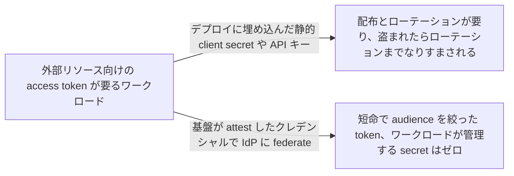
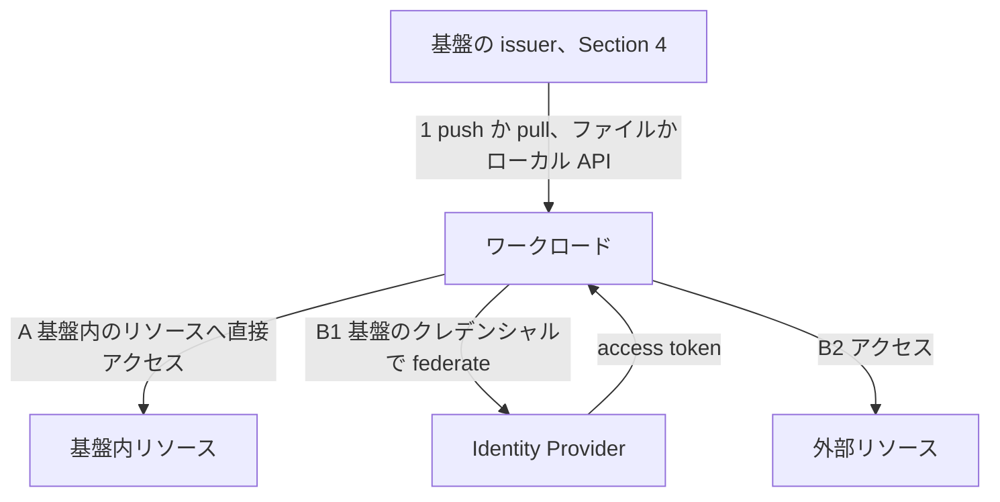
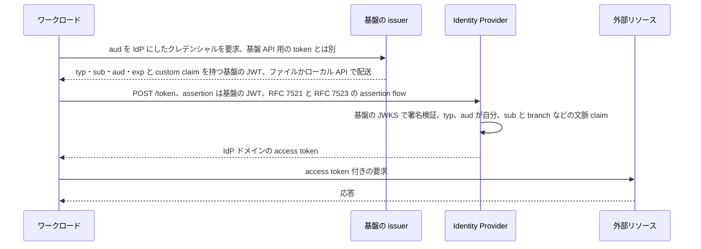

# Workload Identity Practices

> 一言で言うと: ワークロードを動かす基盤 (Kubernetes、SPIFFE、クラウド、CI/CD、service mesh) がワークロードを attest して短命のクレデンシャル (たいてい JWT) を渡し、ワークロードはそれを identity provider で access token に交換する。静的 secret を持つことは一度もない。加えて、その交換を安全に保つための delivery・audience・lifetime・typing のルール。

## どういうときに使うか

- **サービスに OAuth access token が要るが、client secret を配布してローテーションしたくない**: 基盤がワークロードの環境を検証してクレデンシャルを発行し、ワークロードはそれで identity provider に federate して access token を受け取る (Section 1)。
- **Kubernetes の Pod が API server・内部サービス・外部 IdP の 3 つを呼ぶ**: それぞれ別の audience を持つ projected service account token を取る。1 つの token を全員で共有すると、そのうち誰でも他の相手に対して Pod になりすませる (Section 4.1)。
- **CI パイプラインが成果物をアップロードしたりインフラをデプロイしたりする**: パイプラインは実行時に基盤の identity を受け取って federate し、IdP は Git branch などの claim を評価してからアクセスを許す (Section 4.4、Section 5.3)。
- **あるクラウドの VM や serverless function が別のクラウドやアカウントのリソースを使う**: instance metadata service から相手側 STS 宛ての audience を持つクレデンシャルを取り、そこで交換する。自分の基盤向けのクレデンシャルは決して使い回さない (Section 4.3)。

## 解決する問題

従来ワークロードには静的な client credential が配られ、client credentials flow で access token を取っていた。その secret は配布とローテーションが必要で、盗まれれば攻撃者がワークロードになりすませる。OAuth の外の API キーや HTTP basic 認証も同じ問題を抱える。代わりに基盤を通してワークロードを attest する。基盤がワークロードの属性を述べたクレデンシャルに署名し、identity provider が secret の代わりにそれを受け入れる (Section 1)。

それでもクレデンシャルはワークロードに届かなければならず、悪用しにくくなければならない。環境変数経由の delivery はログやプロセス検査に漏れ、ローカル API は SSRF で叩かれ、複数の相手が受け入れる 1 つの bearer token は、受け取った各者が他の相手に対してなりすますことを許す。security considerations はこれらの観察を delivery・audience・lifetime・無効化・token typing についての MUST に変えている (Section 3、Section 5)。

## 仕組み

手順 1 は、基盤がワークロードの環境を検証してクレデンシャルを発行し、ファイルに push するか Unix socket や link-local の metadata アドレスのようなローカル API から pull させるところだ。ワークロードは audience と lifetime の異なる複数のクレデンシャルを取ってよい (Section 1、Section 3.1、Section 3.2)。手順 A はそのクレデンシャルを基盤内で直接使う。手順 B1 が federation で、identity provider は基盤のクレデンシャルを検証して新しいクレデンシャル (典型的には OAuth access token) を発行し、手順 B2 でそれを基盤の外で使う (Section 1)。federation 手順の標準として提案されているのは RFC 7521 と RFC 7523 で、token exchange や独自 API は相互運用性を損なうので推奨されない (Appendix A.2)。Kubernetes は custom audience と lifetime を持つ projected service account token を配り (Section 4.1)、SPIFFE は呼び出し元を out-of-band で識別する無認証の Workload API から JWT-SVID と X509-SVID を出し (Section 4.2)、クラウドは instance metadata endpoint と STS を持ち (Section 4.3)、CI/CD 基盤はジョブの claim を含む実行ごとの identity を発行し (Section 4.4)、service mesh は sidecar proxy に X.509 証明書を発行する (Section 4.5)。

## 仕様が求めること

- 基盤がファイルかローカル API の delivery を提供するなら、環境変数でワークロード identity のクレデンシャルを配ってはならない (MUST NOT)。ファイルへの書き込みは atomic であるべき (SHOULD) (Section 3.1、Section 3.3、Section 5.1.4)。
- クレデンシャルは可能な限り狭くスコープしなければならない (MUST)。基盤内リソース用はそのリソースに、federate 用は identity provider を唯一の audience に。例外は基盤が 1 つのクレデンシャルしか出さないか、ワークロードが audience を指定できない場合だけ (Section 5.1.1)。
- マウントされたクレデンシャルファイルへのアクセスは許可されたアプリケーションに制限しなければならない (MUST)。ローカル API には SSRF 対策が必須で、1 つのローカル API が複数ワークロードに使われるなら rate limiting か呼び出し元ごとの quota を実装すべき (SHOULD) (Section 5.1.2、Section 5.1.3)。
- 実装はアプリケーションの脆弱性がクレデンシャルを晒し得ると想定しなければならず (MUST)、信頼できない入力がクレデンシャルファイルやローカル API へのアクセス方法に影響してはならない (MUST NOT) (Section 5.1.5)。
- issuer は JOSE の `typ` ヘッダで token を型付けすべきで (SHOULD)、authorization grant として使うなら `authorization-grant+jwt` を使う。認可サーバーは判断が依存する claim を評価しなければならない (MUST) (Section 5.2、Section 5.3)。
- token は、基盤が lifetime を判定できない場合を除き、表すワークロードインスタンスより長生きしてはならない (MUST NOT)。issuer は、lifetime が十分短い場合を除き、インスタンスが停止したらクレデンシャルを無効化しなければならない (MUST) (Section 5.4、Section 5.5)。
- JWT のクレデンシャルは `aud` を持ち (MUST)、同じ例外を除いて audience を 2 つ以上持ってはならない (MUST NOT)。基盤 API 用の token をその API の外で使ってはならず (MUST NOT)、他で使う token は `aud` に基盤のサーバーを含んではならない (MUST NOT) (Section 5.7)。

## 注意点

- proof of possession は基盤のクレデンシャルにも得られる access token にも使うべき (SHOULD)。どちら側も対応しないなら、短い lifetime・狭い audience・IP allowlist・mutual TLS などの補完的統制を適用しなければならない (MUST) (Section 5.6)。
- マルチテナント基盤では、全テナントが同じ issuer identifier で設定され得るので `iss` claim が信頼できる authority を一意に示すとは限らない。信頼できない、あるいは偽造しやすい属性だけでアクセスを許してはならず (MUST NOT)、認可に使う属性は relying party が管理する trust domain に結び付いていなければならない (MUST) (Section 5.8)。
- Kubernetes でオブジェクトの lifecycle に結び付けた token の無効化は Token Review API で検証したときにしか検出されない。JWKS ベースの検証では見えない (Section 4.1)。
- ローカル API はしばしば平文で動き、ホスト上の特権コンポーネントが転送中のクレデンシャルを読める。IP などマシン全体の識別子で呼び出し元を判定すると、そのマシンのどのプロセスでも identity を取得できてしまう (Section 5.1.3)。
- CI の branch のような custom claim を無視すると、信頼されない branch から出たクレデンシャルに保護された branch と同じアクセスを与えかねない (Section 5.3)。

## 出典

- [draft-ietf-wimse-workload-identity-practices, Section 1](https://datatracker.ietf.org/doc/html/draft-ietf-wimse-workload-identity-practices#section-1)
- [draft-ietf-wimse-workload-identity-practices, Section 3](https://datatracker.ietf.org/doc/html/draft-ietf-wimse-workload-identity-practices#section-3)
- [draft-ietf-wimse-workload-identity-practices, Section 3.1](https://datatracker.ietf.org/doc/html/draft-ietf-wimse-workload-identity-practices#section-3.1)
- [draft-ietf-wimse-workload-identity-practices, Section 3.2](https://datatracker.ietf.org/doc/html/draft-ietf-wimse-workload-identity-practices#section-3.2)
- [draft-ietf-wimse-workload-identity-practices, Section 3.3](https://datatracker.ietf.org/doc/html/draft-ietf-wimse-workload-identity-practices#section-3.3)
- [draft-ietf-wimse-workload-identity-practices, Section 4](https://datatracker.ietf.org/doc/html/draft-ietf-wimse-workload-identity-practices#section-4)
- [draft-ietf-wimse-workload-identity-practices, Section 4.1](https://datatracker.ietf.org/doc/html/draft-ietf-wimse-workload-identity-practices#section-4.1)
- [draft-ietf-wimse-workload-identity-practices, Section 4.2](https://datatracker.ietf.org/doc/html/draft-ietf-wimse-workload-identity-practices#section-4.2)
- [draft-ietf-wimse-workload-identity-practices, Section 4.3](https://datatracker.ietf.org/doc/html/draft-ietf-wimse-workload-identity-practices#section-4.3)
- [draft-ietf-wimse-workload-identity-practices, Section 4.4](https://datatracker.ietf.org/doc/html/draft-ietf-wimse-workload-identity-practices#section-4.4)
- [draft-ietf-wimse-workload-identity-practices, Section 4.5](https://datatracker.ietf.org/doc/html/draft-ietf-wimse-workload-identity-practices#section-4.5)
- [draft-ietf-wimse-workload-identity-practices, Section 5](https://datatracker.ietf.org/doc/html/draft-ietf-wimse-workload-identity-practices#section-5)
- [draft-ietf-wimse-workload-identity-practices, Section 5.1.1](https://datatracker.ietf.org/doc/html/draft-ietf-wimse-workload-identity-practices#section-5.1.1)
- [draft-ietf-wimse-workload-identity-practices, Section 5.1.2](https://datatracker.ietf.org/doc/html/draft-ietf-wimse-workload-identity-practices#section-5.1.2)
- [draft-ietf-wimse-workload-identity-practices, Section 5.1.3](https://datatracker.ietf.org/doc/html/draft-ietf-wimse-workload-identity-practices#section-5.1.3)
- [draft-ietf-wimse-workload-identity-practices, Section 5.1.4](https://datatracker.ietf.org/doc/html/draft-ietf-wimse-workload-identity-practices#section-5.1.4)
- [draft-ietf-wimse-workload-identity-practices, Section 5.1.5](https://datatracker.ietf.org/doc/html/draft-ietf-wimse-workload-identity-practices#section-5.1.5)
- [draft-ietf-wimse-workload-identity-practices, Section 5.2](https://datatracker.ietf.org/doc/html/draft-ietf-wimse-workload-identity-practices#section-5.2)
- [draft-ietf-wimse-workload-identity-practices, Section 5.3](https://datatracker.ietf.org/doc/html/draft-ietf-wimse-workload-identity-practices#section-5.3)
- [draft-ietf-wimse-workload-identity-practices, Section 5.4](https://datatracker.ietf.org/doc/html/draft-ietf-wimse-workload-identity-practices#section-5.4)
- [draft-ietf-wimse-workload-identity-practices, Section 5.5](https://datatracker.ietf.org/doc/html/draft-ietf-wimse-workload-identity-practices#section-5.5)
- [draft-ietf-wimse-workload-identity-practices, Section 5.6](https://datatracker.ietf.org/doc/html/draft-ietf-wimse-workload-identity-practices#section-5.6)
- [draft-ietf-wimse-workload-identity-practices, Section 5.7](https://datatracker.ietf.org/doc/html/draft-ietf-wimse-workload-identity-practices#section-5.7)
- [draft-ietf-wimse-workload-identity-practices, Section 5.8](https://datatracker.ietf.org/doc/html/draft-ietf-wimse-workload-identity-practices#section-5.8)
- [draft-ietf-wimse-workload-identity-practices, Appendix A.2](https://datatracker.ietf.org/doc/html/draft-ietf-wimse-workload-identity-practices#appendix-A.2)
