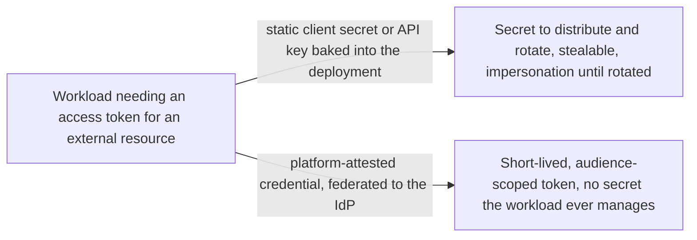
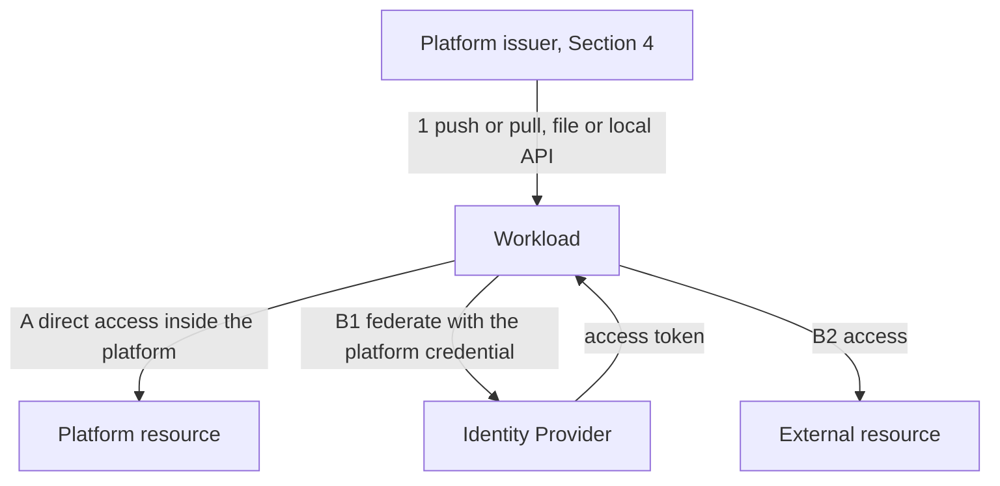
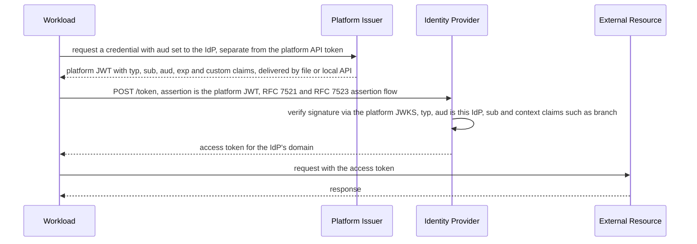

# Workload Identity Practices

> In one line: the platform that runs a workload (Kubernetes, SPIFFE, a cloud, a CI/CD system, a service mesh) attests it and hands it a short-lived credential, usually a JWT, which the workload exchanges with an identity provider for an access token instead of ever holding a static secret, plus the rules on delivery, audience, lifetime and typing that keep that exchange safe.

## When you reach for it

- **A service needs an OAuth access token but you do not want to provision and rotate a client secret**: the platform issues a credential after verifying the workload's environment, and the workload federates with it to the identity provider, which returns the access token (Section 1).
- **A Kubernetes pod must call the API server, an internal service and an external IdP**: it obtains separate projected service account tokens, each with its own audience, because a token shared across those parties lets any of them impersonate the pod at the others (Section 4.1).
- **A CI pipeline uploads artifacts or deploys infrastructure**: the pipeline receives a platform identity at runtime and federates with it, and the IdP must evaluate claims such as the Git branch before granting access (Section 4.4, Section 5.3).
- **A VM or serverless function in one cloud needs a resource in another cloud or account**: it fetches a credential audienced for the other side's STS from the instance metadata service and exchanges it there, never reusing the credential it uses for its own platform (Section 4.3).

## The problem it solves

Workloads were traditionally provisioned with static client credentials and ran the client credentials flow to get an access token. Those secrets have to be provisioned and rotated, and once stolen they let an attacker impersonate the workload; API keys and HTTP basic auth outside OAuth suffer the same way. The alternative is to attest the workload through its platform: the platform signs a credential that states what the workload is, and an identity provider accepts that credential instead of a secret (Section 1).

The credential still has to reach the workload and still has to be hard to misuse. Delivery through environment variables leaks into logs and process inspection, local APIs can be hit by SSRF, and a single bearer token accepted by several parties lets each of them impersonate the workload at the others. The security considerations turn those observations into MUSTs on delivery, audience, lifetime, invalidation and token typing (Section 3, Section 5).

## How it works

Step 1 is the platform issuing a credential after verifying the workload's environment, pushed to a file or pulled from a local API such as a Unix socket or the link-local metadata address, and a workload may obtain several credentials each with its own audience and lifetime (Section 1, Section 3.1, Section 3.2). Step A uses such a credential directly inside the platform. Step B1 federates: the identity provider validates the platform credential and issues a new one, typically an OAuth access token, and step B2 uses it outside the platform (Section 1). RFC 7521 and RFC 7523 are the proposed standards for the federation step; token exchange or custom APIs are discouraged because they prevent interoperability (Appendix A.2). Kubernetes delivers projected service account tokens with custom audience and lifetime (Section 4.1), SPIFFE serves JWT-SVIDs and X509-SVIDs from an unauthenticated Workload API that identifies callers out of band (Section 4.2), clouds expose an instance metadata endpoint and an STS (Section 4.3), CI/CD platforms issue per-run identities with claims about the job (Section 4.4), and service meshes issue X.509 certificates to sidecar proxies (Section 4.5).

## What the spec requires

- Environment variables MUST NOT be used to deliver workload identity credentials where the platform offers filesystem or local API delivery; filesystem writes SHOULD be atomic (Section 3.1, Section 3.3, Section 5.1.4).
- Credentials MUST be scoped as narrowly as possible: a credential for a platform resource MUST be scoped to that resource, and one used to federate MUST carry the identity provider as its sole audience, unless the platform issues a single credential or does not let the workload influence the audience (Section 5.1.1).
- Access to mounted credential files MUST be restricted to authorized applications; SSRF mitigations are required for local APIs; where one local API serves several workloads, rate limiting or per-caller quotas SHOULD be implemented (Section 5.1.2, Section 5.1.3).
- Implementations MUST assume application vulnerabilities can expose credentials, and untrusted input MUST NOT influence how credential files or local credential APIs are accessed (Section 5.1.5).
- Issuers SHOULD type tokens with the JOSE `typ` header, using `authorization-grant+jwt` when the credential is an authorization grant; authorization servers MUST evaluate the claims their decision depends on (Section 5.2, Section 5.3).
- Tokens MUST NOT outlive the workload instance they represent unless the platform cannot determine that lifetime; issuers MUST invalidate credentials when an instance stops unless the lifetime is short enough (Section 5.4, Section 5.5).
- JWT credentials MUST carry `aud` and MUST NOT carry more than one audience, with the same exceptions. A token for the platform API MUST NOT be used beyond that API, and a token used elsewhere MUST NOT carry the platform server in `aud` (Section 5.7).

## Watch out

- Proof of possession SHOULD be used for both the platform credential and the resulting access token; where neither side supports it, deployments MUST apply compensating controls such as short lifetimes, narrow audiences, IP allowlisting or mutual TLS (Section 5.6).
- In multi-tenant platforms the `iss` claim may not uniquely identify a trusted authority because every tenant can be configured with the same issuer. Access MUST NOT be granted on untrusted or forgeable attributes, and attributes used for authorization MUST be bound to a trust domain under the relying party's control (Section 5.8).
- A Kubernetes token bound to an object lifecycle is only detected as invalidated when it is checked through the Token Review API; JWKS-based validation will not see the invalidation (Section 4.1).
- Local APIs often run in clear text, so privileged components on the host can read credentials in transit; identification by IP or other machine-global identifiers lets any process on the machine obtain the identity (Section 5.1.3).
- Ignoring custom claims such as the CI branch can grant a credential from an untrusted branch the same access as one from a protected branch (Section 5.3).

## Sources

- [draft-ietf-wimse-workload-identity-practices, Section 1](https://datatracker.ietf.org/doc/html/draft-ietf-wimse-workload-identity-practices#section-1)
- [draft-ietf-wimse-workload-identity-practices, Section 3](https://datatracker.ietf.org/doc/html/draft-ietf-wimse-workload-identity-practices#section-3)
- [draft-ietf-wimse-workload-identity-practices, Section 3.1](https://datatracker.ietf.org/doc/html/draft-ietf-wimse-workload-identity-practices#section-3.1)
- [draft-ietf-wimse-workload-identity-practices, Section 3.2](https://datatracker.ietf.org/doc/html/draft-ietf-wimse-workload-identity-practices#section-3.2)
- [draft-ietf-wimse-workload-identity-practices, Section 3.3](https://datatracker.ietf.org/doc/html/draft-ietf-wimse-workload-identity-practices#section-3.3)
- [draft-ietf-wimse-workload-identity-practices, Section 4](https://datatracker.ietf.org/doc/html/draft-ietf-wimse-workload-identity-practices#section-4)
- [draft-ietf-wimse-workload-identity-practices, Section 4.1](https://datatracker.ietf.org/doc/html/draft-ietf-wimse-workload-identity-practices#section-4.1)
- [draft-ietf-wimse-workload-identity-practices, Section 4.2](https://datatracker.ietf.org/doc/html/draft-ietf-wimse-workload-identity-practices#section-4.2)
- [draft-ietf-wimse-workload-identity-practices, Section 4.3](https://datatracker.ietf.org/doc/html/draft-ietf-wimse-workload-identity-practices#section-4.3)
- [draft-ietf-wimse-workload-identity-practices, Section 4.4](https://datatracker.ietf.org/doc/html/draft-ietf-wimse-workload-identity-practices#section-4.4)
- [draft-ietf-wimse-workload-identity-practices, Section 4.5](https://datatracker.ietf.org/doc/html/draft-ietf-wimse-workload-identity-practices#section-4.5)
- [draft-ietf-wimse-workload-identity-practices, Section 5](https://datatracker.ietf.org/doc/html/draft-ietf-wimse-workload-identity-practices#section-5)
- [draft-ietf-wimse-workload-identity-practices, Section 5.1.1](https://datatracker.ietf.org/doc/html/draft-ietf-wimse-workload-identity-practices#section-5.1.1)
- [draft-ietf-wimse-workload-identity-practices, Section 5.1.2](https://datatracker.ietf.org/doc/html/draft-ietf-wimse-workload-identity-practices#section-5.1.2)
- [draft-ietf-wimse-workload-identity-practices, Section 5.1.3](https://datatracker.ietf.org/doc/html/draft-ietf-wimse-workload-identity-practices#section-5.1.3)
- [draft-ietf-wimse-workload-identity-practices, Section 5.1.4](https://datatracker.ietf.org/doc/html/draft-ietf-wimse-workload-identity-practices#section-5.1.4)
- [draft-ietf-wimse-workload-identity-practices, Section 5.1.5](https://datatracker.ietf.org/doc/html/draft-ietf-wimse-workload-identity-practices#section-5.1.5)
- [draft-ietf-wimse-workload-identity-practices, Section 5.2](https://datatracker.ietf.org/doc/html/draft-ietf-wimse-workload-identity-practices#section-5.2)
- [draft-ietf-wimse-workload-identity-practices, Section 5.3](https://datatracker.ietf.org/doc/html/draft-ietf-wimse-workload-identity-practices#section-5.3)
- [draft-ietf-wimse-workload-identity-practices, Section 5.4](https://datatracker.ietf.org/doc/html/draft-ietf-wimse-workload-identity-practices#section-5.4)
- [draft-ietf-wimse-workload-identity-practices, Section 5.5](https://datatracker.ietf.org/doc/html/draft-ietf-wimse-workload-identity-practices#section-5.5)
- [draft-ietf-wimse-workload-identity-practices, Section 5.6](https://datatracker.ietf.org/doc/html/draft-ietf-wimse-workload-identity-practices#section-5.6)
- [draft-ietf-wimse-workload-identity-practices, Section 5.7](https://datatracker.ietf.org/doc/html/draft-ietf-wimse-workload-identity-practices#section-5.7)
- [draft-ietf-wimse-workload-identity-practices, Section 5.8](https://datatracker.ietf.org/doc/html/draft-ietf-wimse-workload-identity-practices#section-5.8)
- [draft-ietf-wimse-workload-identity-practices, Appendix A.2](https://datatracker.ietf.org/doc/html/draft-ietf-wimse-workload-identity-practices#appendix-A.2)
