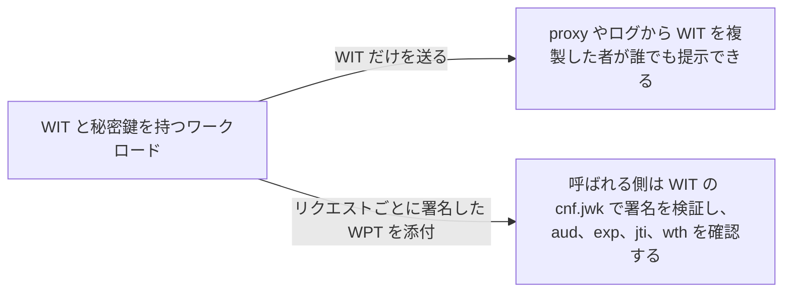
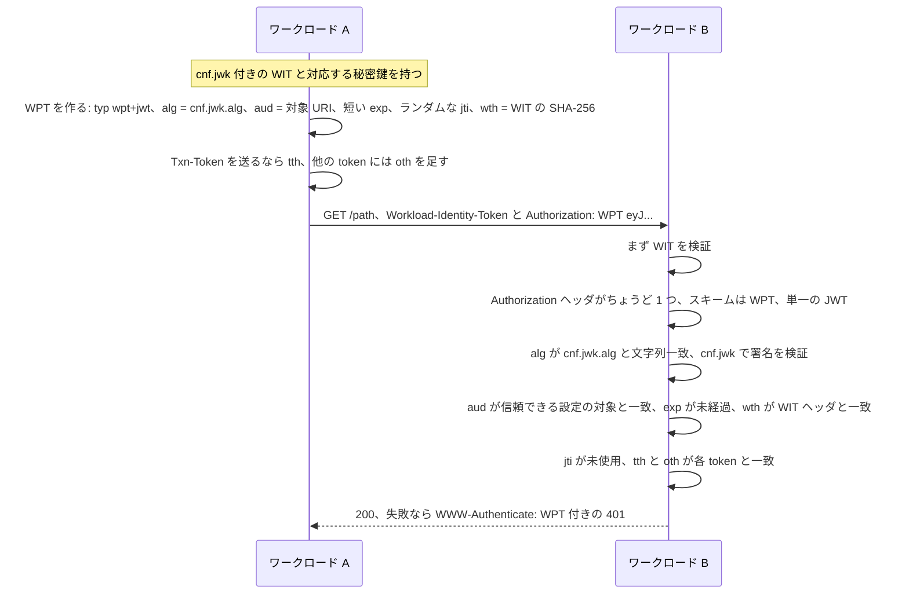

# WIMSE Workload Proof Token

> 一言で言うと: `Authorization: WPT ...` で送る短命な JWT。ワークロードが Workload Identity Token の裏にある秘密鍵で署名し、このリクエストについてその鍵を持っていることを証明する。証明は対象 URI (`aud`)、WIT (`wth`)、同伴する context token (`tth`、`oth`) に結び付く。

## どういうときに使うか

- **WIT を bearer token にしたくない**: WIT は proof of possession を必須とする設計で、WPT がその証明。鍵のない WIT の複製は何も証明しない (Section 1、Section 2)。
- **HTTP 以外、キューやイベント駆動のシステムでも証明を使いたい**: WPT は HTTP 固有の signature base を持たない素の署名付き JWT なので他のトランスポートにも適用できる。この文書は HTTP での使い方をプロファイルする (Section 1)。
- **gateway が transaction token を呼び出しに同伴させ、呼ばれる側が両方が一緒に提示されたことを確認したい**: WPT は `Txn-Token` のハッシュを `tth` に、他の identity や context の token を `oth` に入れるので、不一致は検出され、`oth` に載っていない token は認可に使われない (Section 2)。
- **HTTP Message Signatures をフルに使うより、JWT ベースの簡単な選択肢がほしい**: WPT が掲げる設計目標はシンプルさで、HTTP 固有の signature base を持たない署名付き JWT。代わりにリクエストの大部分は保護しない (Section 1、Section 3.3)。

## 解決する問題

Workload Identity Token は公開鍵を workload identifier に結び付けるが、それ自体は署名された文書にすぎない。複製を持つ者は誰でも送れる。WPT はリクエストごとに、鍵の保持者にしか作れない署名を足し、その署名を特定の対象 URI、特定の WIT、メッセージ内の特定の context token に結び付ける。これで盗まれた token や replay された証明の使い道が狭まる。WPT は分か秒の単位で失効し、audience を 1 つ名指しし、受け手が記憶できる一意な `jti` を持つ (Section 1、Section 2、Section 3.1)。

HTTP binding は証明の置き場所も決める。`Authorization` ヘッダを新しい `WPT` スキームで占有するため、同じリクエストに `Bearer` token を同時に載せられない。この排他性は意図的で、呼び出し元の identity がリクエスト内で最も弱いクレデンシャルに引きずられないためだ (Section 2.2)。

## 仕組み

ワークロード A は WPT に署名する。`alg` は WIT の `cnf.jwk` 内の `alg` と同じ、`aud` はリクエストの対象 URI から query と fragment を除いたもの、`exp` は分か秒の先、`jti` は一意な値 (たとえば 128 ビットの乱数)、`wth` は送信する WIT の base64url SHA-256 (Section 2)。WIT を `Workload-Identity-Token` に、WPT を `WPT` スキームと `token68` 構文で `Authorization` に載せる (Section 2)。ワークロード B はまずクレデンシャル文書に従って WIT を検証し、次に WPT を検証する。`Authorization` ヘッダが 1 つ、アルゴリズムの一致、confirmation key での署名、`aud`、`exp`、`wth`、推奨される `jti` の replay 検査、そして context token の `tth` と `oth` のハッシュ。未知の `oth` エントリは拒否の理由になり、`oth` に載っていない token を認可に使ってはならない (Section 2)。WPT に起因する失敗には `WWW-Authenticate: WPT` チャレンジ付きの 401 を返す (Section 2.1)。

## 仕様が求めること

- WPT は `WPT` 認証スキームで `Authorization` ヘッダに `token68` エンコードで送る。WIT はクレデンシャル文書の定めどおりに送る (Section 2)。
- ヘッダ: `alg` は WIT の `cnf` claim 内の `jwk` の `alg` と MUST で一致、`typ` は `wpt+jwt`。claim: `aud` は query と fragment を除いた対象 URI が SHOULD、`exp` は MUST で短く、`jti` は衝突確率が無視できるほど一意であることが MUST、`wth` は WIT の base64url SHA-256、`tth` と `oth` は対応する token がリクエストにあれば必須 (Section 2)。
- 検証: まず WIT。次に `WPT` を使う `Authorization` ヘッダがちょうど 1 つ、単一の整形された JWT、`alg` が `cnf.jwk.alg` と文字列一致、WIT の confirmation key で署名が有効、`typ` が `wpt+jwt`、`aud` が対象 URI か許容される別名と一致、`exp` が未経過、`wth` が `Workload-Identity-Token` の値と一致、`tth` と `oth` が各 token と一致。未知の `oth` エントリを持つ WPT は MUST で拒否 (Section 2)。
- WIT と WPT で認証するワークロードは、同じリクエストの bearer token に呼び出し元の identity を頼ってはならず、受け手はその token を呼び出し元の認可判断に使ってはならない (Section 2.2)。
- WPT に関する理由で拒否する受け手は、`WPT` スキームを含む `WWW-Authenticate` チャレンジ付きの 401 を返すのが SHOULD。その他のエラーには 400 が引き続き適切 (Section 2.1)。
- 閉じた環境で足す claim は衝突耐性を持たせるのが SHOULD で、理解できない claim は MUST で無視する。閉じた環境の外では IANA への登録が MUST (Section 2.3)。

## 注意点

- token と proof は、別の仕組みで安全な経路が確保されていない限り、サーバー認証済みの TLS 接続で送らなければならず (MUST)、クライアントはホスト名検証を MUST で行う (Section 3.1.1)。
- `jti` の replay 保護は SHOULD で、送信者ごとのスコープ。検証者間で replay cache を共有できず、攻撃者がどのクラスタメンバーにメッセージを届けるか選べるなら、replay 保護は効かない (Section 3.1.4)。
- 実装は既定で生の WPT をログに書いてはならない。ログから拾った値がまだ有効期間内のことがある (Section 3.1.5)。
- 検証者は許可する audience の authority を信頼できる設定から取らなければならない。`Host` や `X-Forwarded-Host` は信頼できず MUST NOT で使わない。さもないと細工したリクエストで別の受け手向けの WPT が通る (Section 3.1.7)。
- WPT はリクエストと応答の大部分を保護しないので、能動的に悪意ある middlebox からは守れない。トラフィックが middlebox を通ってよいかは明示的に判断する (Section 3.3)。
- WIT の裏の鍵は Workload Identifier ごとに MUST で個別、WIT の期限切れ後は MUST NOT で使わず、WIT ごとに個別にするのが SHOULD (Section 3.2)。

## 出典

- [draft-ietf-wimse-wpt, Section 1](https://datatracker.ietf.org/doc/html/draft-ietf-wimse-wpt#section-1)
- [draft-ietf-wimse-wpt, Section 2](https://datatracker.ietf.org/doc/html/draft-ietf-wimse-wpt#section-2)
- [draft-ietf-wimse-wpt, Section 2.1](https://datatracker.ietf.org/doc/html/draft-ietf-wimse-wpt#section-2.1)
- [draft-ietf-wimse-wpt, Section 2.2](https://datatracker.ietf.org/doc/html/draft-ietf-wimse-wpt#section-2.2)
- [draft-ietf-wimse-wpt, Section 2.3](https://datatracker.ietf.org/doc/html/draft-ietf-wimse-wpt#section-2.3)
- [draft-ietf-wimse-wpt, Section 3.1](https://datatracker.ietf.org/doc/html/draft-ietf-wimse-wpt#section-3.1)
- [draft-ietf-wimse-wpt, Section 3.1.1](https://datatracker.ietf.org/doc/html/draft-ietf-wimse-wpt#section-3.1.1)
- [draft-ietf-wimse-wpt, Section 3.1.4](https://datatracker.ietf.org/doc/html/draft-ietf-wimse-wpt#section-3.1.4)
- [draft-ietf-wimse-wpt, Section 3.1.5](https://datatracker.ietf.org/doc/html/draft-ietf-wimse-wpt#section-3.1.5)
- [draft-ietf-wimse-wpt, Section 3.1.7](https://datatracker.ietf.org/doc/html/draft-ietf-wimse-wpt#section-3.1.7)
- [draft-ietf-wimse-wpt, Section 3.2](https://datatracker.ietf.org/doc/html/draft-ietf-wimse-wpt#section-3.2)
- [draft-ietf-wimse-wpt, Section 3.3](https://datatracker.ietf.org/doc/html/draft-ietf-wimse-wpt#section-3.3)
