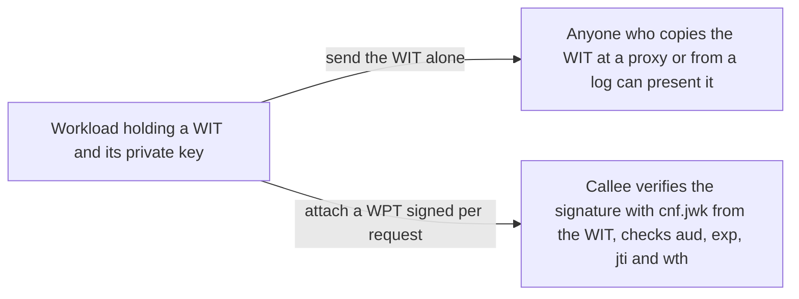
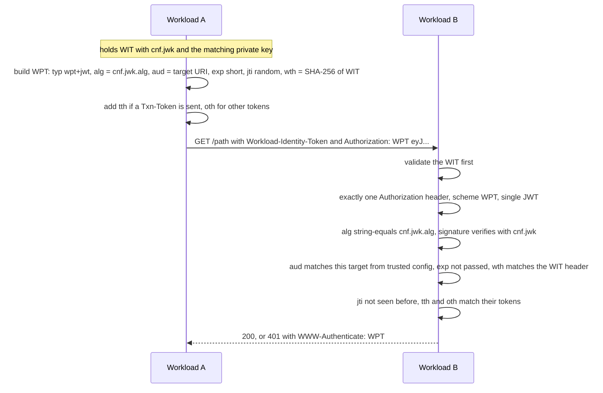

# WIMSE Workload Proof Token

> In one line: a short-lived JWT, sent as `Authorization: WPT ...`, that a workload signs with the private key behind its Workload Identity Token to prove it holds that key for this request, binding the proof to the target URI (`aud`), the WIT (`wth`) and any context tokens (`tth`, `oth`).

## When you reach for it

- **Your WIT must not become a bearer token**: the WIT is designed to require proof of possession, and the WPT is that proof. A captured WIT without the key proves nothing (Section 1, Section 2).
- **You need the proof to work beyond HTTP, in queues or event-driven systems**: the WPT is a plain signed JWT with no HTTP-specific signature base, so it can be adapted to other transports while this document profiles the HTTP usage (Section 1).
- **A gateway forwards a transaction token with the call and the callee must know both were presented together**: the WPT hashes the `Txn-Token` into `tth` and any other identity or context token into `oth`, so a mismatch is detected and tokens not covered by `oth` are excluded from authorization (Section 2).
- **You want the simpler, JWT-based option rather than full HTTP Message Signatures**: the WPT's stated design goal is simplicity, a signed JWT with no HTTP-specific signature base, at the cost of not covering most of the request (Section 1, Section 3.3).

## The problem it solves

A Workload Identity Token binds a public key to a workload identifier, but on its own it is just a signed document. Whoever holds a copy can send it. The WPT adds, per request, a signature that only the key holder can produce, and ties that signature to the specific target URI, the specific WIT, and the specific context tokens in the message. That shrinks what a stolen token or a replayed proof is good for: a WPT is valid for minutes or seconds, names one audience, and carries a unique `jti` the receiver can remember (Section 1, Section 2, Section 3.1).

The HTTP binding also settles where the proof lives. It occupies the `Authorization` header with a new `WPT` scheme, which means a request cannot simultaneously carry a `Bearer` token; that exclusivity is deliberate, so the caller's identity never falls back to the weakest credential in the request (Section 2.2).

## How it works

Workload A signs a WPT whose `alg` equals the `alg` inside the WIT's `cnf.jwk`, whose `aud` is the request's target URI without query or fragment, whose `exp` is minutes or seconds away, whose `jti` is unique, for example 128 bits of randomness, and whose `wth` is the base64url SHA-256 of the WIT as sent (Section 2). It puts the WIT in `Workload-Identity-Token` and the WPT in `Authorization` using the `WPT` scheme and `token68` syntax (Section 2). Workload B validates the WIT per the credentials document, then the WPT: one `Authorization` header, matching algorithm, signature under the confirmation key, `aud`, `exp`, `wth`, the recommended `jti` replay check, and the `tth` and `oth` hashes for any context tokens. Unknown `oth` entries cause rejection, and tokens not listed in `oth` MUST NOT feed authorization (Section 2). Failures tied to the WPT get a 401 with a `WWW-Authenticate: WPT` challenge (Section 2.1).

## What the spec requires

- The WPT is sent in the `Authorization` header with the `WPT` authentication scheme, encoded as `token68`; the WIT is sent as the credentials document specifies (Section 2).
- Header: `alg` MUST match the `alg` of the `jwk` in the WIT's `cnf` claim; `typ` is `wpt+jwt`. Claims: `aud` SHOULD be the target URI without query or fragment, `exp` MUST be short, `jti` MUST be unique with negligible collision probability, `wth` is the base64url SHA-256 of the WIT, and `tth` and `oth` are mandatory whenever the corresponding tokens are in the request (Section 2).
- Validation: the WIT first; then exactly one `Authorization` header using `WPT`, a single well-formed JWT, `alg` string-equal to `cnf.jwk.alg`, a valid signature under the WIT's confirmation key, `typ` of `wpt+jwt`, `aud` matching the target URI or an acceptable alias, an unexpired `exp`, a `wth` matching the `Workload-Identity-Token` value, `tth` and `oth` matching their tokens; a WPT with unknown `oth` entries MUST be rejected (Section 2).
- A workload authenticating with WIT and WPT MUST NOT rely on a bearer token in the same request for the caller's identity, and the recipient MUST NOT use such a token for authorization decisions about the caller (Section 2.2).
- A recipient that rejects a request for a WPT-related reason SHOULD return 401 with a `WWW-Authenticate` challenge that includes the `WPT` scheme; 400 remains appropriate for other errors (Section 2.1).
- New claims in closed environments SHOULD be collision-resistant and MUST be ignored if not understood; outside closed environments they MUST be registered with IANA (Section 2.3).

## Watch out

- The token and proof MUST go over a server-authenticated TLS connection unless some other mechanism provides a secure channel, and the client MUST perform host name validation (Section 3.1.1).
- `jti` replay protection is a SHOULD and is scoped per sender; if validators cannot share a replay cache and an attacker can pick which cluster member receives the message, replay protection does not work (Section 3.1.4).
- Implementations MUST NOT log raw WPTs by default: a value harvested from logs may still be inside its validity window (Section 3.1.5).
- Validators MUST take the allowed audience authorities from trusted configuration; `Host` and `X-Forwarded-Host` are untrusted and MUST NOT be used, or a fabricated request can make a WPT meant for another receiver verify (Section 3.1.7).
- The WPT does not cover most of the request and response, so it gives no protection against an actively malicious middlebox; decide explicitly whether traffic may cross one (Section 3.3).
- The key behind the WIT MUST be individual per Workload Identifier, MUST NOT be used after the WIT expires, and SHOULD be individual per WIT (Section 3.2).

## Sources

- [draft-ietf-wimse-wpt, Section 1](https://datatracker.ietf.org/doc/html/draft-ietf-wimse-wpt#section-1)
- [draft-ietf-wimse-wpt, Section 2](https://datatracker.ietf.org/doc/html/draft-ietf-wimse-wpt#section-2)
- [draft-ietf-wimse-wpt, Section 2.1](https://datatracker.ietf.org/doc/html/draft-ietf-wimse-wpt#section-2.1)
- [draft-ietf-wimse-wpt, Section 2.2](https://datatracker.ietf.org/doc/html/draft-ietf-wimse-wpt#section-2.2)
- [draft-ietf-wimse-wpt, Section 2.3](https://datatracker.ietf.org/doc/html/draft-ietf-wimse-wpt#section-2.3)
- [draft-ietf-wimse-wpt, Section 3.1](https://datatracker.ietf.org/doc/html/draft-ietf-wimse-wpt#section-3.1)
- [draft-ietf-wimse-wpt, Section 3.1.1](https://datatracker.ietf.org/doc/html/draft-ietf-wimse-wpt#section-3.1.1)
- [draft-ietf-wimse-wpt, Section 3.1.4](https://datatracker.ietf.org/doc/html/draft-ietf-wimse-wpt#section-3.1.4)
- [draft-ietf-wimse-wpt, Section 3.1.5](https://datatracker.ietf.org/doc/html/draft-ietf-wimse-wpt#section-3.1.5)
- [draft-ietf-wimse-wpt, Section 3.1.7](https://datatracker.ietf.org/doc/html/draft-ietf-wimse-wpt#section-3.1.7)
- [draft-ietf-wimse-wpt, Section 3.2](https://datatracker.ietf.org/doc/html/draft-ietf-wimse-wpt#section-3.2)
- [draft-ietf-wimse-wpt, Section 3.3](https://datatracker.ietf.org/doc/html/draft-ietf-wimse-wpt#section-3.3)
