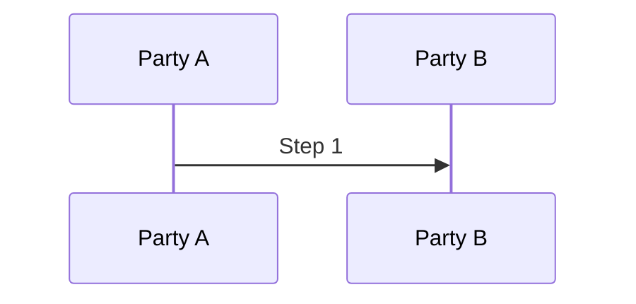

# Deep Dive: TOPIC

> In one line:

## What this is

-

## How it works

## Use cases

-

## Why This Matters Now

- **Trigger**:
- **Source evidence**:
- **Expected impact**:

## What Changed

- Spec/document change summary:
- Compatibility or migration concerns:

## Technical Analysis

- Threat model implications:
- Protocol flow implications:
- Interop concerns:

## Open Questions

-

## Experiments

- [ ] Lab 1:
- [ ] Lab 2:

## Sources

-
