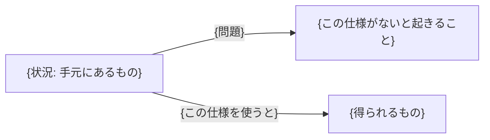
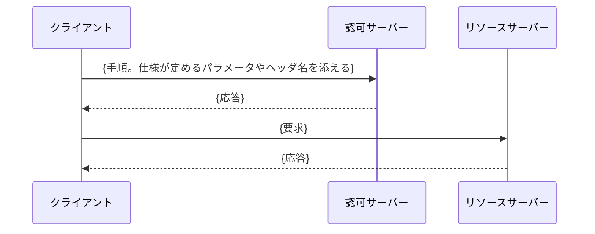

# {仕様名}

> 一言で言うと: {この仕様が何のためにあるかを、同僚に話すように一文で}

## どういうときに使うか

- **{具体的な状況を一行で}**: {そこでこの仕様が何をくれるかを一行で。例: 「client secret を持てないモバイルアプリ」: リダイレクトを横取りした攻撃者が code を交換できなくなる。}
- **{別の状況}**: {...}
- **{3〜4 個。仕様自身の introduction・use case・security considerations が描く実際の配備シナリオであって、創作しない。}**

{任意の 2 枚目の図: 土台にする仕様や置き換える仕様との位置関係、あるいはこの仕様が変える 1 つのメッセージの before/after。下のシーケンス図にない情報を足せるときだけ。}

## 解決する問題

{短い段落を 1〜2 つ。この仕様がないと具体的に何が困るか。当事者 (クライアント、認可サーバー、リソースサーバー、ワークロード、ウォレット、検証者) を名指しする。歴史や宣伝は書かない。}

## 仕組み

{図を順に追って説明する段落を 1 つ。仕様が定義するフィールド・ヘッダ・クレーム (例: `code_challenge`、`DPoP` ヘッダ、`cnf` クレーム) を名前で挙げる。流れではなく構造を定める仕様なら flowchart でよい。}

## 仕様が求めること

- {仕様が述べている要件と、その場所: (Section 4.2)}
- {3〜6 個。どれも本文の規範的・定義的な記述であって、意見ではない。}

## 注意点

- {仕様自身が挙げるセキュリティ上の考慮点や相互運用の落とし穴と、その節: (Section 11.1)}
- {2〜4 個。}

## 出典

- [{RFC 9449, Section 4}]({https://www.rfc-editor.org/rfc/rfc9449#section-4})
- {上で引いた節をすべて、公式本文へのリンクで。公式本文のみ: rfc-editor.org、datatracker.ietf.org、openid.net、spiffe.io。}
