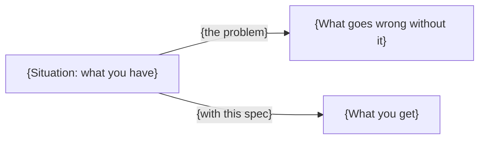
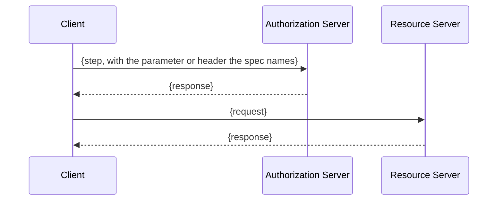

# {Spec name}

> In one line: {one sentence a colleague would say to explain what this spec is for}

## When you reach for it

- **{A concrete situation, one line}**: {what this spec gives you there, one line. Example: "A mobile app with no client secret": PKCE stops an attacker who intercepts the redirect from exchanging the code.}
- **{Another situation}**: {...}
- **{Three or four of these. Each one is a real deployment scenario the spec's own introduction, use-case section or security considerations describe, not an invented one.}**

{Optional second diagram: where this spec sits relative to the ones it builds on or replaces, or a before/after of the one message it changes. Only if it adds something the sequence diagram below does not.}

## The problem it solves

{One or two short paragraphs. What goes wrong without this spec, in concrete terms. Name the parties (client, authorization server, resource server, workload, wallet, verifier). No history, no marketing.}

## How it works

{One paragraph that walks the reader through the diagram, step by step, naming the fields, headers or claims the spec defines (for example `code_challenge`, `DPoP` header, `cnf` claim). A flowchart is fine where the spec defines a structure rather than a flow.}

## What the spec requires

- {A requirement the spec states, with where it says so: (Section 4.2)}
- {Three to six of these. Each one is a normative or defining statement from the text, not an opinion.}

## Watch out

- {A security consideration or interop pitfall the spec itself names, with the section: (Section 11.1)}
- {Two to four of these.}

## Sources

- [{RFC 9449, Section 4}]({https://www.rfc-editor.org/rfc/rfc9449#section-4})
- {Every section cited above, as a link to the official text. Official text only: rfc-editor.org, datatracker.ietf.org, openid.net, spiffe.io.}
