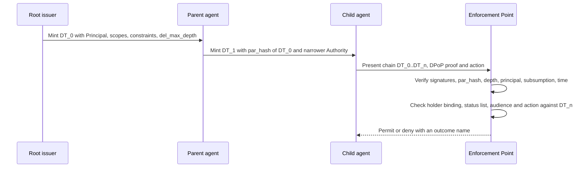

# Deep Dive: draft-asor-wimse-agent-delegation-chain-03

> 一言で言うと: エージェント間の委任ごとに、親へのハッシュによるコミットメントを持ち権限を狭めることしかできない署名付き子トークンを発行する OAuth JWT アクセストークンのプロファイルであり、認可サーバーを呼び出さずにチェーン全体を検証できる。

## 何であるか

AI エージェントはタスクを分割して他のエージェントに副タスクを委任するため、深さが 2 を超える委任チェーンが一般的になる（Section 1）。このドラフトの不変条件は、任意のホップで行使される権限は委任元のホップが保持する権限の部分集合でなければならず（MUST）、執行点は認可サーバーに問い合わせることなくそれを検証できなければならない（MUST）、というものである。ドラフトは、OAuth Token Exchange（RFC 8693）では入れ子の "act" クレームが監査用の履歴にすぎず、各ホップで通常は認可サーバーに接続するため、これを満たせないと主張している（Section 1.1）。仕組みは Delegation Token（DT）である。これは RFC 9068 の JWT であり、スコープと制約を持つ RFC 9396 の "agent_delegation" 認可詳細を 1 つ運び、全ホップで同一の責任主体（Principal）を示す "sub"、動作するエージェントを示す "client_id"、保持者の鍵を示す "cnf"、親の JWS Signing Input の SHA-256 である "par_hash" を持つ（Section 3、4、5）。8 段階の検証アルゴリズムが、署名、リンク、深さ、主体の不変性、包含関係、時刻、保持者バインディング、失効、最後に操作そのものを検査する（Section 6）。ドラフトは新しい暗号を導入しないと述べており、WIMSE ワーキンググループの Standards Track 文書である。

## 仕組み

1. ルート発行者がルート鍵で DT_0 を発行する。"sub" に Principal を、"del_depth" に 0 を設定し、"del_max_depth" と初期の Authority を設定する（Section 3、4）。
2. 各委任元が、同じ "sub"、1 増やした "del_depth"、親の署名入力の正確なバイト列に対する "par_hash"、Section 4.3 の包含規則で親の部分集合となる Authority を持つ子トークンを発行する（Section 5）。
3. 動作する必要のあるエージェントが、DT_0 から DT_n までのチェーンと、リクエストに束縛された DPoP 証明を提示する（Section 6、7）。
4. 執行点は、自身が持つ許可アルゴリズムの一覧と信頼するルート鍵で署名を検証し、次に各 "par_hash"、深さ、主体の不変性を検証する（ステップ 1 から 3）。
5. 各ホップの Authority を親と照合し（ステップ 4）、now が exp 未満であることを含む有効期間を確認する（ステップ 5）。
6. DPoP による保持者バインディングを検証し（ステップ 6）、キャッシュされた Token Status List を参照して、状態が不明なら拒否する（ステップ 7）。
7. 最後に audience と操作を DT_n に対して検査する。累積制約は、リクエスト外で保持される合計値を用いる（ステップ 8）。拒否には Section 6.2 の Table 2 の名前を用いる。

## ユースケース

- 計画エージェントが、1 回あたりの "max_rows" をより小さくし有効期限をより短くして、読み取り専用の副タスクをワーカーエージェントに委任する。ツールの前段にあるゲートウェイは、その狭まりをオフラインで検査する（Section 4.2、4.3）。
- 監査者や発行者が、リクエストを持たずにステップ 1 から 5 と 7 を実行して記録済みのチェーンを再検査し、実施しなかったステップを報告する（Section 6.1）。
- 配備環境が、チェーンだけでは兄弟の消費量を見られないため、"max_subtree" と共有台帳または単一書き込み者の割り当て器を用いて、子のファンアウトを制限する（Section 9.4）。
- 配備環境が、認可サーバーによるアクターの記録と、オフラインで検査可能な権限の上限との両方を得るために、Delegation Chain と並べて OAuth の "act" チェーンを運ぶ（Section 1.2）。
- リソースサーバーが、保護リソースメタデータで実装する認可詳細の型を宣言し、発行者がどのチェーンを受理されるかを知れるようにする（Section 4.4）。

## なぜ今重要か

- **きっかけ**: `subject.json` では「Review related draft: draft-asor-wimse-agent-delegation-chain-03」として挙げられている。ai_note は、委任元に束縛されたチェーンのドラフトがこのドラフトの Delegation Token 形式を拡張し、その束縛をこの形式に含めるべきかを問うている、と述べている。
- **根拠となる資料**: リビジョン 03 の日付は 2026 年 10 月 27 日で、有効期限は 2027 年 4 月 30 日である。Section 1.2（OAuth の actor ドラフトとの関係）、Principal の資格に関する Table 1 の新しい行、3 つのクレーム登録を要求しなくなった Section 10、36 ファイルのテストベクターが追加された（Appendix B、C と Section 11）。
- **期待される影響**: このドラフトは、WIMSE 文書のまま OAuth の権限縮小トークンの作業と収束しつつあるように見える。エージェントゲートウェイの実装者は、試験に使える具体的な検証順序と結果名を得られる。ワーキンググループでの位置づけはドラフトに記載されておらず、`subject.json` にも Datatracker の状態はない。

## 変更点

- Section 1.2 が新設された。"act" クレームを使うドラフト（draft-mcguinness-oauth-actor-profile と draft-mw-oauth-actor-chain）は誰が動作したかを記録するのに対し、このドラフトは各ホップが何をしてよいかをチェーン内で制限する、と述べている。"act" クレームは要求せず、両者の対応付けも定義しない。
- Section 6.1 に Table 1 の行と段落が追加された。Principal が DT_0 で付与された権限をなお保持しているかは、チェーンからもリクエストからも分からない。資格の確認は、ルート発行時（Section 9.7）、および発行後の隙間が許容できない場合は行使時のオンラインサーバーで行う。
- Section 6.4 は、バインディングの隙間（ルート鍵が、信頼される主体にどう結び付くか）と、記録の隙間（後の読み手がチェーンの拠り所を再構成できないこと）を区別するようになった。ルートの材料の保持については draft-gilda-audit-agent-audit-record の Section 4.6、4.7、5.2 を参照し、トラストアンカーのトポロジーは強制しない。
- Section 10 は、"del_depth"、"del_max_depth"、"par_hash" の登録を要求しなくなった。draft-niyikiza-oauth-attenuating-agent-tokens が同じ名前の登録を要求しているためである。両者は "del_max_depth" の定義が異なる。他方のドラフトは葉の "del_depth" がルートの "del_max_depth" に等しくなることを許すが、本ドラフトのステップ 3 は未満であることを要求する。
- ステップ 5 は、RFC 7519 に合わせて、now が exp 以下ではなく exp 未満であることを要求するようになった。
- Section 7 は、DPoP の代替としての mTLS バインドトークンを削除し、mTLS のプロファイルは後のリビジョンに委ねた。
- Section 4.4 は、後に複数の詳細型を認めるリビジョン向けに、親が持たない型を子が加えた場合は拡大として扱うという規則を記録している。-03 ではそのようなトークンは不正（malformed）であり、ベクター "reject_child_adds_detail_type" がそれを固定している。
- Appendix B は、-01 のベクターがすべて再生成されたとは述べなくなった。一部の事例は変更されない -01 の集合にのみ残る。新しい集合は 36 ファイルである。
- 互換性: -03 は -01 の形のチェーンのための移行モードを定義しておらず、"client_id" または "cnf" を持たないトークン、あるいは "aud" が null のトークンは不正である（Section 3.1）。-02 のチェーンを受け入れる必要がある検証者は、now が exp に等しい境界について別の規則を必要とする。-02 のクレーム登録に依存する配備環境は、今後は他方のドラフトの登録に従い、"del_max_depth" の差異を調整する必要がある。

## 技術的分析

- 脅威モデルへの含意: "par_hash" は再親付けとスプライシングを防ぐ（Section 5、9.2）。ステップ 3 の主体の不変性は、子が親と異なる "sub" を持つ場合を塞ぐ（Section 3.1）。meet に基づく権限縮小は、混乱した代理人による権限昇格を抑える（Section 9.3）。DPoP による保持者バインディングは、漏えいした中間トークンを、その鍵なしでは使えなくする（Section 7）。限界は明示されている。親は縮小後も有効なままである（Section 9.1）。1 回あたりの "max" は兄弟間の消費を制限しない（Section 9.4）。失効の遅延はステータスリストの有効時間に等しい（Section 9.5）。Principal の現在の資格は、チェーンからもリクエストからも分からない（Table 1）。
- プロトコルフローへの含意: 検証は決定的で、最初の失敗で拒否する。ステップ 1 から 5 はリクエストなしで実行できる。ステップ 7 にはステータスリストが必要であり、累積制約のステップ 8 にはリクエスト外で保持される累積値が必要である。短い有効期間は、チェーン内のすべてのトークンを数えた再発行の負荷を発行者に課し、更新時に前の親インスタンスを失効させるとバーストが生じる（Section 8、9.5）。親を再発行しても既存の子は無効にならない（Section 5）。
- 相互運用上の懸念: JCS による正規形が必須であり、重複メンバー、非有限数、単独サロゲート、2^53-1 を超える整数は拒否される（Section 3）。スコープはバイト列のみで分類されるため、リーフに見えるドット区切りのプロバイダースコープは、その接頭辞に対するワイルドカードに包含される（Section 4.1）。未知の制約型は拒否側（fail closed）で扱われる（Section 4.2）。"agent_delegation" を実装する 2 つの検証者は同じ包含関係を適用するが、スコープの動詞の解釈が異なることがある（Section 4.5）。参照実装は、Section 3 が要求する RFC 9864 の完全指定の "Ed25519" ではなく、なお "EdDSA" を使い、ステップ 6 もステップ 7 も実施しない（Section 11）。

## 未解決の問い

- "agent_delegation" の型の値を、衝突しにくい名前空間の URI 形式の値に移すべきか。ドラフトは未決としている（Section 4.4）。
- 複数の詳細型を持つチェーン、および型を追加する子はどう定義すべきか。提案されている拡大の規則は、後のリビジョン向けに記録されているにすぎない（Section 4.4）。
- スコープの語彙: 包含関係は構文的であり、ドラフトは共通の動詞のレジストリもプロファイルも提供しない（Section 4.5）。
- トラストアンカーの出所: 検証者がどのようにルート鍵を入手し信頼するかは、ワーキンググループに委ねられている（Section 6.4）。
- Principal の資格をどこで確認するか、およびオンラインの Delegation Server が委任ツリーの状態以外に何を検査するかは、配備環境に委ねられている（Section 6.1、8）。
- "del_depth"、"del_max_depth"、"par_hash" の登録を、"del_max_depth" の意味が異なる draft-niyikiza-oauth-attenuating-agent-tokens とどう調整して 1 つにするか（Section 10）。他方のドラフトが変わるかどうかは、ドラフトに記載されていない。
- 再発行をまたいで存続する親の識別子を設けるべきか。ドラフトは定義していない（Section 5）。
- "act" チェーンと Delegation Chain に定義された対応付けを設けるべきかは、現状では定義がなく、未決である（Section 1.2）。
- ドラフトは、委任元に束縛されたチェーンを扱うかどうか、またそのような束縛がこのトークン形式に属するかどうかを述べていない。これは `subject.json` の ai_note にある問いである。

## 実験

- [ ] Lab 1: 参照ベクターまたは独自の発行コードで 3 ホップのチェーンを作り、ステップ 1 から 5 のみを実行して、Table 2 の各結果名（not_narrower、principal_altered、par_hash_mismatch、expired）を確認する。-03 が拒否する now が exp に等しい境界の事例も含める。
- [ ] Lab 2: ルートの "max" を 100、2 つの子を 60 として、Section 9.4 の 2 ゲートウェイでの過剰消費を再現し、次に共有のアトミックな台帳または単一書き込み者の割り当て器を加えて、各ハザードがどこに現れるかを確認する。
- [ ] Lab 3: 同じ深さの値（葉の "del_depth" がルートの "del_max_depth" に等しい）を、このドラフト向けの検証者と draft-niyikiza-oauth-attenuating-agent-tokens 向けの検証者に与え、結果が食い違う箇所を記録する（Section 10）。

## 出典

- [draft-asor-wimse-agent-delegation-chain-03](https://datatracker.ietf.org/doc/draft-asor-wimse-agent-delegation-chain/03/)
