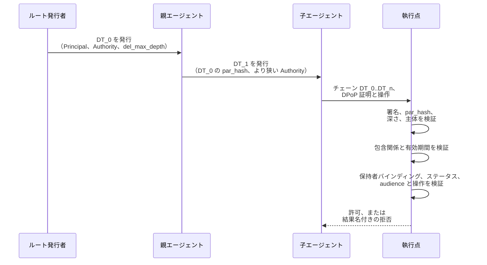

# Deep Dive: draft-asor-wimse-agent-delegation-chain-03

> 一言で言うと: エージェント間の委任ごとに、親へのハッシュによるコミットメントを持ち権限を狭めることしかできない署名付き子トークンを発行する OAuth JWT アクセストークンのプロファイルであり、執行点は認可サーバーを呼び出さずにチェーン全体を検証できる。

## 概要

Section 1 によると、AI エージェントはタスクを分割して他のエージェントに副タスクを委任するため、本番環境では深さが 2 を超える委任チェーンが生じる。このドラフトの不変条件は、任意のホップで行使される権限は、そのホップに委任したホップで付与された権限の部分集合でなければならず（MUST）、そのことを執行点が認可サーバーに問い合わせずに検証できなければならない（MUST）、というものである。ドラフトは、OAuth Token Exchange（RFC 8693）では入れ子の "act" クレームが監査用の履歴にすぎず、各ホップで通常は認可サーバーに接続するため、これを満たせないと主張している（Section 1.1）。仕組みは Delegation Token（DT）である。これは RFC 9068 の JWT であり、スコープと制約を持つ RFC 9396 の "agent_delegation" 認可詳細を 1 つ運び、全ホップで同一の責任主体（Principal）を示す "sub"、動作するエージェントを示す "client_id"、保持者の鍵を示す "cnf"、親の JWS Signing Input の SHA-256 である "par_hash" を持つ（Section 3、4、5）。8 段階の検証アルゴリズムが、署名、リンク、深さ、主体の不変性、包含関係、時刻、保持者バインディング、失効、最後に操作そのものを検査する（Section 6）。Abstract は、新しい暗号を導入しないと述べている。これは個人提出の Internet-Draft である。名前は draft-ietf-wimse- ではなく draft-asor- で始まり、ヘッダーは WIMSE を挙げて「Intended status: Standards Track」としている。このリポジトリの Datatracker データ（2026-11-17 収集）は、これを WIMSE の関連ドラフトとして挙げており、ワーキンググループが採択したドラフトには含めていない。

## 仕組み

1. ルート発行者がルート鍵で DT_0 を発行する。"sub" に Principal を、"del_depth" に 0 を設定し、"del_max_depth" と初期の Authority を設定する（Section 3、4）。
2. 各委任元が、同じ "sub"、1 増やした "del_depth"、親の署名入力の正確なバイト列に対する "par_hash"、親より遅くない "exp"、Section 4.3 の規則で親の部分集合となる Authority を持つ子トークンを発行する（Section 5）。
3. 動作する必要のあるエージェントが、DT_0 から DT_n までのチェーンと、リクエストに束縛された DPoP 証明を提示する（Section 6、7）。
4. 執行点は、自身が持つ許可アルゴリズムの一覧で署名を検証し（DT_0 は信頼するルート鍵で検証する）、次に各 "par_hash"、深さ、主体の不変性を検証する（ステップ 1 から 3）。
5. 各ホップの Authority を親と照合し（ステップ 4）、now が exp 未満であることと、exp がチェーンに沿って増えないことを含めて有効期間を確認する（ステップ 5）。
6. DPoP による保持者バインディングを検証し（ステップ 6）、キャッシュされた Token Status List を参照して、存在するステータス参照の状態が不明なら拒否する（ステップ 7）。
7. 最後に audience と操作を DT_n に対して検査する。累積制約は、リクエストとは別の経路で検査に届く累積値に対して評価する（ステップ 8）。検証者は、拒否を、失敗した検査に Table 2 が与える名前で報告すべきである（SHOULD、Section 6.2）。

## ユースケース

- 計画エージェントが、1 回あたりの "max_rows" をより小さくし有効期限をより短くして、読み取り専用の副タスクをワーカーエージェントに委任する。ツールの前段にあるゲートウェイは、その狭まりをオフラインで検査する（Section 4.2、4.3）。
- 監査者や発行者が、リクエストを持たずにステップ 1 から 5 と 7 を実行して記録済みのチェーンを再検査し、実施しなかったステップを報告する（Section 6.1）。
- 配備環境が、チェーンだけでは兄弟の消費量を見られないため、"max_subtree" に加えて、検査と引き落としをアトミックに行う共有台帳か単一書き込み者の割り当て器を用いて、親の子全体を集計予算内に収める（Section 9.4）。
- 配備環境が、認可サーバーによるアクターの記録と、オフラインで検査可能な権限の上限との両方を得るために、Delegation Chain と並べて OAuth の "act" チェーンを運ぶ（Section 1.2）。
- リソースサーバーが、保護リソースメタデータで実装する認可詳細の型を宣言し、発行者がどのチェーンを受理されるかを知れるようにする（Section 4.4）。

## なぜ今重要か

- **きっかけ**: ietf-wimse トラックの候補一覧に「Review related draft: draft-asor-wimse-agent-delegation-chain-03」があり、そのトリアージのメモは、委任元に束縛されたチェーンのドラフトがこのドラフトの Delegation Token 形式を拡張し、その束縛をこの形式に含めるべきかを問うている。そのドラフトは draft-nandakumar-wimse-delegator-bound-chains-00（2026 年 11 月 16 日）である。このドラフトの -03 を [DELEGATION-TOKENS] として引き、Delegation Token に 5 つの要素を足す、と述べている。委任元への束縛、発信者の仮名、循環の検出、audience の縮小、コンテキストへの束縛である（Section 1）。
- **根拠となる資料**: リビジョン 03 の日付は 2026 年 10 月 27 日で、有効期限は 2027 年 4 月 30 日である。Section 1.2（OAuth の actor ドラフトとの関係）、Principal の資格に関する Table 1 の新しい行、3 つのクレーム登録を要求しなくなった Section 10 が加わり、ベクター集合は 35 ファイルから 36 ファイルに増えた（Appendix B、C と Section 11）。
- **期待される影響**: ドラフトは、draft-niyikiza-oauth-attenuating-agent-tokens および draft-coetzee-oauth-spt-txn-tokens と手法を共有し、収束を目指すと述べている（Section 1.1、Appendix A）。用意された資料には、それに関するワーキンググループの決定は示されていない。エージェントゲートウェイの実装者は、試験に使える具体的な検証順序と結果名を得られる。個人提出のドラフトであるため、ワーキンググループの採択状態はない。

## 変更点

- Section 1.2 が新設された。"act" クレームを使うドラフト（draft-mcguinness-oauth-actor-profile と draft-mw-oauth-actor-chain）は誰が動作したかを記録するのに対し、このドラフトは各ホップが何をしてよいかをチェーン内で制限する、と述べている。"act" クレームは要求せず、両者の対応付けも定義しない。この説明は両ドラフトの本文と合っている。draft-mcguinness-oauth-actor-profile-01 は "act" クレームをプロファイルし、内側の actor をアクセス制御の判断に使わない。draft-mw-oauth-actor-chain-02 の検証付きプロファイルは、actor の各段で actor proof を 1 つ作り、認可サーバーがそれを 1 回受け入れる。
- Section 6.1 に Table 1 の行と段落が追加された。Principal が DT_0 で付与された権限をなお保持しているかは、チェーンからもリクエストからも分からない。資格を知る必要がある配備環境は、ルート発行時（Section 9.7）に確認し、発行後の隙間が許容できない場合は、行使時に呼び出し経路上のオンラインサーバーで再度確認する。
- Section 6.4 は、バインディングの隙間（ルート鍵が、信頼される主体にどう結び付くか）と、記録の隙間（後の読み手がチェーンの拠り所を再構成できないこと）を区別するようになった。ルートの材料の保持については draft-gilda-audit-agent-audit-record-02 の Section 4.6、4.7、5.2（記録の検証、保持する記録、識別子と委任のフィールド）を参照し、トラストアンカーのトポロジーは強制しない。
- Section 10 は、"del_depth"、"del_max_depth"、"par_hash" の登録を要求しなくなった。draft-niyikiza-oauth-attenuating-agent-tokens が同じ名前の登録を要求しているためである。Section 10 によると、そのドラフトは "del_max_depth" をすべてのトークンで必須とし、葉の "del_depth" がルートの "del_max_depth" に等しくなることを許すが、本ドラフトのステップ 3 は未満であることを要求する。
- ステップ 5 は、RFC 7519 の JWT "exp" クレームと同じく、now が exp 未満であることを要求するようになった。-02 は now が exp に等しい場合を許していた（Appendix C）。
- Section 7 は、-02 がトランスポートをエンドツーエンドで制御できる場合に許していた mTLS バインドトークンを削除し、mTLS のプロファイルは後のリビジョンに委ねた。
- Section 4.4 は、後に複数の詳細型を認めるリビジョン向けに、Kieran Sweeney が提案した規則を記録している。親が持たない詳細型を子が加えた場合は、その型の定義が別に定めない限り拡大として扱う。-03 ではそのようなトークンは不正（malformed）であり、ベクター "reject_child_adds_detail_type" がそれを固定している。
- Appendix B は、-01 の集合が扱っていた事例がすべて新しい集合で再生成されたとは述べなくなった。"del_max_depth" が許すより長いチェーンなど一部の事例は、変更されない -01 の集合にのみ残る。新しい集合は 36 ファイルである。
- 互換性: -02 と -03 の間で、検証の挙動は now が exp に等しい境界で変わり（ステップ 5）、保持者バインディングは DPoP のみになり（Section 7）、3 つのクレーム名は niyikiza のドラフト経由でのみ登録される予定で、その "del_max_depth" の意味は異なる（Section 10）。-01 の形のチェーンのための移行モードを定義しないという記述は -02 にすでにあり、変わったのは「previous revision」から「-01」への言い回しだけである（Section 3.1）。

## 技術分析

- 脅威モデルへの含意: "par_hash" は再親付けとスプライシングを防ぐ（Section 5、9.2）。ステップ 3 の主体の不変性は、子が親と異なる "sub" を持つ場合を塞ぐ（Section 3.1）。meet に基づく権限縮小により、子は親が持たない権限を行使するよう誘導されない（Section 9.3）。DPoP による保持者バインディングは、漏えいした中間トークンを、その鍵なしでは使えなくする（Section 7）。限界は明示されている。親は縮小後も有効なままである（Section 9.1）。1 回あたりの "max" は兄弟間の消費を制限しない（Section 9.4）。失効の窓は、キャッシュされたステータス回答の有効時間に等しい（ステップ 7、Section 9.5）。Principal の現在の資格は、チェーンからもリクエストからも分からない（Table 1）。ステップ 1 は DT_0 が信頼するルート鍵で検証されることを要求するが、i が 0 より大きい DT_i をどの鍵で検証すべきかは定めておらず、Section 11 は参照実装が単一署名者の信頼モデルで動くと述べている。
- プロトコルフローへの含意: 検証は決定的で、最初の失敗で拒否する。ステップ 1 から 5 はリクエストなしで実行できる。ステップ 7 にはステータスリストが必要であり、累積制約のステップ 8 にはリクエスト外で保持される累積値が必要である。短い有効期間は、チェーン内のすべてのトークンを数えた再発行の負荷を発行者に課し、更新時に前の親インスタンスを失効させるとバーストが生じる。配備環境はこれに合わせて認可サーバーの規模を決めなければならない（MUST、Section 8、9.5）。親を再発行しても既存の子は無効にならない（Section 5）。
- 相互運用上の懸念: JCS による正規形が必須であり、重複メンバー、非有限数、単独サロゲート、絶対値が 2^53-1 を超える整数は拒否される（Section 3）。スコープはバイト列のみで分類されるため、ドット区切りのリテラルに見えるプロバイダースコープは、その接頭辞に対するワイルドカードに包含される（Section 4.1）。未知の制約型は拒否側（fail closed）で扱われる（Section 4.2）。"agent_delegation" を実装する 2 つの検証者は同じ包含関係を適用するが、スコープの動詞の解釈が異なることがある（Section 4.4、4.5）。Section 11 によると、参照実装は、Section 3 が要求する RFC 9864 の完全指定の "Ed25519" ではなく、なお "EdDSA" を使い、ステップ 6 もステップ 7 も実施しない。

## 未解決の問題

- "agent_delegation" の型の値を、衝突しにくい名前空間の URI 形式の値に移すべきか。ドラフトは未決としている（Section 4.4）。
- 複数の詳細型を持つチェーン、および型を追加する子はどう定義すべきか。提案されている拡大の規則は、後のリビジョン向けに記録されているにすぎない（Section 4.4）。
- スコープの語彙: 包含関係は構文的であり、ドラフトは共通の動詞のレジストリもプロファイルも提供せず、補完文書がそれを担うことを想定している（Section 4.5）。
- トラストアンカーの出所: 検証者がどのようにルート鍵を入手し信頼するかは未決として記録されており、著者はワーキンググループが扱うべきだと考えている（Section 6.4）。
- ルート発行時と行使時に Principal の資格をどう確認するか、およびオンラインの Delegation Server が委任ツリーの状態以外に何を検査するかは、配備環境に委ねられている（Section 6.1、6.4）。
- "del_depth"、"del_max_depth"、"par_hash" の登録を、"del_max_depth" の意味が異なる draft-niyikiza-oauth-attenuating-agent-tokens とどう調整して 1 つにするか（Section 10）。どちらかの定義が変わるかどうかは、ドラフトに記載されていない。
- 再発行をまたいで存続する親の識別子を設けるべきか。ドラフトは定義していない（Section 5）。
- "act" チェーンと Delegation Chain に定義された対応付けを設けるべきかは、現状では定義がなく、未決である（Section 1.2）。
- ドラフトは、委任元に束縛されたチェーンを扱うかどうか、またそのような束縛がこのトークン形式に属するかどうかを述べていない。draft-nandakumar-wimse-delegator-bound-chains-00 は、技術分析で触れたステップ 1 の点を対象にしている。その Section 1 は、このドラフトの検証者はルート以外のすべてのトークンの署名を確かめるが「子トークンをどの鍵で署名すべきかは仕様に書かれていない」と述べる。委任元への束縛（Section 3）は、各子トークンを親トークンが確認する鍵で署名することを要求する。

## 実験

- [x] Lab 1: 参照ベクターまたは独自の発行コードで 3 ホップのチェーンを作り、ステップ 1 から 5 のみを実行して、Table 2 の各結果名（not_narrower、principal_altered、par_hash_mismatch、expired）を確認する。-03 が拒否する now が exp に等しい境界の事例も含める。2026 年 11 月 18 日に実施（検証ログを参照）: `vectors/three_hop.py` で 17 事例すべてが期待どおりの結果名になり、now が exp に等しいときは expired、-02 の規則では受理になった。`vectors/verify_vectors.py` はステップ 6、7、ステップ 8 のアクションの検査を行わずに Appendix B の 36 本すべてと一致した。
- [x] Lab 2: ルートの "max" を 100、2 つの子を 60 として、Section 9.4 の 2 ゲートウェイでの過剰消費を再現し、次に共有のアトミックな台帳または単一書き込み者の割り当て器を加えて、各ハザードがどこに現れるかを確認する。2026 年 11 月 18 日にプロセス内のモデル `vectors/overspend.py` で実施: 集計なしでは 100 に対して 120 を消費し、不可分の台帳では 60、ハザードは、100 の予算から 120 の割り当て（重複割り当て）、60 の割り当てに対して 120 の許可（ローカルなロールバック）、40 の割り当てに対して 80 の許可（早すぎる再利用）として再現した。
- [x] Lab 3: 同じ深さの値（葉の "del_depth" がルートの "del_max_depth" に等しい）を、このドラフト向けの検証者と draft-niyikiza-oauth-attenuating-agent-tokens-02 向けの検証者に与え、結果が食い違う箇所を記録する（本ドラフトの Section 10、および child.del_depth が parent.del_max_depth 以下であることを許す niyikiza のドラフトの Section 4.3 と 8）。2026 年 11 月 18 日に深さの検査だけを `vectors/depth_rules.py` で実施: 格子 49 マス中 7 マスが食い違い、すべて葉の深さがルートの上限に等しいマスだった。名前付きの事例では、ルートの上限 0、クレームを持たない子、下げた子の上限、8 を超えるルートの上限でも食い違った。

## 出典

- [draft-asor-wimse-agent-delegation-chain-03](https://datatracker.ietf.org/doc/draft-asor-wimse-agent-delegation-chain/03/)
- [draft-asor-wimse-agent-delegation-chain-02](https://datatracker.ietf.org/doc/draft-asor-wimse-agent-delegation-chain/02/)（-03 との差分を取った）
- [attenu-io/attenu-guard](https://github.com/attenu-io/attenu-guard) と [attenu-io/attenu-guard-ts](https://github.com/attenu-io/attenu-guard-ts)（Section 11 が挙げる参照実装）
- [draft-niyikiza-oauth-attenuating-agent-tokens-02、tenuo-ai/tenuo 内の写し](https://github.com/tenuo-ai/tenuo/blob/main/ietf/draft-niyikiza-oauth-attenuating-agent-tokens-02.txt)
- [draft-nandakumar-wimse-delegator-bound-chains-00](https://datatracker.ietf.org/doc/draft-nandakumar-wimse-delegator-bound-chains/00/)
