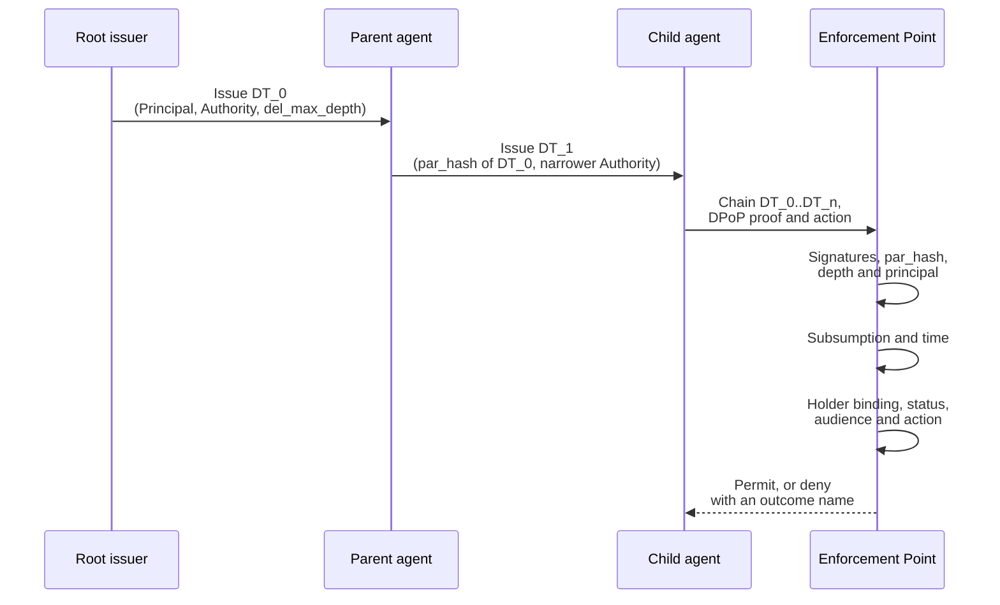

# Deep Dive: draft-asor-wimse-agent-delegation-chain-03

> In one line: a profile of OAuth JWT access tokens in which each agent-to-agent delegation is a signed child token that commits to its parent by hash and may only narrow authority, so an enforcement point can verify the whole chain without calling an authorization server.

## What this is

Section 1 says that AI agents decompose tasks and delegate sub-tasks to other agents, and that production deployments therefore produce delegation chains of depth greater than two. The draft's invariant is that the authority exercised at any hop MUST be a subset of the authority granted at the hop that delegated to it, and that this MUST be verifiable by the enforcement point without contacting an authorization server. It argues that OAuth Token Exchange (RFC 8693) does not do this, because the nested "act" claim is audit history and Token Exchange normally contacts the authorization server at each hop (Section 1.1). The mechanism is a Delegation Token (DT): an RFC 9068 JWT carrying one RFC 9396 "agent_delegation" authorization detail with scopes and constraints, a "sub" naming the accountable Principal that is identical at every hop, a "client_id" naming the acting agent, a "cnf" holder key, and a "par_hash" that is the SHA-256 of the parent's JWS Signing Input (Sections 3, 4, 5). An eight-step verification algorithm checks signatures, linkage, depth, principal invariance, subsumption, time, holder binding, revocation and finally the action itself (Section 6). The abstract says the draft introduces no new cryptography. It is an individual Internet-Draft: the name is draft-asor-, not draft-ietf-wimse-, and the header names WIMSE with "Intended status: Standards Track". The repository's Datatracker data (collected 2026-11-17) lists it among WIMSE related drafts, not among the working group's adopted drafts.

## How it works

1. The root issuer mints DT_0 under a root key. It sets "sub" to the Principal, "del_depth" to 0, "del_max_depth", and the initial Authority (Sections 3, 4).
2. Each delegator mints a child token with the same "sub", "del_depth" incremented, "par_hash" over the parent's exact signing input, an "exp" no later than the parent's, and an Authority that is a subset of the parent's under the rules of Section 4.3 (Section 5).
3. The agent that needs to act presents the chain DT_0 to DT_n together with a DPoP proof bound to the request (Sections 6, 7).
4. The Enforcement Point verifies signatures against its own accepted-algorithm list, with DT_0 under a trusted root key, then each "par_hash", then depth and principal invariance (steps 1 to 3).
5. It checks each hop's Authority against its parent's (step 4) and the validity window with now less than exp, plus non-increasing exp along the chain (step 5).
6. It verifies holder binding by DPoP (step 6) and consults the cached Token Status List, denying when a present status reference is unknown (step 7).
7. Finally it checks the audience and the action against DT_n, including cumulative constraints against a running total that reaches the check through a channel separate from the request (step 8). A verifier SHOULD report each denial under the name Table 2 gives for the failed check (Section 6.2).

## Use cases

- A planner agent delegates a read-only sub-task to a worker agent with a lower per-action "max_rows" and a shorter expiry, and the gateway in front of the tool checks the narrowing offline (Sections 4.2, 4.3).
- An auditor or issuer with no request re-checks a recorded chain by running steps 1 to 5 and 7, and reports which steps it did not perform (Section 6.1).
- A deployment holds a parent's children to an aggregate budget with "max_subtree" plus either a shared ledger that checks and debits atomically or a single-writer allocator, because the chain alone cannot see a sibling's spend (Section 9.4).
- A deployment carries a chain beside an OAuth "act" chain so it has both an authorization server's record of actors and an offline-checkable authority bound (Section 1.2).
- A resource server declares the authorization detail types it implements in protected resource metadata so issuers know which chains it accepts (Section 4.4).

## Why This Matters Now

- **Trigger**: The ietf-wimse track's candidate list has "Review related draft: draft-asor-wimse-agent-delegation-chain-03", with a triage note that the delegator-bound chains draft extends this draft's Delegation Tokens format and asks whether binding belongs in it. That draft is draft-nandakumar-wimse-delegator-bound-chains-00 (16 November 2026). It cites this draft's -03 as [DELEGATION-TOKENS] and says it "extends Delegation Tokens with five things": delegator binding, an originator pseudonym, cycle detection, audience attenuation and context binding (Section 1).
- **Source evidence**: revision 03 is dated 27 October 2026 and expires 30 April 2027. It adds Section 1.2 on the OAuth actor drafts, a Table 1 row on the Principal's standing, a Section 10 that no longer requests the three claim registrations, and a vector set that grows from thirty-five to thirty-six files (Appendices B, C and Section 11).
- **Expected impact**: the draft says it shares its approach with, and is intended to converge with, draft-niyikiza-oauth-attenuating-agent-tokens and draft-coetzee-oauth-spt-txn-tokens (Section 1.1, Appendix A); nothing in the staged material shows a working-group decision on that. Implementers of agent gateways get a concrete verification order and outcome names to test against. As an individual draft it has no working-group adoption state.

## What Changed

- Section 1.2 is new. It says the "act"-claim drafts (draft-mcguinness-oauth-actor-profile and draft-mw-oauth-actor-chain) record who acted, while this draft bounds what each hop may do inside the chain. It requires no "act" claim and defines no mapping between the two. That description matches the drafts themselves: draft-mcguinness-oauth-actor-profile-01 profiles the "act" claim and keeps inner actors out of access-control decisions, and the verified profiles of draft-mw-oauth-actor-chain-02 create one actor proof and one authorization-server acceptance at every actor step.
- Section 6.1 gains a Table 1 row and a paragraph: nothing in the chain or the request shows that the Principal still holds the authority granted at DT_0. A deployment that must know standing checks it at root issuance (Section 9.7) and, where the gap after minting is unacceptable, again at exercise by an online server in the call path.
- Section 6.4 now separates the binding gap (how the root key is bound to the party it is trusted as) from the recording gap (a later reader cannot reconstruct what the chain rested on). It points to Sections 4.6, 4.7 and 5.2 of draft-gilda-audit-agent-audit-record-02 (verifying a record, retained records, and the identity and delegation fields) for retaining root material, and mandates no trust-anchor topology.
- Section 10 no longer requests registration of "del_depth", "del_max_depth" and "par_hash", because draft-niyikiza-oauth-attenuating-agent-tokens requests the same names. According to Section 10, that draft requires "del_max_depth" in every token and allows a leaf's "del_depth" to equal the root's "del_max_depth", while step 3 here requires it to be less.
- Step 5 now requires now less than exp, as the JWT "exp" claim of RFC 7519 does; the -02 text allowed now equal to exp (Appendix C).
- Section 7 drops mTLS-bound tokens, which -02 allowed where the transport is controlled end-to-end, and leaves an mTLS profile to a later revision.
- Section 4.4 records, for a later multi-type revision, Kieran Sweeney's proposed rule that a child adding a detail type its parent lacked is treated as widening unless that type's definition states otherwise. Under -03 such a token is malformed, and the vector "reject_child_adds_detail_type" pins that.
- Appendix B no longer claims the -01 set's coverage is re-minted in the new set. Some cases, such as a chain longer than "del_max_depth" allows, stay only in the unchanged -01 set. The new set has thirty-six files.
- Compatibility: between -02 and -03 verification behavior changes at the now equal to exp boundary (step 5), holder binding is DPoP only (Section 7), and the three claim names are to be registered only through the niyikiza draft, whose "del_max_depth" semantics differ (Section 10). The statement that -03 defines no transition mode for chains shaped by the -01 was already in -02; only its wording changed from "previous revision" to "-01" (Section 3.1).

## Technical Analysis

- Threat model implications: "par_hash" prevents re-parenting and splicing (Sections 5, 9.2). Principal invariance in step 3 closes the case where a child carries a different "sub" (Section 3.1). Meet-based attenuation means a child cannot be induced to exercise authority the parent lacked (Section 9.3). Holder binding by DPoP makes a leaked intermediate token unusable without its key (Section 7). The limits are stated openly: parents stay valid after attenuation (Section 9.1), per-action "max" does not bound sibling spend (Section 9.4), the revocation window equals the cached status answer's time to live (step 7, Section 9.5), and neither the chain nor the request shows the Principal's current standing (Table 1). Step 1 requires DT_0 to verify under a trusted root key but names no key that DT_i with i greater than 0 must verify under, and Section 11 says the reference libraries run under a single-signer trust model.
- Protocol flow implications: verification is deterministic and denies on the first failure, with steps 1 to 5 runnable without a request. Step 7 needs a status list, and step 8 needs a running total held outside the request for cumulative constraints. Short lifetimes push re-issuance load onto the issuer, counted across every token in a chain, with a burst if the previous parent instance is revoked at refresh, and a deployment MUST size its authorization server for it (Sections 8, 9.5). Re-issuing a parent does not invalidate existing children (Section 5).
- Interop concerns: JCS canonical form is mandatory, with rejection of duplicate members, non-finite numbers, lone surrogates and integers whose magnitude exceeds 2^53-1 (Section 3). Scope classification is by bytes alone, so a provider scope that looks like a dotted literal is covered by a wildcard over its prefix (Section 4.1). Unknown constraint types fail closed (Section 4.2). Two verifiers implementing "agent_delegation" apply the same covering relation but may read scope verbs differently (Sections 4.4, 4.5). Section 11 says the reference libraries still use "EdDSA" rather than the fully specified "Ed25519" of RFC 9864 that Section 3 requires, and perform neither step 6 nor step 7.

## Open Questions

- Should the "agent_delegation" type value move to a URI-form value under a collision-resistant namespace? The draft leaves it open (Section 4.4).
- How should chains with several detail types and a child that adds a type be defined? The proposed widening rule is recorded for a later revision only (Section 4.4).
- Scope vocabulary: subsumption is syntactic, and the draft supplies neither a registry nor a profile of common verbs, expecting a companion document to do so (Section 4.5).
- Trust-anchor provenance: how a verifier comes to hold and trust a root key is recorded as open, and the author's view is that it belongs to the working group (Section 6.4).
- How a deployment checks Principal standing at root issuance and at exercise, and what an online Delegation Server inspects beyond delegation-tree state, are left to the deployment (Sections 6.1, 6.4).
- How should the single registration of "del_depth", "del_max_depth" and "par_hash" be reconciled with draft-niyikiza-oauth-attenuating-agent-tokens, given the differing "del_max_depth" semantics (Section 10)? The draft does not say whether either definition will change.
- Should a parent identity that survives re-issuance exist? The draft defines none (Section 5).
- Whether an "act" chain and a Delegation Chain should have a defined mapping is left open, since none is defined (Section 1.2).
- The draft does not say whether it will carry delegator-bound chains or whether such binding belongs in this token format. draft-nandakumar-wimse-delegator-bound-chains-00 targets the step 1 point noted under Technical Analysis. Its Section 1 says this draft's verifier checks the signature of every non-root token "but the specification does not say which key must sign a child token", and its delegator binding (Section 3) requires each child token to be signed with the key confirmed by its parent token.

## Experiments

- [x] Lab 1: build a three-hop chain with the reference vectors or your own minting code, then run steps 1 to 5 only and confirm each Table 2 outcome name (not_narrower, principal_altered, par_hash_mismatch, expired). Include the boundary case now equal to exp, which -03 denies. Done on 18 November 2026 (see the hands-on log): 17 of 17 cases gave the expected name with `vectors/three_hop.py`, now equal to exp gives expired and the -02 rule accepts it, and `vectors/verify_vectors.py` matched all 36 Appendix B vectors without performing steps 6, 7 or the action check of step 8.
- [x] Lab 2: reproduce the two-gateway overspend of Section 9.4 with a root "max" of 100 and two children at 60, then add a shared atomic ledger or a single-writer allocator and see where each hazard appears. Done on 18 November 2026 with `vectors/overspend.py`, an in-process model: 120 spent against 100 without accounting, 60 with an atomic ledger, and the hazards reproduced as 120 units allocated from a budget of 100 (duplicate allocation), 120 honored against an allocation of 60 (local rollback) and 80 honored against an allocation of 40 (premature reuse).
- [x] Lab 3: feed the same depth values to a verifier built for this draft and one built for draft-niyikiza-oauth-attenuating-agent-tokens-02 (a leaf "del_depth" equal to the root's "del_max_depth") and record where they disagree (Section 10 here; Sections 4.3 and 8 of the niyikiza draft, which allow child.del_depth up to parent.del_max_depth). Done on 18 November 2026 with `vectors/depth_rules.py`, depth checks only: 7 of 49 grid cells disagree, all with leaf depth equal to the root bound, and the named cases add a root bound of 0, children without the claim, a lowered child bound and a root bound above 8.
- [x] Lab 4: implement the remaining steps of Section 6 on a minted chain: step 6 (a DPoP proof per RFC 9449 bound to DT_n's "cnf"), step 7 (a cached Token Status List, where unknown status denies and a token without a status reference passes) and the action part of step 8 (scope, per-action constraints, cumulative constraints against a total supplied outside the request, unknown types failing closed). Done on 18 November 2026 with `vectors/full_verify.py`: 52 of 52 cases gave the expected outcome name (some of them names this lab chose, listed in the hands-on log), and `valid_unknown_constraint_identical.json` passes steps 1 to 5 but denies a sample action with unknown_constraint. Table 2 has no name for some outcomes (for example a missing running total, a quantity the action does not state, a "suspended" status, a status reference without a usable index), and the -03 leaves open which token the DPoP "ath" covers and which claim carries the status reference; the hands-on log lists the choices made. The 52 of 52 is not a conformance result: step 7 runs against an in-memory list, not a signed status list token.

## Sources

- [draft-asor-wimse-agent-delegation-chain-03](https://datatracker.ietf.org/doc/draft-asor-wimse-agent-delegation-chain/03/)
- [draft-asor-wimse-agent-delegation-chain-02](https://datatracker.ietf.org/doc/draft-asor-wimse-agent-delegation-chain/02/) (diffed against -03)
- [attenu-io/attenu-guard](https://github.com/attenu-io/attenu-guard) and [attenu-io/attenu-guard-ts](https://github.com/attenu-io/attenu-guard-ts) (reference implementations named in Section 11)
- [draft-niyikiza-oauth-attenuating-agent-tokens-02, copy in tenuo-ai/tenuo](https://github.com/tenuo-ai/tenuo/blob/main/ietf/draft-niyikiza-oauth-attenuating-agent-tokens-02.txt)
- [draft-nandakumar-wimse-delegator-bound-chains-00](https://datatracker.ietf.org/doc/draft-nandakumar-wimse-delegator-bound-chains/00/)
