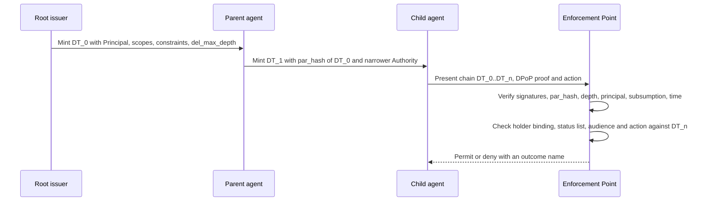

# Deep Dive: draft-asor-wimse-agent-delegation-chain-03

> In one line: a profile of OAuth JWT access tokens in which each agent-to-agent delegation is a signed child token that commits to its parent by hash and may only narrow authority, so an enforcement point can verify the whole chain without calling an authorization server.

## What this is

AI agents split tasks and hand sub-tasks to other agents, so delegation chains of depth greater than two are common (Section 1). The draft's invariant is that the authority exercised at any hop MUST be a subset of what the delegating hop held, and that the enforcement point MUST be able to verify this without contacting an authorization server. It argues that OAuth Token Exchange (RFC 8693) does not do this, because the nested "act" claim is audit history and Token Exchange normally contacts the authorization server at each hop (Section 1.1). The mechanism is a Delegation Token (DT): an RFC 9068 JWT carrying one RFC 9396 "agent_delegation" authorization detail with scopes and constraints, a "sub" naming the accountable Principal that is identical at every hop, a "client_id" naming the acting agent, a "cnf" holder key, and a "par_hash" that is the SHA-256 of the parent's JWS Signing Input (Sections 3, 4, 5). An eight-step verification algorithm checks signatures, linkage, depth, principal invariance, subsumption, time, holder binding, revocation and finally the action itself (Section 6). The draft says it introduces no new cryptography and is a Standards Track document in the WIMSE working group.

## How it works

1. The root issuer mints DT_0 under a root key. It sets "sub" to the Principal, "del_depth" to 0, "del_max_depth", and the initial Authority (Sections 3, 4).
2. Each delegator mints a child token with the same "sub", "del_depth" incremented, "par_hash" over the parent's exact signing input, and an Authority that is a subset of the parent's under the covering rules of Section 4.3 (Section 5).
3. The agent that needs to act presents the chain DT_0 to DT_n together with a DPoP proof bound to the request (Sections 6, 7).
4. The Enforcement Point verifies signatures against its own accepted-algorithm list and trusted root key, then each "par_hash", then depth and principal invariance (steps 1 to 3).
5. It checks each hop's Authority against its parent's (step 4) and the validity window with now less than exp (step 5).
6. It verifies holder binding by DPoP (step 6) and consults the cached Token Status List, denying when a status is unknown (step 7).
7. Finally it checks the audience and the action against DT_n, including cumulative constraints through a total held outside the request (step 8). Denials use the names of Table 2 in Section 6.2.

## Use cases

- A planner agent delegates a read-only sub-task to a worker agent with a lower per-action "max_rows" and a shorter expiry, and the gateway in front of the tool checks the narrowing offline (Sections 4.2, 4.3).
- An auditor or issuer with no request re-checks a recorded chain by running steps 1 to 5 and 7, and reports which steps it did not perform (Section 6.1).
- A deployment bounds a fan-out of children with "max_subtree" and a shared ledger or a single-writer allocator, because the chain alone cannot see a sibling's spend (Section 9.4).
- A deployment carries a chain beside an OAuth "act" chain so it has both an authorization server's record of actors and an offline-checkable authority bound (Section 1.2).
- A resource server declares the authorization detail types it implements in protected resource metadata so issuers know which chains it accepts (Section 4.4).

## Why This Matters Now

- **Trigger**: `subject.json` lists this as "Review related draft: draft-asor-wimse-agent-delegation-chain-03". Its ai_note says the delegator-bound chains draft extends this draft's Delegation Tokens format and asks whether binding belongs in it.
- **Source evidence**: revision 03 is dated 27 October 2026 and expires 30 April 2027. It adds Section 1.2 on the OAuth actor drafts, a Table 1 row on the Principal's standing, a Section 10 that no longer requests the three claim registrations, and a 36-file test-vector set (Appendices B, C and Section 11).
- **Expected impact**: the draft appears to be converging with the OAuth attenuating-token work while staying a WIMSE document. Implementers of agent gateways get a concrete verification order and outcome names to test against. The draft does not say what working-group status it has, and `subject.json` lists no Datatracker states.

## What Changed

- Section 1.2 is new. It says the "act"-claim drafts (draft-mcguinness-oauth-actor-profile and draft-mw-oauth-actor-chain) record who acted, while this draft bounds what each hop may do inside the chain. It requires no "act" claim and defines no mapping between the two.
- Section 6.1 gains a Table 1 row and a paragraph: nothing in the chain or the request shows that the Principal still holds the authority granted at DT_0. Standing is to be checked at root issuance (Section 9.7) and, where the gap after minting is unacceptable, by an online server at exercise.
- Section 6.4 now separates the binding gap (how the root key is bound to the party it is trusted as) from the recording gap (a later reader cannot reconstruct what the chain rested on). It points to Sections 4.6, 4.7 and 5.2 of draft-gilda-audit-agent-audit-record for retaining root material, and mandates no trust-anchor topology.
- Section 10 no longer requests registration of "del_depth", "del_max_depth" and "par_hash", because draft-niyikiza-oauth-attenuating-agent-tokens requests the same names. The two define "del_max_depth" differently: the other draft allows a leaf's "del_depth" to equal the root's "del_max_depth", while step 3 here requires it to be less.
- Step 5 now requires now less than exp instead of less than or equal, matching RFC 7519.
- Section 7 drops mTLS-bound tokens as an alternative to DPoP and leaves an mTLS profile to a later revision.
- Section 4.4 records, for a later multi-type revision, a rule that a child adding a detail type its parent lacked is treated as widening. Under -03 such a token is malformed, and the vector "reject_child_adds_detail_type" pins that.
- Appendix B no longer claims the -01 vectors are all re-minted. Some cases stay only in the unchanged -01 set. The new set has 36 files.
- Compatibility: -03 defines no transition mode for -01-shaped chains, and tokens without "client_id" or "cnf", or with a null "aud", are malformed (Section 3.1). A verifier that must accept -02 chains needs a separate rule for the now equal to exp boundary. A deployment relying on the claim registrations in -02 must now follow the other draft's registration and reconcile "del_max_depth".

## Technical Analysis

- Threat model implications: "par_hash" prevents re-parenting and splicing (Sections 5, 9.2). Principal invariance in step 3 closes the case where a child carries a different "sub" (Section 3.1). Meet-based attenuation limits confused-deputy escalation (Section 9.3). Holder binding by DPoP makes a leaked intermediate token unusable without its key (Section 7). The limits are stated openly: parents stay valid after attenuation (Section 9.1), per-action "max" does not bound sibling spend (Section 9.4), revocation latency equals the status-list time to live (Section 9.5), and neither the chain nor the request shows the Principal's current standing (Table 1).
- Protocol flow implications: verification is deterministic and denies on the first failure, with steps 1 to 5 runnable without a request. Step 7 needs a status list, and step 8 needs a running total held outside the request for cumulative constraints. Short lifetimes push re-issuance load onto the issuer, counted across every token in a chain, with a burst if the previous parent instance is revoked at refresh (Sections 8, 9.5). Re-issuing a parent does not invalidate existing children (Section 5).
- Interop concerns: JCS canonical form is mandatory, with rejection of duplicate members, non-finite numbers, lone surrogates and integers above 2^53-1 (Section 3). Scope classification is by bytes alone, so a provider scope that looks like a dotted literal is covered by a wildcard over its prefix (Section 4.1). Unknown constraint types fail closed (Section 4.2). Two verifiers implementing "agent_delegation" apply the same covering relation but may read scope verbs differently (Section 4.5). Reference libraries still use "EdDSA" rather than the fully specified "Ed25519" of RFC 9864 that Section 3 requires, and perform neither step 6 nor step 7 (Section 11).

## Open Questions

- Should the "agent_delegation" type value move to a URI-form value under a collision-resistant namespace? The draft leaves it open (Section 4.4).
- How should chains with several detail types and a child that adds a type be defined? The proposed widening rule is recorded for a later revision only (Section 4.4).
- Scope vocabulary: subsumption is syntactic, and the draft supplies neither a registry nor a profile of common verbs (Section 4.5).
- Trust-anchor provenance: how a verifier comes to hold and trust a root key is left to the working group (Section 6.4).
- Where Principal standing is checked, and what an online Delegation Server inspects beyond delegation-tree state, is left to the deployment (Sections 6.1, 8).
- How should the single registration of "del_depth", "del_max_depth" and "par_hash" be reconciled with draft-niyikiza-oauth-attenuating-agent-tokens, given the differing "del_max_depth" semantics (Section 10)? The draft does not say whether the other draft will change.
- Should a parent identity that survives re-issuance exist? The draft defines none (Section 5).
- Whether an "act" chain and a Delegation Chain should have a defined mapping is left open, since none is defined (Section 1.2).
- The draft does not say whether it will carry delegator-bound chains or whether such binding belongs in this token format, which is the question in the `subject.json` ai_note.

## Experiments

- [ ] Lab 1: build a three-hop chain with the reference vectors or your own minting code, then run steps 1 to 5 only and confirm each Table 2 outcome name (not_narrower, principal_altered, par_hash_mismatch, expired). Include the boundary case now equal to exp, which -03 denies.
- [ ] Lab 2: reproduce the two-gateway overspend of Section 9.4 with a root "max" of 100 and two children at 60, then add a shared atomic ledger or a single-writer allocator and see where each hazard appears.
- [ ] Lab 3: feed the same depth values to a verifier built for this draft and one built for draft-niyikiza-oauth-attenuating-agent-tokens (a leaf "del_depth" equal to the root's "del_max_depth") and record where they disagree (Section 10).

## Sources

- [draft-asor-wimse-agent-delegation-chain-03](https://datatracker.ietf.org/doc/draft-asor-wimse-agent-delegation-chain/03/)
