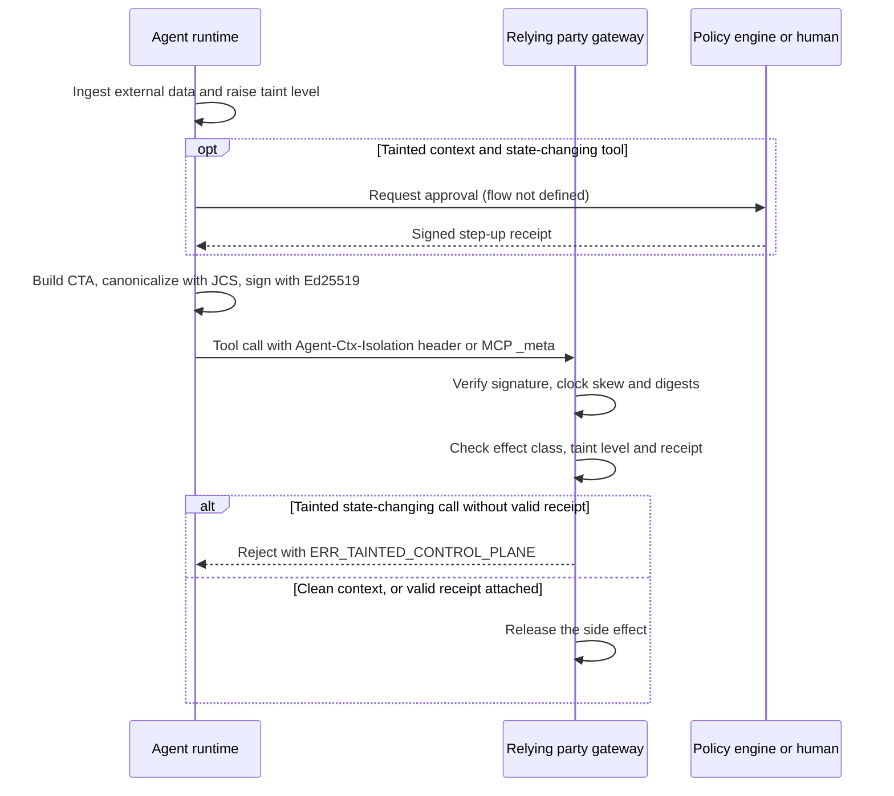

# Deep Dive: draft-durga-wimse-ctx-isolation

> 一言で言うと: AI エージェントのすべてのツール呼び出しに署名付きのテイント証明を付け、信頼できないコンテキスト由来の状態変更呼び出しを、独立した承認レシートがない限り依存当事者が拒否する方式である。

## 概要

Model Context Protocol (MCP) や Agent-to-Agent (A2A) のトランスポートを使う自律型 AI エージェントは、電子メール、Web 文書、RAG で取得したチャンクなどの信頼できないデータを、特権的なツール呼び出しを決めるのと同じ推論コンテキストに取り込む（Abstract）。Section 1 は、こうした入力の例として、第三者の文書、Webhook、未検証のピアエージェントの出力を挙げる。本ドラフトによれば、こうした標準はクライアントの ID と認可スコープを結び付ける（Abstract）が、OAuth 2.0 Token Exchange（RFC 8693）も WIMSE Workload Identity Token も、ツールを選んだ時点のコンテキストウィンドウのテイントへの暗号学的なコミットメントを持たない（Section 1）。そこで、テイントレベル、ツール効果クラス、コンテキスト上のマークルルートを含み、Ed25519 で署名した JSON オブジェクトである Context Taint Attestation (CTA) を提案する（Section 3）。CTA は `Agent-Ctx-Isolation` ヘッダー、または JSON-RPC/MCP の `_meta.ctxIsolation` オブジェクトで運ばれる（Section 3）。依存当事者は、`TRUSTED_ONLY` でない状態変更呼び出しまたは特権呼び出しを、独立したポリシー決定エンジンまたは人間による有効なステップアップレシートが付かない限り、フェイルクローズで拒否しなければならない（Section 4）。ドラフトは 5 ページの個人提出で、Datatracker 上はどのワーキンググループにも採択されておらず、問題の提示と最小限のワイヤフォーマットの骨格の段階にある。

## 仕組み

1. ランタイムは有効なコンテキストのテイントレベルを追跡する。未検証の外部由来のバイトを一つでも取り込んだら、暗号学的なコンテキストリセット境界を実行しない限り、そのコンテキストセッションの残りの間、ランタイムはレベルを `TRUSTED_ONLY` から `MIXED_TAINT` または `UNTRUSTED_INGESTED` に移さなければならない（MUST、Section 4、規則 1）。
2. ランタイムは、制御プレーンのツール呼び出しごとに、`invocation_id`、`parent_trace_ref`、`system_prompt_digest`、`data_plane_merkle_root`、`taint_lattice_level`、`tool_effect_class`、`step_up_receipt_hash`、`iat`、`exp`、`signature` メンバーを持つ CTA を作る（Section 3）。ドラフトはどのフィールドも省略可能とは書いていない。例は `UNTRUSTED_INGESTED` と `STATE_MUTATING` に `step_up_receipt_hash` を組み合わせており、承認済みの場合を示している。
3. CTA は RFC 8785 JCS または RFC 8949 Deterministic CBOR で直列化する（Section 3）。ただし Section 5 は、Ed25519 の署名生成と検証の前に JCS で正規化することを求める。署名した CTA を呼び出しに添付する。
4. 依存当事者は署名を検証する。60 秒を超える時計のずれ、ダイジェストの不一致、暗号学的バインディングの欠落があれば、フェイルクローズにして監査可能なセキュリティ拒否レシートを出さなければならない（MUST、Section 5）。
5. `tool_effect_class` が `STATE_MUTATING` または `PRIVILEGED_ACTUATE` で、`taint_lattice_level != TRUSTED_ONLY` の場合、独立したポリシー決定エンジンまたは人間の検証者が署名した、有効で期限内の `step_up_receipt_hash` が付いていない限り、依存当事者は `ERR_TAINTED_CONTROL_PLANE` で拒否しなければならない（MUST、Section 4、規則 2）。
6. マークルルートは、現在のコンテキストウィンドウにある取得文書とツール出力すべてを RFC 8785 JCS で正規化した、順序付きのチャンクに対して計算しなければならない（MUST、Section 4、規則 3）。

## ユースケース

- メールを読むエージェントが有効なワークロード資格情報を持ち、受信箱の要約を求められる。あるメッセージにはファイル転送を指示する隠し命令が含まれる。ファイル共有ツールの前段のゲートウェイは、`UNTRUSTED_INGESTED` と `STATE_MUTATING` の組み合わせを見て呼び出しを拒否する。
- デプロイパイプラインのエージェントが特権的な操作 API を呼び出す。運用者は、コンテキストが清浄であるか、ポリシーエンジンが承認レシートを発行した場合にのみ進めたい（Section 4、規則 2）。
- MCP サーバーの運用者が、受理した各ツール呼び出しについて、テイントレベルと、それを引き起こしたコンテキストのダイジェストを、インシデントレビューのために記録したい（Section 5 は監査可能な拒否レシートを求める）。
- A2A でピアエージェント間に置かれたゲートウェイが、別のエージェントの出力をきっかけにしたツール呼び出しをどこまで信頼するかを決める。Section 1 は、未検証のピアエージェントの出力を信頼できない入力として挙げている。
- WIMSE の導入者が、テイントの証拠を Workload Identity Token および Workload Proof Token と並べて運べるかを評価する。ドラフトはこれらのトークンに言及する（Abstract は「WIMSE Wit/Wpt tokens」、Section 1 は Workload Identity Token）が、組み合わせ方は定義していない。

## なぜ今重要か

- **きっかけ**: リビジョン 00 は 2026 年 10 月 29 日に公開された。著者は 2026 年 11 月 1 日に、関連ドラフト draft-durga-agenttrust-trace-verification-00 とともに WIMSE メーリングリストで告知し、レビューと、IETF 127（サンフランシスコ、2026 年 11 月 14 日から 20 日）の WIMSE の議題に時間が残れば 5 分のライトニングスロットを求めた。確認した時点で返信はなかった。
- **根拠となる資料**: 告知は、暗号学的なテイント系譜の証拠（taint-lineage witness）がなければ、間接プロンプトインジェクションによって正しく認証された WIMSE ワークロードが confused deputy になると述べ、「ctx_isolation_witness structure and Policy-Epoch AST binding (policy_manifest_sha256)」へのフィードバックを求めている。この二つの名前は、本ドラフトにも関連ドラフトにも、リビジョン 00 には現れない。告知は Hugging Face のベンチマークデータセット（DOI 10.57967/hf/11352、OWASP ASI01 から ASI10 にわたる 100 行）も示しているが、どちらのドラフトもこれを引用していない。
- **期待される影響**: 本ドラフトはワーキンググループ文書ではない。ワーキンググループが関心を持つ場合、テイントの報告が WIMSE の範囲に属するかどうかをまず決める必要がある。現状では署名者はエージェントランタイム自身であり、主張は自己申告である。侵害されたランタイムが署名できるもの以上に、どのような保証が加わるかは、ドラフトからは分からない。

## 変更点

- 仕様・文書の変更の要約: リビジョン 00 であり、比較できる以前のリビジョンはない。CTA オブジェクト（Section 3）、三つの検証不変条件 `TAINT_LATTICE_MONOTONICITY`、`CONFUSED_DEPUTY_FAIL_CLOSED`、`CONTEXT_MERKLE_BINDING`（Section 4）、60 秒の時計ずれ規則（Section 5）、メディアタイプ、テイントレベルのレジストリ、二つのヘッダーフィールドの IANA 登録要求（Section 6）を導入する。
- 互換性・移行上の懸念: 準拠するランタイムは、制御プレーンのすべてのツール呼び出しにヘッダーを付けなければならない（Section 3）ため、既存の MCP クライアントとサーバーはすべて変更が必要になる。ドラフトは、ネゴシエーションも、ヘッダーを理解しない依存当事者向けの導入手順も示していない。ヘッダーのない呼び出しに最も近い規則は、「暗号学的バインディングの欠落」でフェイルクローズにするという Section 5 の要件だが、これがすべての効果クラスに適用されるかは書かれていない。

## 技術分析

- 脅威モデルへの含意: 想定する脅威は、認証済みワークロードを confused deputy に変える間接プロンプトインジェクションである（Abstract。Section 1 は攻撃名を挙げずに隙間だけを述べる）。ドラフトは署名者の信頼モデルを定義していない。テイントレベルを決めるランタイムが署名者でもあるため、侵害またはバグのあるランタイムは `TRUSTED_ONLY` と署名できる。マークルルートはコンテキストのチャンクにコミットするが、チャンクがなければ検証者が確認する方法はドラフトになく、Section 4 の拒否規則もこれを使わない。ドラフトはリプレイにもノンスにも触れていない。関係するのは `iat`、`exp`、Section 3 の例にある UUID の `invocation_id` だけで、検証者が `invocation_id` を記録しなければならないとはどこにも書かれていない。
- プロトコルフローへの含意: 依存当事者は署名者の公開鍵を必要とし、Section 3 の例ではそれを `sha256:<hex>` 形式の `kid` で識別している。鍵の配布方法、`kid` の導出方法、鍵と WIMSE ワークロード ID との結び付けは示されていない。ステップアップの経路は薄い。CTA は `step_up_receipt_hash` を持ち、`Agent-Step-Up-Receipt` がヘッダーとして登録される（Section 6）が、レシートの形式、署名アルゴリズム、特定の呼び出しへの結び付けは定義されていない。規則 2 は、レシートが有効で期限内であり、独立した主体が署名したものであることを求めるだけである（Section 4、規則 2）。
- 相互運用上の懸念: Abstract は COSE_Sign1 と JCS のプロファイルだとするが、Section 3 は独自の `signature` メンバーを持つ JSON オブジェクトを示し、COSE 構造はない。Section 3 は JCS または Deterministic CBOR を認めるが、Section 5 は JCS を要求する。ヘッダーのエンコーディングは示されていない。`sig` のプレースホルダー `base64url(Ed25519(JCS(payload)))` は、ペイロードが `signature` メンバーを除くかどうかを述べていない。例のダイジェストはプレースホルダーで、`data_plane_merkle_root` は空入力の SHA-256、`parent_trace_ref` は `test` の SHA-256 である。テイントレベル `QUARANTINED` は Section 6 で登録されるが、Section 4 のどの規則もこれを使わない。`STATE_MUTATING` と `PRIVILEGED_ACTUATE` 以外のツール効果クラスは列挙されていない。

## 未解決の問い

- 誰が署名でき、依存当事者はなぜテイントレベルを信じるべきか。ランタイムをどう証明するか、鍵を WIMSE ID にどう結び付けるかは、ドラフトにない（Section 3、5）。
- CTA は、Abstract が挙げる Workload Identity Token および Workload Proof Token とどう組み合わせるのか（Section 1 が挙げるのは Workload Identity Token だけ）。Section 3 から 5 にはこれに関する記述がない。
- 「未検証の外部由来のバイト」とは何か、「暗号学的コンテキストリセット境界」とは何か（Section 4、規則 1）。どちらも定義されていない。
- マークルツリーはどう構築するのか（リーフのエンコード、順序、空のコンテキスト）。検証者はそれをどう使うのか（Section 4、規則 3）。
- ステップアップレシートの形式は何か、一つの呼び出しにどう結び付けるのか。「独立」とは何を意味するのか（Section 4、規則 2）。
- CTA は HTTP ヘッダー内でどうエンコードされ、`ERR_TAINTED_CONTROL_PLANE` は HTTP ステータスや JSON-RPC エラーにどう対応付けられるのか（Section 3、4）。
- Section 3 が単純な JSON 署名オブジェクトを示す以上、Abstract の COSE_Sign1 は適用される意図なのか。
- メールにある `ctx_isolation_witness` と `policy_manifest_sha256` は、今後のリビジョンで追加される予定か。どちらのドラフトのリビジョン 00 にもない。
- 引用規格（Section 7）は、RFC 8949（Section 3）、RFC 8693 と draft-durga-agenttrust-trace-verification-00（Section 1）など、本文が依拠する文書を含んでいない。
- どのワーキンググループが取り上げるのか、そもそも取り上げるのか。ヘッダーには「WIMSE / OAuth Working Group」と「Intended status: Standards Track」とあるが、Datatracker では個人提出で、ストリームも WG の状態も目標ステータスもない。

## 実験

- [ ] Lab 1: Section 3 から 5 に基づく小さな検証器を書く。例の CTA を JCS 出力に対する Ed25519 で署名し、署名入力の三つの変種（`signature` メンバーの有無、鍵順序の違い）を試す。二つの独立した実装がどの変種で一致するかを記録する。
- [ ] Lab 2: 簡易な MCP ツールサーバーの前にゲートウェイを置く。`taint_lattice_level` と `tool_effect_class` の組み合わせを、ステップアップレシートの有無を変えて与え、Section 4 の規則 2 に該当するケースだけが `ERR_TAINTED_CONTROL_PLANE` で拒否されることを確認する。`QUARANTINED` と、ドラフトに挙げられていない効果クラスも含め、本文が曖昧な部分を調べる。
- [ ] Lab 3: プロンプトインジェクション用のテスト文書に対してエージェントを動かす。自らテイントレベルを設定するランタイムが適切な時点でレベルを上げるかを確認し、遷移を省く改変ランタイムでは検証者が検知できないことを確かめる。

## 情報源

- <https://datatracker.ietf.org/doc/draft-durga-wimse-ctx-isolation/00/>
- <https://mailarchive.ietf.org/arch/msg/wimse/EDu91EnPTVXXCO4bgtlrUknXLi4/>
- <https://datatracker.ietf.org/doc/draft-durga-agenttrust-trace-verification/>
- <https://doi.org/10.57967/hf/11352>
