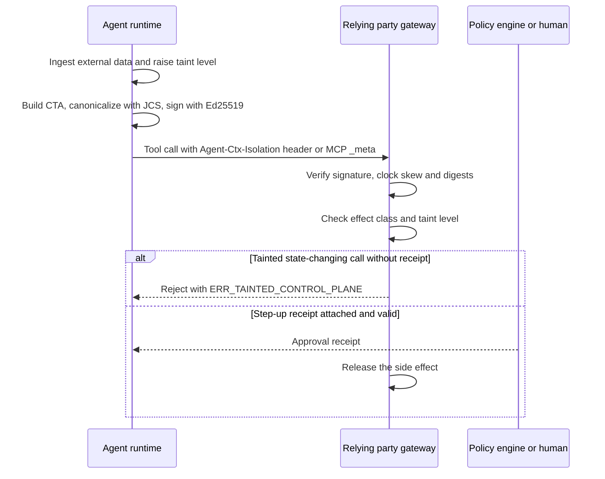

# Deep Dive: draft-durga-wimse-ctx-isolation

> In one line: every tool call from an AI agent carries a signed taint attestation, and a relying party rejects state-changing calls whose context was not trusted unless an independent approval receipt is attached.

## What this is

Autonomous AI agents that use the Model Context Protocol (MCP) or Agent-to-Agent (A2A) transports mix trusted instructions with untrusted data such as emails, web documents and retrieved chunks in one inference context (Section 1). The draft argues that OAuth token exchange (RFC 8693) and WIMSE Workload Identity Tokens authenticate the caller but carry no commitment to the provenance of the context that led to a tool call (Section 1). It proposes a Context Taint Attestation (CTA), a JSON object with a taint level, a tool effect class and a Merkle root over the context, signed with Ed25519 (Section 3). The CTA travels in an `Agent-Ctx-Isolation` header or a `_meta.ctxIsolation` object in JSON-RPC/MCP (Section 3). A relying party must fail closed on state-mutating or privileged calls that are not marked `TRUSTED_ONLY`, unless a valid step-up receipt from an independent policy decision engine or human is attached (Section 4). The draft is very short and is still at the stage of a problem statement plus a skeleton wire format.

## How it works

1. The runtime tracks the taint level of the active context. Once any byte from an unverified external origin is ingested, the level moves from `TRUSTED_ONLY` to `MIXED_TAINT` or `UNTRUSTED_INGESTED` for the rest of the session unless a context-reset boundary is executed (Section 4, rule 1).
2. For each control-plane tool invocation the runtime builds the CTA with `invocation_id`, `parent_trace_ref`, `system_prompt_digest`, `data_plane_merkle_root`, `taint_lattice_level`, `tool_effect_class`, an optional `step_up_receipt_hash`, `iat`, `exp` and a `signature` member (Section 3).
3. The CTA is canonicalized with RFC 8785 JCS (or RFC 8949 Deterministic CBOR), signed with Ed25519, and attached to the call (Sections 3, 5).
4. The relying party verifies the signature and rejects on clock skew above 60 seconds, digest mismatch or missing binding, and emits an auditable rejection receipt (Section 5).
5. If `tool_effect_class` is `STATE_MUTATING` or `PRIVILEGED_ACTUATE` and the level is not `TRUSTED_ONLY`, the call is rejected with `ERR_TAINTED_CONTROL_PLANE` unless a valid, unexpired step-up receipt from an independent policy decision engine or human verifier is attached (Section 4, rule 2).
6. The Merkle root must be computed over the ordered JCS-canonicalized chunks of all retrieved documents and tool outputs in the context window (Section 4, rule 3).

## Use cases

- A mail-reading agent holds a valid workload credential and is asked to summarize an inbox. A message contains a hidden instruction to forward files. The gateway in front of the file-sharing tool sees `UNTRUSTED_INGESTED` with `STATE_MUTATING` and rejects the call.
- A deployment pipeline agent calls a privileged actuation API. The operator wants it to proceed only when the context was clean or a policy engine issued an approval receipt (Section 4, rule 2).
- An MCP server operator wants to log, for each accepted tool call, the taint level and the digest of the context that induced it, for incident review (Section 5 asks for auditable rejection receipts).
- A gateway between peer agents over A2A needs to decide how far to trust a tool call that was triggered by a message from another agent, which the draft lists as untrusted input (Section 1).
- A WIMSE deployer evaluates whether taint evidence could sit next to the Workload Identity Token and Workload Proof Token. The draft names these tokens but defines no composition with them.

## Why This Matters Now

- **Trigger**: The draft was newly announced to the WIMSE list with a request for review and a possible lightning slot at IETF 127 (14-20 November 2026) (`subject.json`, `mail.txt`).
- **Source evidence**: The announcement says that authenticated workloads can still become confused deputies through indirect prompt injection, and asks for feedback on `ctx_isolation_witness` and `policy_manifest_sha256` (`mail.txt`). Neither name appears in the text of revision 00.
- **Expected impact**: If the WG takes interest, it would need to decide whether taint reporting belongs in WIMSE at all. As written, the signer is the agent runtime itself, so the claim is self-asserted. The draft does not show how it adds assurance beyond what a compromised runtime would sign.

## What Changed

- Spec/document change summary: This is revision 00, so there is no previous revision to compare with. It introduces the CTA object (Section 3), three verification invariants `TAINT_LATTICE_MONOTONICITY`, `CONFUSED_DEPUTY_FAIL_CLOSED` and `CONTEXT_MERKLE_BINDING` (Section 4), a 60-second skew rule (Section 5), and IANA requests for a media type, a taint level registry and two header fields (Section 6).
- Compatibility or migration concerns: Conforming runtimes MUST attach the header to every control-plane tool invocation (Section 3), so existing MCP clients and servers would all need changes. The draft gives no negotiation, no rollout path for relying parties that do not understand the header, and no guidance on how a gateway should treat calls with no header.

## Technical Analysis

- Threat model implications: The stated threat is indirect prompt injection that turns an authenticated workload into a confused deputy (Abstract, Section 1). The draft does not define a trust model for the signer. The runtime that decides the taint level is the same party that signs, so a compromised or buggy runtime can sign `TRUSTED_ONLY`. The Merkle root commits to context chunks but nothing in the draft lets a verifier check it without the chunks, and the rejection rule in Section 4 does not use it. Replay is only addressed by `iat`, `exp` and `invocation_id`; the draft does not say that verifiers must track `invocation_id` (Section 3).
- Protocol flow implications: The relying party needs the signer's public key, identified by `kid` as a SHA-256 digest (Section 3). The draft does not say how keys are distributed, how `kid` is derived, or how the key is bound to a WIMSE workload identity. The step-up path is thin: the CTA carries `step_up_receipt_hash`, and `Agent-Step-Up-Receipt` is registered as a header (Section 6), but the receipt format, its signing, its expiry and its binding to a specific invocation are not defined (Section 4, rule 2).
- Interop concerns: The Abstract says the profile is COSE_Sign1 plus JCS, but Section 3 shows a JSON object with its own `signature` member and no COSE structure. Section 3 allows JCS or Deterministic CBOR, while Section 5 requires JCS. The header encoding is not given. The `sig` placeholder `base64url(Ed25519(JCS(payload)))` does not say whether the payload excludes the `signature` member. The taint level `QUARANTINED` is registered in Section 6 but no rule in Section 4 uses it. The tool effect classes other than `STATE_MUTATING` and `PRIVILEGED_ACTUATE` are not listed.

## Open Questions

- Who is allowed to sign, and why should a relying party believe the taint level? The draft does not say how the runtime is attested or how the key is tied to a WIMSE identity (Sections 3, 5).
- How does a CTA compose with the Workload Identity Token and Workload Proof Token, which the Abstract and Section 1 name? Nothing in Sections 3 to 5 says so.
- What counts as "any byte from an unverified external origin" and what is a "cryptographic context-reset boundary" (Section 4, rule 1)? Neither is defined.
- How is the Merkle tree built (leaf encoding, ordering, empty context), and how could a verifier use it (Section 4, rule 3)?
- What is the format of the step-up receipt, and how does it bind to one invocation? What does "independent" mean (Section 4, rule 2)?
- How is the CTA encoded in an HTTP header, and how is `ERR_TAINTED_CONTROL_PLANE` mapped to HTTP status or JSON-RPC errors (Sections 3, 4)?
- Is the COSE_Sign1 claim in the Abstract meant to apply, given Section 3 shows a plain JSON signature object?
- Which fields from the mail (`ctx_isolation_witness`, `policy_manifest_sha256`) are planned for a later revision? They are absent from revision 00.
- The normative references (Section 7) omit documents the text relies on, such as RFC 8949, RFC 8693, and draft-durga-agenttrust-trace-verification-00 (Section 1).
- Which working group would own this? The header says "WIMSE / OAuth Working Group" and the intended status is Standards Track, but the datatracker states are unknown.

## Experiments

- [ ] Lab 1: Write a small verifier from Sections 3 to 5. Sign the example CTA with Ed25519 over JCS output, then test three variants of the signing input (with and without the `signature` member, with different key orders). Record which variants two independent implementations agree on.
- [ ] Lab 2: Put a gateway in front of a toy MCP tool server. Feed it combinations of `taint_lattice_level` and `tool_effect_class`, with and without a step-up receipt, and check that only the cases in Section 4, rule 2 are rejected with `ERR_TAINTED_CONTROL_PLANE`. Include `QUARANTINED` and an effect class not named in the draft to see what the text leaves open.
- [ ] Lab 3: Run an agent against a prompt-injection test document. Check whether a runtime that sets the taint level itself raises it at the right time, and try a modified runtime that omits the transition to see that the verifier cannot detect it.

## Sources

- <https://datatracker.ietf.org/doc/draft-durga-wimse-ctx-isolation/00/>
- <https://mailarchive.ietf.org/arch/msg/wimse/EDu91EnPTVXXCO4bgtlrUknXLi4/>
