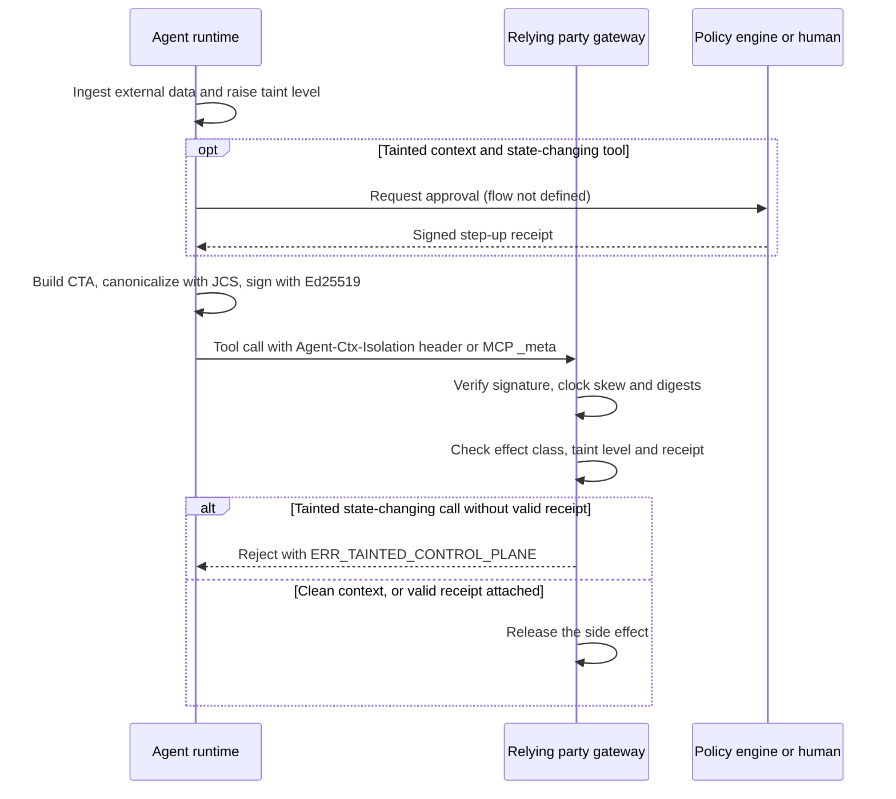

# Deep Dive: draft-durga-wimse-ctx-isolation

> In one line: every tool call from an AI agent carries a signed taint attestation, and a relying party rejects state-changing calls whose context was not trusted unless an independent approval receipt is attached.

## What this is

Autonomous AI agents that use the Model Context Protocol (MCP) or Agent-to-Agent (A2A) transports take untrusted data such as emails, web documents and retrieved RAG chunks into the same inference context that authorizes privileged tool calls (Abstract). Section 1 gives third-party documents, webhooks and unverified peer agent outputs as examples of such input. The draft says that existing workload identity and token standards (OAuth 2.1, GNAP, WIMSE Wit/Wpt tokens) bind client identity and authorization scope (Abstract), but that neither OAuth 2.0 Token Exchange (RFC 8693) nor WIMSE Workload Identity Tokens carry a cryptographic commitment to the taint of the context window at the moment of tool selection (Section 1). It proposes a Context Taint Attestation (CTA), a JSON object with a taint level, a tool effect class and a Merkle root over the context, signed with Ed25519 (Section 3). The CTA travels in an `Agent-Ctx-Isolation` header or a `_meta.ctxIsolation` object in JSON-RPC/MCP (Section 3). A relying party must fail closed on state-mutating or privileged calls that are not marked `TRUSTED_ONLY`, unless a valid step-up receipt from an independent policy decision engine or human is attached (Section 4). The draft is a five-page individual submission, not adopted by any working group on the Datatracker, and is still at the stage of a problem statement plus a skeleton wire format.

## How it works

1. The runtime tracks the taint level of the active context. Once any byte from an unverified external origin is ingested, the runtime MUST move the level from `TRUSTED_ONLY` to `MIXED_TAINT` or `UNTRUSTED_INGESTED` for the remainder of that context session unless a cryptographic context-reset boundary is executed (Section 4, rule 1).
2. For each control-plane tool invocation the runtime builds the CTA with `cta_version`, `invocation_id`, `parent_trace_ref`, `system_prompt_digest`, `data_plane_merkle_root`, `taint_lattice_level`, `tool_effect_class`, `step_up_receipt_hash`, `iat`, `exp` and a `signature` member (Section 3). The draft does not mark any field optional. The example pairs a `step_up_receipt_hash` value with `UNTRUSTED_INGESTED` and `STATE_MUTATING`; the draft does not say whether the example is meant to pass rule 2.
3. The Merkle root MUST be computed over the ordered RFC 8785 JCS-canonicalized chunks of all retrieved documents and tool outputs present in the active context window (Section 4, rule 3).
4. The CTA is serialized with RFC 8785 JCS or RFC 8949 Deterministic CBOR (Section 3), but Section 5 requires JCS canonicalization before Ed25519 signing or verification. The signed CTA is attached to the call.
5. The relying party verifies the signature. Clock skew above 60 seconds, a digest mismatch or a missing cryptographic binding MUST make it fail closed and emit an auditable security rejection receipt (Section 5).
6. If `tool_effect_class` is `STATE_MUTATING` or `PRIVILEGED_ACTUATE` and `taint_lattice_level != TRUSTED_ONLY`, the relying party MUST reject the call with `ERR_TAINTED_CONTROL_PLANE` unless it carries a valid, unexpired `step_up_receipt_hash` signed by an independent policy decision engine or human verifier (Section 4, rule 2).

## Use cases

- A mail-reading agent holds a valid workload credential and is asked to summarize an inbox. A message contains a hidden instruction to forward files. The gateway in front of the file-sharing tool sees `UNTRUSTED_INGESTED` with `STATE_MUTATING` and rejects the call.
- A deployment pipeline agent calls a privileged actuation API. The operator wants it to proceed only when the context was clean or a policy engine issued an approval receipt (Section 4, rule 2).
- An MCP server operator wants to log, for each tool call, the taint level and the digest of the context that induced it, for incident review. The draft only asks for this on rejection: Section 5 requires an auditable security rejection receipt, and says nothing about logging accepted calls.
- A gateway between peer agents over A2A needs to decide how far to trust a tool call that was triggered by the output of another agent. Section 1 lists unverified peer agent outputs as untrusted input.
- A WIMSE deployer evaluates whether taint evidence could sit next to the Workload Identity Token and Workload Proof Token. The draft names them ("WIMSE Wit/Wpt tokens" in the Abstract, Workload Identity Tokens in Section 1) but defines no composition with them.

## Why This Matters Now

- **Trigger**: Revision 00 was posted on 29 October 2026. The author announced it and the companion draft-durga-agenttrust-trace-verification-00 on the WIMSE list on 1 November 2026, asking for review and for a 5-minute lightning slot if WIMSE agenda time remains at IETF 127 (San Francisco, 14-20 November 2026). The message had no replies when checked.
- **Source evidence**: The announcement says that, without a cryptographic taint-lineage witness, indirect prompt injection turns a validly authenticated WIMSE workload into a confused deputy. It asks for feedback on "the ctx_isolation_witness structure and Policy-Epoch AST binding (policy_manifest_sha256)". Neither name appears in revision 00 of this draft or of the companion draft. The mail also points to a benchmark dataset on Hugging Face (DOI 10.57967/hf/11352, 100 rows covering OWASP ASI01 to ASI10), which neither draft cites by that DOI.
- **Expected impact**: The draft is not a WG document. If the WG takes interest, it would need to decide whether taint reporting belongs in WIMSE at all. Section 3 makes the agent runtime attach the signed CTA and names no other signer, so as written the claim reads as self-asserted. The draft does not show how it adds assurance beyond what a compromised runtime would sign.

## What Changed

- Spec/document change summary: This is revision 00, so there is no previous revision to compare with. It introduces the CTA object (Section 3), three verification invariants `TAINT_LATTICE_MONOTONICITY`, `CONFUSED_DEPUTY_FAIL_CLOSED` and `CONTEXT_MERKLE_BINDING` (Section 4), a 60-second skew rule (Section 5), and IANA requests for a media type, a taint level registry and two header fields (Section 6).
- Compatibility or migration concerns: Conforming runtimes MUST attach the header to every control-plane tool invocation (Section 3), so existing MCP clients and servers would all need changes. The draft gives no negotiation and no rollout path for relying parties that do not understand the header. For a call with no header, the nearest rule is the Section 5 requirement to fail closed on a "missing cryptographic binding", which does not say whether it applies to every effect class.

## Technical Analysis

- Threat model implications: The stated threat is indirect prompt injection that turns an authenticated workload into a confused deputy (Abstract; Section 1 states the gap without naming the attack). The draft does not define a trust model for the signer. Section 3 has the runtime that decides the taint level attach the signed CTA and does not say who holds the signing key; if it is the runtime, a compromised or buggy runtime can sign `TRUSTED_ONLY`. The Merkle root commits to context chunks but nothing in the draft lets a verifier check it without the chunks, and the rejection rule in Section 4 does not use it. The draft never mentions replay or nonces. Only `iat`, `exp` and the `invocation_id` UUID in the Section 3 example bear on it, and nothing says that verifiers must track `invocation_id`.
- Protocol flow implications: The relying party needs the signer's public key, identified in the Section 3 example by a `kid` of the form `sha256:<hex>`. The draft does not say how keys are distributed, how `kid` is derived, or how the key is bound to a WIMSE workload identity. The step-up path is thin: the CTA carries `step_up_receipt_hash`, and IANA registration is requested for an `Agent-Step-Up-Receipt` header (Section 6), but the receipt format, its signature algorithm and its binding to a specific invocation are not defined. Rule 2 only says the receipt must be valid, unexpired and signed by an independent party (Section 4, rule 2).
- Interop concerns: The Abstract says the profile is COSE_Sign1 plus JCS, but Section 3 shows a JSON object with its own `signature` member and no COSE structure. Section 3 allows JCS or Deterministic CBOR, while Section 5 requires JCS. The header encoding is not given. The `sig` placeholder `base64url(Ed25519(JCS(payload)))` does not say whether the payload excludes the `signature` member. The example digests are placeholders: `data_plane_merkle_root` is the SHA-256 of empty input (an empty context, although the same example sets `UNTRUSTED_INGESTED`) and `parent_trace_ref` the SHA-256 of `test`. The taint level `QUARANTINED` is registered in Section 6 but no rule in Section 4 uses it. The tool effect classes other than `STATE_MUTATING` and `PRIVILEGED_ACTUATE` are not listed.

## Open Questions

- Who is allowed to sign, and why should a relying party believe the taint level? The draft does not say how the runtime is attested or how the key is tied to a WIMSE identity (Sections 3, 5).
- How does a CTA compose with the Workload Identity Token and Workload Proof Token, which the Abstract names (Section 1 names only the Workload Identity Token)? Nothing in Sections 3 to 5 says so.
- What counts as "any byte from an unverified external origin" and what is a "cryptographic context-reset boundary" (Section 4, rule 1)? Neither is defined.
- How is the Merkle tree built (leaf encoding, ordering, empty context), and how could a verifier use it (Section 4, rule 3)?
- What is the format of the step-up receipt, and how does it bind to one invocation? What does "independent" mean (Section 4, rule 2)?
- How is the CTA encoded in an HTTP header, and how is `ERR_TAINTED_CONTROL_PLANE` mapped to HTTP status or JSON-RPC errors (Sections 3, 4)?
- Is the COSE_Sign1 claim in the Abstract meant to apply, given Section 3 shows a plain JSON signature object?
- Are the names from the mail (`ctx_isolation_witness`, `policy_manifest_sha256`) planned for a later revision? They are absent from revision 00 of both drafts.
- The normative references (Section 7) omit documents the text relies on, such as RFC 8949 (Section 3), RFC 8693 and draft-durga-agenttrust-trace-verification-00 (Section 1).
- Which working group, if any, would take this up? The header says "WIMSE / OAuth Working Group" and "Intended status: Standards Track", but the Datatracker lists it as an individual submission with no stream, no WG state and no intended status.

## Experiments

- [ ] Lab 1: Write a small verifier from Sections 3 to 5. Sign the example CTA with Ed25519 over JCS output, then test three variants of the signing input (with and without the `signature` member, with different key orders). Record which variants two independent implementations agree on.
- [ ] Lab 2: Put a gateway in front of a toy MCP tool server. Feed it combinations of `taint_lattice_level` and `tool_effect_class`, with and without a step-up receipt, and check that only the cases in Section 4, rule 2 are rejected with `ERR_TAINTED_CONTROL_PLANE`. Include `QUARANTINED` and an effect class not named in the draft to see what the text leaves open.
- [ ] Lab 3: Run an agent against a prompt-injection test document. Check whether a runtime that sets the taint level itself raises it at the right time, and try a modified runtime that omits the transition to see that the verifier cannot detect it.

## Sources

- <https://datatracker.ietf.org/doc/draft-durga-wimse-ctx-isolation/00/>
- <https://mailarchive.ietf.org/arch/msg/wimse/EDu91EnPTVXXCO4bgtlrUknXLi4/>
- <https://datatracker.ietf.org/doc/draft-durga-agenttrust-trace-verification/>
- <https://doi.org/10.57967/hf/11352>
