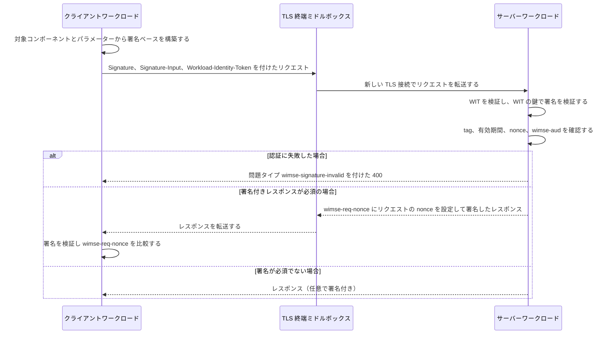

# Deep Dive: draft-ietf-wimse-http-signature

> 一言で言うと: HTTP Message Signatures のプロファイルであり、ワークロードが Workload Identity Token に結び付いた鍵でリクエスト（および任意でレスポンス）に署名することで、TLS を終端するプロキシを挟んでも証明が失われないようにする。

## 概要

HTTP で互いを呼び出すワークロードには認証が要る。相互 TLS は選択肢の一つだが、認証局（Certification Authority）の基盤がない場合や、呼び出しが複数の TLS ホップを経由する場合には、アプリケーション層での保護が好まれる（Section 1）。本ドラフトは、そのようなアプリケーション層の方式を HTTP Message Signatures（[RFC9421]）のプロファイルとして定義する。呼び出し側は Workload Identity Token（WIT）を送り、WIT 内の鍵に対応する秘密鍵でリクエストに署名することで、その鍵の保持を証明する。署名はメソッド、パス、クエリ、選択したヘッダー、および本文がある場合の Content-Digest を対象とし、三つの新しい署名パラメーターを持つ。宛先を示す `wimse-aud`、署名付きレスポンスを要求する `wimse-sign-response`、レスポンスをリクエストに結び付ける `wimse-req-nonce` である。本ドラフトは（CONNECT を除き）`@authority` に署名しないので、authority を書き換えるプロキシを挟んでも検証は壊れない。Datatracker 上の状態は Active、Publication Requested、Submitted to IESG for Publication である（`subject.json`）。

## 仕組み

1. クライアントは署名ベースを構築する。Section 3 により、`@method`、`@path`、`@query`、および存在する場合は Content-Type、Content-Digest、Authorization、Txn-Token、Workload-Identity-Token を対象に含める。`created`、`expires`、`nonce`、`tag`（値は `wimse-workload-to-workload`）、`wimse-aud` を設定し、任意で `wimse-sign-response` を設定する。`keyid` と `alg` は設定してはならない。
2. クライアントは WIT と署名を付けてリクエストを送る。TLS を終端するミドルボックスからは平文の WIT と署名が見えるが、対象コンポーネントを書き換えれば検証に失敗する（Section 5.2）。
3. サーバーは、署名を検証する前にワークロード資格情報ドラフトの規定に従って WIT を検証し、完全に検証されるまでメッセージをそれ以上処理してはならない（Section 3）。
4. サーバーはラベルではなく `tag` の値で WIMSE 署名を見つけ、その tag を持つ署名が複数あればメッセージを拒否する。有効期間を確認し、`wimse-aud` を信頼済み設定と Simple String Comparison で照合する（Section 3、3.2）。
5. 失敗した場合、サーバーは問題タイプ `wimse-signature-invalid` を付けた 400 を返し、どの検査が失敗したかは示さない（Section 3.6）。
6. リクエストの `wimse-sign-response` が true の場合、またはローカルポリシーが要求する場合、サーバーはレスポンスに署名する。対象は `@status`、`req` パラメーター付きのリクエストコンポーネント、Content-Type、Content-Digest、Workload-Identity-Token であり、`wimse-req-nonce` にはリクエストの nonce を設定する（Section 3.4、3.5）。署名できない場合は、署名なしの成功ではなくエラーを返す。
7. クライアントは署名付きレスポンスを検証し、`wimse-req-nonce` を自分の nonce と比較する。署名を要求した場合、署名のないレスポンスは拒否しなければならない（Section 3.5）。

## ユースケース

- TLS を終端するロードバランサーや API ゲートウェイを経由するサービス間呼び出しで、エンドツーエンドの証明を宛先でも検証できなければならない場合（Section 1、5.2）。
- 剥がされた、または差し替えられたレスポンスを検出したいクライアントが、`wimse-sign-response` と `wimse-req-nonce` を併用する場合（Section 3.3、3.5、Appendix A.4）。
- CONNECT メソッドによるプロキシのトンネリングで、プロファイルが `@path` と `@query` の代わりに `@authority` を対象にする場合（Section 3）。
- 一つのサービスに複数の宛先名がある構成で、比較がバイト単位の完全一致であるため、受け入れる文字列をすべて受信側の設定に列挙しなければならない場合（Section 3.2）。
- issue #419 にある今回の版向けの独立したテストベクターで、適合性を確認したい実装者とテスト担当者。

## なぜ今重要か

- **きっかけ**: `subject.json` によれば、本ドラフトに対して三つの新しい issue が立てられている。テストベクター（#419）、例における nonce のエントロピー（#420）、編集上のコメント（#417）である。またドラフトは Publication Requested と Submitted to IESG for Publication の状態にあり、ここでの文言はほぼ最終形になる。
- **根拠となる資料**: -08 の差分は、CONNECT の例外、`wimse-aud` への Simple String Comparison、64 ビット以上の nonce エントロピー、三つの登録済み問題タイプによる一様なエラー処理、およびシェパードレビューへの対応を加えている（Appendix B.1）。2026 年 11 月 6 日には、個人参加者が -08 向けのテストベクター一式（正例 6 件、負例 22 件、所見 3 件）を issue #419 に投稿し、WIMSE メーリングリストで告知した。issue 上での Yaron Sheffer のレビューと別の参加者による独立した検証を受けて、作者は 11 月 7 日に P-01、P-02、P-06、N-15 を再生成した。これらは `@query` の値に先頭の `?` が欠けていた。11 月 5 日には Kathleen Moriarty が導入部への編集上のレビューを送り、Yaron Sheffer が issue #417 として記録した。
- **期待される影響**: 検証実装を共通の入力でテストできるようになり、これまで SHOULD や暗黙だった複数の挙動（nonce の生成とエントロピー、エラー時のステータスコード、`wimse-aud` の比較方法）が MUST になる。TLS の要件は新しくない。-07 でもすでに MUST で、Section 5.1 から Section 3 に移っただけである。-07 の実装は、nonce、エラー処理、audience の比較、CONNECT の経路を確認する必要がある。Section 4（Implementation Status）には二つの実装が最終更新日付きで載っているが、対応する版は書かれていない。Cofide（2025 年 11 月 13 日）と wimsey（2026 年 9 月 8 日）である。Cofide のリポジトリは前身の draft-ietf-wimse-s2s-protocol の実装だと説明しており、最終 push は 2025 年 11 月 14 日なので、-08 の変更より前のものである。-08 の後、ドラフトの main ブランチでは wimsey の項目が「signed responses as per version -08 of the draft」に更新された（PR #406）。

## 変更点

- CONNECT の例外（Section 3）: 送信者は `@method` と `@authority` を対象に含めなければならず、`@path` と `@query` を含めてはならない。CONNECT リクエストに対する署名付きレスポンスでは、パスとクエリのコンポーネントの代わりに `@method;req` と `@authority;req` を用いる。それ以外のメソッドでは引き続き `@authority` を省く。
- `@request-target` の記述: -07 の「HTTP/1.1 以外では NOT RECOMMENDED」という文は、「@request-target ではなく @path と @query を別々に対象とし、[RFC9421] の Section 2.2.5 に従う」という記述に置き換えられた。
- `wimse-aud`（Section 3.2）: 受信者は、信頼済み設定にある値と Simple String Comparison（[RFC3986] の Section 6.2.1）で照合しなければならない。末尾のスラッシュや明示的な既定ポートは一致せず、許容する変種はそれぞれ設定しなければならない。受信者は Host などのリクエストフィールドから audience を導出してはならない。
- nonce（Section 3）: 送信者は暗号論的に安全な乱数生成器を用いなければならず、エントロピーは 64 ビット以上、96 ビット以上が RECOMMENDED である。
- 時間枠（Section 3）: 受信者は有効期間外の署名を拒否しなければならない。Security Considerations にあった MUST をここに移したものである。
- TLS（Section 3）: サーバー認証付き TLS 接続とクライアントによるホスト名検証（[RFC9525]）の MUST は、Section 5.1 からプロトコルの節に移った。BCP 195 に従うことを求める SHOULD が新たに加わった。
- Content-Digest（Section 3）は [RFC9530] を参照するようになった。[RFC9530] は [RFC3986]、BCP 195 と並ぶ新しい規範的参照である。
- エラー処理（Section 3.6）: 認証の失敗には `wimse-signature-invalid` を付けた 400 を返さなければならず、どの検査が失敗したかを示してはならない。署名が必須だが署名に対応しないサーバーは、`wimse-signed-response-unsupported` を付けた 501 を返さなければならない。署名に対応するが、このレスポンスには署名できないサーバーは、`wimse-signed-response-unavailable` を付けた 400 を返さなければならない。-07 では、検証の失敗については「400 などの」ステータスコードが適切と述べるだけで、必須の署名付きレスポンスを返せないサーバーについては 400 か 501 を返す SHOULD だった。problem details の本文は、相手が受け付けないと分かっている場合を除き SHOULD である。
- `wimse-sign-response`（Section 3.3）: true の場合、サーバーは署名するかエラーを返さなければならない。
- IANA（Section 7.2）: HTTP Problem Types への三件の登録が追加された。
- 編集上の再構成: Security Goals は本文（-07 の Section 6）から Appendix A に移り、そのぶん Document History は Appendix B、DPoP との比較は Appendix C に繰り下がった。-07 で Security Considerations の下位節だった Privacy Considerations は独立した Section 6 になり、ワークロード資格情報ドラフトへの参照だけに縮小された。Section 5 にあった複数の MUST は、Section 3 を参照する説明文に書き換えられた。Section 3.1 のアルゴリズムの記述は、「ES256 のサポートが MUST であるという要件を引き継ぐ」から、ワークロード資格情報ドラフトのアルゴリズム要件に「従う」に変わった。Section 3.2 と Section 3.3 の「定義する」という文は書き換えられた。
- 互換性と移行: 短い、または低エントロピーの nonce を使っていた -07 の送信者、URI 正規化後に `wimse-aud` を比較していた送信者または受信者、署名できないときに別の方法で 501 や 400 を返していたサーバー、およびすべての CONNECT 通信は、変更が必要になる。エラーレスポンスは、相手が problem details を受け付けないと分かっている場合を除き、登録済みの問題タイプを付ける必要がある。

## 技術的分析

- 脅威モデルへの含意: WIT はベアラートークンとしては使われないが、盗まれたトークンと署名は、署名の有効期間内なら再送できてしまう（Section 5.1）。短い `expires`、nonce、任意のリプレイキャッシュがこれを軽減する。ただしドラフトは、攻撃者がどのクラスターメンバーが検証するかを選べる場合、リプレイ検出は有効でないと述べている（Section 5.1、Appendix A.4）。ミドルボックスからは平文の WIT と署名が見えるので、それを取得して再送したり、署名されていないヘッダーを書き換えたりできる（Section 5.2）。ドラフトは、対象コンポーネントを書き換えれば必ず検出されるとし、中間者での再署名は対象外としている。audience を `@authority` ではなく署名付きパラメーターで運ぶことで、authority が書き換えられても検証が通るようにしている（Section 3、5.1）。Appendix A.4 によれば、リクエストとレスポンスの組が削除されたことを必ず検出できるのは、クライアントが `wimse-sign-response` で署名を要求し、署名のないレスポンスを拒否する場合だけである。サーバーのローカルポリシーによる署名だけでは、クライアントから見ると日和見的な保護にとどまる（Section 3.5）。
- プロトコルフローへの含意: 検証の順序は固定されている。まず WIT、次に HTTP メッセージ署名であり、両方が通るまでそれ以上の処理は行わない（Section 3）。WIMSE 署名は tag で見つけるため、中間者による他の署名と共存できる（Section 3、5.2）。`wimse-sign-response` は Accept-Signature より優先され、Accept-Signature でプロファイルより弱い対象範囲を要求してはならない（Section 3.5）。アルゴリズムは `alg` パラメーターではなく WIT の `cnf.jwk.alg` から決まり、ローカルポリシーで許容されないアルゴリズムは受信者が拒否する（Section 3.1）。署名に関する二つのエラー経路は、ステータスコードと問題タイプだけで区別される。未対応は 501、利用不能は 400 である（Section 3.6）。
- 相互運用上の懸念: `wimse-aud` は完全一致の文字列として比較されるため、「送信者が知る」既定の対象 URI を使う送信者は、設定された値とバイト単位で一致させなければならない（Section 3.2）。`@query` はクエリが空でも含めなければならず、その値は `?` である（Section 3）。署名ベースで先頭の `?` を落とす誤りは、issue #419 のテストベクターの初版で実際に起きている。本文がある場合、Content-Digest は必ず存在し、検証されなければならない。CONNECT のリクエストとレスポンスは、異なる対象集合を用いる（Section 3）。Section 3 と 3.6 は WIT の検証についてワークロード資格情報ドラフトの「Section 5.1.4」を参照しているが、参照先の版（-02）に Section 5.1.4 はない。検証手順は、-08 より後に出た workload-creds-03 の Section 5.1.3 にある。Section 3.7 の例は固定の nonce（`abcd1111` から `abcd4444`）を使っている。16 進 8 文字で最大 32 ビット、しかもランダムではないので Section 3 の下限を満たさず、真似してはいけない（issue #420）。例のファイルは -07 から変わっておらず、issue #419 の独立した検証では、Figure 2 の署名は `?flavor=vanilla` で検証できたと報告されている。問題タイプの URI は IANA の Problem Types レジストリの名前空間にあり、Section 7.2 の登録が完了している必要がある（Section 7.2）。

## 未解決の問題

- `keyid` と `alg` に対する検証側の挙動（Section 3）: ドラフトは送信者に対して「使ってはならない」と述べているが、検証側がそれらを含むメッセージを拒否するのか無視するのかは、ドラフトの本文に書かれていない。テストベクターの作者は「reject」と記録し（issue #419 の N-06 と N-07）、リストで尋ねた。-08 のヘッダーに載る著者 2 人（Joe Salowey と Yaron Sheffer）のうち Sheffer が、2026 年 11 月 7 日に個人の意見として「IMO a MUST NOT in any security RFC should be rejected by the recipient.」と返信した。これはリスト上の一著者の意見で、ドラフトが採用した規定ではない。-08 後の main ブランチも含め、ドラフトの本文にはまだ書かれていない。
- 例の nonce（Section 3.7）: issue #420 は、#419 の所見 O-2 を受けて Yaron Sheffer が 2026 年 11 月 7 日に立てたもので、例の nonce は説明用でエントロピーの下限を満たさないという編集上の注記を例の近くに加えるよう求めている。例の生成コードは変えない方針である。issue は open のままで、注記はまだドラフトにない。
- nonce の形式（Section 3）: ドラフトはエントロピーのビット数を定めているが、nonce 文字列の符号化や長さは定めておらず、受信者がエントロピーをどう確認できるかも述べていない。-08 の後、main ブランチでは、同じ要件を満たすならクライアントが Accept-Signature にあるサーバー生成の nonce を使ってもよいことになった（PR #404、-09 向け）。
- CONNECT の audience（Section 3、3.2）: `wimse-aud` の既定値はクエリとフラグメントを除いた対象 URI だが、CONNECT の対象は authority-form である。CONNECT の場合の既定の audience が何かは、ドラフトに書かれていない。
- 一様な 400 と別個の問題タイプ（Section 3.6）: サーバーはどの検査が失敗したかを示してはならないが、署名付きレスポンスが利用できない場合の 400 は別のエラーである。problem details を受け付けないクライアントは両者を区別できず、ドラフトはこれを論じていない。
- 中間者による再署名（Section 5.2）: WIMSE 署名を剥がして置き換える処理は、デプロイ環境ごとのポリシーに委ねられている。
- 導入部の文言（Section 1）: Kathleen Moriarty のレビュー（issue #417）は、最初の文に HTTP を明記し、複数の TLS ホップにまたがるオブジェクトレベルの認証を説明するよう提案している。issue は open で結論は出ておらず、-08 の Section 1 にその文言はない。
- リプレイキャッシュの範囲（Section 3、5.1、Appendix A.4）: 何をどれだけの期間記憶するかはローカルポリシーであり、別のクラスターメンバーへのリプレイは成功し得る。
- Appendix C には、署名付きレスポンスを必須にするかどうかは将来の版で決められる、という記述が残っている。

## 実験

- [ ] Lab 1: Section 3.7.1 の Figure 2 のリクエストと Figure 4 のレスポンスについて、RFC 9421 のライブラリで署名ベースを再構築し、WIT 内の公開鍵で署名を検証して、`@query` が先頭の `?` を含む `?flavor=vanilla` になっていることを確認する。
- [x] Lab 2: issue #419 のテストベクター一式（P-01、P-02、P-06、N-15 は作者の 11 月 7 日のコメントにある再生成後の署名）に対して検証実装を実行し、受理と拒否の判断を期待結果と比較する。特に `wimse-aud` の変種（末尾のスラッシュ、明示的な既定ポート）、`wimse-workload-to-workload` の tag の重複、`keyid` と `alg` の存在、CONNECT の各ケースを見る。
- [ ] Lab 3: `Host` を書き換える TLS 終端プロキシをサーバーの前に置き、`wimse-sign-response` を true にした署名付きリクエストを送る。検証が引き続き成功すること、署名できない（ストリーミングの）サーバーが `wimse-signed-response-unavailable` を付けた 400 を返すこと、署名に対応しないサーバーが `wimse-signed-response-unsupported` を付けた 501 を返すことを確認する。

## 情報源

- [draft-ietf-wimse-http-signature-08](https://datatracker.ietf.org/doc/draft-ietf-wimse-http-signature/08/)
- [WIMSE リスト: Test vectors for draft-ietf-wimse-http-signature-08, request for review](https://mailarchive.ietf.org/arch/msg/wimse/4oCoc4IePmmc1cCm1FthFanNNRc/)
- [WIMSE リスト: Re: Test vectors for draft-ietf-wimse-http-signature-08（Yaron Sheffer）](https://mailarchive.ietf.org/arch/msg/wimse/IcH0Hq5968-TzSxLL7Wpi4pl-7k/)
- [WIMSE リスト: Re: Test vectors for draft-ietf-wimse-http-signature-08（ベクターの作者）](https://mailarchive.ietf.org/arch/msg/wimse/VCH1w0y6OuR-koGRiJYakzmtGAo/)
- [WIMSE リスト: Review of draft-ietf-wimse-http-signature](https://mailarchive.ietf.org/arch/msg/wimse/nlwwEHRta3EdrxB--z1NM-Mcp7M/)
- [WIMSE リスト: Re: Review of draft-ietf-wimse-http-signature](https://mailarchive.ietf.org/arch/msg/wimse/Vd1-lCWYXdJYkIMMV2z98f3IL5s/)
- [issue #385: シェパードレビュー](https://github.com/ietf-wg-wimse/draft-ietf-wimse-s2s-protocol/issues/385)
- [issue #417: 導入部への編集上のコメント](https://github.com/ietf-wg-wimse/draft-ietf-wimse-s2s-protocol/issues/417)
- [issue #419: -08 のテストベクター](https://github.com/ietf-wg-wimse/draft-ietf-wimse-s2s-protocol/issues/419)
- [issue #420: エントロピーの下限を満たさない例の nonce](https://github.com/ietf-wg-wimse/draft-ietf-wimse-s2s-protocol/issues/420)
- [ドラフトのソースリポジトリと issue トラッカー](https://github.com/ietf-wg-wimse/draft-ietf-wimse-s2s-protocol)
