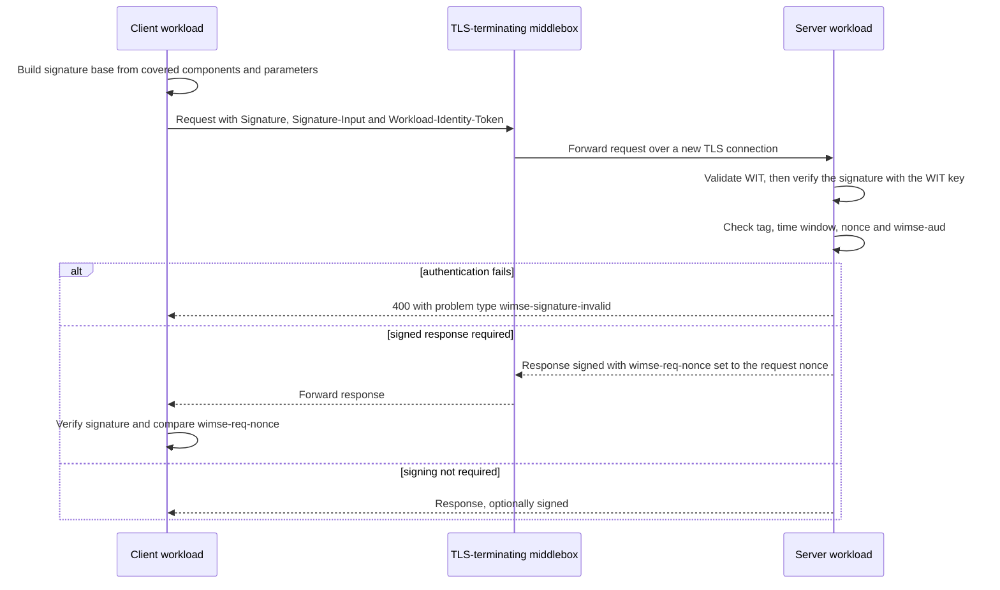

# Deep Dive: draft-ietf-wimse-http-signature

> In one line: a profile of HTTP Message Signatures in which a workload signs its HTTP request (and optionally the response) with the key bound to its Workload Identity Token, so the proof survives TLS-terminating proxies.

## What this is

Workloads that call each other over HTTP need to authenticate. Mutual TLS is one option, but many deployments prefer application-layer protection, either because they lack Certification Authority infrastructure or because a call crosses several TLS hops (Section 1). This draft defines such an application-layer option as a profile of HTTP Message Signatures ([RFC9421]). The caller sends its Workload Identity Token (WIT) and signs the request with the private key that matches the key in the WIT, which proves possession of that key. The signature covers the method, path, query, selected headers and a Content-Digest of any body, and carries three new signature parameters: `wimse-aud` for the intended recipient, `wimse-sign-response` to require a signed response, and `wimse-req-nonce` to bind a response to its request. The draft does not sign `@authority` (except for CONNECT), so proxies that rewrite the authority do not break verification. The datatracker states in `subject.json` are Active, Publication Requested and Submitted to IESG for Publication.

## How it works

1. The client builds the signature base. Under Section 3 it covers `@method`, `@path`, `@query` and, when present, Content-Type, Content-Digest, Authorization, Txn-Token and Workload-Identity-Token. It sets `created`, `expires`, `nonce`, `tag` (the value `wimse-workload-to-workload`) and `wimse-aud`, and optionally `wimse-sign-response`. It must not set `keyid` or `alg`.
2. The client sends the request with the WIT and the signature. The draft's own text says TLS-terminating middleboxes can see the cleartext WIT and signature (Section 5.2), but cannot change covered components without breaking verification.
3. The server validates the WIT as specified in the workload credentials draft before validating the signature, and must not process the message further until it is fully validated (Section 3).
4. The server finds the WIMSE signature by its `tag` value, not by label, and rejects the message if more than one signature carries that tag. It checks the validity window and checks `wimse-aud` against its trusted configuration using Simple String Comparison (Sections 3, 3.2).
5. On failure the server returns 400 with the `wimse-signature-invalid` problem type and does not say which check failed (Section 3.6).
6. If the request carried `wimse-sign-response` set to true, or local policy requires it, the server signs the response, covering `@status`, the request components with the `req` parameter, Content-Type, Content-Digest and Workload-Identity-Token, and sets `wimse-req-nonce` to the request's nonce (Sections 3.4, 3.5). If it cannot sign, it returns an error instead of an unsigned success.
7. The client verifies a signed response and compares `wimse-req-nonce` with its own nonce. It must reject an unsigned response when it asked for signing (Section 3.5).

## Use cases

- Service-to-service calls that pass through a TLS-terminating load balancer or API gateway, where the end-to-end proof must still verify at the destination (Sections 1, 5.2).
- Clients that must detect a stripped or substituted response, using `wimse-sign-response` together with `wimse-req-nonce` (Sections 3.3, 3.5, Appendix A.4).
- Proxy tunnelling with the CONNECT method, where the profile now covers `@authority` instead of `@path` and `@query` (Section 3).
- Deployments with several audience names for one service, which must list each acceptable string in the recipient's configuration because comparison is byte-exact (Section 3.2).
- Implementers and testers who want to check conformance against the independent test vectors proposed on the list for this revision.

## Why This Matters Now

- **Trigger**: `subject.json` records that three new issues target this draft: test vectors (#419), nonce entropy in examples (#420) and editorial comments (#417). The draft is also at Publication Requested and Submitted to IESG for Publication, so wording changes now are close to final.
- **Source evidence**: The -08 diff adds a CONNECT exception, Simple String Comparison for `wimse-aud`, a 64-bit minimum nonce entropy, uniform error handling with three registered problem types, and a shepherd-review pass (Appendix B.1). On the WIMSE list, an individual participant posted a test vector set built against -08 (6 positive and 22 negative cases) and corrected `@query` values that lacked the leading `?`. Another participant sent an editorial review of the introduction, which Yaron Sheffer recorded as issue #417.
- **Expected impact**: Verifiers can now be tested against shared inputs, and several behaviours that were SHOULD or implicit become MUST (nonce generation, error codes, TLS use). Existing -07 implementations need to check the nonce, error handling, audience comparison and CONNECT paths. The draft's Implementation Status lists two implementations (Cofide, wimsey) and does not say which revision either follows.

## What Changed

- CONNECT exception (Section 3): senders MUST cover `@method` and `@authority` and MUST NOT cover `@path` or `@query`. For a signed response to a CONNECT request, `@method;req` and `@authority;req` replace the path and query components. The draft keeps omitting `@authority` for all other methods.
- `@request-target` wording: the -07 sentence calling it NOT RECOMMENDED outside HTTP/1.1 is replaced by "covers @path and @query separately rather than @request-target, following Section 2.2.5 of [RFC9421]".
- `wimse-aud` (Section 3.2): the recipient MUST match it against its trusted configuration with Simple String Comparison ([RFC3986] Section 6.2.1). A trailing slash or explicit default port does not match, and each acceptable variant must be configured. The recipient MUST NOT derive the audience from request fields such as Host.
- Nonce (Section 3): senders MUST use a cryptographically secure random number generator and at least 64 bits of entropy, with 96 bits or more RECOMMENDED.
- Time window (Section 3): recipients MUST reject signatures outside their validity window. This sentence replaces the MUST that was in Security Considerations.
- TLS (Section 3): the MUST for a server-authenticated TLS connection and client hostname validation ([RFC9525]) moves from Section 5.1 to the protocol section. A new SHOULD points to BCP 195.
- Content-Digest (Section 3) now cites [RFC9530], which is a new normative reference together with [RFC3986] and BCP 195.
- Error handling (Section 3.6): authentication failure MUST give 400 with `wimse-signature-invalid` and MUST NOT reveal which check failed. A server that is required to sign but does not support signing MUST give 501 with `wimse-signed-response-unsupported`. A server that supports signing but cannot sign this response MUST give 400 with `wimse-signed-response-unavailable`. In -07 this was a SHOULD for 400 or 501. Problem details bodies are SHOULD.
- `wimse-sign-response` (Section 3.3): when true, the server MUST sign or return an error.
- IANA (Section 7.2): three HTTP Problem Types registrations are added.
- Editorial restructuring: Security Goals move to Appendix A, Document History to Appendix B and the DPoP comparison to Appendix C. Privacy Considerations (Section 6) shrinks to a pointer to the workload credentials draft. Several Section 5 MUSTs become descriptive text that points back to Section 3. The Section 3.1 algorithm text now says implementations "follow the algorithm requirements" of the workload credentials draft rather than "inherit the requirement that ES256 MUST be supported". The Section 3.2 and Section 3.3 "defines" sentences are reworded.
- Compatibility and migration: a -07 sender that used a short or low-entropy nonce, a sender or recipient that compared `wimse-aud` after URI normalization, a server that returned 501 or 400 in some other way when it could not sign, and any CONNECT traffic need changes. Error responses now need the registered problem types unless the peer is known not to accept problem details.

## Technical Analysis

- Threat model implications: The WIT is not a bearer token, but a captured token and signature can be replayed within the signature lifetime (Section 5.1). Short `expires`, the nonce and an optional replay cache reduce this, and the draft says replay detection is ineffective if an attacker can choose which cluster member validates (Section 5.1, Appendix A.4). Middleboxes see the cleartext WIT and signature and can capture and replay them or change unsigned headers (Section 5.2). The draft says a middlebox cannot change covered components without detection, and that re-signing at an intermediary is out of scope. Binding the audience in a signed parameter instead of `@authority` is how the draft keeps verification working through authority rewriting (Sections 3, 5.1). Appendix A.4 says undetected deletion of a request and response pair is prevented only when the client required signing with `wimse-sign-response` and rejects an unsigned response, so server-side local-policy signing alone is opportunistic (Section 3.5).
- Protocol flow implications: Validation order is fixed: WIT first, then the HTTP message signature, and no further processing before both pass (Section 3). The WIMSE signature is found by tag, which allows other signatures from intermediaries to coexist (Sections 3, 5.2). `wimse-sign-response` is authoritative over Accept-Signature, which cannot request weaker coverage than the profile (Section 3.5). The algorithm comes from `cnf.jwk.alg` in the WIT, never from an `alg` parameter, and the recipient rejects algorithms not acceptable under local policy (Section 3.1). Two error paths for signing are distinguished only by status code and problem type: 501 for unsupported and 400 for unavailable (Section 3.6).
- Interop concerns: `wimse-aud` is compared as an exact string, so a sender that uses the default target URI "as known to the sender" must match a configured value byte for byte (Section 3.2). `@query` must be included even for an empty query, with the value `?`, and the mail thread shows that omitting the leading `?` in a signature base was an actual implementation error in the test vectors (Section 3, mail). Content-Digest must be present and verified whenever a body exists. CONNECT requests and their responses use a different covered set (Section 3). The Section 3.7 examples use short nonce strings that the list thread says are shorter than the Section 3 minimum, so implementers should not copy them. Problem type URIs are in the IANA Problem Types registry space and require the registration in Section 7.2 to be completed (Section 7.2).

## Open Questions

- Verifier behaviour for `keyid` and `alg` (Section 3): the draft states "MUST NOT be used" for senders, and the draft text does not say whether a verifier rejects or ignores a message that carries them. The test vector author recorded "reject" and asked the working group on the list. The mail shows Yaron Sheffer answered, and the author wrote that the vectors "stand on the author's stated intent", but the draft text does not yet say so.
- Example nonces (Section 3.7): the list thread proposes an editorial note that example nonces are illustrative. `subject.json` points to an issue on nonce entropy in examples (#420), and the staged material does not show its content.
- Nonce format (Section 3): the draft sets entropy bits but not an encoding or length for the nonce string, and does not say how a recipient could check entropy.
- CONNECT audience (Sections 3, 3.2): the default `wimse-aud` is the target URI without query or fragment, while a CONNECT target is in authority-form. The draft does not say what the default audience is for CONNECT.
- Uniform 400 versus a distinct problem type (Section 3.6): the server MUST NOT reveal which check failed, yet a 400 for an unavailable signed response is a separate error. A client that does not accept problem details cannot tell the cases apart, and the draft does not discuss this.
- Intermediary re-signing (Section 5.2): the draft leaves stripping and replacing the WIMSE signature to deployment policy.
- Introduction wording (Section 1): a review on the list proposes saying HTTP in the first sentence and explaining object-level authentication across multiple TLS hops. -08 Section 1 does not contain that text, and the issue number is #417.
- Replay cache scope (Sections 3, 5.1, Appendix A.4): what to remember and for how long is local policy, and replay to a different cluster member can succeed.
- Appendix C still says future versions may decide whether response signing becomes mandatory.

## Experiments

- [ ] Lab 1: Rebuild the signature base for the Figure 2 request and Figure 4 response in Section 3.7.1 using an RFC 9421 library, verify the signatures with the public keys in the WITs, and check that `@query` is `?flavor=vanilla` with the leading `?`.
- [ ] Lab 2: Run a verifier against the test vector set linked from issue #419 and compare its accept and reject decisions with the expected outcomes, in particular `wimse-aud` variants (trailing slash, explicit default port), duplicate `wimse-workload-to-workload` tags, `keyid` and `alg` present, and the CONNECT cases.
- [ ] Lab 3: Put a TLS-terminating proxy that rewrites `Host` in front of a server, send a signed request with `wimse-sign-response` set to true, and check that verification still succeeds, that a server that cannot sign (streamed response) returns 400 with `wimse-signed-response-unavailable`, and that a server without signing support returns 501 with `wimse-signed-response-unsupported`.

## Sources

- [draft-ietf-wimse-http-signature-08](https://datatracker.ietf.org/doc/draft-ietf-wimse-http-signature/08/)
- [WIMSE list: Test vectors for draft-ietf-wimse-http-signature-08, request for review](https://mailarchive.ietf.org/arch/msg/wimse/4oCoc4IePmmc1cCm1FthFanNNRc/)
- [WIMSE list: Re: Test vectors for draft-ietf-wimse-http-signature-08](https://mailarchive.ietf.org/arch/msg/wimse/VCH1w0y6OuR-koGRiJYakzmtGAo/)
- [WIMSE list: Re: Review of draft-ietf-wimse-http-signature](https://mailarchive.ietf.org/arch/msg/wimse/Vd1-lCWYXdJYkIMMV2z98f3IL5s/)
- [Test vector issue #419 in the draft repository](https://github.com/ietf-wg-wimse/draft-ietf-wimse-s2s-protocol/issues/419)
- [Draft source repository and issue tracker](https://github.com/ietf-wg-wimse/draft-ietf-wimse-s2s-protocol)
