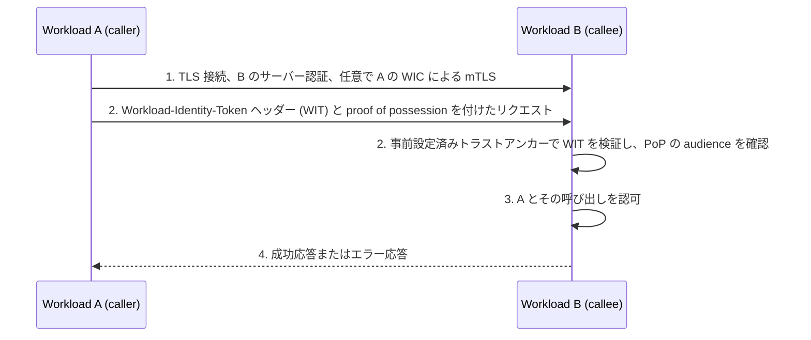

# Deep Dive: WIMSE Workload Credentials (draft-ietf-wimse-workload-creds-03)

> 一言で言うと: このドラフトは、公開鍵をちょうど 1 つの Workload Identifier に結び付ける Workload Identity Token（JWT）と Workload Identity Certificate（X.509 証明書）を定めており、リビジョン 03 では WIT の検証手順、proof of possession の audience に関する規則、トラストドメインと事前設定済みトラストアンカーとのより厳格な結び付けが加わった。

## 概要

- 互いを呼び出すワークロードには、自分が誰であり、どの鍵を保持しているかを示す資格情報が必要である。このドラフトはそのような資格情報を 2 種類定めるが、鍵の所持をどう証明するかは定めず、関連文書に委ねている（Section 1）。
- Workload Identity Token（WIT）は、Identity Server が発行する JWS 署名付き JWT である。`sub` クレームに 1 つの Workload Identifier を、`cnf.jwk` クレームにワークロードの公開鍵を持ち、後続の proof のアルゴリズムを固定する `alg` メンバーを含む（Section 5.1）。
- Workload Identity Certificate（WIC）は、Workload Identifier をちょうど 1 つの URI SubjectAltName に格納する X.509 証明書である（Section 6.1）。WIT はアプリケーション層のプロトコル向け、WIC は主に相互 TLS 向けである（Section 1）。
- 信頼はトラストドメインごとに固定される。利用者は、各トラストドメインから発行者およびトラストアンカーへの対応付けを帯域外で事前に設定しておかなければならず、資格情報は、その Workload Identifier に含まれるトラストドメインに結び付けられたアンカーに対してのみ検証しなければならない（Section 3）。
- リビジョン 03 は文書を再構成し、WIT の検証チェックリスト（Section 5.1.3）、アプリケーション層 proof の audience に関する節（Section 5.2）、トラストドメインへの所属とワークロードの同一性の違いに関するセキュリティ上の節（Section 9.2）を追加した。

## 仕組み

1. Workload B のサーバー認証を伴う TLS でトランスポート接続を確立する。Workload A の WIC を用いた相互 TLS は任意である（Section 1.1 の手順 1）。
2. Workload A は、アプリケーション層の認証情報として、`Workload-Identity-Token` ヘッダーフィールドに入れた WIT と proof of possession を付加できる。proof の仕組みはこのドラフトではなく [I-D.ietf-wimse-wpt] と [I-D.ietf-wimse-http-signature] にある（Section 1、5.1.1）。
3. Workload B は、WIT の `sub` クレームのトラストドメインでトラストアンカーを選び、Section 5.1.3 の検査を行う。さらに、Host などのリクエストフィールドではなく信頼できる設定を用いて、proof の audience が自分を指していることを確認する（Section 5.2）。
4. Workload B は、トラストドメインの範囲で照合した Workload Identifier を用いて呼び出しを認可し（Section 7）、応答を返す。検証の失敗はエラーとして通知され、通常は HTTP 400 である（Section 5.3）。

## ユースケース

- サービスメッシュやプラットフォームが短寿命の WIC をワークロードに発行し、サービス同士が相互 TLS で認証し合う。クライアントはサーバー証明書を、期待する識別子に照らして検証する（Section 1.2、6.1）。
- 中継点が TLS を終端するため、エンドツーエンドのトランスポート保護が使えない。呼び出し側はアプリケーション層で WIT と proof of possession を送る（Section 5）。
- ベアラー JWT から proof of possession ベースの WIT へ移行する際、移行期間中は呼び出し元ごとのポリシーで両方を受け入れる（Section 5.4）。
- WIT とトランザクショントークンを併用する。WIT でどの API 呼び出しを許可するかを決め、コンテキストトークンでどのリソースかを決める（Section 5.4）。
- 多層防御として失効機能を望む運用者が、短い WIT 寿命に加えて、トークンステータスリストや `jti` 拒否リストを運用する（Section 9.3.1）。

## なぜ今重要か

- **きっかけ**: WIMSE ワーキンググループの中核ドラフトのリビジョン 03（Datatracker の状態は Active、I-D Exists、WG Document）で、構成の再編、トラストアンカーの結び付けの厳格化、proof の audience に関する節の追加、1 つのランタイムに複数の識別子がある場合の独立した段落の削除が行われた。ワーキンググループの議長は、追加の議論が必要になる実質的な変更があれば指摘するようメーリングリストで求めた。
- **根拠となる資料**: ドラフトの Section A.1 に、課題番号付きで変更点が列挙されている（#173、#175、#256、#269、#270、#290、#294、#303、#370、#393、#395、#402、#411）。メールアーカイブには、著者による告知と議長のレビュー依頼があり、用意されたメッセージの範囲では技術的な異論は見当たらない。
- **想定される影響**: 関連文書（相互 TLS、WPT、HTTP 署名）の実装者と Identity Server の実装者は、受信側の具体的なチェックリストと、失効、audience、鍵の扱いに関するより明確な規則を得る。旧セクション番号を引用していた文書や、リビジョン 02 が求めていたアクセスパスと識別子の対応付け API を実装していた場合は、03 に照らして再確認が必要になる。

## 変更点

- 仕様・文書の変更概要:
  - Section 3: 資格情報は、その Workload Identifier のトラストドメインに結び付けられたアンカーに対してのみ検証しなければならない（MUST）。トークンから `iss` を使って JWKS を取得することの明示的な禁止は削除された。Section 9.1 は、資格情報自体から鍵を取得する検証者は任意の発行者を受け入れてしまうと説明しており、Appendix A.1 には「remove iss-based key distribution (#411)」とある。`iss` と `jwks_uri` の利用を扱っていたリビジョン 02 の Section 5.1.3 は「Validating the WIT」に置き換えられた。
  - Section 5.1.3（新規）: 受信側は、単一の整形式 JWS コンパクト形式 JWT であること、`sub` が単一の Workload Identifier でありトラストアンカーの選択に使うこと、`typ` が `wit+jwt` であること、署名が有効であること、`alg` を持つ `jwk` を含む `cnf` があることを確認しなければならず（MUST）、未知のクレームは無視する。
  - Section 5.2（新規）: proof of possession の audience は意図した受信者を示し、受信側は audience が自分を指していることを検証しなければならない（MUST）。仕組みの詳細は [I-D.ietf-wimse-wpt] と [I-D.ietf-wimse-http-signature] に委ねられている。
  - Section 1.2: リビジョン 02 の「実装はアクセスパスから Workload Identifier への対応付けを定義できなければならない（MUST）」という要件は、3 つの条件（ワークロードが自分の識別子を知っていること、被呼び出し側が要求が自分宛てであると検証できること、呼び出し側が期待する識別子を知っていること）と、サーバー証明書に関する [RFC9525] への参照に置き換えられた。
  - Section 4: 相関目的で 1 つの資格情報に 2 つ目のワークロード識別子を入れることを禁じていた段落は削除された。資格情報ごとにちょうど 1 つの Workload Identifier とする規則は、Section 4 の最初の段落、`sub`、Section 6.1 に残っており、同じ識別子を持つ複数の資格情報は `jti` などで区別できる。
  - Section 9.3.1 と Section 9.4.1: このドラフトは WIT や WIC の失効に依存しない。デプロイメントはトークンステータスリストや `jti` 拒否リストを運用してもよく（MAY）、その場合はすべての WIT に `jti` を含めなければならない（MUST）。WIC については CRL や OCSP に依存しない。
  - Section 9.2（新規）: トラストドメインのアンカーに対する検証は、そのドメインへの所属を示すだけで、どのワークロードかを示すものではない。proof of possession はこれを解決しない。プロビジョニング解除後も、既存の資格情報は有効期限まで使える。
  - Section 9.5: 秘密鍵は、十分に保護されている場合（例: エクスポート不可かつハードウェアに束縛）を除き、新しい資格情報ごとに再生成すべきである（SHOULD）。「鍵を秘密に保つ」ことの定義が加わり、検証者は資格情報だけからより強い鍵保護を推定してはならない。
  - Section 5.3: HTTP 401 は、`WWW-Authenticate` で返せる適切な HTTP 認証方式が存在する場合に限り、WIT のエラーに使うことが認められた。リビジョン 02 では 401 は NOT RECOMMENDED であった。
  - Section 1 と 9.3: TLS 上で WIT を送ること、あるいは proof を TLS の性質に結び付けることは、WIT をトランスポート層の資格情報にはしない。相互 TLS は WIC を使う。
  - 例と参照文献: 例の `cnf.jwk.alg` は `EdDSA` から `Ed25519` に変わった（[RFC9864]）。WIT の例は再署名された。[RFC8725] は [I-D.ietf-oauth-rfc8725bis] に置き換えられ、[RFC8414] は削除された。[RFC9525]、[RFC6960]、[RFC9864]、[I-D.ietf-oauth-status-list] が新たに参照されている。実装状況に wimsey が追加された。旧 Section 1.1（「Use In Other Protocols」）は削除され、アーキテクチャ図から Identity Server、PEP、PDP が除かれた。
- 互換性・移行上の懸念:
  - セクション番号が変わったため（例: 旧 Section 1.3 は 1.2 に、旧 Section 9.2 は 9.3 に）、番号で参照している外部文書は更新が必要である。すでに食い違いが 1 つある。[draft-ietf-wimse-http-signature-08](https://www.ietf.org/archive/id/draft-ietf-wimse-http-signature-08.txt)（Section 3、3.6）は、受信側に本ドラフトの「Section 5.1.4」に従って WIT を検証するよう求めているが、Section 5.1.4 は -02 にも -03 にも存在しない。-03 で WIT の検証を定めているのは Section 5.1.3 である。
  - `EdDSA` は禁止されていない。Section 5.1 の `alg` の規則は、`none` と対称鍵のアルゴリズムを除き、IANA の JOSE レジストリにある署名アルゴリズムを引き続き認めている。[RFC9864] はこのレジストリで `EdDSA` を Deprecated とし、例は完全に指定された `Ed25519` に移った。新しい識別子しか受け付けない検証者は、従来の `EdDSA` の鍵を拒否する。
  - `iss` による鍵の発見に依存していたデプロイメントは、事前設定済みトラストアンカーへ移行する必要がある。
  - リビジョン 02 のアクセスパス対応付けフックを公開していた実装には、期待される被呼び出し側の識別子をどう与えるかについて、規範的な指針がなくなった。

## 技術分析

- 脅威モデルへの含意:
  - ドメインをまたぐなりすまし: 識別子はトラストドメイン内でのみ意味を持ち、トラストドメインを無視すると、あるドメインが別のドメインになりすませる（Section 9.1、9.4）。
  - 不正な発行者: 資格情報自体から取得した鍵を使うと、発行者を運用できる誰からの資格情報も受け入れてしまう。事前設定による結び付けがこれを防ぐ（Section 3、9.1）。
  - 所属と同一性: 正しいドメインの有効な資格情報であっても、クライアントやサーバーが相手にしているワークロードが何かは分からず、proof of possession もこの隔たりを埋めない。それを埋めるのが Section 1.2 の識別子の照合である（Section 9.2）。
  - PoP の有効期間内に、取得した WIT と PoP が再送されること。緩和策は、短い PoP 寿命、狭い audience やスコープ、リプレイ防止、任意の TLS への束縛である（Section 9.3.2 から 9.3.5）。
  - 侵害とプロビジョニング解除: JWT や証明書の資格情報はその場で失効できないため、寿命が主要な対策となる。発行を止めても既存の資格情報は無効にならない（Section 9.2、9.3.1、9.4.1）。
  - トラストアンカーの侵害は証明書の安全性の上限を決めるため、リーフとアンカーの寿命は併せて検討すべきである（Section 9.4.1）。
  - 中継点は WIT と PoP を平文で見られ、それらを再送したり、PoP が保護しないデータを改変したりできる（Section 9.6）。
- プロトコルフローへの含意:
  - このドラフトは資格情報のみを扱う。所持の証明、audience の符号化、リプレイの規則は他のドラフトにあるため、Section 5.1.3 の検査は認証の必要条件ではあっても十分条件ではない。
  - 呼び出し側は期待する被呼び出し側の識別子を、被呼び出し側は自分の audience のための信頼できる設定を必要とする（Section 1.2、5.2）。
  - WIT は `Workload-Identity-Token` ヘッダーで運ばれ、その ABNF は 3 つの base64url 部分からなり、`Authorization` ヘッダー向けではない（Section 5.1、5.1.1）。
- 相互運用上の懸念:
  - `typ` は `wit+jwt` でなければならず、`cnf.jwk.alg` は必須で proof のアルゴリズムでなければならず、汎用の実装は ES256 に対応しなければならない（Section 5.1）。
  - 未知のクレームは無視しなければならず、プライベートなクレーム名は NOT RECOMMENDED であるため、拡張には衝突耐性のある名前か IANA に登録された名前を使うべきである（Section 5.1.2）。
  - WIC には、識別子を持つ URI SAN がちょうど 1 つ必要である。クライアントがホスト名で検証する場合に備え、DNSName SAN を含めることが RECOMMENDED である（Section 6.1）。
  - 規範的な依存先には複数のインターネットドラフト（[I-D.ietf-oauth-rfc8725bis]、[WIMSE-ID]、[I-D.ietf-wimse-mutual-tls]）が含まれ、このドラフトの進行速度に影響する（Section 12.1）。

## 未解決の問題

- Section 5.1.3 には、`exp` の確認、アルゴリズムの許可リスト、`iss` がある場合の `iss` の確認が列挙されていない。[RFC7515] と JWT のベストプラクティスを参照しており、Section 9.3.1 は寿命に関する考慮事項を見るよう述べるだけである。これで相互運用可能な検証者になるのか。
- Section 5.1 は `iss` を RECOMMENDED だが任意とし、詳細は Section 5.1.2 を見るよう述べている。Section 5.1.2 は「上で述べた監査・運用上の用途」に言及するが、改訂後の Section 5.1 の本文にはそれが明記されていない。
- Section 3 は、トラストドメインごとに既知の事前設定済み発行者を求めるが、`iss` がある場合に受信側がそれをその発行者と比較しなければならないかどうかは書かれていない。
- Section 4 は資格情報ごとに識別子を 1 つとする規則を維持する一方、安定したサービス識別子とインスタンス識別子についての指針を削除した。Section 9.2 は、識別子を共有するインスタンスは区別できないと警告している。短くなった文面で足りるかどうかは、議長が求める実質的変更のレビューの対象になり得る。
- Section 1.2 と Section 5.2 は、被呼び出し側に audience の検証を、呼び出し側に期待する被呼び出し側の識別子の把握を求めるが、どちらの値も知る手段を示していない。関連ドラフトでは、audience は WPT の `aud` クレーム（HTTP の対象 URI とすることが SHOULD。[draft-ietf-wimse-wpt-02](https://www.ietf.org/archive/id/draft-ietf-wimse-wpt-02.txt) Section 2、3.1.7）と、必須の `wimse-aud` 署名パラメータ（[draft-ietf-wimse-http-signature-08](https://www.ietf.org/archive/id/draft-ietf-wimse-http-signature-08.txt) Section 3.2）として運ばれる。audience を持たない proof の仕組みの場合にどうなるかも書かれていない。
- Section 5.3 は、「適切な HTTP 認証方式が存在する場合」に `WWW-Authenticate` 付きの 401 を認めている。ドラフトは WIT 向けのそのような方式を挙げておらず、Section 5.1 は WIT を `Authorization` ヘッダーに使わないとしている。
- Section 9.3.1 は、拒否リストやトークンステータスリストを運用するデプロイメントに `jti` を必須とするが、Section 5.1 は `jti` を OPTIONAL のままにしている。検証者は、発行者がそのような仕組みを運用しているかどうかを、トークンからは判別できない。
- Section 9.5 は、鍵がハードウェアに束縛されエクスポート不可であれば資格情報間での鍵の再利用を認めるが、検証者はそれを資格情報から推定できないとする。検証者がそれをどう知るかは、デプロイメントのプロファイルに委ねられている。
- メーリングリストの資料にあるのは告知と議長のレビュー依頼のみである。ワーキンググループがどの変更を実質的と見ているかは、確認できない。

## 実験

- [ ] Lab 1: Section 5.1.3 のチェックリストを実装した WIT 検証器を作り、誤った `typ`、`cnf.jwk.alg` の欠落、`sub` 内の 2 つの URI、未知のクレーム、期限切れの `exp`、アンカーが設定されていないトラストドメインを持つトークンを与える。チェックリストだけで拒否されるものと、JWT ベストプラクティスの規則に依存するものを記録する。
- [ ] Lab 2: Figure 2 と同様の WIT を、攻撃者が管理する JWKS の URL を指す `iss` で署名し、Section 3 と Section 9.1 に従う検証器がその URL を取得せず、対応する事前設定済みアンカーがなければトークンを拒否することを確認する。
- [ ] Lab 3: 取得した WIT と proof を 2 つ目の被呼び出し側へ再送する。信頼できる設定による audience 検査（Section 5.2）がある場合とない場合、および Host を書き換えるプロキシがある場合で試し、audience 検証がどこで失敗するかを確認する。

## 出典

- [Datatracker 上の draft-ietf-wimse-workload-creds-03](https://datatracker.ietf.org/doc/draft-ietf-wimse-workload-creds/03/)
- [リビジョン 02 と 03 の差分](https://author-tools.ietf.org/iddiff?url1=draft-ietf-wimse-workload-creds-02&url2=draft-ietf-wimse-workload-creds-03)
- [WIMSE リスト: リビジョン 03 の I-D Action 告知](https://mailarchive.ietf.org/arch/msg/wimse/D0yp8C50a2LkaBERkKq2cYJmQ3o/)
- [WIMSE リスト: 新版通知と議長のレビュー依頼](https://mailarchive.ietf.org/arch/msg/wimse/gAWR5Ocuquz_psAlNEcjyackx3E/)
- [draft-ietf-wimse-workload-creds-02 本文](https://www.ietf.org/archive/id/draft-ietf-wimse-workload-creds-02.txt)
- [draft-ietf-wimse-wpt-02 本文](https://www.ietf.org/archive/id/draft-ietf-wimse-wpt-02.txt)
- [draft-ietf-wimse-http-signature-08 本文](https://www.ietf.org/archive/id/draft-ietf-wimse-http-signature-08.txt)
- [RFC 9864](https://www.rfc-editor.org/rfc/rfc9864)
- [wimsey（Section 8 に掲載の実装）](https://github.com/kanywst/wimsey)
