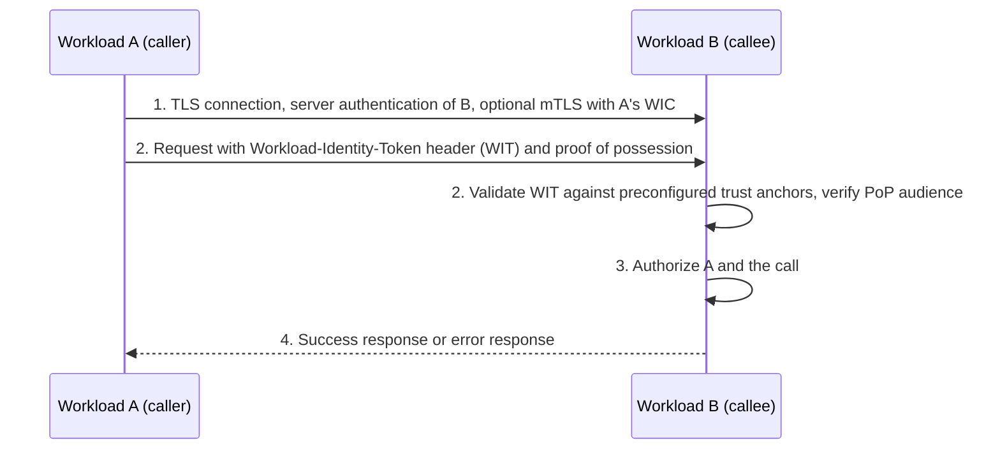

# Deep Dive: WIMSE Workload Credentials (draft-ietf-wimse-workload-creds-03)

> In one line: the draft defines the Workload Identity Token (a JWT) and the Workload Identity Certificate (an X.509 certificate) that bind a public key to exactly one Workload Identifier, and revision 03 adds a WIT validation procedure, a rule on the audience of proofs of possession, and stricter binding of trust domains to preconfigured trust anchors.

## What this is

- Workloads that call each other need a credential that says who they are and which key they hold. This draft defines two such credentials and nothing about how possession of the key is proven; that is left to companion documents (Section 1).
- The Workload Identity Token (WIT) is a JWS-signed JWT issued by an Identity Server. Its `sub` claim carries one Workload Identifier and its `cnf.jwk` claim carries the workload's public key, including an `alg` member that fixes the algorithm of the later proof (Section 5.1).
- The Workload Identity Certificate (WIC) is an X.509 certificate that carries the Workload Identifier in exactly one URI SubjectAltName (Section 6.1). The WIT is meant for application-layer protocols and the WIC primarily for mutual TLS (Section 1).
- Trust is anchored per trust domain. Consumers must hold a preconfigured, out-of-band mapping from each trust domain to its issuers and trust anchors, and must validate a credential only against the anchors of the trust domain named in its Workload Identifier (Section 3).
- Revision 03 reorganises the document and adds a WIT validation checklist (Section 5.1.3), a section on the audience of application-layer proofs (Section 5.2) and a security section on the difference between trust domain membership and workload identity (Section 9.2).

## How it works

1. A transport connection is established with TLS server authentication of Workload B. Mutual TLS using Workload A's WIC is optional (Section 1.1, step 1).
2. Workload A may add application-layer authentication: the WIT in the `Workload-Identity-Token` header field plus a proof of possession. The proof mechanisms are in [I-D.ietf-wimse-wpt] and [I-D.ietf-wimse-http-signature], not in this draft (Sections 1, 5.1.1).
3. Workload B selects trust anchors by the trust domain in the WIT `sub` claim and runs the checks of Section 5.1.3. It also verifies that the audience of the proof refers to itself, using trusted configuration and not request fields such as Host (Section 5.2).
4. Workload B authorizes the call using the Workload Identifier, matched in the scope of its trust domain (Section 7), and returns a response. Validation failures are reported as errors, typically HTTP 400 (Section 5.3).

## Use cases

- A service mesh or platform issues short-lived WICs to workloads, and services authenticate each other with mutual TLS. The client checks the server certificate against the identifier it expects (Sections 1.2, 6.1).
- Traffic passes through intermediaries that terminate TLS, so end-to-end transport security is unavailable. The caller sends a WIT with a proof of possession at the application layer (Section 5).
- A deployment migrates from bearer JWTs to proof-of-possession WITs and accepts both for a transition period, with per-caller policy (Section 5.4).
- A deployment combines the WIT with a transaction token: the WIT decides which API calls are allowed and the context token decides which resources (Section 5.4).
- An operator that wants revocation as defence in depth runs a token status list or a `jti` deny-list next to short WIT lifetimes (Section 9.3.1).

## Why This Matters Now

- **Trigger**: revision 03 of a core WIMSE working group draft (Datatracker states: Active, I-D Exists, WG Document) reorganised its structure, tightened trust-anchor binding, added a proof-audience section and removed the standalone paragraph on several identifiers per runtime. The working group chair asked the list to flag any substantive change that needs more discussion.
- **Source evidence**: Section A.1 of the draft lists the changes with issue numbers (#173, #175, #256, #269, #270, #290, #294, #303, #370, #393, #395, #402, #411). The mail archive shows the author announcement and the chair's request for review (30 October 2026, 18:29 UTC; both linked under Sources). As of 1 November 2026 the list had no replies to either.
- **Expected impact**: implementers of the companion documents (mutual TLS, WPT, HTTP signatures) and of identity servers get a concrete recipient checklist and clearer rules on revocation, audience and key handling. Anyone who cited the old section numbers, or built the access-path-to-identifier mapping API that revision 02 required, has to re-check against 03.

## What Changed

- Spec/document change summary:
  - Section 3: a credential MUST be validated only against the anchors bound to the trust domain in its Workload Identifier. The explicit prohibition on using `iss` to fetch a JWKS from the token is gone; Section 9.1 now explains that a validator taking keys from the credential would accept any issuer, and Appendix A.1 says "remove iss-based key distribution (#411)". Section 5.1.3 of revision 02, which covered `iss` and `jwks_uri` use, was replaced by "Validating the WIT".
  - Section 5.1.3 (new): the recipient MUST check a single well-formed JWS compact JWT, a single Workload Identifier in `sub` used to pick trust anchors, `typ` of `wit+jwt`, a valid signature, `cnf` with a `jwk` that has `alg`, and ignore unknown claims.
  - Section 5.2 (new): the audience of the proof of possession identifies the intended recipient, and the recipient MUST verify it refers to itself. Mechanism details are left to [I-D.ietf-wimse-wpt] and [I-D.ietf-wimse-http-signature].
  - Section 1.2: the revision 02 requirement that implementations MUST allow a mapping from access path to workload identifier is replaced by three conditions (a workload knows its own identifier, a callee can verify a request is meant for it, a caller knows the identifier it expects) and a pointer to [RFC9525] for server certificates.
  - Section 4: the paragraph on deployments with several labels for one runtime is removed. It put the identity used for the access decision in the one credential and forbade a second workload identifier for correlation. The rule of exactly one Workload Identifier per credential stays in the first paragraph of Section 4, in `sub`, and in Section 6.1; multiple credentials with the same identifier may be told apart by `jti` and similar fields.
  - Section 9.3.1 and Section 9.4.1: the draft does not rely on WIT or WIC revocation. Deployments MAY run a token status list or `jti` deny-list, and then MUST include `jti` in every WIT. CRL and OCSP are not relied on for WICs.
  - Section 9.2 (new): validating against a trust domain's anchors proves membership of the domain, not which workload the peer is. Proof of possession does not fix that. Existing credentials stay usable after deprovisioning until expiry.
  - Section 9.5: private keys SHOULD be regenerated for each new credential unless sufficiently protected, for example non-exportable and hardware-bound; "keeping the key private" is defined, and verifiers must not infer stronger key protection from the credential alone.
  - Section 5.3: HTTP 401 is allowed for WIT errors only when an acceptable HTTP authentication mechanism can be returned in `WWW-Authenticate`. Revision 02 said 401 was NOT RECOMMENDED.
  - Section 1 and 9.3: a WIT sent over TLS, or a proof bound to TLS properties, does not make the WIT a transport-layer credential; mutual TLS uses the WIC.
  - Examples and references: `cnf.jwk.alg` in the examples is now `Ed25519` instead of `EdDSA` ([RFC9864]); the WIT example was re-signed. [RFC8725] is replaced by [I-D.ietf-oauth-rfc8725bis] and [RFC8414] is dropped. New references are [RFC9525], [RFC6960], [RFC9864] and [I-D.ietf-oauth-status-list]. An implementation status entry for wimsey was added. Section 1.1 of the old document ("Use In Other Protocols") was removed and the Identity Server, PEP and PDP were dropped from the architecture figure.
- Compatibility or migration concerns:
  - Section numbers moved (for example former Section 1.3 is now 1.2, former Section 9.2 is now 9.3), so external references by number need updating. One is already wrong: [draft-ietf-wimse-http-signature-08](https://www.ietf.org/archive/id/draft-ietf-wimse-http-signature-08.txt) (Sections 3 and 3.6) tells recipients to validate the WIT "as specified in Section 5.1.4" of this draft, but neither -02 nor -03 has a Section 5.1.4. WIT validation is Section 5.1.3 in -03.
  - `EdDSA` is not forbidden. The `alg` rule in Section 5.1 still allows any signature algorithm in the IANA JOSE registry except `none`, symmetric-key and encryption algorithms. [RFC9864] marks `EdDSA` as Deprecated in that registry, and the examples moved to the fully specified `Ed25519`. Verifiers that accept only the new identifier will reject older `EdDSA` keys.
  - Deployments that relied on `iss`-driven key discovery must move to preconfigured trust anchors.
  - Implementations that exposed the revision 02 access-path mapping hook get no normative guidance on how the expected callee identifier is supplied now.

## Technical Analysis

- Threat model implications:
  - Cross-domain spoofing: identifiers are meaningful only inside their trust domain, and ignoring the trust domain lets one domain impersonate another (Sections 9.1, 9.4).
  - Rogue issuer: key material taken from the credential itself would be accepted from anyone running an issuer; preconfigured binding prevents it (Sections 3, 9.1).
  - Membership versus identity: a valid credential from the right domain does not tell a client or server which workload it faces, and proof of possession does not close that gap. The identifier comparison of Section 1.2 is what does (Section 9.2).
  - Capture and replay of a WIT with its PoP within the PoP lifetime. Mitigations are short PoP lifetime, narrow audience or scope, replay protection and optional TLS binding (Sections 9.3.2 to 9.3.5).
  - Compromise and deprovisioning: JWT and certificate credentials are not revocable on demand, so lifetime is the main control. Stopping issuance does not invalidate existing credentials (Sections 9.2, 9.3.1, 9.4.1).
  - Trust anchor compromise bounds certificate safety, so leaf and anchor lifetimes should be considered together (Section 9.4.1).
  - Intermediaries see the WIT and PoP in clear text and can replay them or alter data the PoP does not cover (Section 9.6).
- Protocol flow implications:
  - The draft is credential-only. Possession proof, audience encoding and replay rules live in other drafts, so the checks of Section 5.1.3 are necessary but not sufficient for authentication.
  - The caller side now needs an expected callee identifier, and the callee side needs trusted configuration for its own audience (Sections 1.2, 5.2).
  - The WIT is carried in the `Workload-Identity-Token` header, defined by an ABNF of three base64url parts, and is not for the `Authorization` header (Sections 5.1, 5.1.1).
- Interop concerns:
  - `typ` must be `wit+jwt`, `cnf.jwk.alg` is mandatory and must be the algorithm of the proof, and ES256 MUST be supported by general purpose implementations (Section 5.1).
  - Unknown claims must be ignored, and private claim names are NOT RECOMMENDED, so extensions should use collision-resistant or IANA-registered names (Section 5.1.2).
  - The WIC must have exactly one URI SAN carrying the identifier. DNSName SANs are RECOMMENDED when clients validate by host name (Section 6.1).
  - Normative dependencies include several Internet-Drafts ([I-D.ietf-oauth-rfc8725bis], [WIMSE-ID], [I-D.ietf-wimse-mutual-tls]), which affects how quickly this draft can progress (Section 12.1).

## Open Questions

- Section 5.1.3 does not list the `exp` check, an algorithm allowlist, or an `iss` check when `iss` is present. It refers to [RFC7515] and the JWT best practices, and Section 9.3.1 only says to see lifetime considerations. Is that enough for interoperable validators?
- Section 5.1 says `iss` is RECOMMENDED but optional and points to Section 5.1.2 for details. Section 5.1.2 refers to "the auditing and operational uses described above", which the revised Section 5.1 text no longer spells out.
- Section 3 requires a known, preconfigured issuer per trust domain, but the draft does not say whether a recipient must compare a present `iss` with that issuer.
- Section 4 keeps exactly one identifier per credential but drops the guidance on stable service identity versus instance identity. Section 9.2 warns that instances sharing an identifier cannot be told apart. Whether the shorter text is enough is a question the chair's request for substantive-change review could cover.
- Section 1.2 and Section 5.2 require the callee to verify the audience and the caller to know the expected callee identifier, but give no mechanism to learn either value. The companion drafts carry the audience as the WPT `aud` claim, which SHOULD be the HTTP target URI ([draft-ietf-wimse-wpt-02](https://www.ietf.org/archive/id/draft-ietf-wimse-wpt-02.txt) Sections 2 and 3.1.7), and as the mandatory `wimse-aud` signature parameter ([draft-ietf-wimse-http-signature-08](https://www.ietf.org/archive/id/draft-ietf-wimse-http-signature-08.txt) Section 3.2). What happens with proof mechanisms that carry no audience is not stated.
- Section 5.3 allows 401 with `WWW-Authenticate` "when an acceptable HTTP authentication mechanism exists". The draft does not name such a mechanism for WITs, and Section 5.1 says the WIT is not for the `Authorization` header.
- Section 9.3.1 makes `jti` mandatory for deployments that run a deny-list or token status list, while Section 5.1 keeps `jti` OPTIONAL. A validator cannot tell from the token whether the issuer operated such a mechanism.
- Section 9.5 allows key reuse across credentials when the key is hardware-bound and non-exportable, but says verifiers cannot infer this from the credential. How a verifier learns it is left to deployment profiles.
- As of 1 November 2026 the WIMSE list had only the announcement and the chair's call for review, with no replies. Which changes, if any, the working group considers substantive is not yet known.

## Experiments

- [ ] Lab 1: build a WIT validator that implements the Section 5.1.3 checklist and feed it tokens with a wrong `typ`, a missing `cnf.jwk.alg`, two URIs in `sub`, an unknown claim, an expired `exp`, and a trust domain with no configured anchors. Record which cases the checklist alone rejects and which depend on JWT best-practice rules.
- [ ] Lab 2: sign a Figure 2 style WIT with an `iss` pointing at an attacker-controlled JWKS URL and confirm that a validator following Section 3 and Section 9.1 never fetches it and rejects the token when the trust domain has no matching preconfigured anchor.
- [ ] Lab 3: replay a captured WIT and proof to a second callee, with and without audience checking from trusted configuration (Section 5.2), and with a proxy that rewrites Host, to see where audience validation fails.

## Sources

- [draft-ietf-wimse-workload-creds-03 on the Datatracker](https://datatracker.ietf.org/doc/draft-ietf-wimse-workload-creds/03/)
- [Diff between revisions 02 and 03](https://author-tools.ietf.org/iddiff?url1=draft-ietf-wimse-workload-creds-02&url2=draft-ietf-wimse-workload-creds-03)
- [WIMSE list: I-D Action announcement for revision 03](https://mailarchive.ietf.org/arch/msg/wimse/D0yp8C50a2LkaBERkKq2cYJmQ3o/)
- [WIMSE list: new version notification and chair's request for review](https://mailarchive.ietf.org/arch/msg/wimse/gAWR5Ocuquz_psAlNEcjyackx3E/)
- [draft-ietf-wimse-workload-creds-02 text](https://www.ietf.org/archive/id/draft-ietf-wimse-workload-creds-02.txt)
- [draft-ietf-wimse-wpt-02 text](https://www.ietf.org/archive/id/draft-ietf-wimse-wpt-02.txt)
- [draft-ietf-wimse-http-signature-08 text](https://www.ietf.org/archive/id/draft-ietf-wimse-http-signature-08.txt)
- [RFC 9864](https://www.rfc-editor.org/rfc/rfc9864)
- [wimsey, the implementation listed in Section 8](https://github.com/kanywst/wimsey)
