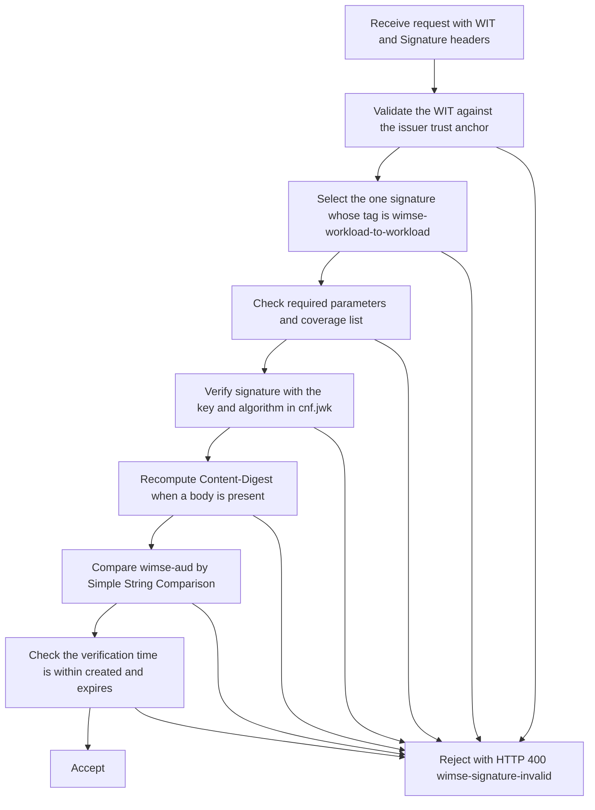

# Deep Dive: draft-miao-wimse-http-signature-test-vectors

> 一言で言うと: WIMSE の Workload-to-Workload HTTP Message Signatures プロファイル向けのテストベクター集。テスト鍵をすべて公開し、時計を固定して、正例 6 件、負例 23 件と、基底仕様の文面では合否を決められない観察事項 3 件を収める。

## 概要

draft-ietf-wimse-http-signature の WIMSE プロファイルは、ワークロード間の HTTP リクエストとレスポンスに RFC 9421 で署名し、署名鍵を Workload Identity Token（WIT）の `cnf.jwk` クレームに結び付ける。このプロファイルには、必須コンポーネント、必須パラメーターと禁止パラメーター、タグによる署名の選択、audience の照合、nonce によるレスポンスの結び付けといった小さな MUST 規則が多く、どれも実装ごとに少しずつずれやすい。本ドラフトは、固定した公開のメッセージ、署名ベース、期待結果を示し、実装を同じ入力で検査できるようにする。新しいプロトコル動作は定義しない（Abstract、Section 1）。各負例は、正例を 1 か所だけ変えたもの、または実装の動作の記述で、基底仕様から引用した要件に対応付けられている（Section 1、Section 5）。ほかに観察事項が 3 件あり、合否判定の対象外である（Section 2、Section 6）。

## 仕組み

この図は、P-01、P-03、P-06 が挙げるリクエストの検査を、このリポジトリーがまとめたものである（Section 4.1、4.3、4.6）。ドラフトに図はない。順序のうち本文から来るのは二つだけである。WIT を署名より先に検証すること（基底仕様 Section 3 の MUST で、N-20 が試す）と、タグとカバー範囲の検査が署名検証の前に失敗すること（N-01、N-08。Section 5.1、5.8）。P-01 の手順は署名の検査をカバー範囲の検査より先に書いており、この点でドラフトは一貫していない。それ以外の順序はこちらで決めた。クライアントによる署名付きレスポンスの検査（P-02、Section 4.2）は描いていない。

1. テストランナーが、公開された鍵、WIT、信頼する構成を読み込む（Section 3）。svcB の検証者は 4 つの `wimse-aud` 値と発行者の公開鍵を信頼する。
2. ランナーは時計を固定する。署名は T0 = 1795000000 に作成され、created+300 で期限が切れ、エントリーに別の記載がなければ T0+60 に検証される（Section 2）。
3. 正例では、実装が署名ベース（RFC 9421 Section 2.5）とリテラルの Signature 値を再現し、検証者がメッセージを受理する（Section 2、Section 4）。
4. 負例では、ランナーが基になるベクターに記載の変更を 1 つ加え、WIT に結び付いた鍵で署名し直す。エントリーが署名をそのまま引き継ぐ、またはリテラルで示すと書いている場合は除く（Section 2）。Ed25519 と RFC 6979 の ES256 は決定的なので、署名し直した値も再現できる。
5. 検証者は、どの検査が失敗したかを示さずに、HTTP 400 と `wimse-signature-invalid` の問題タイプで拒否する。レスポンスの場合はクライアントが拒否する（Section 2、Section 5）。
6. 負例のうち 6 件（N-16 から N-20 と N-22）は、送信者、サーバー、検証者の動作の判定で、単一のメッセージではなく記載の手順で判断する（Section 2。Section 5.17 から 5.21 と 5.23）。

## ユースケース

- WIMSE HTTP 署名プロファイルの実装者が、P-01 から P-06 を回帰テストとして回し、署名ベースと Signature 値がバイト単位で一致することを確かめる。
- 検証者の作者が、N-06 と N-07 で、暗号的には有効でも `keyid` または `alg` を含む署名が拒否されることを確かめる（Section 5.6、5.7）。
- サーバーの作者が、無効な WIT と無効な署名へのエラーレスポンスがどちらも HTTP 400 で見分けがつかず、401 を返さないことを検査する（N-17、Section 5.18）。
- クライアントの作者が、署名のないレスポンスと、`wimse-req-nonce` が欠けている、または値が違うレスポンスを拒否することを検査する（N-12、N-13、N-14）。
- ワーキンググループのレビュアーが Section 6 を読み、基底仕様に編集上の注記やテストの指針が要りそうな箇所を確認する。

## なぜ今重要か

- **きっかけ**: リビジョン -00 が 2026 年 11 月 18 日に、想定ステータス Informational の個人提出として公開された。ワーキンググループには採択されていない（Datatracker）。
- **根拠となる資料**: このセットは 2026 年 11 月 6 日に ietf-wg-wimse/draft-ietf-wimse-s2s-protocol の issue #419 で最初に公開され、同じ日に WIMSE メーリングリストで告知された。本ドラフトはそのセットの v4（2026 年 11 月 13 日）を Internet-Draft の形にしたものである（Section 1、Appendix B）。基底として draft-ietf-wimse-http-signature-08 を引用する（Section 9.1）。-09 は 2026 年 11 月 20 日に出た。
- **想定される影響**: 独立した実装どうしが、プロファイルの MUST 規則を同じ物差しで測れるようになる。セットとともに挙がった点のうち二つは -09 に入った。CONNECT の `@authority` の値が RFC 9421 の既定ポート省略に従うようになり（P-04）、例の nonce が説明用でエントロピーの要件を満たさないと明記された（O-2）（-09 Section 3、Section 3.7、Appendix B.1）。issue #419 で Yaron Sheffer は 2026 年 11 月 7 日、どの形の貢献が役立つかを chair に相談するよう作者に勧めている。

## 変更点

- 仕様・文書の変更の概要: リビジョン -00 なので差分はない。v4 のセットを Internet-Draft の形で示す。変更履歴には、v1（2026 年 11 月 6 日、ベクター 28 件: 正例 6 件、負例 22 件、ほかに観察事項 3 件）、v2（P-01、P-02、P-06 の `@query` 行を先頭の `?` を含む形に直して署名を出し直し、N-15 を再計算し、N-06 と N-07 に共著者の確認を注記）、v3（2026 年 11 月 12 日、P-04 の `@authority` を既定ポートを省いた形に正規化）、v4（2026 年 11 月 13 日、N-09b と機械可読のアンカー層を追加）が記録されている（Appendix B）。
- 互換性または移行上の懸念: このセットは draft-ietf-wimse-http-signature-08 に固定されている（Section 9.1）。-09 では、負例が引用する要件はすべて変わっていない。例外は N-20 が引用する WIT 検証の節で、workload credentials ドラフトの Section 5.1.4 から 5.1.3 に変わった。-09 は、クライアントが Accept-Signature でサーバーが生成した nonce を使うことも認めた（Section 3 の MAY）が、これを試すベクターはない。ドラフトは、今後の改訂にどう追随するかを書いていない。テスト鍵は公開されており、本番のシステムで使ってはならない（MUST NOT、Section 7）。

## 技術分析

- 脅威モデルへの含意: 負例は具体的な攻撃や誤りの類型に対応する。`@query` のカバー漏れと Content-Digest の不一致は、署名が本当にメッセージを覆っているかを試す（Section 5.1、5.4）。Simple String Comparison による audience の照合は、正規化による取り違えへの耐性を試す（Section 5.11）。`wimse-req-nonce` による結び付けは、レスポンスの取り違えとリクエストをまたぐリプレイへの防御と説明されている（Section 5.14）。WIT 検証前の処理は、認証されていない内容が業務処理に届かないことを試す（Section 5.21）。O-1 は、リプレイキャッシュを持つのは MAY、既出の nonce を拒否するのは SHOULD にとどまるため、検証者間でキャッシュを共有しなければリプレイが通りうると指摘する（Section 6。基底仕様 Section 3、5.1）。
- プロトコルフローへの含意: ベクターは基底仕様が求める順序を固定する。WIT を検証し、次に署名を検証し、検証が終わるまでそれ以上処理しない（Section 5.21）。WIMSE 署名はラベルではなくタグで選び、WIMSE タグの署名が二つあればメッセージ全体を拒否する（P-06、N-08、N-22）。CONNECT は例外で、`@method` と `@authority` を覆い、`@path` と `@query` は覆ってはならない（P-04、N-02、N-21）。N-09b は有効期間を閉区間 [created, expires] として扱い、T0+300 で受理、T0+301 で拒否を確かめる（Section 5.10）。基底仕様は期間外の署名を拒否しなければならない（MUST）としか書いていないので、右端を含むのはドラフトの解釈である。
- 相互運用上の懸念: ドラフトは次を挙げる。クエリがないとき `@query` は `?` になる（P-05）。`@authority` の値は既定ポートを省く（P-04）。これは -09 の文言には合うが、-08 の「the host and port of the CONNECT target」には合わない。ES256 の署名は r||s をそのまま連結した形である（P-03）。署名し直した値は決定的な署名に依存する（Section 2）。正例はリテラルの Signature 値を示すが、負例の多くはランナーが署名し直すので、実装は基底仕様の Section 3.1 に従って署名し直せる必要がある。長い行は RFC 8792 の折り返しを使う（Section 2）。-00 の本文では、WIT のプレースホルダーが `[WIT-A，§2 全文]` と書かれている。全角の読点を含み、鍵は Section 3 にあるのに §2 を指している。Section 2 は `[WIT-x, full text in the Test Key Material section]` という形を説明し、プレースホルダーは署名対象にそのまま残ると書く。ここで公開の svcA 鍵を使って P-01 を署名し直すと、公開の Signature 値と一致するのは WIT-A の全文を入れたときだけで、プレースホルダーのままでは一致しない（検証ログ）。ランナーはベースにトークンの全文を入れる必要がある。

## 未解決の問い

- Section 1 は訂正が Change Log（Appendix A）に記録されているとするが、Change Log は Appendix B である。相互参照の誤りと思われる。
- Section 2 はプレースホルダーが「retained verbatim in the signed material」だとするが、P-01 の署名は WIT-A の全文に対してしか検証に通らない。「deterministic expansion」はそれ以上定義されていない。作者は issue #419（2026 年 11 月 13 日）で、展開は関連する適合性テストスイートの抽出層で行うと述べたが、ドラフトはそのスイートを引用していない。
- N-04 は、本文の差し替えで署名も無効になる（「also invalidates the signature」）と書く。実際には無効にならない。署名が覆うのは Content-Digest ヘッダーで、その値は変わらないため、失敗するのは再計算したダイジェストの比較だけである。このリポジトリーは 2026 年 11 月 11 日に issue #419 でこれを報告したが、-00 にもこの文が残っている（Section 5.4）。
- N-06 と N-07 は `keyid` と `alg` を含むメッセージの拒否を期待するが、基底仕様はこれを送信者の規則（「MUST NOT be used」、Section 3、3.1）としてしか書いていない。この解釈の根拠は、2026 年 11 月 7 日の WIMSE メーリングリストでの Yaron Sheffer の返信「IMO a MUST NOT in any security RFC should be rejected by the recipient」である。-09 は受信側の文言を足していない。N-01、N-02、N-21 も同じく送信者の規則に依っている。
- O-1: リプレイキャッシュを持つのは MAY なので、このセットにリプレイの負例はない。ドラフトはテストの指針について「may merit a note」と書くが、具体案は示さない（Section 6）。
- O-2: 基底仕様の例の nonce（`abcd1111` など）は 32 ビットで、64 ビットのエントロピーを求める MUST に届かない。ドラフトは編集上の注記が入るまでこの項目を残すとしている（Section 6）。-09 の Section 3.7 にはその注記が入った（「The nonce values in these examples are illustrative and do not meet the entropy requirement in Section 3」。issue #420、2026 年 11 月 20 日にクローズ）ので、次の改訂でこの項目は外せる。
- O-3: CONNECT 以外のリクエストで `@authority` を覆うことは必須でも禁止でもなく、`wimse-aud` との役割分担は決まっていない（Section 6）。
- N-16 は「the nonces of N requests」を集めるという以上のしきい値の決め方を示さず、N も決めていない（Section 5.17）。
- N-20 は、順序を「additionally assessed by implementation inspection or instrumentation evidence」としており、ブラックボックスのテストとしては再現できない（Section 5.21）。
- Section 1 は、以前の版を独立した実装者 2 人が再現し、全体を cred-ninja が検証したと書く。公開の記録で確認できるのは、issue #419 での 2 回の実行（2026 年 11 月 7 日の実行は v2 で直された `@query` の不具合を見つけ、11 月 11 日の実行はすべての結果が一致したと報告）と、cred-ninja/sdk の PR #136（2026 年 11 月 19 日にマージ）にある「#419 vectors: 28/28」である。28 は v4 で N-09b が加わる前の件数で、29 件すべてを対象にした公開の報告は見つからなかった。

## 実験

- [x] Lab 1: 記載のシード（`SHA-256("s01-validation-vectors:<name>")` と svcC のスカラーの導出）からテスト鍵を作り直して公開の JWK と比べ、次に P-01 の署名ベースを組み立て直して Signature 値をバイト単位で比べる。UTC で 2026 年 11 月 25 日に実施した。5 つの鍵はすべて一致し、P-01 はベースに WIT-A の全文を入れたときだけ一致した（検証ログ）。
- [ ] Lab 2: 既存の WIMSE HTTP 署名の検証者に P-01 から P-06、N-01 から N-15、T0+300 と T0+301 の N-09b を通し、それぞれの受理・拒否と HTTP ステータスを記録する。N-06、N-07、N-10 が、署名が有効でも拒否されることを確かめる。受理・拒否の部分は draft-ietf-wimse-http-signature の deep dive でスクリプトの検証者を使って実行済み（2026 年 11 月 11 日と 15 日）で、判定はすべて一致した。動いているサーバーでの HTTP ステータスは未確認である。
- [ ] Lab 3: 動作のプローブを実行する。WIT が期限切れで署名は有効なメッセージを送って副作用を観察する（N-20）。無効な WIT と無効な署名を送ってレスポンスを比べる（N-17）。署名できないサーバーに `wimse-sign-response` 付きのリクエストを送る（N-18）。

## 出典

- [draft-miao-wimse-http-signature-test-vectors-00](https://datatracker.ietf.org/doc/draft-miao-wimse-http-signature-test-vectors/00/)
- [draft-ietf-wimse-http-signature-08（ドラフトが引用する基底仕様）](https://datatracker.ietf.org/doc/html/draft-ietf-wimse-http-signature-08)
- [draft-ietf-wimse-http-signature-09](https://datatracker.ietf.org/doc/html/draft-ietf-wimse-http-signature-09)
- [issue #419（セットが最初に公開された場所）](https://github.com/ietf-wg-wimse/draft-ietf-wimse-s2s-protocol/issues/419)
- [WIMSE メーリングリスト: 2026 年 11 月 7 日の Yaron Sheffer の返信](https://mailarchive.ietf.org/arch/msg/wimse/IcH0Hq5968-TzSxLL7Wpi4pl-7k/)
- [cred-ninja/sdk PR #136](https://github.com/cred-ninja/sdk/pull/136)
- [このリポジトリーでの #419 ベクターの実行](https://github.com/0-draft/identity-deep-dive/blob/main/tracks/ietf-wimse/deep-dives/draft-ietf-wimse-http-signature/spec-notes.md)
