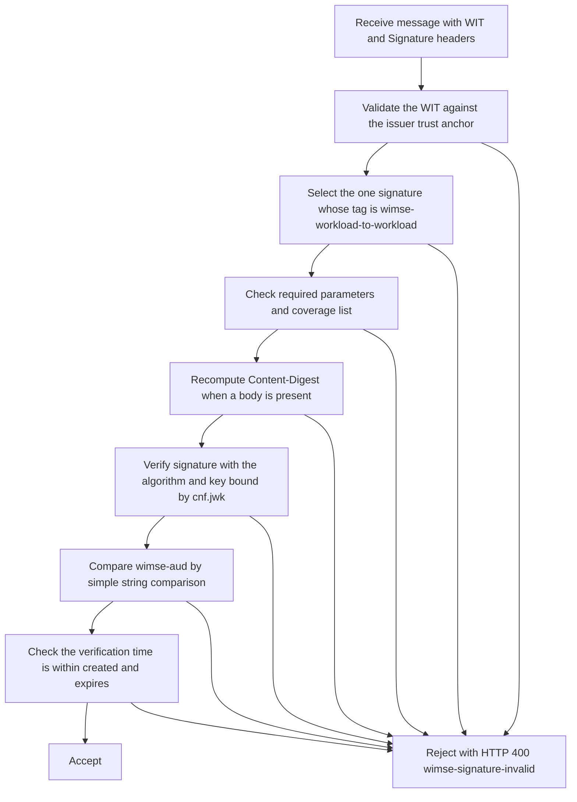

# Deep Dive: draft-miao-wimse-http-signature-test-vectors

> 一言で言うと: WIMSE の Workload-to-Workload HTTP Message Signatures プロファイルのためのテストベクター集であり、公開済みのテスト鍵、固定された時計、正例 6 件、負例 23 件、および基底仕様の文面では合否を判定できない 3 件の観察事項を含む。

## 概要

draft-ietf-wimse-http-signature の WIMSE プロファイルは、RFC 9421 でワークロード間の HTTP リクエストとレスポンスに署名し、署名鍵を Workload Identity Token（WIT）の `cnf.jwk` クレームに結び付ける。このプロファイルには、必須コンポーネント、必須パラメーターと禁止パラメーター、タグによる署名選択、audience の照合、nonce によるレスポンスの結び付けなど、小さな MUST 規則が多数あり、それぞれ実装が少しずつ異なりやすい。本ドラフトは、固定された公開のメッセージ、署名ベース、期待結果の集合を提供し、実装を同じ入力で検査できるようにする。新しいプロトコル動作は定義しない（Abstract、Section 1）。各負例は、正例を 1 か所変更したもの、または実装の動作の記述であり、基底仕様から引用した要件に対応付けられている（Section 1、Section 5）。さらに 3 件の観察事項があるが、判定の対象ではない（Section 6）。

## 仕組み

この図は、正例が文章で述べる検証者の手順をまとめたものである（Section 4.1、4.2）。ドラフト自体は図を示しておらず、中間の検査の順序は要約であって、ドラフトの記述ではない。

1. テストランナーが、公開された鍵、WIT、信頼された構成を読み込む（Section 3）。svcB の検証者は 4 つの `wimse-aud` 値と発行者の公開鍵を信頼する。
2. ランナーは時計を固定する。署名は T0 = 1795000000 に作成され、created+300 で失効し、記載がない限り T0+60 に検証される（Section 2）。
3. 正例では、実装が署名ベース（RFC 9421 Section 2.5）とリテラルの Signature 値を再現し、検証者がメッセージを受理する（Section 4）。
4. 負例では、ランナーが基底ベクターに 1 つの変更を加え、WIT に結び付けられた鍵で再署名する。ただし、エントリーが署名を引き継ぐ、またはリテラルであると述べる場合は除く（Section 2）。Ed25519 と RFC 6979 の ES256 は決定的なので、再生成された値は再現可能である。
5. 検証者は、どの検査が失敗したかを示さずに、HTTP 400 と `wimse-signature-invalid` 問題タイプで拒否しなければならない。または、クライアントがレスポンスを拒否しなければならない（Section 2、Section 5）。
6. 一部の負例は、単一メッセージではなく、記載された手順で判断する送信者、サーバー、検証者の動作判定である（N-16 から N-22 の一部、Section 2、Section 5.17、5.18、5.19、5.20、5.21、5.22、5.23）。

## ユースケース

- WIMSE HTTP 署名プロファイルの実装者が、P-01 から P-06 を回帰テストとして実行し、署名ベースと Signature 値がバイト単位で一致することを確認する。
- 検証者の作者が、N-06 と N-07 を使い、暗号的に有効でも `keyid` または `alg` を含む署名が拒否されることを確認する（Section 5.6、5.7）。
- サーバーの作者が、無効な WIT と無効な署名に対するエラーレスポンスがどちらも HTTP 400 で区別できず、401 が返されないことを検査する（N-17、Section 5.18）。
- クライアントの作者が、署名のないレスポンス、および `wimse-req-nonce` が欠落または不一致のレスポンスを拒否することを検査する（N-12、N-13、N-14）。
- ワーキンググループのレビュアーが、Section 6 を読み、基底仕様に編集上の注記やテスト指針が必要になりうる箇所を確認する。

## なぜ今重要か

- **きっかけ**: draft-ietf-wimse-http-signature の仕様の曖昧さに関する、29 件のベクターと 3 件の観察事項を含む新しいドラフト。
- **根拠となる資料**: ドラフトの日付は 2026 年 11 月 18 日で、2026 年 11 月 6 日に基底仕様のリポジトリーの issue #419 として最初に投稿されたセット v4 の Internet-Draft 形式である（Section 1、Appendix B）。基底として draft-ietf-wimse-http-signature-08 を引用している（Section 9.1）。
- **想定される影響**: 独立した実装が、プロファイルの MUST 規則に対する共通の物差しを得る。3 件の観察事項は、基底仕様の編集上の変更につながる可能性がある。ドラフトは、例示 nonce に関する編集上の注記を共著者が確認したと述べている（Section 6、O-2）。ワーキンググループがこのドラフトを採用するかどうかは、資料に記載がない。

## 変更点

- 仕様・文書の変更の概要: 本リビジョンは -00 であり、差分はない。v4 のセットを Internet-Draft 形式で導入する。変更履歴には、v1（2026 年 11 月 6 日、28 件のベクター: 正例 6 件、負例 22 件、および観察事項 3 件）、v2（P-01、P-02、P-06 の `@query` 行に先頭の `?` を追加し、署名を再発行、N-15 を再計算）、v3（P-04 の `@authority` を正規化して既定ポートを省略）、v4（N-09b と機械可読のアンカー層を追加）が記録されている（Appendix B）。
- 互換性または移行上の懸念: このセットは draft-ietf-wimse-http-signature-08 に固定されている。基底ドラフトが要件の文面を変更すると、引用された節番号と期待結果がずれる可能性がある。ドラフトは、そのような変更にどう追随するかを述べていない。テスト鍵は公開されており、本番環境で使ってはならない（Section 7）。

## 技術分析

- 脅威モデルへの含意: 負例は具体的な攻撃またはエラーの類型に対応する。`@query` の被覆の欠落と Content-Digest の不一致は、署名がメッセージを実際に覆っているかを試す（Section 5.1、5.4）。Simple String Comparison による audience の照合は、正規化の混同への耐性を試す（Section 5.11）。`wimse-req-nonce` の結び付けは、レスポンスの取り違えとリクエスト間のリプレイへの防御と説明されている（Section 5.14）。WIT の検証前の処理は、未認証の内容が業務ロジックに到達しないことを試す（Section 5.21）。O-1 は、リプレイ防御が SHOULD にすぎず、検証者のキャッシュが共有されない場合にリプレイが成功しうると述べる（Section 6）。
- プロトコルフローへの含意: ベクターは基底仕様が求める順序を固定する。WIT を検証し、次に署名を検証し、完全に検証されるまでそれ以上の処理を行わない（Section 5.21）。WIMSE 署名はラベルではなくタグで選択され、WIMSE タグを持つ署名が 2 つあるとメッセージ全体を拒否する（P-06、N-08、N-22）。CONNECT は例外であり、`@method` と `@authority` を覆い、`@path` と `@query` を覆ってはならない（P-04、N-02、N-21）。N-09b は有効期間を閉区間 [created, expires] として扱い、T0+300 は受理、T0+301 は拒否を検査する（Section 5.10）。
- 相互運用上の懸念: ドラフトは次の点を挙げている。クエリがない場合、`@query` は `?` でなければならない（P-05）。`@authority` の値は既定ポートを省く（P-04）。ES256 の署名は生の r||s である（P-03）。再生成された署名は決定的な署名に依存する（Section 2）。正例はリテラルの Signature 値を示すが、多くの負例はランナーが再生成するため、実装は基底仕様の Section 3.1 に従って再署名できなければならない。長い行は RFC 8792 の折り返しを用いる（Section 2）。提供された本文では、WIT のプレースホルダーが `[WIT-A，§2 全文]` と表記されているが、Section 2 は `[WIT-x, full text in the Test Key Material section]` と説明しており、プレースホルダーは署名対象に含まれる。公開された成果物がどちらの形式を使うかは、読者が確認する必要がある。

## 未解決の問い

- Section 1 は訂正が変更履歴（Appendix A）に記録されていると述べるが、提供された本文では変更履歴は Appendix B である。相互参照の誤りと思われる。
- 提供された本文では、メッセージと署名ベースにプレースホルダー `[WIT-A，§2 全文]` が現れ、Section 2 の説明と異なる。ドラフトは、「決定的な展開」の正確な定義を示していない（Section 2）。
- N-06 と N-07 は、2026 年 11 月 7 日にメーリングリストで共著者が確認した解釈に基づく（Section 5.6、5.7）。基底の文面は MUST NOT として引用されているが、この解釈が基底仕様に明記されるかどうかは述べられていない。メーリングリストのメッセージは提供されていない。
- O-1: リプレイキャッシュは SHOULD にすぎないため、このセットにはリプレイの負例がない。ドラフトはテスト指針の注記が「あってもよい」と示唆するが、具体案は示していない（Section 6）。
- O-2: 基底仕様の例示 nonce（`abcd1111` など）は 32 ビットであり、64 ビットのエントロピーの MUST に反する。ドラフトは、編集上の注記が現れるまでこの項目を残す（Section 6）。
- O-3: 通常のリクエストで `@authority` を覆うことは、必須でも禁止でもなく、`wimse-aud` との役割分担は未解決である（Section 6）。
- N-16 と N-19 から N-22 は動作判定である。ドラフトは、1 つの nonce からエントロピーを測れないと述べるが、「N 件のリクエストの nonce を集める」以上のしきい値の方法を示さず、N も指定していない（Section 5.17）。
- N-20 は、順序が「実装の検査または計測による証拠で追加的に評価される」と述べており、ブラックボックスのテストとしては再現できない（Section 5.21）。
- ドラフトは、第三者の実装による検証と 2 人の実装者による再現を述べるが、提供された資料にはこれらを裏付けるテスト報告がない（Section 1）。
- Zenodo の DOI と issue #419 が引用されているが、Section 1 のリポジトリー名（ietf-wg-wimse/draft-ietf-wimse-s2s-protocol）は基底ドラフト名 draft-ietf-wimse-http-signature と異なり、ドラフトはその違いを説明していない。

## 実験

- [ ] Lab 1: 記載のシードからテスト鍵を再生成し（`SHA-256("s01-validation-vectors:<name>")`、および svcC のスカラー導出）、公開された JWK と比較する。次に P-01 の署名ベースを再構築し、Signature 値をバイト単位で比較する。
- [ ] Lab 2: 既存の WIMSE HTTP 署名の検証者を、P-01 から P-06 と N-01 から N-15、および T0+300 と T0+301 の N-09b に対して実行し、それぞれの受理または拒否と HTTP ステータスを記録する。N-06、N-07、N-10 が、署名が有効でも拒否されることを確認する。
- [ ] Lab 3: 動作プローブを実行する。署名が有効で WIT が期限切れのメッセージを送り、副作用を観察する（N-20）。無効な WIT と無効な署名を送り、レスポンスの差分を取る（N-17）。署名できないサーバーに `wimse-sign-response` を付けたリクエストを送る（N-18）。

## 出典

- [draft-miao-wimse-http-signature-test-vectors-00](https://datatracker.ietf.org/doc/draft-miao-wimse-http-signature-test-vectors/00/)
- [draft-ietf-wimse-http-signature-08（ドラフトが引用する基底仕様）](https://datatracker.ietf.org/doc/html/draft-ietf-wimse-http-signature-08)
