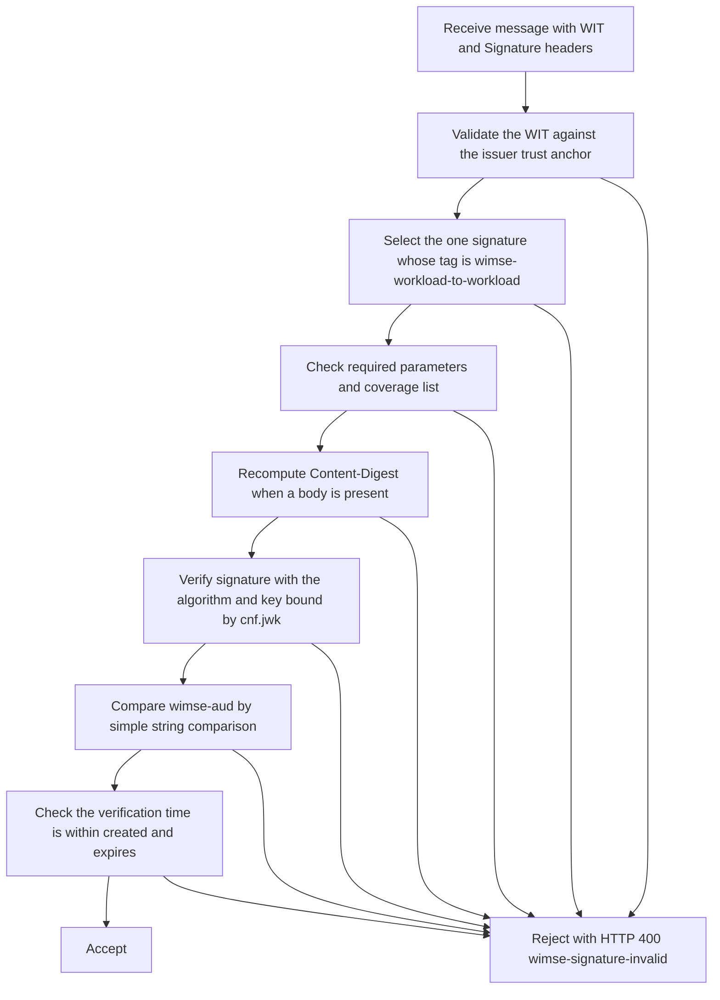

# Deep Dive: draft-miao-wimse-http-signature-test-vectors

> In one line: a test-vector set for the WIMSE Workload-to-Workload HTTP Message Signatures profile, with fully published test keys, a fixed clock, 6 positive and 23 negative vectors, and 3 observations where the base text does not decide pass or fail.

## What this is

The WIMSE profile in draft-ietf-wimse-http-signature signs HTTP requests and responses between workloads with RFC 9421 and binds the signing key to a Workload Identity Token (WIT) through its `cnf.jwk` claim. That profile has many small MUST rules (required components, required and forbidden parameters, tag-based signature selection, audience matching, response binding by nonce), and each is easy to implement slightly differently. This draft supplies a fixed, public set of messages, signature bases and expected outcomes so that implementations can be checked against the same inputs. It defines no new protocol behavior (Abstract, Section 1). Each negative vector is one mutation of a positive vector, or a described implementation behavior, and is mapped to a quoted requirement of the base specification (Section 1, Section 5). Three further entries are observations that are not judged (Section 6).

## How it works

The diagram is the verifier procedure that the positive vectors describe in prose (Section 4.1, 4.2); the draft does not give it as a diagram, and the order of the middle checks is a summary, not a statement of the draft.

1. A test runner loads the published keys, the WITs and the trusted configuration (Section 3). The verifier at svcB trusts four `wimse-aud` values and the issuer public key.
2. The runner fixes the clock: signatures are created at T0 = 1795000000, expire at created+300, and are verified at T0+60 unless the entry says otherwise (Section 2).
3. For a positive vector, the implementation reproduces the signature base (RFC 9421 Section 2.5) and the literal Signature value, and the verifier accepts the message (Section 4).
4. For a negative vector, the runner applies one stated mutation to a base vector and re-signs it with the key bound by the WIT, except where the entry says the signature is carried over or literal (Section 2). Ed25519 and ES256 with RFC 6979 are deterministic, so regenerated values are reproducible.
5. The verifier must reject with HTTP 400 and the `wimse-signature-invalid` problem type without saying which check failed, or the client must reject the response (Section 2, Section 5).
6. Some negatives are behavior judgments on a sender, server or verifier (N-16 to N-22 in part), reached by a stated procedure instead of a single message (Section 2, Section 5.17 to 5.23).

## Use cases

- An implementer of the WIMSE HTTP signature profile runs P-01 to P-06 as a regression suite and checks that the signature base and Signature value come out byte for byte.
- A verifier author uses N-06 and N-07 to confirm that a cryptographically valid signature carrying `keyid` or `alg` is still rejected (Section 5.6, 5.7).
- A server author tests that error responses for an invalid WIT and an invalid signature are both HTTP 400 and indistinguishable, and that no 401 is returned (N-17, Section 5.18).
- A client author tests rejection of unsigned responses and of responses whose `wimse-req-nonce` is missing or wrong (N-12, N-13, N-14).
- A working-group reviewer reads Section 6 for places where the base text may need an editorial note or testing guidance.

## Why This Matters Now

- **Trigger**: New draft with 29 vectors and 3 observations on spec ambiguity in draft-ietf-wimse-http-signature.
- **Source evidence**: The draft is dated 18 November 2026 and is the Internet-Draft form of set v4, first posted on 6 November 2026 as issue #419 of the base specification's repository (Section 1, Appendix B). It cites draft-ietf-wimse-http-signature-08 as the base (Section 9.1).
- **Expected impact**: Independent implementations get a shared yardstick for the profile's MUST rules, and the three observations may lead to editorial changes in the base specification. The draft says a co-author confirmed an editorial note for the example nonces (Section 6, O-2). Whether the working group adopts the draft is not stated in the material.

## What Changed

- Spec/document change summary: This is revision -00, so there is no diff. It introduces the v4 set in Internet-Draft form. The change log records v1 (6 November 2026, 28 vectors: 6 positive, 22 negative, and 3 observations), v2 (`@query` line corrected to include the leading `?` in P-01, P-02 and P-06, signatures re-issued, N-15 recomputed), v3 (P-04 `@authority` normalized to omit the default port) and v4 (N-09b and a machine-readable anchor layer added) (Appendix B).
- Compatibility or migration concerns: The set is pinned to draft-ietf-wimse-http-signature-08. If the base draft changes requirement text, quoted section numbers and expected outcomes may drift. The draft does not say how it will track such changes. Test keys are public and must never be used in production (Section 7).

## Technical Analysis

- Threat model implications: The negatives map to concrete attack or error classes. Missing `@query` coverage and a mismatched Content-Digest test whether the signature really covers the message (Section 5.1, 5.4). Audience matching by Simple String Comparison tests resistance to normalization confusion (Section 5.11). `wimse-req-nonce` binding is described as the defense against response mix-up and replay across requests (Section 5.14). Processing before WIT validation tests that unauthenticated content never reaches business logic (Section 5.21). O-1 notes that replay protection is only a SHOULD, so a replay can succeed where verifier caches are not shared (Section 6).
- Protocol flow implications: The vectors fix the order that the base text requires: validate the WIT, then the signature, with no further processing before full validation (Section 5.21). The tag, not the label, selects the WIMSE signature, and two signatures with the WIMSE tag cause rejection of the whole message (P-06, N-08, N-22). CONNECT is an exception: `@method` and `@authority` are covered and `@path` and `@query` must not be (P-04, N-02, N-21). N-09b treats the validity window as the closed interval [created, expires] and checks T0+300 accepted and T0+301 rejected (Section 5.10).
- Interop concerns: The draft lists the following. `@query` must be `?` when there is no query (P-05). The `@authority` value drops the default port (P-04). ES256 signatures are raw r||s (P-03). Regenerated signatures depend on deterministic signing (Section 2). Positive vectors give literal Signature values, but many negatives are regenerated by the runner, so an implementation must be able to re-sign per Section 3.1 of the base specification. Long lines use RFC 8792 folding (Section 2). In the staged text the WIT placeholder appears as `[WIT-A，§2 全文]`, while Section 2 describes it as `[WIT-x, full text in the Test Key Material section]`, and the placeholder is part of the signed material. A reader should check which form the published artifacts use.

## Open Questions

- Section 1 says the corrections are recorded in the Change Log (Appendix A), but the change log is Appendix B in the staged text. This looks like a cross-reference error.
- The staged text shows the placeholder `[WIT-A，§2 全文]` in the messages and signature bases, which differs from the form described in Section 2, and the draft does not say how the "deterministic expansion" is defined precisely (Section 2).
- N-06 and N-07 rest on a co-author reading confirmed on the mailing list on 7 November 2026 (Section 5.6, 5.7). The base text is quoted as a MUST NOT, but the draft does not say whether that reading will be written into the base specification. The mailing-list message was not staged.
- O-1: the replay cache is only a SHOULD, so the set has no replay negative. The draft suggests testing guidance "may merit a note" but does not propose one (Section 6).
- O-2: the base specification's example nonces such as `abcd1111` are 32 bits against a 64-bit entropy MUST. The draft keeps the entry until an editorial note appears (Section 6).
- O-3: covering `@authority` in non-CONNECT requests is neither required nor forbidden, and its division of labor with `wimse-aud` is left open (Section 6).
- N-16 and N-19 to N-22 are behavior judgments. The draft says entropy cannot be measured from one nonce, and does not give a threshold method beyond "collect nonces of N requests" with N unspecified (Section 5.17).
- N-20 says ordering is "additionally assessed by implementation inspection or instrumentation evidence", which is not reproducible as a black-box test (Section 5.21).
- The draft says the set was validated by a third-party implementation and reproduced by two implementers, but the staged material gives no test reports for these claims (Section 1).
- The Zenodo DOI and issue #419 are cited, but the repository name in Section 1 (ietf-wg-wimse/draft-ietf-wimse-s2s-protocol) differs from the base draft name draft-ietf-wimse-http-signature; the draft does not explain the difference.

## Experiments

- [ ] Lab 1: Regenerate the test keys from the stated seeds (`SHA-256("s01-validation-vectors:<name>")`, and the svcC scalar derivation), compare them with the published JWKs, then rebuild the P-01 signature base and compare the Signature value byte for byte.
- [ ] Lab 2: Run an existing WIMSE HTTP signature verifier against P-01 to P-06 and N-01 to N-15, plus N-09b at T0+300 and T0+301, and record accept or reject and the HTTP status for each. Check that N-06, N-07 and N-10 are rejected even when the signature is valid.
- [ ] Lab 3: Run the behavior probes: send an expired WIT with a valid signature and watch for side effects (N-20), send an invalid WIT and an invalid signature and diff the responses (N-17), and send a request with `wimse-sign-response` to a server that cannot sign (N-18).

## Sources

- [draft-miao-wimse-http-signature-test-vectors-00](https://datatracker.ietf.org/doc/draft-miao-wimse-http-signature-test-vectors/00/)
- [draft-ietf-wimse-http-signature-08, the base specification cited by the draft](https://datatracker.ietf.org/doc/html/draft-ietf-wimse-http-signature-08)
