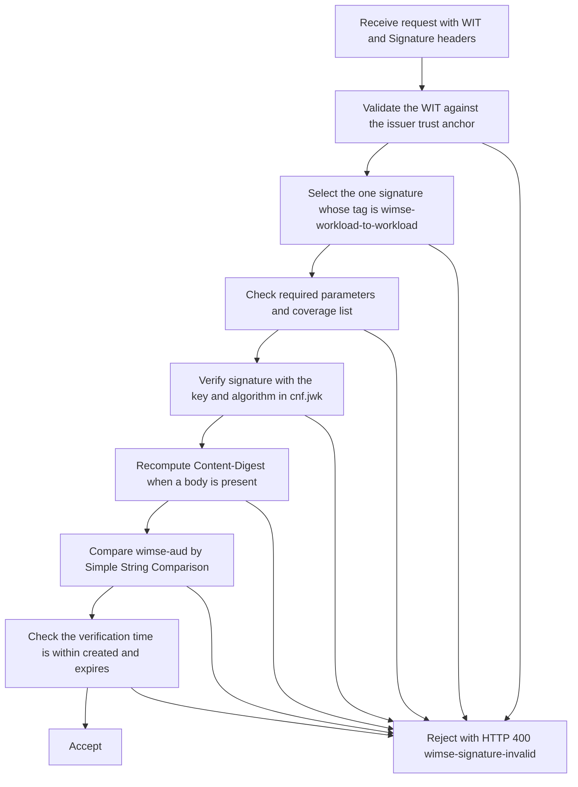

# Deep Dive: draft-miao-wimse-http-signature-test-vectors

> In one line: a test-vector set for the WIMSE Workload-to-Workload HTTP Message Signatures profile, with fully published test keys, a fixed clock, 6 positive and 23 negative vectors, and 3 observations where the base text does not decide pass or fail.

## What this is

The WIMSE profile in draft-ietf-wimse-http-signature signs HTTP requests and responses between workloads with RFC 9421 and binds the signing key to a Workload Identity Token (WIT) through its `cnf.jwk` claim. That profile has many small MUST rules (required components, required and forbidden parameters, tag-based signature selection, audience matching, response binding by nonce), and each is easy to implement slightly differently. This draft supplies a fixed, public set of messages, signature bases and expected outcomes so that implementations can be checked against the same inputs. It defines no new protocol behavior (Abstract, Section 1). Each negative vector is one mutation of a positive vector, or a described implementation behavior, and is mapped to a quoted requirement of the base specification (Section 1, Section 5). Three further entries are observations that are not judged (Section 2, Section 6).

## How it works

The diagram is this repository's summary of the request checks named in P-01, P-03 and P-06 (Sections 4.1, 4.3, 4.6); the draft has no diagram. Two parts of the order come from the text: the WIT is validated before the signature (a MUST in base Section 3, exercised by N-20), and the tag and coverage checks fail before signature verification is reached (N-01, N-08; Sections 5.1, 5.8). The P-01 procedure lists the signature check before the coverage check, so the draft is not consistent on that point. The rest of the order is ours. The client's check of a signed response (P-02, Section 4.2) is not drawn.

1. A test runner loads the published keys, the WITs and the trusted configuration (Section 3). The verifier at svcB trusts four `wimse-aud` values and the issuer public key.
2. The runner fixes the clock: signatures are created at T0 = 1795000000, expire at created+300, and are verified at T0+60 unless the entry says otherwise (Section 2).
3. For a positive vector, the implementation reproduces the signature base (RFC 9421 Section 2.5) and the literal Signature value, and the verifier accepts the message (Section 2, Section 4).
4. For a negative vector, the runner applies one stated mutation to a base vector and re-signs it with the key bound by the WIT, except where the entry says the signature is carried over or literal (Section 2). Ed25519 and ES256 with RFC 6979 are deterministic, so regenerated values are reproducible.
5. The verifier must reject with HTTP 400 and the `wimse-signature-invalid` problem type without saying which check failed, or the client must reject the response (Section 2, Section 5).
6. Six negatives (N-16 to N-20 and N-22) are behavior judgments on a sender, server or verifier, reached by a stated procedure instead of a single message (Section 2; Sections 5.17 to 5.21 and 5.23).

## Use cases

- An implementer of the WIMSE HTTP signature profile runs P-01 to P-06 as a regression suite and checks that the signature base and Signature value come out byte for byte.
- A verifier author uses N-06 and N-07 to confirm that a cryptographically valid signature carrying `keyid` or `alg` is still rejected (Section 5.6, 5.7).
- A server author tests that error responses for an invalid WIT and an invalid signature are both HTTP 400 and indistinguishable, and that no 401 is returned (N-17, Section 5.18).
- A client author tests rejection of unsigned responses and of responses whose `wimse-req-nonce` is missing or wrong (N-12, N-13, N-14).
- A working-group reviewer reads Section 6 for places where the base text may need an editorial note or testing guidance.

## Why This Matters Now

- **Trigger**: Revision -00 was posted on 18 November 2026 as an individual submission with intended status Informational. It was not adopted by a working group (Datatracker).
- **Source evidence**: The set was first posted on 6 November 2026 in issue #419 of ietf-wg-wimse/draft-ietf-wimse-s2s-protocol and announced on the WIMSE list the same day. This draft is the Internet-Draft form of v4 of that set (13 November 2026) (Section 1, Appendix B). It cites draft-ietf-wimse-http-signature-08 as the base (Section 9.1); -09 followed on 20 November 2026.
- **Expected impact**: Independent implementations get a shared yardstick for the profile's MUST rules. Two points raised with the set are already in -09: the CONNECT `@authority` value now follows the RFC 9421 default-port omission (P-04), and the examples now say their nonces are illustrative and below the entropy requirement (O-2) (-09 Section 3, Section 3.7, Appendix B.1). On issue #419, Yaron Sheffer suggested on 7 November 2026 that the author ask the chairs what form of contribution is most useful.

## What Changed

- Spec/document change summary: This is revision -00, so there is no diff. It introduces the v4 set in Internet-Draft form. The change log records v1 (6 November 2026, 28 vectors: 6 positive, 22 negative, and 3 observations), v2 (`@query` line corrected to include the leading `?` in P-01, P-02 and P-06, signatures re-issued, N-15 recomputed, N-06 and N-07 annotated with the co-author confirmation), v3 (12 November 2026, P-04 `@authority` normalized to omit the default port) and v4 (13 November 2026, N-09b and a machine-readable anchor layer added) (Appendix B).
- Compatibility or migration concerns: The set is pinned to draft-ietf-wimse-http-signature-08 (Section 9.1). In -09 every requirement the negatives quote is unchanged, except that the WIT validation section that N-20 quotes is now Section 5.1.3 of the workload credentials draft instead of 5.1.4. -09 also lets a client use a server-generated nonce from Accept-Signature (a MAY in Section 3), which no vector covers. The draft does not say how it will follow later revisions. Test keys are public and MUST NOT be used in any production system (Section 7).

## Technical Analysis

- Threat model implications: The negatives map to concrete attack or error classes. Missing `@query` coverage and a mismatched Content-Digest test whether the signature really covers the message (Section 5.1, 5.4). Audience matching by Simple String Comparison tests resistance to normalization confusion (Section 5.11). `wimse-req-nonce` binding is described as the defense against response mix-up and replay across requests (Section 5.14). Processing before WIT validation tests that unauthenticated content never reaches business logic (Section 5.21). O-1 notes that keeping a replay cache is a MAY and rejecting a seen nonce only a SHOULD, so a replay can succeed where verifier caches are not shared (Section 6; base Sections 3 and 5.1).
- Protocol flow implications: The vectors fix the order that the base text requires: validate the WIT, then the signature, with no further processing before full validation (Section 5.21). The tag, not the label, selects the WIMSE signature, and two signatures with the WIMSE tag cause rejection of the whole message (P-06, N-08, N-22). CONNECT is an exception: `@method` and `@authority` are covered and `@path` and `@query` must not be (P-04, N-02, N-21). N-09b treats the validity window as the closed interval [created, expires] and checks T0+300 accepted and T0+301 rejected (Section 5.10). The base text only says that signatures outside the window MUST be rejected, so the inclusive right edge is the draft's reading.
- Interop concerns: The draft lists the following. `@query` must be `?` when there is no query (P-05). The `@authority` value drops the default port (P-04), which matches the -09 wording but not -08's "the host and port of the CONNECT target". ES256 signatures are raw r||s (P-03). Regenerated signatures depend on deterministic signing (Section 2). Positive vectors give literal Signature values, but many negatives are regenerated by the runner, so an implementation must be able to re-sign per Section 3.1 of the base specification. Long lines use RFC 8792 folding (Section 2). In the -00 text the WIT placeholder appears as `[WIT-A，§2 全文]`, with a full-width comma and a pointer to §2 although the keys are in Section 3. Section 2 describes the form `[WIT-x, full text in the Test Key Material section]` and says the placeholder is retained verbatim in the signed material. Re-signing P-01 here with the published svcA key reproduces the published Signature value only over the full WIT-A text, not over the placeholder (hands-on log), so a runner must put the full token into the base.

## Open Questions

- Section 1 says the corrections are recorded in the Change Log (Appendix A), but the change log is Appendix B. This looks like a cross-reference error.
- Section 2 says the placeholder is "retained verbatim in the signed material", but the P-01 signature verifies only over the full WIT-A text. The draft defines the "deterministic expansion" no further. On issue #419 (13 November 2026) the author said the expansion happens in the extraction layer of a companion conformance suite, which the draft does not cite.
- N-04 says the body swap "also invalidates the signature". It does not: the signature covers the Content-Digest header, which is unchanged, so only the recomputed digest fails. This repository reported that on issue #419 on 11 November 2026, and -00 still has the sentence (Section 5.4).
- N-06 and N-07 expect rejection for `keyid` and `alg`, which the base text states only as sender rules ("MUST NOT be used", Sections 3, 3.1). The reading rests on Yaron Sheffer's reply on the WIMSE list on 7 November 2026: "IMO a MUST NOT in any security RFC should be rejected by the recipient". -09 adds no receive-side wording. N-01, N-02 and N-21 rest on sender rules in the same way.
- O-1: keeping a replay cache is a MAY, so the set has no replay negative. The draft says testing guidance "may merit a note" but does not propose one (Section 6).
- O-2: the base specification's example nonces such as `abcd1111` are 32 bits against a 64-bit entropy MUST. The draft keeps the entry until an editorial note appears (Section 6). -09 Section 3.7 now has it ("The nonce values in these examples are illustrative and do not meet the entropy requirement in Section 3"; issue #420, closed 20 November 2026), so a later revision can drop the entry.
- O-3: covering `@authority` in non-CONNECT requests is neither required nor forbidden, and its division of labor with `wimse-aud` is left open (Section 6).
- N-16 gives no threshold method beyond collecting "the nonces of N requests", and does not fix N (Section 5.17).
- N-20 says ordering is "additionally assessed by implementation inspection or instrumentation evidence", which is not reproducible as a black-box test (Section 5.21).
- Section 1 says earlier versions were reproduced by two independent implementers and the full set validated by cred-ninja. The public record shows two runs on issue #419 (7 November 2026, which found the `@query` defect fixed in v2, and 11 November 2026, which reported that all outcomes matched) and cred-ninja/sdk PR #136 (merged 19 November 2026), which reports "#419 vectors: 28/28". 28 is the count before v4 added N-09b; no public report covering all 29 vectors was found.

## Experiments

- [x] Lab 1: Regenerate the test keys from the stated seeds (`SHA-256("s01-validation-vectors:<name>")`, and the svcC scalar derivation), compare them with the published JWKs, then rebuild the P-01 signature base and compare the Signature value byte for byte. Done on 26 November 2026: all five keys match, and P-01 matches only with the full WIT-A text in the base (hands-on log).
- [ ] Lab 2: Run an existing WIMSE HTTP signature verifier against P-01 to P-06 and N-01 to N-15, plus N-09b at T0+300 and T0+301, and record accept or reject and the HTTP status for each. Check that N-06, N-07 and N-10 are rejected even when the signature is valid. The accept or reject part was run with a script verifier in the draft-ietf-wimse-http-signature deep dive (11 and 15 November 2026) and every decision matched; HTTP status from a running server is still open.
- [ ] Lab 3: Run the behavior probes: send an expired WIT with a valid signature and watch for side effects (N-20), send an invalid WIT and an invalid signature and diff the responses (N-17), and send a request with `wimse-sign-response` to a server that cannot sign (N-18).

## Sources

- [draft-miao-wimse-http-signature-test-vectors-00](https://datatracker.ietf.org/doc/draft-miao-wimse-http-signature-test-vectors/00/)
- [draft-ietf-wimse-http-signature-08, the base specification cited by the draft](https://datatracker.ietf.org/doc/html/draft-ietf-wimse-http-signature-08)
- [draft-ietf-wimse-http-signature-09](https://datatracker.ietf.org/doc/html/draft-ietf-wimse-http-signature-09)
- [Issue #419, where the set was first posted](https://github.com/ietf-wg-wimse/draft-ietf-wimse-s2s-protocol/issues/419)
- [WIMSE list: Yaron Sheffer's reply of 7 November 2026](https://mailarchive.ietf.org/arch/msg/wimse/IcH0Hq5968-TzSxLL7Wpi4pl-7k/)
- [cred-ninja/sdk PR #136](https://github.com/cred-ninja/sdk/pull/136)
- [This repository's run of the #419 vectors](https://github.com/0-draft/identity-deep-dive/blob/main/tracks/ietf-wimse/deep-dives/draft-ietf-wimse-http-signature/spec-notes.md)
