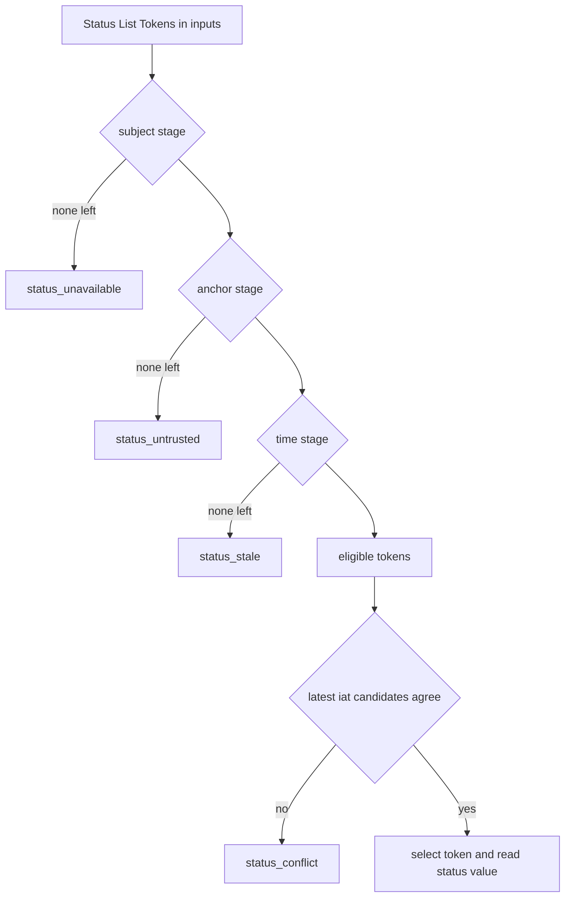
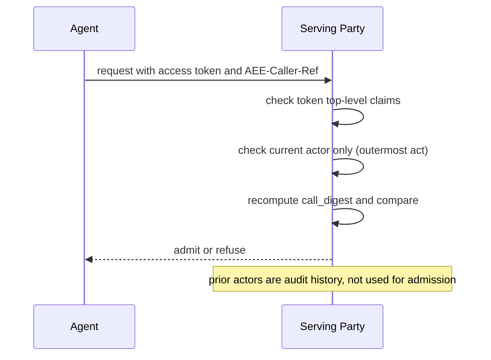
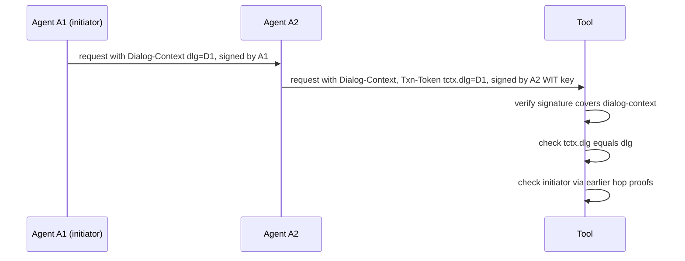

# WIMSE Daily Report (2026-11-01)

Generated at: 2026-11-01T17:56:40+00:00

<!-- insights:start -->
## Briefing

> The only change is draft-thaha-wimse-agent-evidence-binding-02. It changes admission so a serving party uses only the current actor, as RFC 8693 Section 4.1 requires, and treats the Actor Chain as attribution, not authority.

_Updated 2026-11-01T11:50:41+00:00. Machine-drafted from the sources linked below, which stay authoritative._

### In short, agent-mandate-01 makes validation deterministic: a digest-fixed Trust Anchor Set, split status error codes and stricter claim typing

`draft-revision` · `substantive` · first seen 2026-11-01 · [draft-hulea-wimse-agent-mandate-01: Verifiable Mandates for Agents Acting Across Administrative Domains](https://author-tools.ietf.org/iddiff?url1=draft-hulea-wimse-agent-mandate-00&url2=draft-hulea-wimse-agent-mandate-01)

This is a repair revision. The Trust Anchor Set becomes a JSON document identified by URI and digest, with roles, iss, keys and frameworks, and the role_mismatch and signature_invalid rules are spelled out. Status List Token handling is filtered in three ordered stages, giving the codes status_unavailable, status_untrusted and status_stale, plus status_conflict and status_unrecognized. The Validation Profile gains an issuer, optional signing, self_schemes, and max_validity keyed by typ (replacing max_lifetime). The references in a root's authority are alternatives, and disclosures in an SD-JWT never affect the result. The WIT must carry iss and iat under this profile, which the workload-creds draft does not require. Constraint value types, chain-length handling and the Links step are defined more precisely. The diff is truncated, so later sections are not visible.

**Use cases**

- A relying party that accepts agent mandates across domains needs two validators to return the same result, which this revision targets.
- An implementer building a status-list-backed revocation check can use the staged filtering and error codes.

**Related in other tracks**

- `oauth-wg` / `draft-ietf-oauth-status-list`: The status evidence procedure in step 7 is built on Status List Tokens.

### In short, workload-creds-03 restructures the WIT/WIC draft, tightens trust-anchor binding and adds a section on the audience of proofs of possession

`draft-revision` · `substantive` · first seen 2026-11-01 · [draft-ietf-wimse-workload-creds-03: WIMSE Workload Credentials](https://author-tools.ietf.org/iddiff?url1=draft-ietf-wimse-workload-creds-02&url2=draft-ietf-wimse-workload-creds-03)

The diff (truncated at 30000 characters, so later sections are not visible) renames and reorders sections and rewrites the architecture flow in 1.1 around TLS server auth, optional mTLS with a WIC, then an application-layer WIT and proof. It states that a WIT presented over TLS is not a transport-layer credential. Section 3 now requires a credential to be validated only against anchors bound to the trust domain named in its Workload Identifier, and drops the explicit prohibition on using iss to fetch a JWKS. New sections appear for validating the WIT (5.1.3), the audience of application-layer proofs (5.2) and trust domain membership (9.2). Section 4 drops the paragraph forbidding a second workload identifier in one WIT/WIC and says only that credentials of the same identifier may be told apart by jti. The jti text now ties it to token status or deny-list mechanisms. iss stays optional, and the example now uses alg Ed25519 instead of EdDSA.

**Use cases**

- A WIT validator implementer needs to re-check how issuer and trust-anchor lookup is specified, because the text on iss and JWKS discovery changed.
- An mTLS or HTTP-signature binding author should check the new audience requirement in 5.2 and the 1.2 rule that a callee must verify a request is meant for it.

**Related in other tracks**

- `oauth-wg` / `draft-ietf-oauth-rfc8725bis`: The WIT typ requirement now cites rfc8725bis instead of RFC 8725.

### In short, credential-delegation-02 adds a chain-verifiable profile that adopts the asor token format, plus sub-delegation exchange and new security sections

`draft-revision` · `substantive` · first seen 2026-11-01 · [draft-sweeney-wimse-credential-delegation-02: Credential Delegation Protocol for AI Agents in Multi-System Environments](https://author-tools.ietf.org/iddiff?url1=draft-sweeney-wimse-credential-delegation-01&url2=draft-sweeney-wimse-credential-delegation-02)

The table of contents adds 5.4.1 Sub-Delegation Exchange, 5.5 Chain-Verifiable Profile, and security sections on long-term evidence (10.8) and the trusted delegation server (10.9). Section 5.5 adopts the asor agent-delegation-chain format unchanged for tokens verified away from the Delegation Server. The ceiling claim is renamed from constraints to delegation_constraints. Agents may use ML-DSA where a did:key encoding exists, and every verifier must hold a local algorithm allow-list. The WAG identity must no longer be carried inside act. The 'credentials are never possessed' claim is narrowed: it protects against agent exfiltration, not the DS itself. The draft cites asor -03, notes that it no longer registers del_depth, del_max_depth and par_hash, and updates the Delegate SD-JWT status to adopted. The agent_checksum claim is removed. The diff is truncated, so sections 5.4 to 10 are only partly visible.

**Use cases**

- An agent platform that holds upstream credentials server-side and also wants offline-verifiable delegation chains can follow the 5.5 profile.
- A verifier implementer can plan to reuse one subsumption implementation for both this draft and asor.

**Related in other tracks**

- `oauth-wg` / `draft-ietf-oauth-delegate-sd-jwt`: The draft now says the OAuth WG adopted Delegate SD-JWT on 16 October 2026 and compares chain rules with it.

### In short, evidence-binding-01 makes token-carried assurance status depend on when it was checked, and ties the caller reference to a per-call digest

`draft-revision` · `substantive` · first seen 2026-11-01 · [draft-thaha-wimse-agent-evidence-binding-01: Evidence Binding for AI Agent Credentials](https://author-tools.ietf.org/iddiff?url1=draft-thaha-wimse-agent-evidence-binding-00&url2=draft-thaha-wimse-agent-evidence-binding-01)

A new signed status_checked_at (CBOR key 10) is required whenever assurance_level and assurance_status are present. A serving party may rely on those values only if the observation is recent enough for its policy, regardless of the token's remaining lifetime. AEE-Caller-Ref gains a cd member carrying the caller's call_digest. The serving party computes its own digest over the request it received, refuses a mismatch, and refuses a caller reference already admitted. The admission receipt records the digest and the status observation time. The security text now lists the failure modes (E_CALLER_REF, E_CALL_MISMATCH, E_SERVING_HOST). The reference to the audit record draft is renamed to draft-gilda-audit-agent-audit-record, and EP-AEC is added as a reference. Note that item 08 says an -02 is already posted, so -01 is superseded.

**Use cases**

- A service accepting agent tokens that embed cached assurance status needs a signed observation time to judge freshness.
- A gateway admitting agent calls can bind the caller's receipt to the exact request it received.

### This revision limits admission decisions to the current actor and calls the Actor Chain attribution, not authority

`draft-revision` · `substantive` · first seen 2026-11-01 · [draft-thaha-wimse-agent-evidence-binding-02: Evidence Binding for AI Agent Credentials](https://author-tools.ietf.org/iddiff?url1=draft-thaha-wimse-agent-evidence-binding-01&url2=draft-thaha-wimse-agent-evidence-binding-02)

Admission step 4 now follows RFC 8693 Section 4.1. The access-control inputs are the token's top-level claims and the current actor (the outermost act). Prior actors are informational only and MUST NOT decide admission. The earlier wording that a Serving Party checks every Actor is removed. The Actor Chain is described as the token issuer's asserted history, neither complete nor proof that any hop held or narrowed authority. Authority across hops needs per-hop signed evidence, such as a delegation chain (draft-ietf-oauth-identity-chaining) or linked receipts. A new rule says AEE-Caller-Ref, which binds one call, MUST NOT be carried in a token that can be presented on more than one call. The draft now says it is a companion to AIMS, not proposed text for it. The audit-record section is renamed, and a pointer to an Execution Receipt or its SCITT Receipt no longer goes in correlation.externalAnchor, because it does not date the audit record. The -01 posted earlier lacked some of the -00 revisions, and this version includes them.

**Use cases**

- A service that admits agent calls with RFC 8693 delegated tokens, where it must decide whether prior actors in the chain affect its access-control decision.
- A deployment that wants to carry a per-call binding (AEE-Caller-Ref) and must keep it out of reusable bearer-style tokens.
- An auditor who correlates agent audit records with SCITT-registered Execution Receipts and needs to know which anchor claims are valid.

**Related in other tracks**

- `oauth-wg` / `draft-ietf-oauth-identity-chaining`: Newly cited as an example of a delegation chain that gives per-hop signed evidence of authority across hops.

### In short, a new individual draft proposes a signed taint attestation header on every agent tool call so relying parties reject tainted state-changing calls

`new-draft` · `new-proposal` · first seen 2026-11-01 · [draft-durga-wimse-ctx-isolation-00: Cryptographic Separation of Untrusted Data-Plane Context from Control-Plane Tool Invocations in Autonomous AI Agents](https://datatracker.ietf.org/doc/draft-durga-wimse-ctx-isolation/00/)

The draft defines a Context Taint Attestation, a JCS-serialised object with a taint level (TRUSTED_ONLY, MIXED_TAINT, UNTRUSTED_INGESTED), a tool effect class, a Merkle root over context chunks, and an optional step-up receipt hash, signed with Ed25519. It travels in an Agent-Ctx-Isolation header or MCP _meta. A relying party must reject a STATE_MUTATING or PRIVILEGED_ACTUATE call that is not TRUSTED_ONLY unless a valid step-up receipt from an independent policy engine or human is attached. It is a very short draft (about five pages). The signer is the agent runtime, so the taint level is self-asserted. The draft says nothing about how the key is bound to a WIMSE identity, and it defines no composition with the WIT or WPT.

**Use cases**

- An MCP gateway that wants to block state-changing tool calls triggered after untrusted data entered the model context.

### In short, a new draft extends the WIMSE HTTP signature and WPT to cover a Dialog-Context field and records the dialog id in transaction tokens

`new-draft` · `new-proposal` · first seen 2026-11-01 · [draft-reddy-wimse-oauth-dialog-binding-00: Binding Agent Dialogs to WIMSE and OAuth Credentials](https://datatracker.ietf.org/doc/draft-reddy-wimse-oauth-dialog-binding/00/)

The draft assumes an agent communication protocol that carries a Dialog-Context field with a dialog id and initiator. It requires the WIMSE HTTP signature to cover that field in requests and in signed responses, extends the WPT to cover it for requests, and adds a dlg member to the transaction token tctx. Receivers check that the token's dlg equals the field's. Earlier hops' proofs travel with the message so a distant receiver can verify who initiated the dialog. At a trust boundary the sender starts a linked dialog and authorization moves through identity chaining. Dialog-Context is a placeholder name. The text is truncated after Section 7.

**Use cases**

- A multi-agent deployment where a tool must confirm that a transaction token belongs to the dialog the request claims.
- A gateway that terminates TLS but must still let the receiver verify the sending workload.

**Related in other tracks**

- `oauth-wg` / `draft-ietf-oauth-transaction-tokens`: Adds a dlg member to the tctx claim.
- `oauth-wg` / `draft-ietf-oauth-identity-chaining`: A new dialog at a trust boundary is aligned with identity chaining.

### In short, a reviewer proposes letting principal standing be proved against a signed, published commitment instead of an identifier lookup

`mail` · `discussion` · first seen 2026-11-01 · [draft-jackson-wimse-evaluation-05, Section 3.6: principal standing without an identifier join](https://mailarchive.ietf.org/arch/msg/wimse/0lww5-4hYs09TJJd1YxwlH0aWsk/)

The comment on Section 3.6 of the evaluation draft says looking up standing by identifier reveals to the source which principal is evaluated, by whom and when, and needs an identifier stable across relying parties. The proposal is a signed standing commitment published by the source. The presenter proves standing against it, and the relying party pins the publisher and a maximum age. Revocation then takes effect within the maximum age plus skew and publication lag. Proposed text is included, along with a suggestion for the audit record's principal-standing-source. The sender says they run this form with zero-knowledge proofs.

**Use cases**

- A relying party that checks the standing of a delegating principal but should not tell the status source who it is evaluating.

### In short, a request for a 15-minute joint WIMSE/OAuth slot at IETF 127 on keeping delegated user authority distinct from workload authentication

`mail` · `discussion` · first seen 2026-11-01 · [Agenda request for IETF 127: "Authenticated Is Not Authorized: Delegated Authority Across Workload and Agent Boundaries" (joint WIMSE/OAuth session)](https://mailarchive.ietf.org/arch/msg/wimse/14leMcljsbd1hdqCebK3Mmddcxo/)

The request describes a discussion with no new draft. It cites an open, unmerged WIMSE architecture PR (#140) on identity requirements for AI intermediaries. It also cites an AuthZEN decision on 8 October that COAZ-MCP will not define a trust-anchored context.agent field, so policies reason over validated token claims such as client_id and act. The broader mapping gap moves to a separate OAuth mapping profile. It also lists executable A2A-to-MCP authority-boundary test cases. The sender is available in person on 14 to 16 November.

**Related in other tracks**

- `openid` / `openid/authzen`: The message cites the AuthZEN decision on issue #612 and the closed COAZ-MCP PR.

### In short, the author of an AER-1 mapping draft asks the list for written feedback on using AER-1 receipts as AIMS Section 11 audit records

`mail` · `discussion` · first seen 2026-11-01 · [draft-zambo-aer1-wimse-mapping-01: AER-1 as a candidate format for AIMS Section 11 audit records](https://mailarchive.ietf.org/arch/msg/wimse/PGRWtqrXrpqNzeH1So6NEUDQqv4/)

The mapping draft maps the AER-1 execution receipt onto the seven minimum audit fields and execution chain reconstruction in the AIMS framework, which deliberately specifies no record format. The author asks where the mapping fails Section 11 and what a record format would need. They explicitly do not ask for agenda time or for WIMSE to adopt AER-1, and they say they filed a companion data-model draft for the AUDIT BoF.

### In short, the credential-delegation author asks the three offline attenuation formats to share one subsumption rule per constraint type

`mail` · `discussion` · first seen 2026-11-01 · [New version: Attenuating Authorization Tokens (draft-niyikiza-oauth-attenuating-agent-tokens-02)](https://mailarchive.ietf.org/arch/msg/wimse/a0VMWgZk9S0JV6qDmlvqpqY73dg/)

The quoted announcement says AATs -02 is cited by twelve drafts, has 229 test vectors, and gives step-by-step chain verification in Section 8. In the reply, Sweeney argues offline attenuation and a server in the call path compose. Chain-wide cumulative budgets need a single writer, and revocation finer than the root needs a party in the path. They note three offline formats with typed constraints now exist (AATs, asor and hulea mandate), that asor reuses AAT claim names with different del_max_depth semantics, and ask for one subsumption rule per constraint type across all three.

**Use cases**

- A verifier implementer facing three attenuation formats would want shared constraint comparison logic rather than three versions.

### In short, the mandate thread settles that a mandate should carry root entitlement as an Authority Assertion and renames max_lifetime to max_validity

`mail` · `discussion` · first seen 2026-11-01 · [draft-hulea-wimse-agent-mandate-00: evidence that the delegator was entitled to delegate](https://mailarchive.ietf.org/arch/msg/wimse/lZ1_efh-DULGLvG7PXYdNd42zxs/)

Quoted messages show Sweeney arguing that the chain carries narrowing while the Authority Assertion carries the root's entitlement, with both checked against current records by whoever is in the path at use. He advises adopting the asor chain and typed ceilings. Hulea agrees, renames max_lifetime to max_validity to avoid a clash with the asor ceiling, and says the chain move waits for -02. He notes that window, sum_max (a total over a calendar period) and cosign_above (an obligation, not permit or deny) have no asor type and asks asor's author whether the registry would accept them. Sweeney's closing note says a sum_max total can be known only where the running total is held. The text is truncated.

### Triage of the candidate queue

- **high** `Diff active WG draft: draft-ietf-wimse-workload-creds-03`: Reorganised structure, stricter trust-anchor binding, new proof-audience section and dropped single-identifier rule, all in a core WG draft.
- **high** `Review related draft: draft-hulea-wimse-agent-mandate-01`: -01 makes validation deterministic with a Trust Anchor Set, status codes and a Validation Profile, and the author's post lists what is still open.
- **high** `Review related draft: draft-reddy-wimse-oauth-dialog-binding-00`: New draft that extends the WIMSE HTTP signature and WPT and adds a tctx.dlg member.
- **high** `Review related draft: draft-sweeney-wimse-credential-delegation-02`: Adds a chain-verifiable profile adopting the asor format and new sub-delegation and security sections.
- **high** `Review related draft: draft-thaha-wimse-agent-evidence-binding-02`: The -02 changes the admission rule to current actor only and adds a new MUST NOT on caller references in reusable tokens.
- **low** `Diff active WG draft: draft-ietf-wimse-workload-identity-practices-08`: -08 is mostly typo fixes and rewording after AD feedback, with no new requirements visible.
- **low** `Review related draft: draft-durga-wimse-ctx-isolation-00`: Very short -00 with a self-asserted taint level and no stated link to WIMSE credentials.

<!-- insights:end -->

## Snapshot

- Active WG drafts: 8
- Related drafts: 20
- Mailing-list posts scanned: 68
- Tracked GitHub repos: 6

## Active WG Drafts

| Draft | Date | Title |
| --- | --- | --- |
| draft-ietf-wimse-workload-creds-03 | 2026-10-30 | WIMSE Workload Credentials |
| draft-ietf-wimse-workload-identity-practices-08 | 2026-10-30 | Workload Identity Practices |
| draft-ietf-wimse-mutual-tls-03 | 2026-10-24 | Workload Authentication Using Mutual TLS |
| draft-ietf-wimse-identifier-04 | 2026-10-23 | Workload Identifier |
| draft-ietf-wimse-http-signature-08 | 2026-10-20 | WIMSE Workload-to-Workload Authentication with HTTP Signatures |
| draft-ietf-wimse-aims-00 | 2026-09-15 | AI Identity Management System |
| draft-ietf-wimse-wpt-02 | 2026-08-27 | WIMSE Workload Proof Token |
| draft-ietf-wimse-arch-08 | 2026-07-06 | Workload Identity in a Multi System Environment (WIMSE) Architecture |

## Recent Related Drafts

| Draft | Date | Title |
| --- | --- | --- |
| draft-hulea-wimse-agent-mandate-01 | 2026-11-01 | Verifiable Mandates for Agents Acting Across Administrative Domains |
| draft-thaha-wimse-agent-evidence-binding-02 | 2026-11-01 | Evidence Binding for AI Agent Credentials |
| draft-reddy-wimse-oauth-dialog-binding-00 | 2026-10-30 | Binding Agent Dialogs to WIMSE and OAuth Credentials |
| draft-sweeney-wimse-credential-delegation-02 | 2026-10-30 | Credential Delegation Protocol for AI Agents in Multi-System Environments |
| draft-durga-wimse-ctx-isolation-00 | 2026-10-29 | Cryptographic Separation of Untrusted Data-Plane Context from Control-Plane Tool Invocations in Autonomous AI Agents |
| draft-jackson-wimse-evaluation-05 | 2026-10-28 | Verifier-Side Evaluation Semantics for Delegated Authority Chains |
| draft-asor-wimse-agent-delegation-chain-03 | 2026-10-27 | Verifiable Attenuated Delegation for AI Agent Chains |
| draft-ni-wimse-ai-agent-identity-04 | 2026-10-27 | WIMSE Applicability for AI Agents |
| draft-uppalapati-wimse-pq-agent-identity-01 | 2026-10-27 | Post-Quantum Requirements for Software and AI Agent Identity |
| draft-heigh-wimse-workload-identity-metadata-00 | 2026-10-16 | Workload Identity Metadata |

## Mailing List Topics

- No mailing-list topics extracted.

## Recent GitHub Activity

| Repository | Latest Commit |
| --- | --- |
| ietf-wg-wimse/draft-ietf-wimse-arch | 2026-10-31T12:28:27Z |
| ietf-wg-wimse/draft-ietf-wimse-s2s-protocol | 2026-10-30T18:09:20Z |
| ietf-wg-wimse/draft-ietf-wimse-workload-identity-practices | 2026-10-30T09:50:30Z |
| ietf-wg-wimse/draft-ietf-wimse-identifier | 2026-10-23T15:16:50Z |
| ietf-wg-wimse/ietf-wg-wimse.github.io | 2026-10-07T19:43:41Z |
| ietf-wg-wimse/admin | 2024-03-17T22:59:45Z |

## Top Deep-Dive Candidates

- [7] Diff active WG draft: draft-ietf-wimse-http-signature-08
- [7] Diff active WG draft: draft-ietf-wimse-mutual-tls-03
- [7] Diff active WG draft: draft-ietf-wimse-workload-creds-03
- [6] Review related draft: draft-asor-wimse-agent-delegation-chain-03
- [6] Review related draft: draft-atakora-wimse-sadp-delegation-01
- [6] Review related draft: draft-durga-wimse-ctx-isolation-00
- [6] Review related draft: draft-hulea-wimse-agent-mandate-01
- [6] Review related draft: draft-jackson-wimse-evaluation-05
- [6] Review related draft: draft-lee-wimse-local-tool-call-proof-01
- [6] Review related draft: draft-ni-wimse-ai-agent-identity-04

