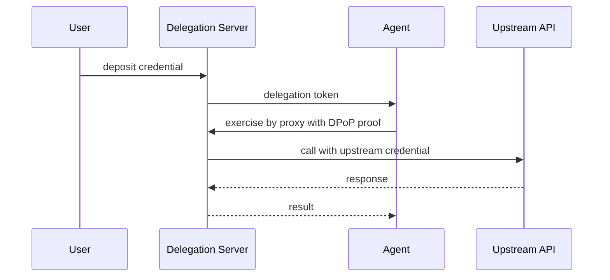
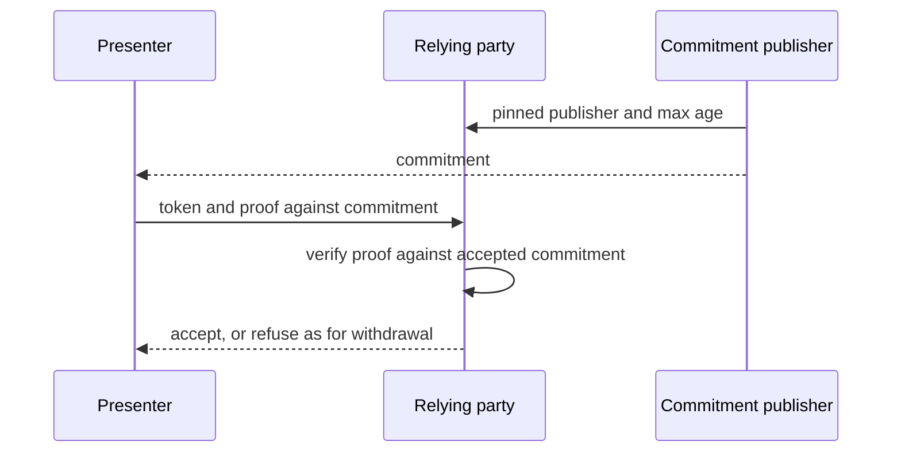
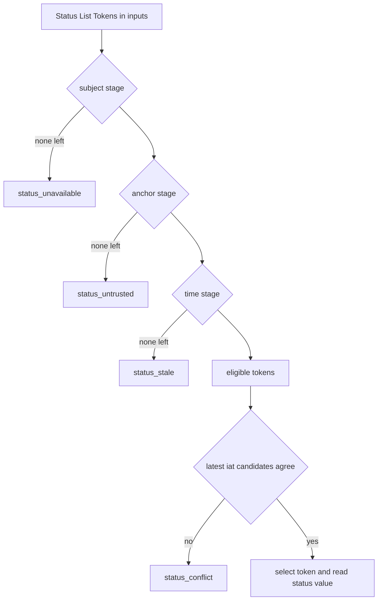

# WIMSE Daily Report (2026-11-02)

Generated at: 2026-11-02T15:59:26+00:00

<!-- insights:start -->
## Briefing

> The main activity is the agent-delegation cluster on the WIMSE list: draft-sweeney-wimse-credential-delegation-02 and the AAT, asor and Cred drafts are converging on one del_max_depth meaning, with the vectors to be reconciled before IETF 127. No WG draft changed. The thaha -03 revision is a one-paragraph caveat.

_Updated 2026-11-02T16:03:18+00:00. Machine-drafted from the sources linked below, which stay authoritative._

### The -03 revision adds one caveat: behind a shared gateway host, a replayed caller reference can still pass

`draft-revision` · `substantive` · first seen 2026-11-02 · [draft-thaha-wimse-agent-evidence-binding-03: Evidence Binding for AI Agent Credentials](https://author-tools.ietf.org/iddiff?url1=draft-thaha-wimse-agent-evidence-binding-02&url2=draft-thaha-wimse-agent-evidence-binding-03)

The only substantive text change is in the replay-detection paragraph. A replayed field is still refused by the Serving Party that already admitted it and detected by Linked Verification at another. The new text adds an exception: behind a shared gateway host, a wrong-backend admission can still pass when only that admission is in the Linked Bundle. It points to the Security Considerations of the SCITT agent execution evidence draft and credits Iman Schrock. The rest of the diff is table-of-contents page numbers, a Changes since -02 section and a stray blank line.

**Use cases**

- A deployment that fronts several agent backends with one gateway and relies on Linked Verification to catch replayed caller references.

### draft-sweeney-wimse-credential-delegation-02 adds sub-delegation, cumulative bounds, a chain-verifiable profile and a revocation section

`mail` · `substantive` · first seen 2026-11-02 · [draft-sweeney-wimse-credential-delegation-02](https://mailarchive.ietf.org/arch/msg/wimse/blYoMmYTJ2UlnspmOCEIJHGRyck/)

The announcement describes a Delegation Server (DS) that holds user-deposited credentials, while agents exercise them by proxy under a delegation token, so the agent never holds the upstream credential. Main changes: a two-step sub-delegation exchange where act is attribution only; rank order carried in the token; a delegation_constraints claim with max_lifetime and max_subtree, the DS being single writer of the running total; and a chain-verifiable profile adopting the asor agent_delegation format unchanged for tokens verified away from the DS. Section 7 frames revoked_count as invalidation, not closure, with a 1-hour token cap bounding admission after revocation. The author asks for review on cumulative-bound mode (DS ledger or delegate-held tally), the revocation framing, the del_max_depth one-hop difference with AAT, and user-minted root composition for -03.

**Use cases**

- An agent platform that wants agents to call upstream APIs without ever holding the user's credential.
- A deployer needing a cap on the total lifetime or number of sub-delegations across a delegation tree.

### The evaluation draft's author will add a commitment-based way to check principal standing in -06

`mail` · `discussion` · first seen 2026-11-02 · [draft-jackson-wimse-evaluation-05, Section 3.6: principal standing without an identifier join](https://mailarchive.ietf.org/arch/msg/wimse/CXxR1y_41d06DktOvGJxjZQHMig/)

Wes Jackson accepts Marc Miro i Rierola's proposal as a third form in Section 3.6, next to a lookup beside the chain and short grant lifetimes. The relying party pins the commitment publisher and a maximum age, and the presenter proves against a commitment, so the source does not learn who is evaluated and no cross-party principal identifier is needed. Two corrections are agreed. The bound is the pinned maximum age, not the publication cadence, and a relying party wanting a tighter bound fetches the newest commitment itself. A missing or non-verifying proof is a refusal like a withdrawal, not an unavailable input, and the two are indistinguishable to an unauthenticated caller. The audit record member principal-standing-source in draft-gilda-audit-agent-audit-record-03 should name the publisher and the commitment's as-of time. The change lands in -06 after IETF 127.

**Use cases**

- A relying party checks an agent's principal standing without telling a registry which principal is being evaluated.
- A deployment needs a stated withdrawal bound, so it states the pinned maximum age and when that age starts.

### A deployment gives revocation bounds of 185, 245 and 395 seconds for principal standing, and evaluation -06 will add a commitment-based form

`mail` · `discussion` · first seen 2026-11-02 · [draft-jackson-wimse-evaluation-05, Section 3.6: principal standing without an identifier join](https://mailarchive.ietf.org/arch/msg/wimse/Hrs5zoD0NhilOMFW0vi2CEWd-8g/)

Marc Miro i Rierola states the withdrawal bounds of his deployment, each with a start event and defined as the latest moment every conforming verifier refuses. Issuer withdrawal is 185 s (180 maximum commitment age plus 5 clock tolerance). Holder withdrawal is 245 s, adding a 60 s fold grace. Cascade is 395 s, with 7 publication intervals of 30 s. An emergency commitment takes effect in the block that records it. Wes Jackson says the commitment form fits Section 3.6 and will be a third form in -06 with credit. Publication cadence does not shorten the bound, and a missing or non-verifying proof is a withdrawal-style refusal rather than an unavailable input. He suggests principal-standing-source should name the commitment publisher and as-of time.

**Use cases**

- A relying party choosing a pinned maximum commitment age and wanting to know the resulting revocation latency.
- An operator documenting worst-case admission time after an issuer or holder withdraws a credential.

### The evaluation -05 and AIMS multi-hop drafts disagree on whether an age equal to the maximum is fresh, and Wes Jackson leaves the choice open

`mail` · `discussion` · first seen 2026-11-02 · [A principal-standing name for the 5.4 closed set](https://mailarchive.ietf.org/arch/msg/wimse/nfY2R8M_90Rr-eJ19HWfLPKSjI8/)

Kieran asks that all three documents share one horizon boundary. The AIMS boundary vectors (21 of 21 confirmed on 28 October) use inclusive limits: an age equal to the maximum is fresh and a permit is usable at its expiry. That is the -03 reading (FR2), while -05 refuses at or past the horizon. He leans toward -05 adopting at-most and wants evaluation instant versus decision.reportedAt stated as a normative rule. Wes confirms that an unavailable principal-standing lookup is a transient refusal recorded as not-evaluated with principal-standing-source. He has filed test records, including Vector B as an open conflict at exactly maxAge. He accepts Girish's wording so a withdrawn principal records as evaluated, deny, to be decided in -06. A joint profile waits until the boundary settles.

**Use cases**

- A verifier implementer who must decide whether an input aged exactly maxAge is fresh or refused.
- An audit-record producer that must choose between evaluation time and decision.reportedAt when measuring age.

### The evaluation draft and the audit-record draft disagree on whether an age exactly equal to the maximum age is fresh

`mail` · `discussion` · first seen 2026-11-02 · [A principal-standing name for the 5.4 closed set](https://mailarchive.ietf.org/arch/msg/wimse/pfPpZFDrdqavOQg7eSMesHJroYA/)

Wes Jackson confirms that a principal-standing lookup that cannot complete is a transient refusal, recorded as not-evaluated with principal-standing-source, as in draft-gilda-audit-agent-audit-record-03. He filed test vectors in an agent-evidence-vectors issue. At an age exactly equal to the maximum age, -05 requires refusal (at-or-past horizon), while -03 counts it as fresh (FR2), so the same record validates under one and not the other. The drafts also judge age at different instants: -05 at the evaluation instant, -03 at decision.reportedAt. He leaves the choice open and defers a joint profile until one boundary is agreed. Girish Konda's gap is confirmed: the permanent-refusal list and disclosure rule name issuers but not the principal. His wording is a likely fix, a withdrawn principal recording as evaluated, deny, but it is a -06 decision not yet taken.

**Use cases**

- An audit-record implementer needs to know whether a record at exactly the maximum age is valid or malformed.
- A decision point must choose between judging age at evaluation time and at the reported time.

### Sweeney and Niyikiza agree that AAT-style offline attenuation and a Delegation Server are complementary, and that del_max_depth needs one meaning

`mail` · `discussion` · first seen 2026-11-02 · [AAT -02 announcement](https://mailarchive.ietf.org/arch/msg/wimse/r-o9td1ZckYXYkvUGcny7fMrkJs/)

Sweeney replies to Niyikiza's AAT -02 thread with three points. Chain-wide budgets such as max_lifetime and max_subtree need a single writer of the running total, which in Cred -02 is the DS ledger layered on an AAT-style chain. Revocation is partial for tokens verified away from the DS until they expire, and he asks that the companion document for AAT Section 9.8 state the freshness bound the enforcement point must meet. On del_max_depth, a leaf at del_depth equal to the root maximum is rejected by Asor -03 but accepted by AAT test vector J.10.f. Sweeney leans toward the Asor meaning but cares more that the vectors are reconciled. Earlier in the thread Niyikiza proposed comparing constraint types across the three drafts before IETF 127.

**Use cases**

- A verifier that must implement subsumption checks for AAT, asor and hulea tokens and wants one rule per constraint type.
- A deployment that sets del_max_depth on a root and needs to know whether a leaf exactly at that depth is valid.

**Related in other tracks**

- `oauth-wg` / `draft-ietf-oauth-transaction-tokens`: The AAT announcement says AATs complement transaction tokens.
- `oauth-wg` / `draft-ietf-oauth-identity-chaining`: The AAT announcement says AATs complement identity chaining.

### An independent report finds a TypeScript verifier agrees with all 229 AAT vectors, and lists points the drafts leave underspecified

`mail` · `discussion` · first seen 2026-11-02 · [Implementation report: attenuating delegation chains for agents (draft-niyikiza-oauth-attenuating-agent-tokens, draft-asor-wimse-agent-delegation-chain)](https://mailarchive.ietf.org/arch/msg/wimse/t_R_fa4Y6MFW61IbBnlRY-iTxSA/)

Azat Davliatshin posted draft-davliatshin-oauth-attenuation-chains-report-00, an RFC 7942-style implementation report by someone who authors neither draft covered. A verifier written from the text of AAT -01 and -02 and asor-02 agrees with the 229 AAT vectors and the 35 attenu-guard vectors. A ProVerif model covers both chain structures and isolates where their guarantees differ: which key verifies a link below the root. The report records 25 observations on AAT -01 (19 decided by -02), ten points where AAT -02 still permits more than one conforming behaviour, and seven observations on asor-02. The main asor-02 one is that Section 6 names no key for a link below the root. The author asks the draft authors for corrections.

**Use cases**

- An implementer of AAT or asor chains who wants an independent verifier and vectors to test against.
- A draft author looking for the ambiguities that independent implementers hit.

### A newcomer asks how an individual can contribute to the WIMSE AI identity work

`mail` · `routine` · first seen 2026-11-02 · [Process question: individual personal-capacity contribution to WIMSE AI identity work](https://mailarchive.ietf.org/arch/msg/wimse/YbA0_uqrNGji2vsDdmqj2KlbND0/)

Vaishnavi Gudur asks which route suits an individual contributor who is not speaking for an employer: a mailing-list comment, an issue or pull request, or a separate Internet-Draft. They also ask about IPR and disclosure steps. The topic is AI-agent identity, authorization freshness and revocation in relation to draft-ietf-wimse-aims. No technical text is submitted and the message has no replies in the material.

### In short, agent-mandate-01 makes validation deterministic: a digest-fixed Trust Anchor Set, split status error codes and stricter claim typing

`draft-revision` · `substantive` · first seen 2026-11-01 · [draft-hulea-wimse-agent-mandate-01: Verifiable Mandates for Agents Acting Across Administrative Domains](https://author-tools.ietf.org/iddiff?url1=draft-hulea-wimse-agent-mandate-00&url2=draft-hulea-wimse-agent-mandate-01)

This is a repair revision. The Trust Anchor Set becomes a JSON document identified by URI and digest, with roles, iss, keys and frameworks, and the role_mismatch and signature_invalid rules are spelled out. Status List Token handling is filtered in three ordered stages, giving the codes status_unavailable, status_untrusted and status_stale, plus status_conflict and status_unrecognized. The Validation Profile gains an issuer, optional signing, self_schemes, and max_validity keyed by typ (replacing max_lifetime). The references in a root's authority are alternatives, and disclosures in an SD-JWT never affect the result. The WIT must carry iss and iat under this profile, which the workload-creds draft does not require. Constraint value types, chain-length handling and the Links step are defined more precisely. The diff is truncated, so later sections are not visible.

**Use cases**

- A relying party that accepts agent mandates across domains needs two validators to return the same result, which this revision targets.
- An implementer building a status-list-backed revocation check can use the staged filtering and error codes.

**Related in other tracks**

- `oauth-wg` / `draft-ietf-oauth-status-list`: The status evidence procedure in step 7 is built on Status List Tokens.

### In short, workload-creds-03 restructures the WIT/WIC draft, tightens trust-anchor binding and adds a section on the audience of proofs of possession

`draft-revision` · `substantive` · first seen 2026-11-01 · [draft-ietf-wimse-workload-creds-03: WIMSE Workload Credentials](https://author-tools.ietf.org/iddiff?url1=draft-ietf-wimse-workload-creds-02&url2=draft-ietf-wimse-workload-creds-03)

The diff (truncated at 30000 characters, so later sections are not visible) renames and reorders sections and rewrites the architecture flow in 1.1 around TLS server auth, optional mTLS with a WIC, then an application-layer WIT and proof. It states that a WIT presented over TLS is not a transport-layer credential. Section 3 now requires a credential to be validated only against anchors bound to the trust domain named in its Workload Identifier, and drops the explicit prohibition on using iss to fetch a JWKS. New sections appear for validating the WIT (5.1.3), the audience of application-layer proofs (5.2) and trust domain membership (9.2). Section 4 drops the paragraph forbidding a second workload identifier in one WIT/WIC and says only that credentials of the same identifier may be told apart by jti. The jti text now ties it to token status or deny-list mechanisms. iss stays optional, and the example now uses alg Ed25519 instead of EdDSA.

**Use cases**

- A WIT validator implementer needs to re-check how issuer and trust-anchor lookup is specified, because the text on iss and JWKS discovery changed.
- An mTLS or HTTP-signature binding author should check the new audience requirement in 5.2 and the 1.2 rule that a callee must verify a request is meant for it.

**Related in other tracks**

- `oauth-wg` / `draft-ietf-oauth-rfc8725bis`: The WIT typ requirement now cites rfc8725bis instead of RFC 8725.

### In short, credential-delegation-02 adds a chain-verifiable profile that adopts the asor token format, plus sub-delegation exchange and new security sections

`draft-revision` · `substantive` · first seen 2026-11-01 · [draft-sweeney-wimse-credential-delegation-02: Credential Delegation Protocol for AI Agents in Multi-System Environments](https://author-tools.ietf.org/iddiff?url1=draft-sweeney-wimse-credential-delegation-01&url2=draft-sweeney-wimse-credential-delegation-02)

The table of contents adds 5.4.1 Sub-Delegation Exchange, 5.5 Chain-Verifiable Profile, and security sections on long-term evidence (10.8) and the trusted delegation server (10.9). Section 5.5 adopts the asor agent-delegation-chain format unchanged for tokens verified away from the Delegation Server. The ceiling claim is renamed from constraints to delegation_constraints. Agents may use ML-DSA where a did:key encoding exists, and every verifier must hold a local algorithm allow-list. The WAG identity must no longer be carried inside act. The 'credentials are never possessed' claim is narrowed: it protects against agent exfiltration, not the DS itself. The draft cites asor -03, notes that it no longer registers del_depth, del_max_depth and par_hash, and updates the Delegate SD-JWT status to adopted. The agent_checksum claim is removed. The diff is truncated, so sections 5.4 to 10 are only partly visible.

**Use cases**

- An agent platform that holds upstream credentials server-side and also wants offline-verifiable delegation chains can follow the 5.5 profile.
- A verifier implementer can plan to reuse one subsumption implementation for both this draft and asor.

**Related in other tracks**

- `oauth-wg` / `draft-ietf-oauth-delegate-sd-jwt`: The draft now says the OAuth WG adopted Delegate SD-JWT on 16 October 2026 and compares chain rules with it.

### Triage of the candidate queue

- **high** `Diff active WG draft: draft-ietf-wimse-workload-creds-03`: Five issues tagged workload-creds were closed this week, including two on trust domains and server name validation.
- **high** `Diff active WG draft: draft-ietf-wimse-workload-identity-practices-08`: It is in IESG Last Call until 2026-11-13 and a reviewer proposed concrete text changes to Sections 4.5, 5.1.5 and 5.6.
- **high** `Review related draft: draft-asor-wimse-agent-delegation-chain-03`: Its del_max_depth semantics differ from AAT by one hop and an implementation report lists asor-02 gaps.
- **high** `Review related draft: draft-durga-wimse-ctx-isolation-00`: It was newly announced to the list with a request for review and a lightning slot at IETF 127.
- **high** `Review related draft: draft-hulea-wimse-agent-mandate-01`: It is named as one of three offline attenuation formats whose subsumption rules may be compared before IETF 127.
- **high** `Review related draft: draft-jackson-wimse-evaluation-05`: Open boundary conflict with AIMS and a new commitment-based standing form planned for -06.
- **high** `Review related draft: draft-reddy-wimse-oauth-dialog-binding-00`: New draft that extends the WIMSE HTTP signature and WPT and adds a tctx.dlg member.
- **high** `Review related draft: draft-sweeney-wimse-credential-delegation-02`: -02 announced with sub-delegation, cumulative bounds, chain profile and revocation, with specific review requests.
- **high** `Review related draft: draft-thaha-wimse-agent-evidence-binding-02`: The -02 changes the admission rule to current actor only and adds a new MUST NOT on caller references in reusable tokens.

<!-- insights:end -->

## Snapshot

- Active WG drafts: 8
- Related drafts: 20
- Mailing-list posts scanned: 69
- Tracked GitHub repos: 6

## Active WG Drafts

| Draft | Date | Title |
| --- | --- | --- |
| draft-ietf-wimse-workload-creds-03 | 2026-10-30 | WIMSE Workload Credentials |
| draft-ietf-wimse-workload-identity-practices-08 | 2026-10-30 | Workload Identity Practices |
| draft-ietf-wimse-mutual-tls-03 | 2026-10-24 | Workload Authentication Using Mutual TLS |
| draft-ietf-wimse-identifier-04 | 2026-10-23 | Workload Identifier |
| draft-ietf-wimse-http-signature-08 | 2026-10-20 | WIMSE Workload-to-Workload Authentication with HTTP Signatures |
| draft-ietf-wimse-aims-00 | 2026-09-15 | AI Identity Management System |
| draft-ietf-wimse-wpt-02 | 2026-08-27 | WIMSE Workload Proof Token |
| draft-ietf-wimse-arch-08 | 2026-07-06 | Workload Identity in a Multi System Environment (WIMSE) Architecture |

## Recent Related Drafts

| Draft | Date | Title |
| --- | --- | --- |
| draft-hulea-wimse-agent-mandate-01 | 2026-11-01 | Verifiable Mandates for Agents Acting Across Administrative Domains |
| draft-thaha-wimse-agent-evidence-binding-03 | 2026-11-01 | Evidence Binding for AI Agent Credentials |
| draft-reddy-wimse-oauth-dialog-binding-00 | 2026-10-30 | Binding Agent Dialogs to WIMSE and OAuth Credentials |
| draft-sweeney-wimse-credential-delegation-02 | 2026-10-30 | Credential Delegation Protocol for AI Agents in Multi-System Environments |
| draft-durga-wimse-ctx-isolation-00 | 2026-10-29 | Cryptographic Separation of Untrusted Data-Plane Context from Control-Plane Tool Invocations in Autonomous AI Agents |
| draft-jackson-wimse-evaluation-05 | 2026-10-28 | Verifier-Side Evaluation Semantics for Delegated Authority Chains |
| draft-asor-wimse-agent-delegation-chain-03 | 2026-10-27 | Verifiable Attenuated Delegation for AI Agent Chains |
| draft-ni-wimse-ai-agent-identity-04 | 2026-10-27 | WIMSE Applicability for AI Agents |
| draft-uppalapati-wimse-pq-agent-identity-01 | 2026-10-27 | Post-Quantum Requirements for Software and AI Agent Identity |
| draft-heigh-wimse-workload-identity-metadata-00 | 2026-10-16 | Workload Identity Metadata |

## Mailing List Topics

- No mailing-list topics extracted.

## Recent GitHub Activity

| Repository | Latest Commit |
| --- | --- |
| ietf-wg-wimse/draft-ietf-wimse-arch | 2026-10-31T12:28:27Z |
| ietf-wg-wimse/draft-ietf-wimse-s2s-protocol | 2026-10-30T18:09:20Z |
| ietf-wg-wimse/draft-ietf-wimse-workload-identity-practices | 2026-10-30T09:50:30Z |
| ietf-wg-wimse/draft-ietf-wimse-identifier | 2026-10-23T15:16:50Z |
| ietf-wg-wimse/ietf-wg-wimse.github.io | 2026-10-07T19:43:41Z |
| ietf-wg-wimse/admin | 2024-03-17T22:59:45Z |

## Top Deep-Dive Candidates

- [7] Diff active WG draft: draft-ietf-wimse-http-signature-08
- [7] Diff active WG draft: draft-ietf-wimse-mutual-tls-03
- [7] Diff active WG draft: draft-ietf-wimse-workload-creds-03
- [6] Review related draft: draft-asor-wimse-agent-delegation-chain-03
- [6] Review related draft: draft-atakora-wimse-sadp-delegation-01
- [6] Review related draft: draft-durga-wimse-ctx-isolation-00
- [6] Review related draft: draft-hulea-wimse-agent-mandate-01
- [6] Review related draft: draft-jackson-wimse-evaluation-05
- [6] Review related draft: draft-lee-wimse-local-tool-call-proof-01
- [6] Review related draft: draft-ni-wimse-ai-agent-identity-04

