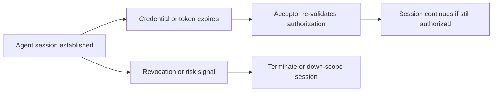
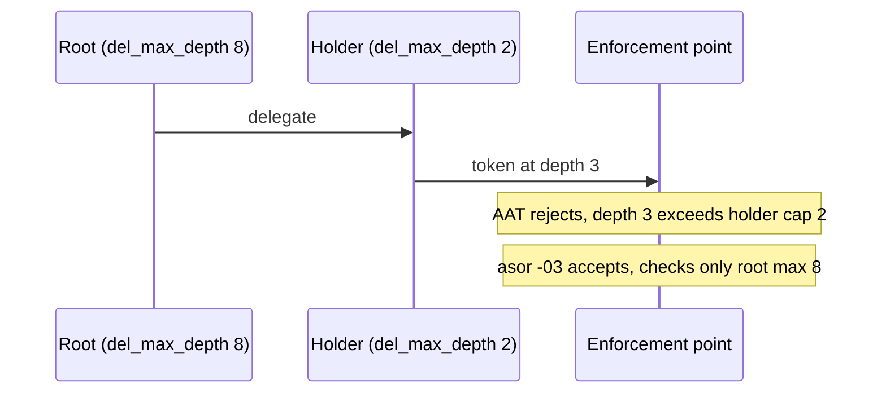
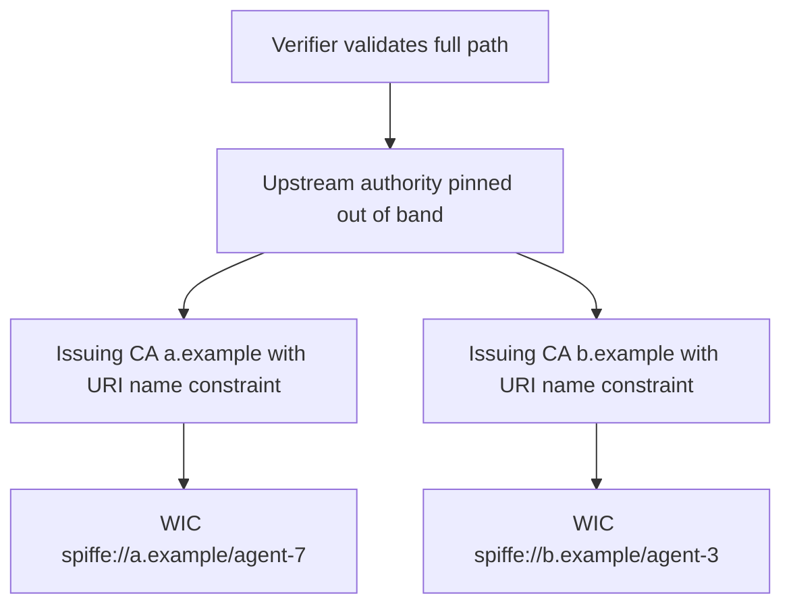
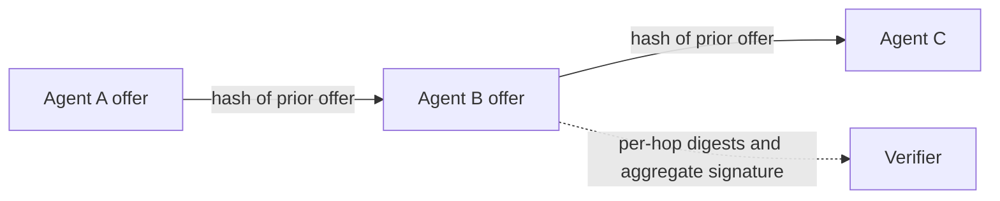

# WIMSE Daily Report (2026-11-03)

Generated at: 2026-11-03T23:25:46+00:00

<!-- insights:start -->
## Briefing

> The most substantive thread is AAT vs. draft-asor-wimse-agent-delegation-chain: they disagree on del_max_depth semantics (an off-by-one at the leaf, plus whether a holder's lower cap binds descendants), and the authors plan to reconcile test vectors before IETF 127. The chairs also issued guidance on AI-generated contributions and published the 18 Nov agenda.

_Updated 2026-11-03T23:27:50+00:00. Machine-drafted from the sources linked below, which stay authoritative._

### AIMS -01 adds sections on policy systems and long-lived sessions, plus deprovisioning and identifier-lifecycle text

`draft-revision` · `substantive` · first seen 2026-11-03 · [draft-ietf-wimse-aims-01: AI Identity Management System](https://author-tools.ietf.org/iddiff?url1=draft-ietf-wimse-aims-00&url2=draft-ietf-wimse-aims-01)

The diff adds Section 9.3 (long-lived sessions and streams): authentication happens at session setup, authorization is bounded by the credential lifetime, and the accepting party re-validates on expiry and terminates or down-scopes sessions on revocation or risk signals. A new Section 10.4 says an access token may be only one input to a policy-based decision, that policy is local to each domain, and that cross-domain mechanisms convey decision outcomes as tokens rather than policy. It also points to AuthZEN for external policy decision points and to sender-constrained tokens (mTLS, DPoP). Other additions: agent identifiers must not be reassigned after retirement and must stay interpretable in records, posture assessment at issuance does not prove current posture (shorter lifetimes or eventing are the options), and a deprovisioning phase that revokes derived credentials. Section 11 now lists WISE alongside CAEP and RISC. Token exchange text states that scope can never exceed the presented token. Sections 10.4 onward were renumbered.

**Use cases**

- Deploying agents that hold long-lived streaming connections, where tokens expire mid-session and revocation must cut the session.
- Designing a resource server that combines an access token with an external policy decision point such as AuthZEN.
- Retiring an agent so that credentials derived from its primary credential also stop being accepted.

**Related in other tracks**

- `oauth-wg` / `draft-ietf-oauth-transaction-tokens`: AIMS Section 10.6 uses transaction tokens to reduce risk inside Agent, LLM and Tool call chains.
- `oauth-wg` / `draft-ietf-oauth-identity-chaining`: Cross-domain access in AIMS Section 10.7 exchanges tokens for a JWT authorization grant as in identity chaining.
- `openid` / `openid/authzen`: The new Section 10.4 cites the AuthZEN Authorization API for external policy decision points.
- `openid` / `openid/sharedsignals`: Section 11 now names WISE in addition to CAEP and RISC as SSF profiles for remediation signals.

### An independent AAT-02 verifier report led the AAT author to settle how ten interpretation questions should read and to plan fixes in -03

`mail` · `substantive` · first seen 2026-11-03 · [Implementation report: attenuating delegation chains for agents (draft-niyikiza-oauth-attenuating-agent-tokens, draft-asor-wimse-agent-delegation-chain)](https://mailarchive.ietf.org/arch/msg/wimse/UPxNKe3xv033k83xIYsAQO4gc6s/)

Azat's implementation report on the AAT-02 profile raised points C1 to C10. Niyikiza states the intended readings: duplicate header members are rejected like claims, aat_aud is a single string, a root signed by a shared key passes under either issuer because the enforcement point trusts the key (3k only checks the issuer is trusted for that key), C8 means a well-formed public key per its kty's rules (RFC 8037 for OKP), and C10 means absolute-URI per RFC 3986. C2 is acknowledged as a good catch, and the author aims to address all ten in -03. Azat will tighten the C10 check, which currently accepts any scheme followed by non-space characters. Songbo Bu contributed seven C6 issuer/key regression cases, which pass without verifier changes. The suite on main has no case yet where anchors share a key or issuer.

**Use cases**

- Implementers of AAT verifiers who need to know the intended reading of root-issuer and key matching
- Test authors building cross-implementation vectors for delegation-chain verification

**Related in other tracks**

- `oauth-wg` / `draft-ietf-oauth-rfc8725bis`: The AAT discussion on rejecting inconsistent alg/kty and header handling is a similar JWT hardening concern, but the item does not cite this draft.

### Wes Jackson picks the JWT rule for permit expiry: a permit is refused at or after its expiry instant

`mail` · `substantive` · first seen 2026-11-03 · [A principal-standing name for the 5.4 closed set](https://mailarchive.ietf.org/arch/msg/wimse/owShZ68sWfdlOOV0MUVIuJjKoAw/)

Following Blake Morrison's point that RFC 7519 section 4.1.4 forbids accepting a JWT on or after exp, Wes Jackson supports the at-or-past rule. He notes RFC 8392 says the same for CWTs and that SPIFFE uses RFC 7519 for the JWT-SVID exp. The -05 text keeps its rule, FR2 flips on the record side, and the AIMS vectors move. He offers to coordinate the -06 and -04 texts so both drafts adopt the same rule together. He also agrees -05 judges the horizon at the evaluation instant and says -06 will state that as normative.

**Use cases**

- Implementers deciding whether a permit is still valid exactly at its expiry time
- Authors of AIMS test vectors that must match the boundary rule

### AAT and draft-asor-wimse-agent-delegation-chain disagree on del_max_depth, and the authors plan to reconcile their vectors before IETF 127

`mail` · `substantive` · first seen 2026-11-03 · [AAT -02 announcement](https://mailarchive.ietf.org/arch/msg/wimse/rjw8cJzJgQfy6qY4rqw5NONFa5U/)

Under a root with del_max_depth 8, AAT accepts a leaf at del_depth 8 (vector J.10.f) while asor -03 rejects it. Niyikiza adds a second difference: if a holder delegates with del_max_depth 2, AAT caps everything below at that depth, while asor checks depth only against the root's 8. Niyikiza wants the shared definition to keep that cap so holders can restrict their own delegation depth, and will add a vector for it. Sweeney, whose credential-delegation draft adopts the asor format unchanged for tokens verified away from the server, leans toward the asor entry but cares more that vectors are reconciled. They also agree each name gets a single registry entry, and that the AAT revocation companion document should state how fresh an enforcement point's revocation state must be. Niyikiza will prepare a constraint-type comparison across the drafts for IETF 127.

**Use cases**

- Implementers who accept delegation chains from both AAT and asor and would get different verdicts on the same token
- Operators who need a holder to be able to restrict how deep its own sub-delegation can go

### A review of AIMS -01 says cross-domain trust is unaddressed and proposes name-constrained issuing CAs under an upstream authority

`mail` · `new-proposal` · first seen 2026-11-03 · [AIMS -01: upstream authorities for Workload Identity Certificates (trust between trust domains)](https://mailarchive.ietf.org/arch/msg/wimse/E1UmvYz5XxGqJxZ-G1_172yCdso/)

The message argues that AIMS -01 does not say how a verifier comes to trust the certificate issuer of a trust domain it does not operate, and that WIMSE-CRED Section 3 and WIMSE-MTLS Section 3.2 name no mechanism, so verifiers exchange trust bundles pairwise. It proposes using only existing X.509: one upstream authority pinned out of band, with per-domain issuing CAs carrying a critical URI name constraint and a path length constraint. Verifiers validate the full path and still choose which domains they accept, and revoking an issuing CA withdraws its whole domain. The requested changes are to record the gap in AIMS, describe this deployment model for Workload Identity Certificates, and add to WIMSE-CRED Sections 3 and 9.4 and WIMSE-MTLS Sections 3.2 and 5.1 rules for sharing one anchor across domains. The author cites informal library testing, and the text offers to contribute wording. The message is truncated, so its closing references are not visible.

**Use cases**

- Two organizations whose workloads must verify each other without exchanging trust bundles pairwise for every trust domain.
- A platform operator hosting several trust domains under one pinned anchor that must keep one domain's issuer from issuing identities in another.

**Related in other tracks**

- `oauth-wg` / `draft-ietf-oauth-spiffe-client-auth`: Both rely on SPIFFE-style identities, and the message ties the pattern to SPIRE UpstreamAuthority and X.509-SVIDs.

### The WIMSE chairs ask participants to vet AI-assisted content and warn they may restrict posting privileges for automated noise

`mail` · `discussion` · first seen 2026-11-03 · [Guidelines for AI-Assisted Contributions to the WIMSE WG](https://mailarchive.ietf.org/arch/msg/wimse/Gkclut9IkiXtsXyeDRINOjXYDOY/)

The chairs say AI use for grammar, clarity or as a sounding board is fine, but participants must be able to explain, defend and take responsibility for what they submit. They object to large volumes of unvetted AI-generated text on the list and in drafts. If it continues, they may restrict posting privileges of participants whose automated content disrupts the group. No technical content changed.

### A handoff-context author wants to cite the aggregate-signatures draft for the per-hop attribution gap in their own draft

`mail` · `discussion` · first seen 2026-11-03 · [Use case input: signed per-hop handoff context](https://mailarchive.ietf.org/arch/msg/wimse/IHnw5zksOpiI1A7tURqVbQms4cs/)

Kumar Srivastava describes draft-srivastava-agentproto-handoff-context: signed offers and status replies that each name the previous offer by hash, so a dropped or reordered hop shows when the chain is carried. Authorization stays with OAuth and WIMSE. Tirumal Reddy answered that his draft-reddy-wimse-aggregate-signatures-01 covers this, since per-hop digests detect omission of workloads that modify messages and aggregate signatures also detect removal of workloads that forward unchanged. He notes it does not address authorization. In the latest message, Srivastava says -01 of his draft is out, that his offers do not record what each hop received and forwarded, and that he wants to cite Reddy's draft in the B3-6 row of the requirements table in -02. He also asked earlier whether such a per-hop element fits the charter or counts as out-of-scope audit data. This message does not answer that.

**Use cases**

- Verifying which agents handled a delegated task and whether any of them altered the request or response.
- Choosing between hop-linked signed offers and aggregate signatures for chain integrity in multi-agent handoffs.

**Related in other tracks**

- `oauth-wg` / `draft-ietf-oauth-transaction-tokens`: Both deal with carrying request context across services, but this thread says authorization is out of scope for the provenance draft.

### Three delegation drafts' authors agree trust-anchor provenance is outside the chain format; AAT lacks a post-quantum cutoff rule

`mail` · `discussion` · first seen 2026-11-03 · [Trust-anchor provenance (draft-asor-wimse-agent-delegation-chain-02, Section 6.4)](https://mailarchive.ietf.org/arch/msg/wimse/Jc2dw6mvquzlcq1_HdTxmdtu99g/)

Uppalapati notes that draft-asor, their own draft and AAT each treat how a verifier came to trust a root key, and how it is bound to a party, as out of scope. Niyikiza (AAT) confirms the verifier is configured with a trust anchor and that provisioning and key-to-party binding stay outside the protocol. Uppalapati says AAT Section 9.11 already requires an algorithm allowlist, but the -02 says nothing about post-quantum algorithms or a date after which quantum-vulnerable signatures are rejected. Whether that belongs in AAT or a deployment profile is left to Niyikiza. Uppalapati will cite AAT in their -02. The quoted thread also covers wording for the online/offline binding evidence. The message was truncated, so later parts are not covered.

**Use cases**

- Deploying delegation-chain verifiers that need a defined date after which quantum-vulnerable signatures are refused
- Deciding where trust-anchor provisioning and key-to-party binding are specified for agent delegation

### The author of an Independent Submission draft points to how it handles source authority, decision-time validity and replayable verification

`mail` · `discussion` · first seen 2026-11-03 · [Three questions on cross-domain authority evidence and decision-time verification](https://mailarchive.ietf.org/arch/msg/wimse/KgIBpXR02dIGXJIoJBchaw4AUvo/)

Lee answers three questions about cross-domain authority evidence, citing draft-li-rttp-iqa-addressing-02. Authority for a subject is fixed by the owning organ, and an unreachable source gives authority_not_determined, never read as assent. Section 8.2 keeps effective instants and the observed instant as separate members, and expired reads are answered as expired. Section 8.3 describes sealed archives with the digest, frozen inputs, code and a replay procedure. The message presents these as reference points and not as a proposal against the WIMSE drafts.

### The author of draft-li-rttp-iqa-addressing-02 announces conformance test vectors for a closed refusal vocabulary and asks WIMSE to consider the pattern

`mail` · `discussion` · first seen 2026-11-03 · [Executable conformance material for the refusal vocabulary and lease semantics in draft-li-rttp-iqa-addressing-02](https://mailarchive.ietf.org/arch/msg/wimse/M6HZLuj_f5QzF05jtEaV2XEsYFg/)

The author reports two vector families (aicent-grant-ref with 25 cases, aicent-lease-boundary with 15) for a five-value refusal vocabulary in a fixed priority order, with a grant reference in every response. Checker and mutation results are quoted, and the sets are hosted at a conformance hub and a GitHub lab. The author asks both the WIMSE and OAuth groups whether this pattern is worth referencing for error and expiry semantics. The draft is not a WIMSE document, and the message contains no WIMSE text change.

### A short reply argues that expiry must be exclusive, because RFC 7519 forbids accepting a JWT on or after exp

`mail` · `discussion` · first seen 2026-11-03 · [A principal-standing name for the 5.4 closed set](https://mailarchive.ietf.org/arch/msg/wimse/Ohjj34ptHLwoSwPc0mCpxbotYI8/)

The author replies to a quoted passage proposing inclusive limits, where a permit is still usable at its expiry. The reply says a permit carried as a JWT cannot be usable at expiry, since RFC 7519 Section 4.1.4 says the token must not be accepted on or after exp. It therefore recommends keeping the at-or-past rule in draft-jackson-wimse-evaluation-05 and moving the AIMS example to it. The message is short and gives no further context.

**Use cases**

- Implementers deciding whether a permit expiry check uses less-than or less-than-or-equal when the permit is a JWT.

### A message urges separate refusal reasons for an unreachable source and a missing proof, citing the author's own draft

`mail` · `discussion` · first seen 2026-11-03 · [draft-jackson-wimse-evaluation-05, Section 3.6: principal standing without an identifier join](https://mailarchive.ietf.org/arch/msg/wimse/rupjVELlCZWJgED1tcEE69jth08/)

The sender says a commitment that cannot be obtained (an unreachable source) and a commitment that is available while the proof is missing or fails to verify are different refusal situations. They point to Section 8.1 of draft-li-rttp-iqa-addressing-02, their own Independent Submission draft, for a closed five-value refusal vocabulary. There, the unreachable case falls under authority_not_determined and the missing proof case is an evaluated deny. The point is that both fail closed but stay distinct in the record, so the reason can be audited. It is offered as a reference for the -06 wording of draft-jackson-wimse-evaluation, not a competing proposal. The claim about conformance runs is the sender's own and is not verified here.

**Use cases**

- Designing error or refusal codes for a verifier that must tell an unreachable status source apart from a failed proof.

### Triage of the candidate queue

- **high** `Diff active WG draft: draft-ietf-wimse-workload-identity-practices-08`: It is in IESG Last Call until 2026-11-13 and a reviewer proposed concrete text changes to Sections 4.5, 5.1.5 and 5.6.
- **high** `Review related draft: draft-asor-wimse-agent-delegation-chain-03`: del_max_depth semantics conflict with AAT and vectors are to be reconciled before IETF 127.
- **high** `Review related draft: draft-durga-wimse-ctx-isolation-00`: It was newly announced to the list with a request for review and a lightning slot at IETF 127.
- **high** `Review related draft: draft-hulea-wimse-agent-mandate-01`: It is named as one of three offline attenuation formats whose subsumption rules may be compared before IETF 127.
- **high** `Review related draft: draft-reddy-wimse-aggregate-signatures-01`: Named on the list as the mechanism for per-hop provenance in delegation chains, with a second draft planning to cite it.
- **high** `Review related draft: draft-reddy-wimse-oauth-dialog-binding-00`: New draft that extends the WIMSE HTTP signature and WPT and adds a tctx.dlg member.
- **high** `Review related draft: draft-thaha-wimse-agent-evidence-binding-02`: The -02 changes the admission rule to current actor only and adds a new MUST NOT on caller references in reusable tokens.

<!-- insights:end -->

## Snapshot

- Active WG drafts: 8
- Related drafts: 20
- Mailing-list posts scanned: 67
- Tracked GitHub repos: 6

## Active WG Drafts

| Draft | Date | Title |
| --- | --- | --- |
| draft-ietf-wimse-aims-01 | 2026-11-02 | AI Identity Management System |
| draft-ietf-wimse-workload-creds-03 | 2026-10-30 | WIMSE Workload Credentials |
| draft-ietf-wimse-workload-identity-practices-08 | 2026-10-30 | Workload Identity Practices |
| draft-ietf-wimse-mutual-tls-03 | 2026-10-24 | Workload Authentication Using Mutual TLS |
| draft-ietf-wimse-identifier-04 | 2026-10-23 | Workload Identifier |
| draft-ietf-wimse-http-signature-08 | 2026-10-20 | WIMSE Workload-to-Workload Authentication with HTTP Signatures |
| draft-ietf-wimse-wpt-02 | 2026-08-27 | WIMSE Workload Proof Token |
| draft-ietf-wimse-arch-08 | 2026-07-06 | Workload Identity in a Multi System Environment (WIMSE) Architecture |

## Recent Related Drafts

| Draft | Date | Title |
| --- | --- | --- |
| draft-hulea-wimse-agent-mandate-01 | 2026-11-01 | Verifiable Mandates for Agents Acting Across Administrative Domains |
| draft-thaha-wimse-agent-evidence-binding-03 | 2026-11-01 | Evidence Binding for AI Agent Credentials |
| draft-reddy-wimse-oauth-dialog-binding-00 | 2026-10-30 | Binding Agent Dialogs to WIMSE and OAuth Credentials |
| draft-sweeney-wimse-credential-delegation-02 | 2026-10-30 | Credential Delegation Protocol for AI Agents in Multi-System Environments |
| draft-durga-wimse-ctx-isolation-00 | 2026-10-29 | Cryptographic Separation of Untrusted Data-Plane Context from Control-Plane Tool Invocations in Autonomous AI Agents |
| draft-jackson-wimse-evaluation-05 | 2026-10-28 | Verifier-Side Evaluation Semantics for Delegated Authority Chains |
| draft-asor-wimse-agent-delegation-chain-03 | 2026-10-27 | Verifiable Attenuated Delegation for AI Agent Chains |
| draft-ni-wimse-ai-agent-identity-04 | 2026-10-27 | WIMSE Applicability for AI Agents |
| draft-uppalapati-wimse-pq-agent-identity-01 | 2026-10-27 | Post-Quantum Requirements for Software and AI Agent Identity |
| draft-heigh-wimse-workload-identity-metadata-00 | 2026-10-16 | Workload Identity Metadata |

## Mailing List Topics

- No mailing-list topics extracted.

## Recent GitHub Activity

| Repository | Latest Commit |
| --- | --- |
| ietf-wg-wimse/draft-ietf-wimse-arch | 2026-11-02T22:05:03Z |
| ietf-wg-wimse/draft-ietf-wimse-s2s-protocol | 2026-10-30T18:09:20Z |
| ietf-wg-wimse/draft-ietf-wimse-workload-identity-practices | 2026-10-30T09:50:30Z |
| ietf-wg-wimse/draft-ietf-wimse-identifier | 2026-10-23T15:16:50Z |
| ietf-wg-wimse/ietf-wg-wimse.github.io | 2026-10-07T19:43:41Z |
| ietf-wg-wimse/admin | 2024-03-17T22:59:45Z |

## Top Deep-Dive Candidates

- [7] Diff active WG draft: draft-ietf-wimse-aims-01
- [7] Diff active WG draft: draft-ietf-wimse-http-signature-08
- [7] Diff active WG draft: draft-ietf-wimse-mutual-tls-03
- [7] Diff active WG draft: draft-ietf-wimse-workload-creds-03
- [6] Review related draft: draft-asor-wimse-agent-delegation-chain-03
- [6] Review related draft: draft-atakora-wimse-sadp-delegation-01
- [6] Review related draft: draft-durga-wimse-ctx-isolation-00
- [6] Review related draft: draft-hulea-wimse-agent-mandate-01
- [6] Review related draft: draft-jackson-wimse-evaluation-05
- [6] Review related draft: draft-lee-wimse-local-tool-call-proof-01

