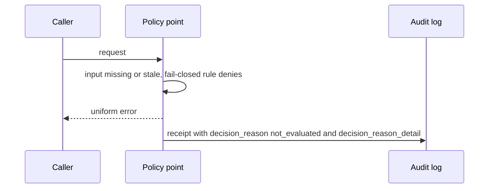
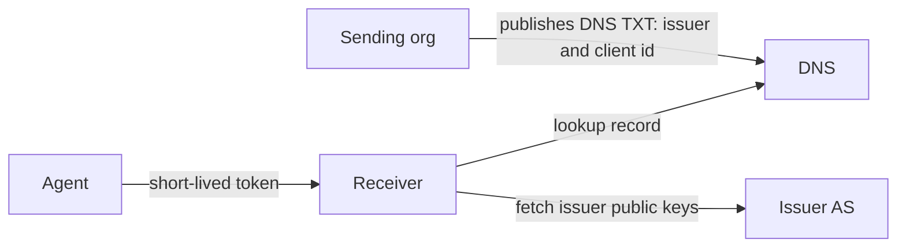

# WIMSE Daily Report (2026-11-06)

Generated at: 2026-11-06T06:51:34+00:00

<!-- insights:start -->
## Briefing

> The list had two review emails from the same reviewer, one on draft-ietf-wimse-workload-creds and one on draft-ietf-wimse-http-signature. Both are mostly wording suggestions. The one normative suggestion is to allow mTLS as well as server-authenticated TLS for carrying a WIT and its proof of possession (PoP).

_Updated 2026-11-06T06:53:13+00:00. Machine-drafted from the sources linked below, which stay authoritative._

### A reviewer suggests mostly readability edits to workload-creds, plus questions on exp lifetime, deny-list wording and mTLS in Section 9.6

`mail` · `discussion` · first seen 2026-11-06 · [Review of draft-ietf-wimse-workload-creds](https://mailarchive.ietf.org/arch/msg/wimse/ea6rdI-IV2MeMNWjU_DmY01hU8Y/)

The reviewer proposes rewording the abstract so credentials are 'bound to' the workload identity rather than 'represent' it. They also propose restating the WIT (application layer, e.g. HTTP) versus WIC (transport layer, mTLS) split as two recommended patterns, with a rationale. For Section 5 they suggest explaining why TLS termination at a load balancer calls for an application-layer credential that stays unaltered. On Section 5.1 they ask whether the 'hours' guidance for exp should be shorter, since some deployments already use about 5 minutes, and why jti text says deny-list rather than allow-list. They suggest Section 9.2 mention that short exp values mitigate the problem it describes. The one normative edit is in Section 9.6, where the requirement to send the WIT and PoP over a 'server-authenticated TLS' connection would also name mTLS. No WG response is in the material.

**Use cases**

- An implementer choosing WIT lifetimes would watch whether the WG tightens the 'on the order of hours' guidance for exp.
- A deployer sending WITs over mTLS between services would benefit if Section 9.6 states that mTLS satisfies the channel requirement.

### A reviewer suggests wording changes to the http-signature introduction to state the full scope and why application-layer protection is used

`mail` · `editorial` · first seen 2026-11-06 · [Review of draft-ietf-wimse-http-signature](https://mailarchive.ietf.org/arch/msg/wimse/nlwwEHRta3EdrxB--z1NM-Mcp7M/)

The reviewer notes the draft is past WGLC and judges the rest of the document very good. They propose adding 'HTTP' to the first sentence of the introduction so the full scope is stated at once. They also propose rewriting the introduction's rationale for application-layer protection. The new text says the motivation is consistent identifier and credential handling across the full transit path, including TLS sessions terminated and restarted at proxies or middleboxes, using HTTP signatures with a JWT. No protocol change is proposed, and no WG response is in the material.

### The AER-1 mapping for AIMS Section 11 audit records adds a committed not_evaluated reason, distinct from denied, in -03

`mail` · `substantive` · first seen 2026-11-05 · [draft-zambo-aer1-wimse-mapping-01: AER-1 as a candidate format for AIMS Section 11 audit records](https://mailarchive.ietf.org/arch/msg/wimse/DDq9WeFOiRcZ1f8eRMF-llUZl7E/)

Girish Konda found that a rejection receipt commits only to the request and the error returned, so a policy denial and a decision never evaluated look identical to a later reader. Brennan Zambo's -02 of draft-zambo-aer1-wimse-mapping added a committed decision_reason member in the receipt metadata, with denied and not_evaluated, plus decision_reason_detail naming the missing input. The reason is committed for the audit reader and not returned to the caller, so the caller still gets a uniform error and no oracle is created. Konda then pointed out that a fail-closed policy point still denies when a status source is silent, and that a reached but stale input is not covered. Zambo adopted this for -03: not_evaluated applies whenever an input the decision depended on could not be established, even if a fail-closed rule then denies. -03 will post on November 15 when the submission tool reopens.

**Use cases**

- Audit teams reconstructing why an agent action was refused after a status service outage.
- Implementers of AIMS Section 11 audit logging choosing a tamper-evident record format.

### AIMS participants agree to record cross-domain issuer trust as a gap and are drafting a mechanism-neutral property list

`mail` · `discussion` · first seen 2026-11-05 · [AIMS -01: upstream authorities for Workload Identity Certificates (trust between trust domains)](https://mailarchive.ietf.org/arch/msg/wimse/F3qLiSetj-FygeMxDBz2v4-tkc8/)

The thread is about how a verifier in one trust domain can trust another domain's issuer of Workload Identity Certificates (WICs). David Croston proposed four properties: trust without bilateral configuration, an issuer speaking only for its authorized names, the verifier choosing which domains it accepts, and time-bounded withdrawal for both a single agent and a whole issuer. Certificate-path and DNS-published approaches would be listed only as examples. Sriram Shankarlingam (draft-shankarlingam-oauth-agent-dns-link) agreed that DNSSEC and the sender's domain are also a root, differing in what they attest: control of a name versus an issuer constrained to its names. He accepted that the DNS link gives only agent-level withdrawal, and that a WIC over mTLS can authenticate the name while his record binds it to the OAuth client. Jiahui Miao proposed a fifth, bounding property: accepting another domain's issuer establishes authenticity of credentials for its names, not an agent's authorization for any action. Shankarlingam supported it. No text has changed yet.

**Use cases**

- A receiving domain that must accept agent credentials from a partner domain with no prior bundle exchange.
- Deployments that combine WIC over mTLS with an OAuth client record to link an authenticated agent name to its client.

**Related in other tracks**

- `oauth-wg` / `draft-ietf-oauth-identity-chaining`: Also addresses cross-domain trust and authorization, though the thread does not cite it.

### Kathleen's review finds draft-ietf-wimse-identifier ready for WGLC, with one wording question on "guarantee" of uniqueness

`mail` · `discussion` · first seen 2026-11-05 · [Review of draft-ietf-wimse-identifie](https://mailarchive.ietf.org/arch/msg/wimse/JKrQPk6TmUIwlo_HiK8vKdLH42I/)

The reviewer finds the abstract clearly written and the goals and out-of-scope text good. The one point raised is that "guarantee" of uniqueness may be too strong without a cryptographic assurance or strict naming process. The reviewer notes that uniqueness rests on the domain name as part of the authority, so the domain is responsible for it, and the wording may be fine. The reviewer thinks the document looks ready for WGLC or publication, and urges others to review because only one other reviewer is listed. The subject line is truncated in the archive and the message does not name a draft version.

**Use cases**

- Authors and chairs deciding whether the identifier draft can enter WGLC.
- Implementers relying on the draft's uniqueness statement for workload naming within a domain.

### A request for five minutes in the WIMSE/OAuth joint session to present a competing cross-domain transaction token draft

`mail` · `discussion` · first seen 2026-11-05 · [OAuth IETF 127 Call for Agenda Items](https://mailarchive.ietf.org/arch/msg/wimse/PhZTX1QKOWLVNrCGkI1Lb0FMne0/)

Yuan asks the chairs for five minutes in the joint session to present draft-liu-oauth-cross-domain-txn-token. Cross-Domain Transaction Tokens is already on the joint session agenda, and Yuan describes the draft as a different approach to the same use case. Yuan says the two approaches have been discussed in issue #17 of gffletch/tt_xdomain, and wants feedback on the design differences. The quoted chairs' call states that OAuth and WIMSE chairs requested a two-hour joint session for topics touching both groups, with priority for working group items with interest from multiple parties. It also gives the draft cut-off as 2 November 2026 23:59 UTC.

**Use cases**

- Teams propagating transaction context across trust domains who must choose between competing drafts.

**Related in other tracks**

- `oauth-wg` / `draft-ietf-oauth-transaction-tokens`: The cross-domain drafts extend Transaction Tokens to span trust domains.

### A reviewer asks that the AER-1 audit mapping record fail-closed denials as not_evaluated when a required input was unavailable

`mail` · `discussion` · first seen 2026-11-05 · [draft-zambo-aer1-wimse-mapping-01: AER-1 as a candidate format for AIMS Section 11 audit records](https://mailarchive.ietf.org/arch/msg/wimse/ld6Xvi4y3UUZ55w0XcIiV8PMauI/)

The author of draft-zambo-aer1-wimse-mapping proposes AER-1 receipts as one candidate format for the audit records that AIMS Section 11 requires but leaves unspecified. After an earlier review by Girish Konda, the -02 revision adds a committed decision_reason member in the receipt metadata: "denied" when the policy point evaluated and denied, "not_evaluated" when evaluation could not be completed, plus a decision_reason_detail naming the unreachable input. The reason is committed for the audit reader and is not returned to the caller, who still gets a uniform error, so the error does not become an oracle. Girish's latest reply says a fail-closed policy point that denies because a status source did not answer is still recorded as "denied", which merges the two cases again. The same applies to an input that was reached but too old. Girish proposes that "not_evaluated" apply whenever a decision-relevant input could not be established, even if a fail-closed rule then denies, with decision_reason_detail naming that input. The author states this is not a request for WIMSE adoption or agenda time at IETF 127. This is individual-draft discussion, not WG text.

**Use cases**

- An audit pipeline for AI agents that must tell a real policy denial from a denial caused by an unreachable status or policy source.
- A policy enforcement point that fails closed and needs its audit record to name which input was missing or stale.

### A side meeting at IETF 127 will discuss draft-le-agent-passport-00 and its open -01 questions

`mail` · `routine` · first seen 2026-11-05 · [Side meeting at IETF 127: agent passports and delegation receipts (draft-le-agent-passport-00)](https://mailarchive.ietf.org/arch/msg/wimse/EcAT9B_KEeK4WAmYBRvUz9UfIU8/)

Ben Le booked a 60-minute side meeting on Tuesday, November 17, 2026, 18:45 to 19:45 PT in Plaza A, with Webex remote participation. The agenda is a design walk-through (call-time joint verification of agent identity and tool claims, build-bound delegation), then open -01 questions, then implementation experience. The questions are fail-closed revocation, controller cache bounds and revalidation, transport requirements (TLS 1.2+ and BCP 195) with intermediaries, and attested builds with pinned digests. The group will also consider whether a post-127 interim is worthwhile. Notes will be shared on the list. No draft text is in the message.

### A reply to a gap report on AIMS -01 suggests a DNS-published alternative to upstream-CA trust across trust domains

`mail` · `discussion` · first seen 2026-11-04 · [AIMS -01: upstream authorities for Workload Identity Certificates (trust between trust domains)](https://mailarchive.ietf.org/arch/msg/wimse/2parb22KDc6Scj4hem0giiG0E0o/)

The message replies to David Croston's comments on draft-ietf-wimse-aims-01. Croston asks AIMS to record that it does not say how a verifier comes to trust the certificate issuer of a trust domain it does not operate. He proposes issuing CAs chained to an upstream authority with critical URI name constraints, using existing X.509 only. The reply supports recording the gap but notes that both parties must still agree on a common anchor, and that withdrawal works at trust-domain level. It offers draft-shankarlingam-oauth-agent-dns-link-01 as a complement: the sender publishes a DNS TXT record naming its issuer and client identifier, the agent presents a short-lived token, and receivers validate it with that record and the issuer's keys (DNSSEC advised). It does not authenticate the agent's name. The reply asks AIMS to say that both certificate-path and DNS-published approaches exist. The source is truncated, so the rest of Croston's proposal is not visible.

**Use cases**

- Deployers of agents that call partner organizations and want to avoid exchanging trust bundles pairwise.
- Authors of AIMS or the credential drafts deciding how to describe cross-domain issuer trust.

**Related in other tracks**

- `oauth-wg` / `draft-ietf-oauth-identity-chaining`: Also addresses authorization across trust domains, though this message does not cite it.

### AIMS chair says cross-domain issuer trust is tracked as issue 175, but AIMS will only reference adopted WG work

`mail` · `discussion` · first seen 2026-11-04 · [AIMS -01: upstream authorities for Workload Identity Certificates (trust between trust domains)](https://mailarchive.ietf.org/arch/msg/wimse/SCeSRqWqUYfniYujXL4SsHVKvMI/)

A thread on AIMS -01 asks for a gap statement on how a verifier establishes trust in another trust domain's issuer for Workload Identity Certificates. Jeff Lombardo opened it as issue 175 in the AIMS repository and said AIMS is a referencing-standards proposal that aggregates existing or officially developing WG work. He noted that none of the candidate drafts named (agent-dns-link, cross-org-delegation, agent-delegation-chain §6.4, trust-domain-discovery §6.1) is WG-adopted, and urged contributors to join adopted efforts or present to the WG. Jiahui Miao proposed a fifth property for the gap text: accepting another domain's issuer establishes authenticity of credentials for that domain's names, not an agent's authorization for an action. David Croston asked whether a gap statement with only the property list would fit AIMS. No text change in AIMS was made.

**Use cases**

- Authors of cross-domain trust drafts deciding whether to seek WG adoption before expecting AIMS to cite them
- Operators designing first-contact federation between trust domains who must not treat issuer trust as authorization

### Reviewer Caleb lists six gaps in credential-delegation-02, mainly how a user-issued token roots a delegation chain

`mail` · `discussion` · first seen 2026-11-04 · [draft-sweeney-wimse-credential-delegation-02](https://mailarchive.ietf.org/arch/msg/wimse/yP24rfg3lxoZnCoJ1IeeYuxz4jY/)

The author's announcement of -02 (quoted in the reply) describes a Delegation Server (DS) that holds user-deposited credentials, with agents using them by proxy under a delegation token. -02 adds a sub-delegation exchange, rank order in the token, cumulative bounds (max_lifetime, max_subtree) with the DS as single writer, a chain-verifiable profile (§5.5) adopting the Asor agent_delegation format, and revocation text framed as invalidation, not closure. Caleb's reply asks for: an explicit claim remap for user-issued tokens (principal in sub, agent in client_id/act.sub) with defined depth-0 values; a root-composition rule where the DS validates the presented token and uses its jti as the root receipt; a per-token tally-mode indicator (DS-held vs delegate-held, disputes resolved toward denial); a defined del_max_depth at depth 0 (AAT and Asor differ by one hop); a status mechanism for tokens with no DS (e.g. a status_uri); and use of 'user-issued' instead of 'user-minted'. The message is truncated, so the rest of the announcement is not covered.

**Use cases**

- A deployer letting end users issue delegation tokens directly to agents, without a Delegation Server minting the root
- An implementer of a verifier that must enforce cumulative spending or subtree limits away from the DS
- Authors aligning del_max_depth semantics across the Asor and AAT delegation drafts

### The joint WIMSE/OAuth session at IETF 127 is set for 19 November with eleven agenda items

`mail` · `routine` · first seen 2026-11-04 · [Joint WIMSE/OAuth Session at IETF 127: Agenda (Thursday, 19 November 2026)](https://mailarchive.ietf.org/arch/msg/wimse/3NgJKiPssovx-46mOdJpyDMryX4/)

The WIMSE chairs published the agenda for the joint WIMSE/OAuth session on Thursday 19 November 2026, 14:00 to 16:00 PST in Golden Gate 4-5; slides are due 17 November. Items include identity chaining, OAuth–WIMSE–SPIFFE boundaries, the future of Client ID, AuthZen, SPIFFE OAuth client authentication, cross-domain transaction tokens, transaction tokens for agents and a BCP, transactional access tokens, and an OAuth actor profile for delegation. This is a schedule announcement, not a protocol change.

**Related in other tracks**

- `oauth-wg` / `draft-ietf-oauth-identity-chaining`: Listed as agenda item 2, presented by Brian Campbell.
- `oauth-wg` / `draft-ietf-oauth-spiffe-client-auth`: Listed as agenda item 6, presented by Arndt Schwenkschuster.
- `oauth-wg` / `draft-ietf-oauth-transaction-tokens`: Several agenda items (cross-domain, agents, BCP) concern transaction tokens.

### Triage of the candidate queue

- **high** `Diff active WG draft: draft-ietf-wimse-aims-01`: The list thread is shaping a new gap statement for cross-domain issuer trust and an audit-record mapping for Section 11.
- **high** `Diff active WG draft: draft-ietf-wimse-identifier-04`: A fresh review calls it ready for WGLC and raises the "guarantee" wording.
- **high** `Diff active WG draft: draft-ietf-wimse-workload-identity-practices-08`: It is in IESG Last Call until 2026-11-13 and a reviewer proposed concrete text changes to Sections 4.5, 5.1.5 and 5.6.
- **high** `Review related draft: draft-asor-wimse-agent-delegation-chain-03`: Its format is adopted unchanged in credential-delegation-02 §5.5, and its depth semantics and §6.4 are under discussion.
- **high** `Review related draft: draft-durga-wimse-ctx-isolation-00`: It was newly announced to the list with a request for review and a lightning slot at IETF 127.
- **high** `Review related draft: draft-hulea-wimse-agent-mandate-01`: It is named as one of three offline attenuation formats whose subsumption rules may be compared before IETF 127.
- **high** `Review related draft: draft-reddy-wimse-aggregate-signatures-01`: Named on the list as the mechanism for per-hop provenance in delegation chains, with a second draft planning to cite it.
- **high** `Review related draft: draft-reddy-wimse-oauth-dialog-binding-00`: New draft that extends the WIMSE HTTP signature and WPT and adds a tctx.dlg member.
- **high** `Review related draft: draft-sweeney-wimse-credential-delegation-02`: A detailed list reviewer comment proposes changes to §5.5, tally mode and revocation, with open questions from the author.
- **high** `Review related draft: draft-thaha-wimse-agent-evidence-binding-02`: The -02 changes the admission rule to current actor only and adds a new MUST NOT on caller references in reusable tokens.

<!-- insights:end -->

## Snapshot

- Active WG drafts: 8
- Related drafts: 20
- Mailing-list posts scanned: 65
- Tracked GitHub repos: 6

## Active WG Drafts

| Draft | Date | Title |
| --- | --- | --- |
| draft-ietf-wimse-aims-01 | 2026-11-02 | AI Identity Management System |
| draft-ietf-wimse-workload-creds-03 | 2026-10-30 | WIMSE Workload Credentials |
| draft-ietf-wimse-workload-identity-practices-08 | 2026-10-30 | Workload Identity Practices |
| draft-ietf-wimse-mutual-tls-03 | 2026-10-24 | Workload Authentication Using Mutual TLS |
| draft-ietf-wimse-identifier-04 | 2026-10-23 | Workload Identifier |
| draft-ietf-wimse-http-signature-08 | 2026-10-20 | WIMSE Workload-to-Workload Authentication with HTTP Signatures |
| draft-ietf-wimse-wpt-02 | 2026-08-27 | WIMSE Workload Proof Token |
| draft-ietf-wimse-arch-08 | 2026-07-06 | Workload Identity in a Multi System Environment (WIMSE) Architecture |

## Recent Related Drafts

| Draft | Date | Title |
| --- | --- | --- |
| draft-hulea-wimse-agent-mandate-01 | 2026-11-01 | Verifiable Mandates for Agents Acting Across Administrative Domains |
| draft-thaha-wimse-agent-evidence-binding-03 | 2026-11-01 | Evidence Binding for AI Agent Credentials |
| draft-reddy-wimse-oauth-dialog-binding-00 | 2026-10-30 | Binding Agent Dialogs to WIMSE and OAuth Credentials |
| draft-sweeney-wimse-credential-delegation-02 | 2026-10-30 | Credential Delegation Protocol for AI Agents in Multi-System Environments |
| draft-durga-wimse-ctx-isolation-00 | 2026-10-29 | Cryptographic Separation of Untrusted Data-Plane Context from Control-Plane Tool Invocations in Autonomous AI Agents |
| draft-jackson-wimse-evaluation-05 | 2026-10-28 | Verifier-Side Evaluation Semantics for Delegated Authority Chains |
| draft-asor-wimse-agent-delegation-chain-03 | 2026-10-27 | Verifiable Attenuated Delegation for AI Agent Chains |
| draft-ni-wimse-ai-agent-identity-04 | 2026-10-27 | WIMSE Applicability for AI Agents |
| draft-uppalapati-wimse-pq-agent-identity-01 | 2026-10-27 | Post-Quantum Requirements for Software and AI Agent Identity |
| draft-heigh-wimse-workload-identity-metadata-00 | 2026-10-16 | Workload Identity Metadata |

## Mailing List Topics

- No mailing-list topics extracted.

## Recent GitHub Activity

| Repository | Latest Commit |
| --- | --- |
| ietf-wg-wimse/draft-ietf-wimse-arch | 2026-11-02T22:05:03Z |
| ietf-wg-wimse/draft-ietf-wimse-s2s-protocol | 2026-10-30T18:09:20Z |
| ietf-wg-wimse/draft-ietf-wimse-workload-identity-practices | 2026-10-30T09:50:30Z |
| ietf-wg-wimse/draft-ietf-wimse-identifier | 2026-10-23T15:16:50Z |
| ietf-wg-wimse/ietf-wg-wimse.github.io | 2026-10-07T19:43:41Z |
| ietf-wg-wimse/admin | 2024-03-17T22:59:45Z |

## Top Deep-Dive Candidates

- [7] Diff active WG draft: draft-ietf-wimse-aims-01
- [7] Diff active WG draft: draft-ietf-wimse-http-signature-08
- [7] Diff active WG draft: draft-ietf-wimse-mutual-tls-03
- [7] Diff active WG draft: draft-ietf-wimse-workload-creds-03
- [6] Review related draft: draft-asor-wimse-agent-delegation-chain-03
- [6] Review related draft: draft-durga-wimse-ctx-isolation-00
- [6] Review related draft: draft-hulea-wimse-agent-mandate-01
- [6] Review related draft: draft-jackson-wimse-evaluation-05
- [6] Review related draft: draft-lee-wimse-local-tool-call-proof-01
- [6] Review related draft: draft-ni-wimse-ai-agent-identity-04

