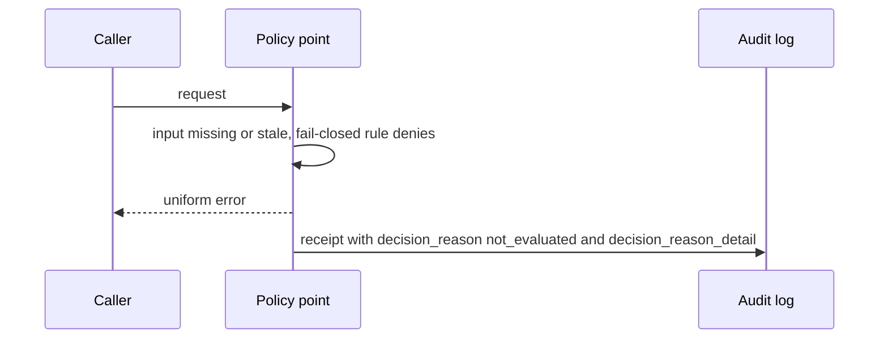

# WIMSE Daily Report (2026-11-07)

Generated at: 2026-11-07T21:54:24+00:00

<!-- insights:start -->
## Briefing

> Only one item: a mailing-list follow-up on community-contributed test vectors for draft-ietf-wimse-http-signature-08, fixing a missing "?" in the @query component of three vectors. No draft text changed.

_Updated 2026-11-07T21:55:17+00:00. Machine-drafted from the sources linked below, which stay authoritative._

### In short, the AER-1 mapping for AIMS audit records will separate denied decisions from decisions that could not be evaluated

`mail` · `substantive` · first seen 2026-11-07 · [draft-zambo-aer1-wimse-mapping-01: AER-1 as a candidate format for AIMS Section 11 audit records](https://mailarchive.ietf.org/arch/msg/wimse/7hhLkU1MMoQJJoahXOS2T17YiQk/)

In a thread on draft-zambo-aer1-wimse-mapping, Girish Konda argued that a rejection receipt cannot distinguish a policy denial from a check that could not be completed, since the producer's reason sits outside the committed hash. The -02 added a committed decision_reason member (denied or not_evaluated) with decision_reason_detail. Konda then noted that fail-closed denials after an unreachable or stale input would still be recorded as denied. The author agreed: -03 will use not_evaluated whenever an input the decision depended on could not be established, even if a fail-closed rule denies. The reason is committed for the audit reader and not returned to the caller. -03 will be posted on November 15 after the submission tool reopens.

**Use cases**

- A deployment producing tamper-evident audit logs for AIMS Section 11 needs to tell policy denials from unreachable or stale policy and status sources.
- A fail-closed policy point can keep returning a uniform error to callers while still recording why it denied.

### In short, Rob Zagarella commented on Cred delegation -02: keep human-approval evidence separate in a user-minted root, and specify suspend/restore semantics

`mail` · `discussion` · first seen 2026-11-07 · [draft-sweeney-wimse-credential-delegation-02](https://mailarchive.ietf.org/arch/msg/wimse/EDluDjc325ZvOf2QXX9rj3kJM7o/)

The thread carries Kieran Sweeney's -02 announcement. The draft is a profile where a Delegation Server holds user-deposited credentials and agents exercise them by proxy under a delegation token. Main changes are a sub-delegation exchange, rank order in the token, cumulative bounds (max_lifetime, max_subtree) with the DS as single writer, a chain-verifiable profile adopting draft-asor-wimse-agent-delegation-chain's agent_delegation format, and revocation framed as invalidation, not closure. Zagarella's reply, the new message, suggests that -03 distinguish who minted a root from evidence of natural-person approval, recording only method and assurance. It also asks Section 7 to say what a verifier sees for actions during a suspension and whether a restored delegation is the same grant, with the 1-hour cap presented as a bound on exposure.

**Use cases**

- An agent platform that lets users deposit upstream credentials and delegate to agents without exposing them.
- A verifier away from the Delegation Server needs a fixed place to check human-approval evidence for a user-minted root.

**Related in other tracks**

- `oauth-wg` / `draft-ietf-oauth-transaction-tokens`: Both carry delegated authority across call chains, but the material does not link them explicitly; weak connection.

### In short, an independent test-vector set for http-signature-08 was posted, and the editor said verifiers should reject messages carrying MUST NOT parameters

`mail` · `discussion` · first seen 2026-11-07 · [Test vectors for draft-ietf-wimse-http-signature-08 — request for review (2 new messages)](https://mailarchive.ietf.org/arch/msg/wimse/IcH0Hq5968-TzSxLL7Wpi4pl-7k/)

Jiahui Miao posted 6 positive and 22 negative vectors, each tied to a MUST in the draft, with deterministic keys, spelled-out signature bases and a fixed clock. They asked whether a verifier should reject or ignore sender-side MUST NOT parameters (keyid, alg), and whether the Section 3.7 example nonces, which are below the 64-bit minimum, deserve an editorial note. Yaron replied that a MUST NOT in a security RFC should be rejected by the recipient, that an issue will be opened to add this note, and that a few of the vectors may need fixing (details in issue 419). The set is under review in the s2s-protocol repository.

**Use cases**

- An implementer of WIMSE HTTP message signatures wanting interoperability checks can use the vectors, noting some may be corrected.
- A verifier author deciding how to treat messages that include keyid or alg parameters now has the editor's stated intent: reject.

### In short, the AAT and Asor drafts disagree on del_max_depth, and the thread favours a shared definition that lets a holder cap depth below its own position

`mail` · `discussion` · first seen 2026-11-07 · [AAT -02 announcement](https://mailarchive.ietf.org/arch/msg/wimse/cTEAHakgjO-revheF0EDR8Am5RA/)

This thread compares delegation-constraint drafts ahead of IETF 127. AAT accepts a leaf at del_depth equal to the root's del_max_depth (test vector J.10.f) while asor -03 rejects it. A second difference from Azat's implementation report: if a root has del_max_depth 8 and its holder delegates with 2, AAT rejects depth 3 while Asor checks only against 8. Niki argued the shared definition should keep the cap, and Rob Zagarella's new reply agrees. Zagarella also asked that the comparison record whether each draft can bind a leaf to a digest of the exact request, and that the AAT Section 9.8 companion document state a revocation freshness bound in terms comparable to Cred -02 Section 7. The material shown is truncated.

**Use cases**

- Implementers of offline-verifiable delegation chains need identical depth-limit behaviour across drafts to avoid interoperability failures.
- Deployments requiring fresh human approval want a leaf bound to one exact request.

### Test vectors for the WIMSE HTTP signature draft were fixed: @query values lacked the leading ? required by RFC 9421

`mail` · `routine` · first seen 2026-11-07 · [Test vectors for draft-ietf-wimse-http-signature-08 — request for review](https://mailarchive.ietf.org/arch/msg/wimse/VCH1w0y6OuR-koGRiJYakzmtGAo/)

An individual contributor reports on the mailing list that test vectors P-01 and P-02 wrote the @query component value without the leading ? required by RFC 9421 Section 2.2.7. An independent run found the same defect in P-06's WIMSE signature. All three were regenerated over corrected signature bases with the same keys, parameters and fixed clock. The literal signature in N-15 was also regenerated because it was computed over a P-01-shaped base. Its expected outcome (reject, Section 3.1) is unchanged. Old signatures fail against the corrected bases, and other cases are unaffected. The author also confirms that N-06/N-07 record reject for the keyid / alg MUST NOT parameters, now backed by the draft author's stated intent. An issue was opened to add an example-nonce note. The author will contact the chairs about how to contribute the vectors. Nothing in the draft itself changed.

### In short, one commit fixing three spelling errors in the s2s-protocol repository

`repo-activity` · `routine` · first seen 2026-11-07 · [1 new commit(s) in ietf-wg-wimse/draft-ietf-wimse-s2s-protocol](https://github.com/ietf-wg-wimse/draft-ietf-wimse-s2s-protocol)

Commit 499f0608fc22 (#415) fixes three spelling errors in the wpt directory or component, going by the message 'wpt: fix three spelling errors'. No further detail is available and no protocol behaviour is indicated.

### Kathleen Moriarty's review of workload-creds suggests clearer wording and a few security tweaks; Yaron logged it as issue #418

`mail` · `discussion` · first seen 2026-11-06 · [Review of draft-ietf-wimse-workload-creds](https://mailarchive.ietf.org/arch/msg/wimse/YSabmWandtjPFRSY5R89Ci6OWhA/)

The review proposes rewording the abstract to say credentials are bound to the identity rather than represent it. It also proposes stating directly in the introduction that the WIT is for application-layer protocols such as HTTP and the WIC is for transport-layer protocols, mainly mTLS. For Section 5 it suggests explaining that TLS termination at a load balancer is a reason to use an application-layer credential. For Section 5.1 it asks whether the exp guidance of hours should be shorter, and why the draft says deny-list rather than allow-list. For Section 9.6 it suggests allowing mTLS as well as server-authenticated TLS. The message is truncated, so later comments are not visible. Yaron recorded it as s2s-protocol issue #418. These are suggestions, not adopted changes.

**Use cases**

- Implementers choosing between WIT and WIC for a deployment with TLS-terminating load balancers.
- Operators setting WIT lifetimes and deciding between deny-list and allow-list status mechanisms.

**Related in other tracks**

- `oauth-wg` / `draft-ietf-oauth-status-list`: The review questions deny-list versus allow-list token status in the WIT, which is the area Token Status List covers; the material does not link the two drafts.

### A reviewer suggests mostly readability edits to workload-creds, plus questions on exp lifetime, deny-list wording and mTLS in Section 9.6

`mail` · `discussion` · first seen 2026-11-06 · [Review of draft-ietf-wimse-workload-creds](https://mailarchive.ietf.org/arch/msg/wimse/ea6rdI-IV2MeMNWjU_DmY01hU8Y/)

The reviewer proposes rewording the abstract so credentials are 'bound to' the workload identity rather than 'represent' it. They also propose restating the WIT (application layer, e.g. HTTP) versus WIC (transport layer, mTLS) split as two recommended patterns, with a rationale. For Section 5 they suggest explaining why TLS termination at a load balancer calls for an application-layer credential that stays unaltered. On Section 5.1 they ask whether the 'hours' guidance for exp should be shorter, since some deployments already use about 5 minutes, and why jti text says deny-list rather than allow-list. They suggest Section 9.2 mention that short exp values mitigate the problem it describes. The one normative edit is in Section 9.6, where the requirement to send the WIT and PoP over a 'server-authenticated TLS' connection would also name mTLS. No WG response is in the material.

**Use cases**

- An implementer choosing WIT lifetimes would watch whether the WG tightens the 'on the order of hours' guidance for exp.
- A deployer sending WITs over mTLS between services would benefit if Section 9.6 states that mTLS satisfies the channel requirement.

### A thread on AIMS -01 converges on two bounding sentences for the gap text, with the rule placed in Section 10.4

`mail` · `discussion` · first seen 2026-11-06 · [AIMS -01: upstream authorities for Workload Identity Certificates (trust between trust domains)](https://mailarchive.ietf.org/arch/msg/wimse/uHj7l43s0fHCCyGLYRnOqvVpfpM/)

Lee (author of draft-li-rttp-iqa-addressing) and Jiahui Miao agree to put one bounding sentence in the AIMS gap text and the undeterminable-state behaviour in Section 10.4, where the accepting domain's own evaluation is described. The first sentence says that accepting another domain's issuer does not establish authorization for an action. The second says a determination made from observed evidence holds at the time of observation and does not by itself hold after that evidence expires. Lee supports this with his own draft's closed five-value refusal vocabulary and an observation_as_of_ms field. This is a proposal from one participant, not a WG decision. The message is truncated, and the other drafts and conformance sites it cites are self-promotion that I did not verify.

**Use cases**

- Deciding how a verifier treats a certificate from another trust domain's issuer when AIMS leaves authorization undetermined.
- Designing a cross-domain acceptance audit record that includes the age of the evidence relied on.

### Kathleen Moriarty's review of http-signature asks for a one-sentence HTTP scope and a clearer reason for application-layer protection; logged as issue #417

`mail` · `editorial` · first seen 2026-11-06 · [Review of draft-ietf-wimse-http-signature](https://mailarchive.ietf.org/arch/msg/wimse/Vd1-lCWYXdJYkIMMV2z98f3IL5s/)

The review says the draft is clear and in good shape. It suggests adding HTTP to the first sentence of the introduction. It also suggests rewording the paragraph on why deployments prefer application-layer protection. The proposed text says TLS may involve several hops that terminate and restart sessions, such as at a proxy or middlebox, and HTTP signatures with a JWT keep one identifier and credential across the path. It is a wording change only and does not alter the protocol. Yaron noted it as s2s-protocol issue #417.

### A reviewer suggests wording changes to the http-signature introduction to state the full scope and why application-layer protection is used

`mail` · `editorial` · first seen 2026-11-06 · [Review of draft-ietf-wimse-http-signature](https://mailarchive.ietf.org/arch/msg/wimse/nlwwEHRta3EdrxB--z1NM-Mcp7M/)

The reviewer notes the draft is past WGLC and judges the rest of the document very good. They propose adding 'HTTP' to the first sentence of the introduction so the full scope is stated at once. They also propose rewriting the introduction's rationale for application-layer protection. The new text says the motivation is consistent identifier and credential handling across the full transit path, including TLS sessions terminated and restarted at proxies or middleboxes, using HTTP signatures with a JWT. No protocol change is proposed, and no WG response is in the material.

### The AER-1 mapping for AIMS Section 11 audit records adds a committed not_evaluated reason, distinct from denied, in -03

`mail` · `substantive` · first seen 2026-11-05 · [draft-zambo-aer1-wimse-mapping-01: AER-1 as a candidate format for AIMS Section 11 audit records](https://mailarchive.ietf.org/arch/msg/wimse/DDq9WeFOiRcZ1f8eRMF-llUZl7E/)

Girish Konda found that a rejection receipt commits only to the request and the error returned, so a policy denial and a decision never evaluated look identical to a later reader. Brennan Zambo's -02 of draft-zambo-aer1-wimse-mapping added a committed decision_reason member in the receipt metadata, with denied and not_evaluated, plus decision_reason_detail naming the missing input. The reason is committed for the audit reader and not returned to the caller, so the caller still gets a uniform error and no oracle is created. Konda then pointed out that a fail-closed policy point still denies when a status source is silent, and that a reached but stale input is not covered. Zambo adopted this for -03: not_evaluated applies whenever an input the decision depended on could not be established, even if a fail-closed rule then denies. -03 will post on November 15 when the submission tool reopens.

**Use cases**

- Audit teams reconstructing why an agent action was refused after a status service outage.
- Implementers of AIMS Section 11 audit logging choosing a tamper-evident record format.

### Triage of the candidate queue

- **high** `Diff active WG draft: draft-ietf-wimse-aims-01`: The list thread is shaping a new gap statement for cross-domain issuer trust and an audit-record mapping for Section 11.
- **high** `Diff active WG draft: draft-ietf-wimse-identifier-04`: A fresh review calls it ready for WGLC and raises the "guarantee" wording.
- **high** `Diff active WG draft: draft-ietf-wimse-workload-identity-practices-08`: It is in IESG Last Call until 2026-11-13 and a reviewer proposed concrete text changes to Sections 4.5, 5.1.5 and 5.6.
- **high** `Review related draft: draft-asor-wimse-agent-delegation-chain-03`: Its del_max_depth semantics are being reconciled with AAT and are adopted unchanged by Cred -02 Section 5.5.
- **high** `Review related draft: draft-durga-wimse-ctx-isolation-00`: It was newly announced to the list with a request for review and a lightning slot at IETF 127.
- **high** `Review related draft: draft-hulea-wimse-agent-mandate-01`: It is named as one of three offline attenuation formats whose subsumption rules may be compared before IETF 127.
- **high** `Review related draft: draft-reddy-wimse-aggregate-signatures-01`: Named on the list as the mechanism for per-hop provenance in delegation chains, with a second draft planning to cite it.
- **high** `Review related draft: draft-reddy-wimse-oauth-dialog-binding-00`: New draft that extends the WIMSE HTTP signature and WPT and adds a tctx.dlg member.
- **high** `Review related draft: draft-sweeney-wimse-credential-delegation-02`: Active -02 review thread with open design questions on cumulative bounds, revocation and the depth boundary.
- **high** `Review related draft: draft-thaha-wimse-agent-evidence-binding-02`: The -02 changes the admission rule to current actor only and adds a new MUST NOT on caller references in reusable tokens.
- **low** `Diff active WG draft: draft-ietf-wimse-http-signature-08`: Today's material is only a test-vector correction on the list; it brings no draft text change to diff.

<!-- insights:end -->

## Snapshot

- Active WG drafts: 8
- Related drafts: 20
- Mailing-list posts scanned: 65
- Tracked GitHub repos: 6

## Active WG Drafts

| Draft | Date | Title |
| --- | --- | --- |
| draft-ietf-wimse-aims-01 | 2026-11-02 | AI Identity Management System |
| draft-ietf-wimse-workload-creds-03 | 2026-10-30 | WIMSE Workload Credentials |
| draft-ietf-wimse-workload-identity-practices-08 | 2026-10-30 | Workload Identity Practices |
| draft-ietf-wimse-mutual-tls-03 | 2026-10-24 | Workload Authentication Using Mutual TLS |
| draft-ietf-wimse-identifier-04 | 2026-10-23 | Workload Identifier |
| draft-ietf-wimse-http-signature-08 | 2026-10-20 | WIMSE Workload-to-Workload Authentication with HTTP Signatures |
| draft-ietf-wimse-wpt-02 | 2026-08-27 | WIMSE Workload Proof Token |
| draft-ietf-wimse-arch-08 | 2026-07-06 | Workload Identity in a Multi System Environment (WIMSE) Architecture |

## Recent Related Drafts

| Draft | Date | Title |
| --- | --- | --- |
| draft-hulea-wimse-agent-mandate-01 | 2026-11-01 | Verifiable Mandates for Agents Acting Across Administrative Domains |
| draft-thaha-wimse-agent-evidence-binding-03 | 2026-11-01 | Evidence Binding for AI Agent Credentials |
| draft-reddy-wimse-oauth-dialog-binding-00 | 2026-10-30 | Binding Agent Dialogs to WIMSE and OAuth Credentials |
| draft-sweeney-wimse-credential-delegation-02 | 2026-10-30 | Credential Delegation Protocol for AI Agents in Multi-System Environments |
| draft-durga-wimse-ctx-isolation-00 | 2026-10-29 | Cryptographic Separation of Untrusted Data-Plane Context from Control-Plane Tool Invocations in Autonomous AI Agents |
| draft-jackson-wimse-evaluation-05 | 2026-10-28 | Verifier-Side Evaluation Semantics for Delegated Authority Chains |
| draft-asor-wimse-agent-delegation-chain-03 | 2026-10-27 | Verifiable Attenuated Delegation for AI Agent Chains |
| draft-ni-wimse-ai-agent-identity-04 | 2026-10-27 | WIMSE Applicability for AI Agents |
| draft-uppalapati-wimse-pq-agent-identity-01 | 2026-10-27 | Post-Quantum Requirements for Software and AI Agent Identity |
| draft-heigh-wimse-workload-identity-metadata-00 | 2026-10-16 | Workload Identity Metadata |

## Mailing List Topics

- No mailing-list topics extracted.

## Recent GitHub Activity

| Repository | Latest Commit |
| --- | --- |
| ietf-wg-wimse/draft-ietf-wimse-s2s-protocol | 2026-11-06T20:17:37Z |
| ietf-wg-wimse/draft-ietf-wimse-arch | 2026-11-02T22:05:03Z |
| ietf-wg-wimse/draft-ietf-wimse-workload-identity-practices | 2026-10-30T09:50:30Z |
| ietf-wg-wimse/draft-ietf-wimse-identifier | 2026-10-23T15:16:50Z |
| ietf-wg-wimse/ietf-wg-wimse.github.io | 2026-10-07T19:43:41Z |
| ietf-wg-wimse/admin | 2024-03-17T22:59:45Z |

## Top Deep-Dive Candidates

- [7] Diff active WG draft: draft-ietf-wimse-aims-01
- [7] Diff active WG draft: draft-ietf-wimse-http-signature-08
- [7] Diff active WG draft: draft-ietf-wimse-mutual-tls-03
- [7] Diff active WG draft: draft-ietf-wimse-workload-creds-03
- [6] Review related draft: draft-asor-wimse-agent-delegation-chain-03
- [6] Review related draft: draft-durga-wimse-ctx-isolation-00
- [6] Review related draft: draft-hulea-wimse-agent-mandate-01
- [6] Review related draft: draft-jackson-wimse-evaluation-05
- [6] Review related draft: draft-lee-wimse-local-tool-call-proof-01
- [6] Review related draft: draft-ni-wimse-ai-agent-identity-04

