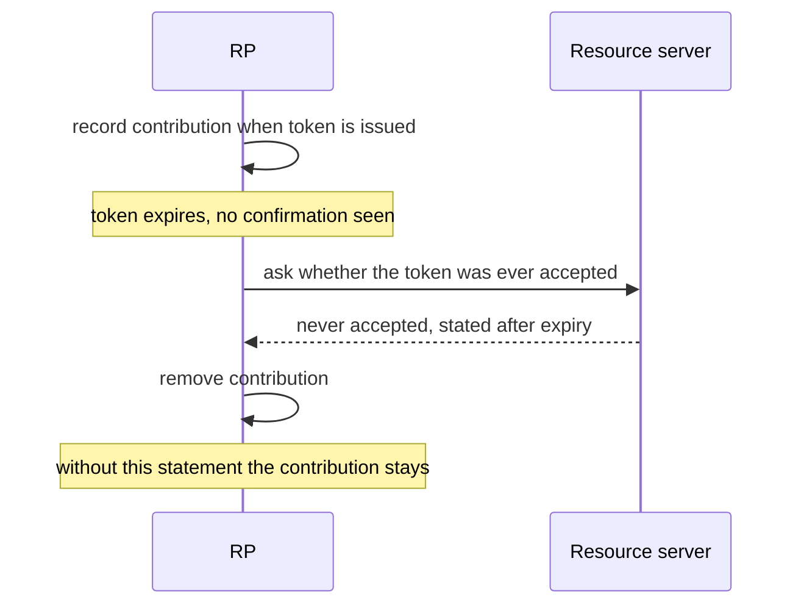

# WIMSE Daily Report (2026-11-11)

Generated at: 2026-11-11T06:27:58+00:00

<!-- insights:start -->
## Briefing

> No draft text changed in this run: the two items are mailing-list messages. The more substantive one is a review comment asking that section 5.4 of an unnamed record format say its entries are valid only at the evaluation instant. The other is a procedural reply about a joint WIMSE/OAuth session at IETF 127.

_Updated 2026-11-10T19:47:45+00:00. Machine-drafted from the sources linked below, which stay authoritative._

### A reviewer says the agent-mandate draft should only let an RP un-count an unused token on positive evidence, not on missing confirmation

`mail` · `discussion` · first seen 2026-11-10 · [draft-hulea-wimse-agent-mandate-01, Section 9.5: tokens that "expire unused"](https://mailarchive.ietf.org/arch/msg/wimse/cmB6Ar7ozE1T2IqSG9BpuL0NoWk/)

Dmitri Chistyakov comments on Section 9.5 of draft-hulea-wimse-agent-mandate-01. The draft treats unresolvable status as indeterminate and denies by default, but says that if a token expires unused the RP MAY remove its contribution to a cumulative limit. The contribution is recorded when the token is issued (Section 10.2), yet the draft does not say how the RP learns the token was unused. If the RP infers this from a missing or late execution confirmation, it can remove the contribution of an action that did run. The budget is then under-counted and a later request can pass the sum_max check wrongly. The proposed text allows removal only on positive evidence trusted under RP policy or the Trust Framework, such as a statement from the resource server that it never accepted the token. Absence of a confirmation does not count. Without such evidence the contribution stays recorded, which may cause an unneeded denial until it leaves the period window. The sender notes the message was prepared with AI assistance. This is a review comment, not a change to the draft.

**Use cases**

- An RP enforcing a per-period spending or action limit on an AI agent using mandate tokens, where execution confirmations can arrive late or be lost.
- A Trust Framework author defining which party may attest that a token was never accepted.

### A reviewer asks that section 5.4 state that its entries describe the evaluation instant only, not the moment of the effect

`mail` · `discussion` · first seen 2026-11-10 · [A principal-standing name for the 5.4 closed set](https://mailarchive.ietf.org/arch/msg/wimse/suAzkd-0n9Luwa_CCR5n0JKA53Q/)

Cliff supports adding an optional decision.evaluatedAt field, alongside Marc's malformed case. He notes this does not settle the gap between freshness at evaluation and freshness at the effect. Because the record already carries effect.interval.openedAt, a reader can compute an input's age when the effect began. He asks for one sentence in 5.4 saying the entries speak to the evaluation instant only. He also asks for a test record whose standing is fresh at evaluatedAt but past maxAge at openedAt, to be accepted as well formed. The message does not name the draft, and the thread's earlier context is not included, so the surrounding proposal is only partly visible.

**Use cases**

- An implementer validating decision records needs to know whether a stale input at effect time makes the record malformed or only informational.
- An auditor reconstructing an action from a record wants to compute input age at effect start from effect.interval.openedAt, without treating evaluatedAt as proof of freshness at that time.

### Chairs say a competing cross-domain transaction token proposal may ask questions at the IETF 127 joint session but may not co-present

`mail` · `routine` · first seen 2026-11-10 · [OAuth IETF 127 Call for Agenda Items](https://mailarchive.ietf.org/arch/msg/wimse/L1aB2ez0awvPzFZxxfm-tlZmZ64/)

This is a short reply from Sean to Yuan, quoting an earlier thread. Yuan had asked for five minutes at the joint WIMSE/OAuth session to present draft-liu-oauth-cross-domain-txn-token, which targets the same use case as the Cross-Domain Transaction Tokens item already on the agenda. Sean says that after talking with Pieter and George, Yuan is welcome to ask questions but co-presenting is not an option for now. The quoted call for agenda items says the OAuth chairs requested two two-hour slots plus a joint WIMSE/OAuth session. It also says items with demonstrated interest from several parties get priority, and gives 2 November 2026 as the draft submission cut-off. No protocol text changed.

**Related in other tracks**

- `oauth-wg` / `draft-ietf-oauth-transaction-tokens`: The joint session item concerns transaction tokens extended across domains, and the competing draft targets the same use case.

### Marc backs an optional decision.evaluatedAt so that decision age is measured at evaluation time, not report time

`mail` · `discussion` · first seen 2026-11-09 · [A principal-standing name for the 5.4 closed set](https://mailarchive.ietf.org/arch/msg/wimse/3t4tKJjiiP3rdNSF5plL6CUACCs/)

Marc supports Sankalp's proposal of an optional decision.evaluatedAt, with age measured there when present and at reportedAt otherwise. He says the commitment-sourced rows in agent-evidence-vectors (PS3 to PS5, from #402) were written assuming age at evaluation, while rows built on PS1 measure at reportedAt, so they hold only if the decision point reports when it evaluates. For a published commitment, measuring at a later reportedAt would make a correct record look stale and fail the recompute. He suggests also refusing a record whose evaluatedAt is later than reportedAt by more than the skew tolerance applied to lastResult, as malformed. This is a thread from a related draft ecosystem, not a WG draft change.

**Use cases**

- A verifier recomputing the age of a policy decision that relied on a published commitment held at evaluation time.

### Kathleen's review of the mTLS draft asks it to cover key-pair authentication, not just path validation and naming, and thinks WGLC is possible

`mail` · `discussion` · first seen 2026-11-09 · [Review of https://datatracker.ietf.org/doc/draft-ietf-wimse-mutual-tls/](https://mailarchive.ietf.org/arch/msg/wimse/Tme8ajuvk1sMcFHm07qA25OUoIs/)

The review proposes adding at the transport layer to the first sentence of the Introduction. It suggests a new section before 3.2 on authenticating the workload with the key pair tied to the certificate, including provisioning when the workload must match expected key pairs. In Section 5.1 it proposes wording so the server is authenticated using its credentials and key pair, not only the workload identity name. It also proposes that a server doing mTLS MUST validate the client certificate chain and key pair, as well as trust domain and Workload Identifier. With these changes the reviewer sees WGLC as possible.

**Use cases**

- An mTLS implementer who wants the spec to say explicitly that proof of possession of the certificate key is part of authentication, alongside chain and identifier checks.

### In short, an individual draft will treat an input exactly maxAge old as stale, and the author floats an optional decision.evaluatedAt

`mail` · `discussion` · first seen 2026-11-09 · [A principal-standing name for the 5.4 closed set](https://mailarchive.ietf.org/arch/msg/wimse/V5RNKagX4l-NXPOKeX8Wrt3s1Ng/)

Sankalp Gilda replies to Wes, Blake, Kieran and Girish. He agrees the freshness boundary is "at or past", so an input is fresh only while its age is less than maxAge. The next revision of draft-gilda-audit-agent-audit-record (after -03) will say this, and his test record FR2, an input exactly maxAge old, becomes a reject case. He asks whether an optional decision.evaluatedAt would fit. Age would be measured there when present and at decision.reportedAt otherwise, and he would add test records on each side of the boundary for a decision point that reports late. He will put Girish's wording "an issuer or a principal whose standing is withdrawn" into Section 5, with a withdrawn-principal record. He also asks Wes for the -06 text of Section 3 and 3.2 so he can mirror it. The message does not say which draft the -05/-06 text belongs to, and no WG draft text changes in it.

**Use cases**

- An implementer of an audit or evidence verifier who must decide whether an input exactly at the maxAge limit is accepted.
- A decision point that reports its result late and needs the age check done at the evaluation instant instead of the report time.

### AAT, Asor and Cred-02 authors try to agree one meaning for del_max_depth and compare constraints before IETF 127

`mail` · `discussion` · first seen 2026-11-09 · [AAT -02 announcement](https://mailarchive.ietf.org/arch/msg/wimse/a1elD5SHAy4Yhdf4GkQ4zkrIa78/)

In this thread Niki (AAT) and Kieran (Cred-02) agree that each registry name should have a single entry, so the open point is how del_max_depth is interpreted. With a root del_max_depth of 8, AAT accepts a leaf at del_depth 8 (test vector J.10.f) while the Asor format rejects it. Niki adds that if a holder re-delegates with del_max_depth 2, AAT rejects a token at depth 3, whereas Asor checks only against the root's 8. Niki wants the shared definition to keep that cap. Rob supports keeping it. Kieran leans toward the Asor entry but cares more that the vectors are reconciled. Niki will add a test case for the capped scenario. Kieran separates chain-wide budgets, which need a single writer such as the Cred-02 Delegation Server ledger, from offline attenuation. On revocation, he asks the AAT Section 9.8 companion document to state a freshness bound for the enforcement point, in terms comparable to Cred-02 Section 7. Rob asks the comparison to record whether each draft can express a leaf bound to a digest of the exact request. Niki will have the comparison ready before IETF 127 and confirms a side meeting in San Francisco.

**Use cases**

- An implementer of agent delegation who must decide whether a leaf at the root's maximum depth is accepted or rejected.
- A deployer who needs revocation of delegated tokens to take effect within a bounded time at enforcement points.
- A human-approval workflow that must bind a delegated token to one exact action, such as one payee and amount.

### Kathleen's review of draft-ietf-wimse-wpt asks why jti replay checking is only RECOMMENDED and what collision-resistant claim names means

`mail` · `discussion` · first seen 2026-11-09 · [Review of draft-ietf-wimse-wpt](https://mailarchive.ietf.org/arch/msg/wimse/awkadBvsHww58vtGBDIM2OjkrVw/)

The review is mostly editorial and reads the draft as a clear guide for implementers. It asks to break out the Key Characteristics paragraphs. From a security view it asks why the check that a jti has not been used before in the WPT validity window is RECOMMENDED rather than MUST. It also asks what collision resistant means for a claim such as example.com/myclaim, since the term usually refers to hash functions. No text change has been made.

**Use cases**

- An implementer deciding whether to enforce jti replay detection on WPTs when the draft only recommends it.

### Marc asks whether sub being preserved at every hop means the same value everywhere, even across trust domains

`mail` · `discussion` · first seen 2026-11-09 · [Subject: AIMS-00: multi-hop delegation context across agent, tool and resource boundaries](https://mailarchive.ietf.org/arch/msg/wimse/pLsPkrtN5tiN7gDW0S9cVG1YHjc/)

Marc cites Kieran's statements that sub is the Principal at every hop and stays the original delegated subject. He asks whether preserved means the same sub value at every party, including after a hop crosses a trust domain and a party gets a transcribed identifier (OAUTH-ID-CHAIN, Section 2.5). The alternative is that each value refers to the same User and the issuing authorization server keeps the mapping for Section 11. He asks because Nik is proposing text for Section 10.10 on AIMS issues #88 and #90 in which the value may differ between parties, and that text should not conflict with Kieran's property. No answer is in this message.

**Use cases**

- A multi-domain agent deployment where a downstream authorization server issues a different identifier for the same user.

**Related in other tracks**

- `oauth-wg` / `draft-ietf-oauth-identity-chaining`: The message cites OAUTH-ID-CHAIN Section 2.5 for transcribed identifiers across trust domains.

### Kathleen's review of identifier-04 has one nit: say that credentials means WIMSE workload credentials

`mail` · `editorial` · first seen 2026-11-09 · [Review of draft-ietf-wimse-identifier-04](https://mailarchive.ietf.org/arch/msg/wimse/TWGtUv1z2nJ5x1mE0goy2_c0GYI/)

The only comment concerns the last paragraph of Section 5. It proposes changing the final words from credentials to WIMSE workload credentials, so readers know it refers to the credential formats of \[WIMSE-CREDENTIALS\]. The review otherwise finds the document well written. This is a terminology fix with no protocol change.

### A side meeting on Attenuating Authorization Tokens is set for IETF 127, Monday 16 Nov, 11:15 PST

`mail` · `routine` · first seen 2026-11-09 · [IETF 127 side meeting: Attenuating Authorization Tokens, Monday 11:15](https://mailarchive.ietf.org/arch/msg/wimse/KhTvcCX802aq2nWC2d1fB7kU4Mg/)

Niki announces a side meeting in Continental 7 and on Webex. Topics are implementation experience, integrations with HTTP APIs, MCP, A2A and agent frameworks, what belongs in the core document versus profiles, and alignment with related delegation chain drafts in OAuth and WIMSE, including common test vectors.

### Triage of the candidate queue

- **high** `Diff active WG draft: draft-ietf-wimse-http-signature-08`: Three new issues target this draft (test vectors #419, nonce entropy in examples #420, editorial comments #417).
- **high** `Diff active WG draft: draft-ietf-wimse-mutual-tls-03`: A review proposes key-pair authentication text and says WGLC looks possible.
- **high** `Diff active WG draft: draft-ietf-wimse-workload-creds-03`: Active issues on editorial comments (#418), coexistence reconciliation (#414) and overlapping trust roots (#370).
- **high** `Review related draft: draft-asor-wimse-agent-delegation-chain-03`: The del_max_depth meaning versus AAT is being reconciled before IETF 127.
- **high** `Review related draft: draft-hulea-wimse-agent-mandate-01`: A list comment identifies a concrete under-counting gap in Section 9.5 that bypasses sum_max.
- **high** `Review related draft: draft-sweeney-wimse-credential-delegation-02`: Cred-02 Sections 5.5 and 7 are being compared with AAT on depth and revocation.
- **low** `Diff active WG draft: draft-ietf-wimse-identifier-04`: The only review comment is a one-phrase terminology nit.

<!-- insights:end -->

## Snapshot

- Active WG drafts: 8
- Related drafts: 20
- Mailing-list posts scanned: 67
- Tracked GitHub repos: 6

## Active WG Drafts

| Draft | Date | Title |
| --- | --- | --- |
| draft-ietf-wimse-aims-01 | 2026-11-02 | AI Identity Management System |
| draft-ietf-wimse-workload-creds-03 | 2026-10-30 | WIMSE Workload Credentials |
| draft-ietf-wimse-workload-identity-practices-08 | 2026-10-30 | Workload Identity Practices |
| draft-ietf-wimse-mutual-tls-03 | 2026-10-24 | Workload Authentication Using Mutual TLS |
| draft-ietf-wimse-identifier-04 | 2026-10-23 | Workload Identifier |
| draft-ietf-wimse-http-signature-08 | 2026-10-20 | WIMSE Workload-to-Workload Authentication with HTTP Signatures |
| draft-ietf-wimse-wpt-02 | 2026-08-27 | WIMSE Workload Proof Token |
| draft-ietf-wimse-arch-08 | 2026-07-06 | Workload Identity in a Multi System Environment (WIMSE) Architecture |

## Recent Related Drafts

| Draft | Date | Title |
| --- | --- | --- |
| draft-hulea-wimse-agent-mandate-01 | 2026-11-01 | Verifiable Mandates for Agents Acting Across Administrative Domains |
| draft-thaha-wimse-agent-evidence-binding-03 | 2026-11-01 | Evidence Binding for AI Agent Credentials |
| draft-reddy-wimse-oauth-dialog-binding-00 | 2026-10-30 | Binding Agent Dialogs to WIMSE and OAuth Credentials |
| draft-sweeney-wimse-credential-delegation-02 | 2026-10-30 | Credential Delegation Protocol for AI Agents in Multi-System Environments |
| draft-durga-wimse-ctx-isolation-00 | 2026-10-29 | Cryptographic Separation of Untrusted Data-Plane Context from Control-Plane Tool Invocations in Autonomous AI Agents |
| draft-jackson-wimse-evaluation-05 | 2026-10-28 | Verifier-Side Evaluation Semantics for Delegated Authority Chains |
| draft-asor-wimse-agent-delegation-chain-03 | 2026-10-27 | Verifiable Attenuated Delegation for AI Agent Chains |
| draft-ni-wimse-ai-agent-identity-04 | 2026-10-27 | WIMSE Applicability for AI Agents |
| draft-uppalapati-wimse-pq-agent-identity-01 | 2026-10-27 | Post-Quantum Requirements for Software and AI Agent Identity |
| draft-heigh-wimse-workload-identity-metadata-00 | 2026-10-16 | Workload Identity Metadata |

## Mailing List Topics

- No mailing-list topics extracted.

## Recent GitHub Activity

| Repository | Latest Commit |
| --- | --- |
| ietf-wg-wimse/draft-ietf-wimse-s2s-protocol | 2026-11-06T20:17:37Z |
| ietf-wg-wimse/draft-ietf-wimse-arch | 2026-11-02T22:05:03Z |
| ietf-wg-wimse/draft-ietf-wimse-workload-identity-practices | 2026-10-30T09:50:30Z |
| ietf-wg-wimse/draft-ietf-wimse-identifier | 2026-10-23T15:16:50Z |
| ietf-wg-wimse/ietf-wg-wimse.github.io | 2026-10-07T19:43:41Z |
| ietf-wg-wimse/admin | 2024-03-17T22:59:45Z |

## Top Deep-Dive Candidates

- [7] Diff active WG draft: draft-ietf-wimse-aims-01
- [7] Diff active WG draft: draft-ietf-wimse-http-signature-08
- [7] Diff active WG draft: draft-ietf-wimse-mutual-tls-03
- [7] Diff active WG draft: draft-ietf-wimse-workload-creds-03
- [6] Review related draft: draft-asor-wimse-agent-delegation-chain-03
- [6] Review related draft: draft-durga-wimse-ctx-isolation-00
- [6] Review related draft: draft-hulea-wimse-agent-mandate-01
- [6] Review related draft: draft-jackson-wimse-evaluation-05
- [6] Review related draft: draft-lee-wimse-local-tool-call-proof-01
- [6] Review related draft: draft-ni-wimse-ai-agent-identity-04

