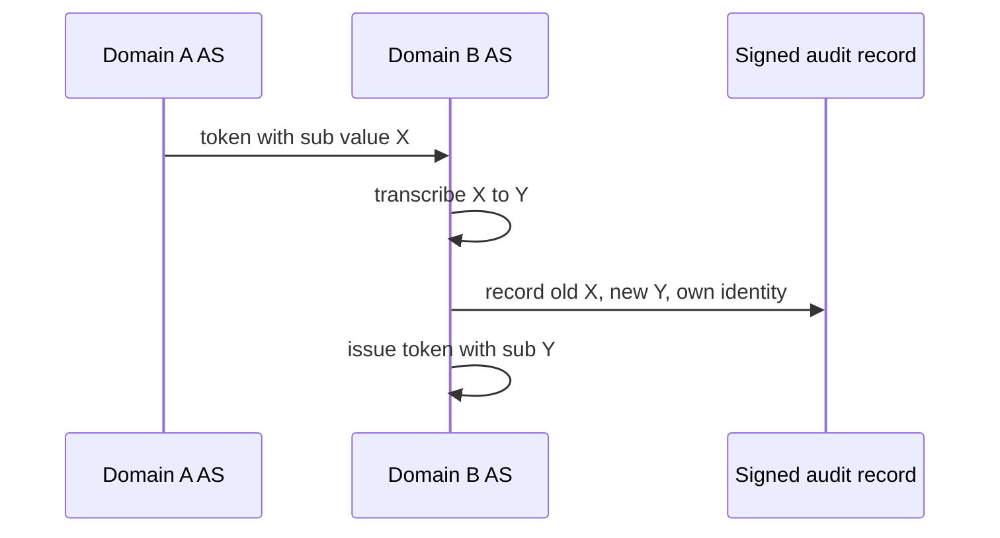
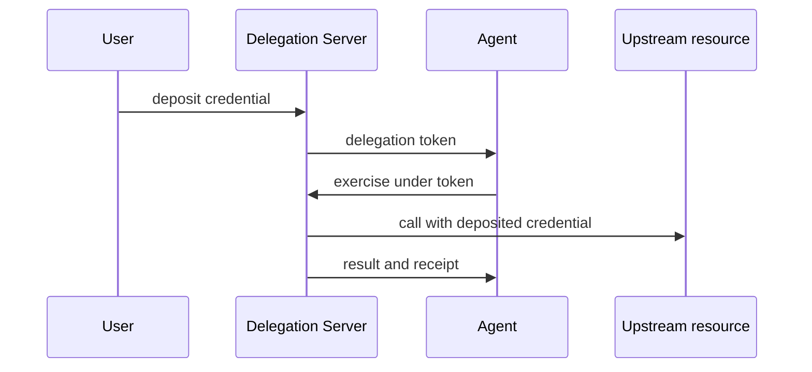
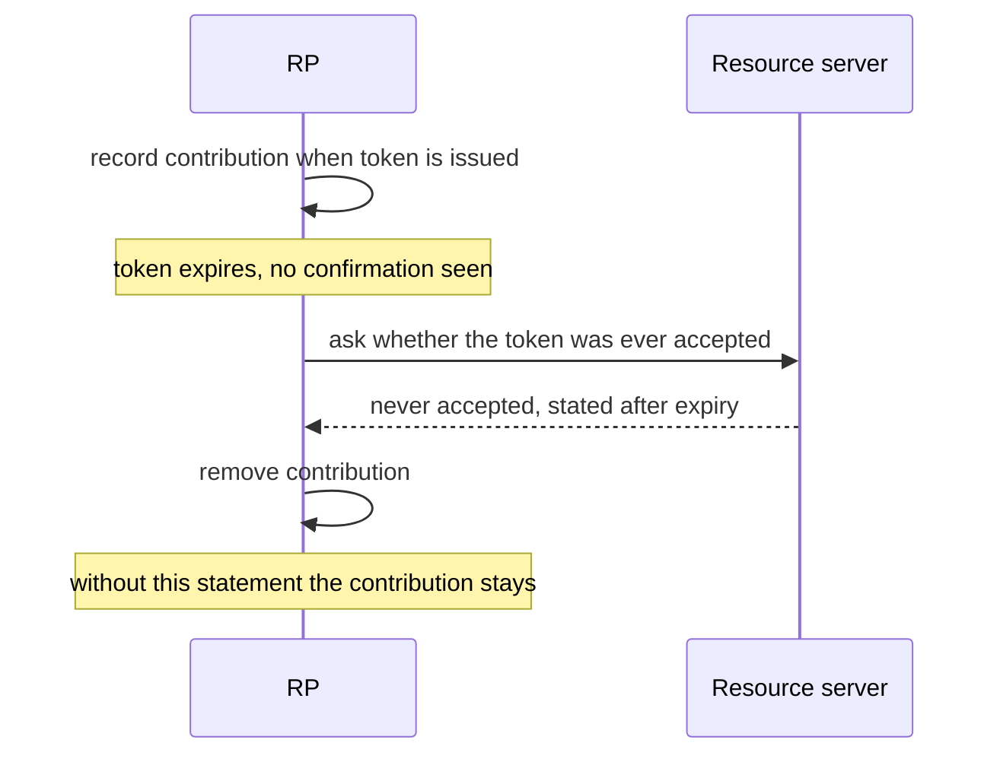

# WIMSE Daily Report (2026-11-11)

Generated at: 2026-11-11T19:38:25+00:00

<!-- insights:start -->
## Briefing

> The most concrete movement is on the delegation-chain drafts: AAT, Asor and Cred -02 are converging on one meaning for del_max_depth, and the AIMS thread agreed the delegated subject may be transcribed across trust domains if the mapping is in the signed audit record. Several threads also moved a freshness boundary to "at or past" (refused at exactly the limit).

_Updated 2026-11-11T19:40:15+00:00. Machine-drafted from the sources linked below, which stay authoritative._

### AIMS cross-domain gap text: agreed to add bounding sentences that issuer trust does not decide authorization and that determinations expire

`mail` · `discussion` · first seen 2026-11-11 · [AIMS -01: upstream authorities for Workload Identity Certificates (trust between trust domains) (6 new messages)](https://mailarchive.ietf.org/arch/msg/wimse/33_tdetI9AjZMcqhQnnnUdJTNCs/)

The thread continues David Croston's proposal to record in AIMS a gap about trust between trust domains, with a mechanism-neutral property list (verifier trusts another domain's issuer without bilateral setup, issuer speaks only for its names, verifier chooses domains, bounded withdrawal). Jiahui Miao adds a bounding property: accepting another domain's issuer does not by itself establish authorization for an action. ShaoBao Li adds a time half, that a determination holds at the time of observation and not after the evidence expires. Cliff agrees to put one sentence in the gap text and the rest, including recording "not determined" rather than "not permitted", in Section 10.4. Sriram Shankarlingam agrees and notes his DNS-link link token grants nothing. Several messages cite the authors' own drafts and conformance suites.

**Use cases**

- Federating agents across organizations where no bilateral trust bundle exchange exists.
- Auditors needing to tell apart refused because authority could not be determined and refused because the operation is not permitted.

**Related in other tracks**

- `oauth-wg` / `draft-ietf-oauth-spiffe-client-auth`: Related only loosely (workload identity to OAuth client binding); the material does not cite it.

### One short reply: act is attribution, not a policy input, and the evidence-binding authors will take that in -02

`mail` · `discussion` · first seen 2026-11-11 · [New I-D: draft-thaha-wimse-agent-evidence-binding-00 (evidence binding for AIMS audit)](https://mailarchive.ietf.org/arch/msg/wimse/G81dpzTWMQgyCzshUmHHbzr8bzU/)

Despite the subject line announcing draft-thaha-wimse-agent-evidence-binding-00, the only message in the file is Kieran replying to Mikhail. Kieran concedes his earlier "policy input" line was wrong because Section 4.1 of the RFC keeps prior actors out of the access-control decision, so deny-listing a prior actor still conflicts with it. Direction (a) is the correct reading and Shameer and Shaibi will take it in -02. Per-hop authority needs separately verified evidence. The announcement text itself is not in the file.

### AIMS delegation thread: the delegated subject may differ across trust domains if the transcription is in the signed record

`mail` · `discussion` · first seen 2026-11-11 · [Subject: AIMS-00: multi-hop delegation context across agent, tool and resource boundaries (2 new messages)](https://mailarchive.ietf.org/arch/msg/wimse/HewNx8oZlaK0RSEV7BnYOLq1xuc/)

Kieran Sweeney clarified that "sub preserved" means the same principal, not the same bytes. Within one trust domain the value stays identical at every hop (sub fixed, actor in client_id and act). Across a trust domain, transcription under identity chaining is acceptable if the transcribing party records old value, new value and its own identity in what it signs; an AS merely keeping the mapping is not enough for AIMS Section 11. Marc proposes two changes on PR #176 along those lines. Both sides also agree to move the freshness boundary to at-or-past, so the 21 boundary vectors and the 23 October wording change, and the case admitted at exactly S+L becomes refused.

**Use cases**

- A deployment where an agent chain crosses trust domains via identity chaining and needs auditors to reconstruct the original user from records alone.
- A verifier implementing the S+L revocation-admission bound that must decide whether an input exactly at its limit is accepted.

**Related in other tracks**

- `oauth-wg` / `draft-ietf-oauth-identity-chaining`: The cross-domain transcribed identifier is discussed as OAUTH-ID-CHAIN Section 2.5.

### AAT, Asor and Cred -02 authors agree a child's lower del_max_depth must be honoured, and compare constraints before IETF 127

`mail` · `discussion` · first seen 2026-11-11 · [AAT -02 announcement (2 new messages)](https://mailarchive.ietf.org/arch/msg/wimse/P1yDQDvbTRAwDDsLYU5WZDocCsQ/)

Kieran agrees that the effective maximum depth at any hop is the lowest del_max_depth on the path, and that this cap is separate from the question of the leaf at the maximum (AAT J.10.f accepts a leaf at del_depth equal to the root maximum, Asor -03 rejects it). Rob Zagarella asks the comparison of the three drafts to record whether each can bind a leaf to a digest of one exact request; Kieran says Cred -02 cannot express that in the token today, and its Section 5.5 takes the chain format by reference so its entry for off-DS verification is provisional. Rob also asks that the AAT Section 9.8 revocation freshness bound be stated in the same terms as Cred -02 Section 7. Niki holds a side meeting on 16 November in San Francisco.

**Use cases**

- Implementers of attenuating delegation tokens who need to know whether a leaf at the maximum depth is accepted.
- Human-approval flows where an approval must bind to one exact action such as a payee and amount.

**Related in other tracks**

- `oauth-wg` / `draft-ietf-oauth-transaction-tokens`: Not referenced in the material; omit if unsure.

### Review of Cred delegation -02: user-issued roots, tally mode and revocation status are the open points for -03

`mail` · `discussion` · first seen 2026-11-11 · [draft-sweeney-wimse-credential-delegation-02 (2 new messages)](https://mailarchive.ietf.org/arch/msg/wimse/zLDfwOIkylaaI4vS97LSdAt4RYw/)

Kieran's -02 announcement describes a Delegation Server (DS) that holds deposited user credentials and lets agents exercise them by proxy under a delegation token. It adds sub-delegation exchange (5.4.1), rank order in the token, delegation_constraints with max_lifetime and max_subtree written only by the DS, a chain-verifiable profile (5.5) adopting the Asor agent_delegation format unchanged, revocation text stating revoked_count is invalidation not closure, and ML-DSA. Caleb Dayton raises six points, including the claim remap for user-issued tokens, using the token's jti as root receipt, a mode marker for single-writer versus delegate-held tally, and a status mechanism when no DS exists. Kieran agrees to a per-key mode marker but cautions that a per-verifier tally does not bound the total across verifiers, and says -02 names no status mechanism for tokens the DS did not issue. Rob Zagarella suggests separating who issued a root from evidence a person approved it, and asks Section 7 to cover suspension and restoration.

**Use cases**

- An agent platform where users deposit OAuth credentials with a proxy and agents never hold the upstream token.
- A verifier away from the DS that must decide whether a cumulative budget has been exceeded.

**Related in other tracks**

- `oauth-wg` / `draft-ietf-oauth-identity-chaining`: Not named in the material; omit.

### A reviewer says the agent-mandate draft should only let an RP un-count an unused token on positive evidence, not on missing confirmation

`mail` · `discussion` · first seen 2026-11-10 · [draft-hulea-wimse-agent-mandate-01, Section 9.5: tokens that "expire unused"](https://mailarchive.ietf.org/arch/msg/wimse/cmB6Ar7ozE1T2IqSG9BpuL0NoWk/)

Dmitri Chistyakov comments on Section 9.5 of draft-hulea-wimse-agent-mandate-01. The draft treats unresolvable status as indeterminate and denies by default, but says that if a token expires unused the RP MAY remove its contribution to a cumulative limit. The contribution is recorded when the token is issued (Section 10.2), yet the draft does not say how the RP learns the token was unused. If the RP infers this from a missing or late execution confirmation, it can remove the contribution of an action that did run. The budget is then under-counted and a later request can pass the sum_max check wrongly. The proposed text allows removal only on positive evidence trusted under RP policy or the Trust Framework, such as a statement from the resource server that it never accepted the token. Absence of a confirmation does not count. Without such evidence the contribution stays recorded, which may cause an unneeded denial until it leaves the period window. The sender notes the message was prepared with AI assistance. This is a review comment, not a change to the draft.

**Use cases**

- An RP enforcing a per-period spending or action limit on an AI agent using mandate tokens, where execution confirmations can arrive late or be lost.
- A Trust Framework author defining which party may attest that a token was never accepted.

### A reviewer asks that section 5.4 state that its entries describe the evaluation instant only, not the moment of the effect

`mail` · `discussion` · first seen 2026-11-10 · [A principal-standing name for the 5.4 closed set](https://mailarchive.ietf.org/arch/msg/wimse/suAzkd-0n9Luwa_CCR5n0JKA53Q/)

Cliff supports adding an optional decision.evaluatedAt field, alongside Marc's malformed case. He notes this does not settle the gap between freshness at evaluation and freshness at the effect. Because the record already carries effect.interval.openedAt, a reader can compute an input's age when the effect began. He asks for one sentence in 5.4 saying the entries speak to the evaluation instant only. He also asks for a test record whose standing is fresh at evaluatedAt but past maxAge at openedAt, to be accepted as well formed. The message does not name the draft, and the thread's earlier context is not included, so the surrounding proposal is only partly visible.

**Use cases**

- An implementer validating decision records needs to know whether a stale input at effect time makes the record malformed or only informational.
- An auditor reconstructing an action from a record wants to compute input age at effect start from effect.interval.openedAt, without treating evaluatedAt as proof of freshness at that time.

### Chairs say a competing cross-domain transaction token proposal may ask questions at the IETF 127 joint session but may not co-present

`mail` · `routine` · first seen 2026-11-10 · [OAuth IETF 127 Call for Agenda Items](https://mailarchive.ietf.org/arch/msg/wimse/L1aB2ez0awvPzFZxxfm-tlZmZ64/)

This is a short reply from Sean to Yuan, quoting an earlier thread. Yuan had asked for five minutes at the joint WIMSE/OAuth session to present draft-liu-oauth-cross-domain-txn-token, which targets the same use case as the Cross-Domain Transaction Tokens item already on the agenda. Sean says that after talking with Pieter and George, Yuan is welcome to ask questions but co-presenting is not an option for now. The quoted call for agenda items says the OAuth chairs requested two two-hour slots plus a joint WIMSE/OAuth session. It also says items with demonstrated interest from several parties get priority, and gives 2 November 2026 as the draft submission cut-off. No protocol text changed.

**Related in other tracks**

- `oauth-wg` / `draft-ietf-oauth-transaction-tokens`: The joint session item concerns transaction tokens extended across domains, and the competing draft targets the same use case.

### Audit-record test corpus: an input exactly maxAge old becomes stale, and an optional decision.evaluatedAt is proposed

`mail` · `discussion` · first seen 2026-11-09 · [A principal-standing name for the 5.4 closed set (2 new messages)](https://mailarchive.ietf.org/arch/msg/wimse/3t4tKJjiiP3rdNSF5plL6CUACCs/)

Sankalp Gilda agrees the freshness boundary is at-or-past: in the next revision of draft-gilda-audit-agent-audit-record an input is fresh only while its age is less than maxAge, so test record FR2 (exactly maxAge old) becomes a reject case. Because the record carries only decision.reportedAt, he proposes an optional decision.evaluatedAt, with age measured there when present and at reportedAt otherwise, plus test records on each side of the boundary. Marc supports this, noting that standing taken from a published commitment depends on its age when the decision was taken, and adds that an evaluatedAt later than reportedAt beyond the skew tolerance should be refused as malformed. A withdrawn-principal wording from Girish goes into Section 5.

**Use cases**

- Authors of audit-record verifiers who need a defined result for evidence exactly at its maximum age.
- Decision points that report late and would otherwise appear stale when age is measured at the report time.

### Kathleen's review of the mTLS draft asks it to cover key-pair authentication, not just path validation and naming, and thinks WGLC is possible

`mail` · `discussion` · first seen 2026-11-09 · [Review of https://datatracker.ietf.org/doc/draft-ietf-wimse-mutual-tls/](https://mailarchive.ietf.org/arch/msg/wimse/Tme8ajuvk1sMcFHm07qA25OUoIs/)

The review proposes adding at the transport layer to the first sentence of the Introduction. It suggests a new section before 3.2 on authenticating the workload with the key pair tied to the certificate, including provisioning when the workload must match expected key pairs. In Section 5.1 it proposes wording so the server is authenticated using its credentials and key pair, not only the workload identity name. It also proposes that a server doing mTLS MUST validate the client certificate chain and key pair, as well as trust domain and Workload Identifier. With these changes the reviewer sees WGLC as possible.

**Use cases**

- An mTLS implementer who wants the spec to say explicitly that proof of possession of the certificate key is part of authentication, alongside chain and identifier checks.

### In short, an individual draft will treat an input exactly maxAge old as stale, and the author floats an optional decision.evaluatedAt

`mail` · `discussion` · first seen 2026-11-09 · [A principal-standing name for the 5.4 closed set](https://mailarchive.ietf.org/arch/msg/wimse/V5RNKagX4l-NXPOKeX8Wrt3s1Ng/)

Sankalp Gilda replies to Wes, Blake, Kieran and Girish. He agrees the freshness boundary is "at or past", so an input is fresh only while its age is less than maxAge. The next revision of draft-gilda-audit-agent-audit-record (after -03) will say this, and his test record FR2, an input exactly maxAge old, becomes a reject case. He asks whether an optional decision.evaluatedAt would fit. Age would be measured there when present and at decision.reportedAt otherwise, and he would add test records on each side of the boundary for a decision point that reports late. He will put Girish's wording "an issuer or a principal whose standing is withdrawn" into Section 5, with a withdrawn-principal record. He also asks Wes for the -06 text of Section 3 and 3.2 so he can mirror it. The message does not say which draft the -05/-06 text belongs to, and no WG draft text changes in it.

**Use cases**

- An implementer of an audit or evidence verifier who must decide whether an input exactly at the maxAge limit is accepted.
- A decision point that reports its result late and needs the age check done at the evaluation instant instead of the report time.

### AAT, Asor and Cred-02 authors try to agree one meaning for del_max_depth and compare constraints before IETF 127

`mail` · `discussion` · first seen 2026-11-09 · [AAT -02 announcement](https://mailarchive.ietf.org/arch/msg/wimse/a1elD5SHAy4Yhdf4GkQ4zkrIa78/)

In this thread Niki (AAT) and Kieran (Cred-02) agree that each registry name should have a single entry, so the open point is how del_max_depth is interpreted. With a root del_max_depth of 8, AAT accepts a leaf at del_depth 8 (test vector J.10.f) while the Asor format rejects it. Niki adds that if a holder re-delegates with del_max_depth 2, AAT rejects a token at depth 3, whereas Asor checks only against the root's 8. Niki wants the shared definition to keep that cap. Rob supports keeping it. Kieran leans toward the Asor entry but cares more that the vectors are reconciled. Niki will add a test case for the capped scenario. Kieran separates chain-wide budgets, which need a single writer such as the Cred-02 Delegation Server ledger, from offline attenuation. On revocation, he asks the AAT Section 9.8 companion document to state a freshness bound for the enforcement point, in terms comparable to Cred-02 Section 7. Rob asks the comparison to record whether each draft can express a leaf bound to a digest of the exact request. Niki will have the comparison ready before IETF 127 and confirms a side meeting in San Francisco.

**Use cases**

- An implementer of agent delegation who must decide whether a leaf at the root's maximum depth is accepted or rejected.
- A deployer who needs revocation of delegated tokens to take effect within a bounded time at enforcement points.
- A human-approval workflow that must bind a delegated token to one exact action, such as one payee and amount.

### Triage of the candidate queue

- **high** `Diff active WG draft: draft-ietf-wimse-http-signature-08`: Independent vectors (issue #419) and the chair's reject-on-MUST-NOT answer may lead to fixes and clarifications.
- **high** `Diff active WG draft: draft-ietf-wimse-mutual-tls-03`: A review proposes key-pair authentication text and says WGLC looks possible.
- **high** `Diff active WG draft: draft-ietf-wimse-workload-creds-03`: Active issues on editorial comments (#418), coexistence reconciliation (#414) and overlapping trust roots (#370).
- **high** `Review related draft: draft-asor-wimse-agent-delegation-chain-03`: del_max_depth meaning and leaf-at-maximum behaviour are being reconciled with AAT and Cred -02.
- **high** `Review related draft: draft-hulea-wimse-agent-mandate-01`: A list comment identifies a concrete under-counting gap in Section 9.5 that bypasses sum_max.
- **high** `Review related draft: draft-sweeney-wimse-credential-delegation-02`: -02 is under active review with open points for -03 (user-issued root, tally mode, revocation status).
- **low** `Diff active WG draft: draft-ietf-wimse-identifier-04`: The only review comment is a one-phrase terminology nit.

<!-- insights:end -->

## Snapshot

- Active WG drafts: 8
- Related drafts: 20
- Mailing-list posts scanned: 40
- Tracked GitHub repos: 6

## Active WG Drafts

| Draft | Date | Title |
| --- | --- | --- |
| draft-ietf-wimse-aims-01 | 2026-11-02 | AI Identity Management System |
| draft-ietf-wimse-workload-creds-03 | 2026-10-30 | WIMSE Workload Credentials |
| draft-ietf-wimse-workload-identity-practices-08 | 2026-10-30 | Workload Identity Practices |
| draft-ietf-wimse-mutual-tls-03 | 2026-10-24 | Workload Authentication Using Mutual TLS |
| draft-ietf-wimse-identifier-04 | 2026-10-23 | Workload Identifier |
| draft-ietf-wimse-http-signature-08 | 2026-10-20 | WIMSE Workload-to-Workload Authentication with HTTP Signatures |
| draft-ietf-wimse-wpt-02 | 2026-08-27 | WIMSE Workload Proof Token |
| draft-ietf-wimse-arch-08 | 2026-07-06 | Workload Identity in a Multi System Environment (WIMSE) Architecture |

## Recent Related Drafts

| Draft | Date | Title |
| --- | --- | --- |
| draft-hulea-wimse-agent-mandate-01 | 2026-11-01 | Verifiable Mandates for Agents Acting Across Administrative Domains |
| draft-thaha-wimse-agent-evidence-binding-03 | 2026-11-01 | Evidence Binding for AI Agent Credentials |
| draft-reddy-wimse-oauth-dialog-binding-00 | 2026-10-30 | Binding Agent Dialogs to WIMSE and OAuth Credentials |
| draft-sweeney-wimse-credential-delegation-02 | 2026-10-30 | Credential Delegation Protocol for AI Agents in Multi-System Environments |
| draft-durga-wimse-ctx-isolation-00 | 2026-10-29 | Cryptographic Separation of Untrusted Data-Plane Context from Control-Plane Tool Invocations in Autonomous AI Agents |
| draft-jackson-wimse-evaluation-05 | 2026-10-28 | Verifier-Side Evaluation Semantics for Delegated Authority Chains |
| draft-asor-wimse-agent-delegation-chain-03 | 2026-10-27 | Verifiable Attenuated Delegation for AI Agent Chains |
| draft-ni-wimse-ai-agent-identity-04 | 2026-10-27 | WIMSE Applicability for AI Agents |
| draft-uppalapati-wimse-pq-agent-identity-01 | 2026-10-27 | Post-Quantum Requirements for Software and AI Agent Identity |
| draft-heigh-wimse-workload-identity-metadata-00 | 2026-10-16 | Workload Identity Metadata |

## Mailing List Topics

- No mailing-list topics extracted.

## Recent GitHub Activity

| Repository | Latest Commit |
| --- | --- |
| ietf-wg-wimse/draft-ietf-wimse-s2s-protocol | 2026-11-06T20:17:37Z |
| ietf-wg-wimse/draft-ietf-wimse-arch | 2026-11-02T22:05:03Z |
| ietf-wg-wimse/draft-ietf-wimse-workload-identity-practices | 2026-10-30T09:50:30Z |
| ietf-wg-wimse/draft-ietf-wimse-identifier | 2026-10-23T15:16:50Z |
| ietf-wg-wimse/ietf-wg-wimse.github.io | 2026-10-07T19:43:41Z |
| ietf-wg-wimse/admin | 2024-03-17T22:59:45Z |

## Top Deep-Dive Candidates

- [7] Diff active WG draft: draft-ietf-wimse-aims-01
- [7] Diff active WG draft: draft-ietf-wimse-http-signature-08
- [7] Diff active WG draft: draft-ietf-wimse-mutual-tls-03
- [7] Diff active WG draft: draft-ietf-wimse-workload-creds-03
- [6] Review related draft: draft-asor-wimse-agent-delegation-chain-03
- [6] Review related draft: draft-durga-wimse-ctx-isolation-00
- [6] Review related draft: draft-hulea-wimse-agent-mandate-01
- [6] Review related draft: draft-jackson-wimse-evaluation-05
- [6] Review related draft: draft-lee-wimse-local-tool-call-proof-01
- [6] Review related draft: draft-ni-wimse-ai-agent-identity-04

