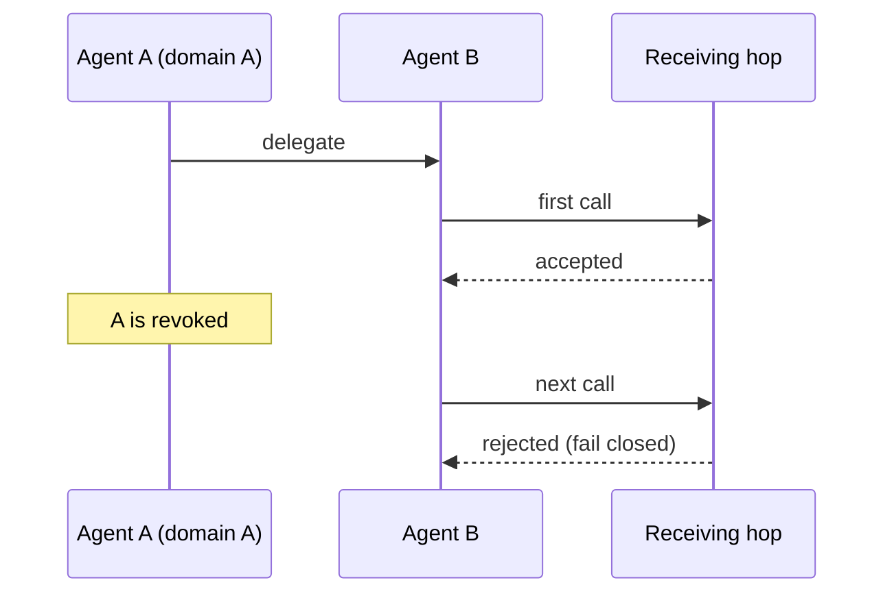
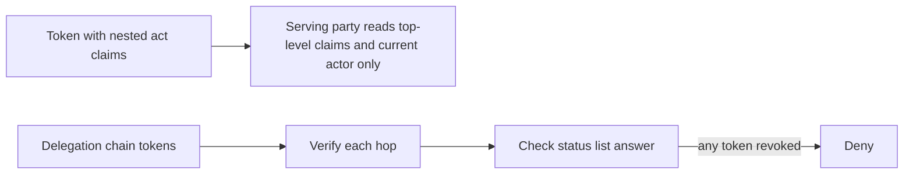
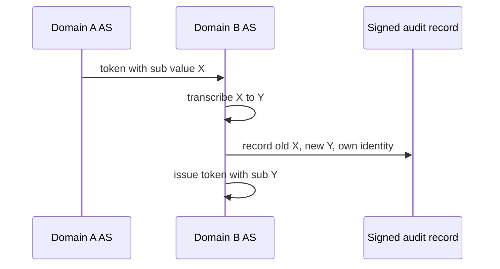
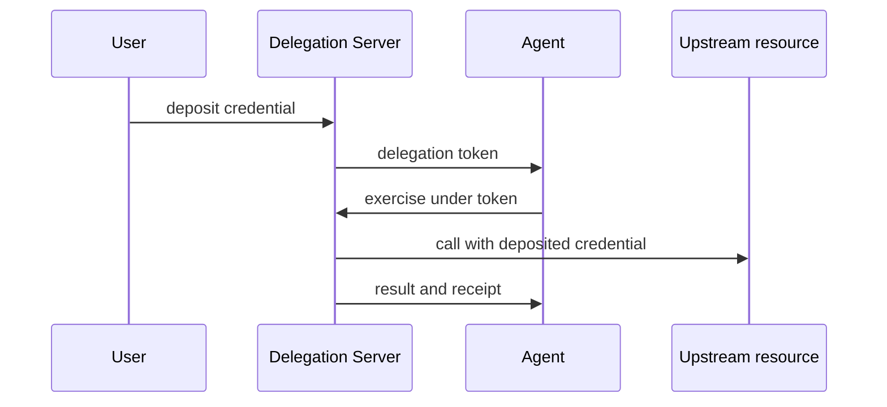

# WIMSE Daily Report (2026-11-13)

Generated at: 2026-11-13T19:44:59+00:00

<!-- insights:start -->
## Briefing

> One item: a tooling status announcement from the author of draft-li-rttp-iqa-addressing (not a WIMSE WG draft). It covers package releases, test vector filings and a hosted MCP endpoint. No WIMSE draft text changed, so nothing substantive moved.

_Updated 2026-11-13T19:45:59+00:00. Machine-drafted from the sources linked below, which stay authoritative._

### In short, the evidence-binding authors will narrow a claim about suspended prior actors so it no longer conflicts with RFC 8693 Section 4.1

`mail` · `discussion` · first seen 2026-11-13 · [New I-D: draft-thaha-wimse-agent-evidence-binding-00 (evidence binding for AIMS audit)](https://mailarchive.ietf.org/arch/msg/wimse/3RkVPuznZ9tNbEdSDHi-Z8vfXOw/)

Shameer accepts Mikhail's two corrections. The statement that a Serving Party cannot refuse a call because a prior actor is suspended was too broad, because RFC 8693 Section 4.1 only rules out using nested act claims for that decision, not separately verified delegation tokens. The wording becomes: cannot refuse a call on the basis of the nested act claims because a prior actor has since been suspended. The phrase about history being neither complete nor evidence is replaced with: does not by itself establish that it is complete, or that any hop held or narrowed authority. Both edits will go into the next revisions of the SCITT draft and the Evidence Binding draft. No draft text was posted in this message.

**Use cases**

- A Serving Party deciding whether it may deny a call based on a suspended prior actor, using verified delegation tokens rather than nested act claims.

**Related in other tracks**

- `oauth-wg` / `draft-ietf-oauth-transaction-tokens`: Weak link only: both deal with carrying delegation context across hops, but the material does not reference it.

### In short, the AIMS/MBA thread settles on an at-or-past (exclusive) expiry rule and on allowing a transcribed delegated-subject value across trust domains

`mail` · `discussion` · first seen 2026-11-13 · [Subject: AIMS-00: multi-hop delegation context across agent, tool and resource boundaries](https://mailarchive.ietf.org/arch/msg/wimse/CUSo_w53my0EePs-7PdFaqHr0Rk/)

Participants agree to use an at-or-past boundary: state whose age equals S is stale, and a permit is not usable at or after its expiry. Mikhail's example with S = L = 300,000 ms shows that new admissions are bounded strictly before as-of + S + L, assuming zero skew and grace. It does not bound completion of work already admitted. Rerunning the harness with at-or-past expectations against MBA gave 15 of 22 cases agreeing and 7 differing, mostly where MBA compares inclusively at equality. These are described as differences from the convention, not defects. Separately, Marc and Kieran settle that the delegated-subject value must stay identical within a trust domain but may be transcribed when crossing one. Marc proposes the mapping be recorded in the transcribing server's tamper-evident audit record, via suggested changes on PR #176.

**Use cases**

- An implementer of permit or token expiry checks deciding whether equality at the boundary counts as expired.
- A cross-domain agent gateway that must rewrite the delegated subject identifier while keeping it auditable.

### In short, an IETF 127 hackathon plan for WIMSE agent call chains drew proposed negative test scenarios centred on revocation and fail-closed checks

`mail` · `discussion` · first seen 2026-11-13 · [IETF 127 Hackathon: WIMSE interop scenarios for agent call chains (5 new messages)](https://mailarchive.ietf.org/arch/msg/wimse/N84c51Qxwe6i1bihDHCklyDphUg/)

Alexander Pelov will run interop scenarios across independent implementations (SPIRE with experimental WIT-SVID, go-spiffe, Cofide's PoC and a Python implementation). The scenarios use workload-creds-03, wpt-02, http-signature-08, identifier-04, Txn-Tokens and identity chaining across two trust domains, with a shared transaction ID in logs. The normal path binds a Txn-Token to each hop's proof, and the Txn-Token never leaves its domain. Replies from Ben Le (draft-le-agent-passport) and Iman add cases: unreachable status list, revocation after delegation, widening delegation, cumulative limits across two services, request rewritten by a proxy and tool-description digest changes. Iman asks that logs distinguish confirmed revocation, expired status cache and unavailable status service, and that a revoked authorization blocks the operation before effect.

**Use cases**

- An implementer of WIT/WPT or Txn-Tokens wanting shared negative test cases to compare against other implementations.
- A deployer defining fail-closed policy when a status list is unreachable or a delegating agent is revoked mid-chain.

**Related in other tracks**

- `oauth-wg` / `draft-ietf-oauth-transaction-tokens`: The scenario binds a Txn-Token to each hop's proof and keeps it inside its domain.
- `oauth-wg` / `draft-ietf-oauth-identity-chaining`: Crossing to trust domain B uses identity chaining.

### The author of draft-li-rttp-iqa-addressing announces package releases, vector filings and a hosted MCP endpoint on the wimse list

`mail` · `routine` · first seen 2026-11-13 · [RTTP+IQA tooling update: three releases, five lab filings, and a hosted MCP endpoint](https://mailarchive.ietf.org/arch/msg/wimse/B3VfzW_jlvVT3BI4T4f4oAySBxU/)

The author reports version 1.3.2 of the rttp and iqa-org packages on crates.io, PyPI and npm, with conformance vectors re-anchored to draft-li-rttp-iqa-addressing-02 (vector bytes unchanged). They also report iqa-mcp 1.0.3, an MCP server with four tools (derive_route_shard, parse_envelope, verify_envelope, published_vector). Four new vector families were filed as candidates with the Agent-Authority-Conformance lab (PRs #221 to #224), and an interop run over a third-party family was recorded (PR #225). A hosted MCP endpoint at mcp.iqa.org serves the same code. The message is a status note with links to the author's blog. It proposes no protocol change, and the draft's content is not described beyond naming. It is not a WIMSE WG draft and does not touch any WIMSE candidate.

### Credential-delegation -03 will cover cumulative-budget tally limits and a status location for user-issued grants

`mail` · `discussion` · first seen 2026-11-12 · [draft-sweeney-wimse-credential-delegation-02](https://mailarchive.ietf.org/arch/msg/wimse/Gu4rPKixfcCaSPlMWxHUeP9PWs4/)

Caleb accepts Kieran's review points 1, 4 and 6 and the jti-as-root shape for composing a user-issued root with the chain format. For -03 he agrees a tally held at each verifier bounds the total per verifier, not across verifiers, so a cumulative budget needs a single writer that sees every exercise. He also accepts the status gap: since a user cannot run a status endpoint, the grant must name where its status lives, and he will bring text. Quoted earlier, Rob suggests keeping who minted the root separate from evidence that a person approved it, and asks Section 7 to say what verifiers see for actions during a suspension and whether a restored delegation is the same grant; Kieran notes -02 Section 7 covers revocation only.

**Use cases**

- Building a delegated-credential service that enforces a cumulative spending or call budget across several verifiers.
- Issuing a delegation root directly from a user, where there is no server to host a status endpoint.

### Thread on multi-hop delegation settles on an exclusive at-or-past rule for state age and permit expiry

`mail` · `discussion` · first seen 2026-11-12 · [Subject: AIMS-00: multi-hop delegation context across agent, tool and resource boundaries](https://mailarchive.ietf.org/arch/msg/wimse/XDzEijPg8qT_4X4u7Yl11PHU5og/)

Mikhail agrees to change his 23 October example to exclusive limits: state whose age equals S is stale, and a permit is unusable at or after its expiry; issuance needs a permit deadline later than issuance time. With S enforced at final issuance and permit lifetime bounded by L, new admissions are bounded strictly before original as-of + S + L (assuming zero skew and grace), though completion of already-admitted work is not bounded. Re-running the harness against MBA at commit ea1a149 gives 15 of 22 cases agreeing and 7 differing, where MBA compares inclusively at equality; he calls these differences from the convention, not defects. In the quoted message Marc asks Kieran to confirm that a transcribed delegated-subject value across a trust domain is acceptable if the transcription (old value, new value, server identity) is in the server's tamper-evident audit record, and proposes two changes on PR #176.

**Use cases**

- Implementing permit or mission-bound authorization expiry checks, where the boundary instant (equal to expiry) must be treated as expired.
- Writing test vectors for staleness and expiry so that independent implementations agree at equality.
- Deciding how a server records a subject identifier it rewrites when a request crosses a trust domain.

### Mikhail asks the evidence-binding authors to reword claims that a serving party cannot refuse a call over a suspended prior actor

`mail` · `discussion` · first seen 2026-11-12 · [New I-D: draft-thaha-wimse-agent-evidence-binding-00 (evidence binding for AIMS audit)](https://mailarchive.ietf.org/arch/msg/wimse/zDPvc_Mm39RS_-26njTvkhjfv6w/)

Kieran has accepted that RFC 8693 Section 4.1 keeps prior actors in nested act claims out of access-control decisions, and the authors will take that reading in -02. Mikhail notes the SCITT -02 text still says a Serving Party cannot refuse a call because a prior actor was suspended. He points out that separately verified delegation tokens give another basis: a chain in the draft-asor-wimse-agent-delegation-chain-03 format is verified hop by hop, and step 7 denies when an accepted status answer marks any token revoked, within the status list freshness window. He suggests wording limited to refusal on the basis of nested act claims, and rewording the phrase that history is neither complete nor evidence.

**Use cases**

- Designing an audit or serving-party policy for multi-hop agent calls where an upstream actor is later suspended.
- Choosing whether per-hop authority is checked from act claims (attribution only) or from separately verified delegation tokens with status references.

**Related in other tracks**

- `oauth-wg` / `draft-ietf-oauth-status-list`: The delegation-chain draft's status references and freshness window are checked against a status list answer.

### AIMS cross-domain gap text: agreed to add bounding sentences that issuer trust does not decide authorization and that determinations expire

`mail` · `discussion` · first seen 2026-11-11 · [AIMS -01: upstream authorities for Workload Identity Certificates (trust between trust domains) (6 new messages)](https://mailarchive.ietf.org/arch/msg/wimse/33_tdetI9AjZMcqhQnnnUdJTNCs/)

The thread continues David Croston's proposal to record in AIMS a gap about trust between trust domains, with a mechanism-neutral property list (verifier trusts another domain's issuer without bilateral setup, issuer speaks only for its names, verifier chooses domains, bounded withdrawal). Jiahui Miao adds a bounding property: accepting another domain's issuer does not by itself establish authorization for an action. ShaoBao Li adds a time half, that a determination holds at the time of observation and not after the evidence expires. Cliff agrees to put one sentence in the gap text and the rest, including recording "not determined" rather than "not permitted", in Section 10.4. Sriram Shankarlingam agrees and notes his DNS-link link token grants nothing. Several messages cite the authors' own drafts and conformance suites.

**Use cases**

- Federating agents across organizations where no bilateral trust bundle exchange exists.
- Auditors needing to tell apart refused because authority could not be determined and refused because the operation is not permitted.

**Related in other tracks**

- `oauth-wg` / `draft-ietf-oauth-spiffe-client-auth`: Related only loosely (workload identity to OAuth client binding); the material does not cite it.

### One short reply: act is attribution, not a policy input, and the evidence-binding authors will take that in -02

`mail` · `discussion` · first seen 2026-11-11 · [New I-D: draft-thaha-wimse-agent-evidence-binding-00 (evidence binding for AIMS audit)](https://mailarchive.ietf.org/arch/msg/wimse/G81dpzTWMQgyCzshUmHHbzr8bzU/)

Despite the subject line announcing draft-thaha-wimse-agent-evidence-binding-00, the only message in the file is Kieran replying to Mikhail. Kieran concedes his earlier "policy input" line was wrong because Section 4.1 of the RFC keeps prior actors out of the access-control decision, so deny-listing a prior actor still conflicts with it. Direction (a) is the correct reading and Shameer and Shaibi will take it in -02. Per-hop authority needs separately verified evidence. The announcement text itself is not in the file.

### AIMS delegation thread: the delegated subject may differ across trust domains if the transcription is in the signed record

`mail` · `discussion` · first seen 2026-11-11 · [Subject: AIMS-00: multi-hop delegation context across agent, tool and resource boundaries (2 new messages)](https://mailarchive.ietf.org/arch/msg/wimse/HewNx8oZlaK0RSEV7BnYOLq1xuc/)

Kieran Sweeney clarified that "sub preserved" means the same principal, not the same bytes. Within one trust domain the value stays identical at every hop (sub fixed, actor in client_id and act). Across a trust domain, transcription under identity chaining is acceptable if the transcribing party records old value, new value and its own identity in what it signs; an AS merely keeping the mapping is not enough for AIMS Section 11. Marc proposes two changes on PR #176 along those lines. Both sides also agree to move the freshness boundary to at-or-past, so the 21 boundary vectors and the 23 October wording change, and the case admitted at exactly S+L becomes refused.

**Use cases**

- A deployment where an agent chain crosses trust domains via identity chaining and needs auditors to reconstruct the original user from records alone.
- A verifier implementing the S+L revocation-admission bound that must decide whether an input exactly at its limit is accepted.

**Related in other tracks**

- `oauth-wg` / `draft-ietf-oauth-identity-chaining`: The cross-domain transcribed identifier is discussed as OAUTH-ID-CHAIN Section 2.5.

### AAT, Asor and Cred -02 authors agree a child's lower del_max_depth must be honoured, and compare constraints before IETF 127

`mail` · `discussion` · first seen 2026-11-11 · [AAT -02 announcement (2 new messages)](https://mailarchive.ietf.org/arch/msg/wimse/P1yDQDvbTRAwDDsLYU5WZDocCsQ/)

Kieran agrees that the effective maximum depth at any hop is the lowest del_max_depth on the path, and that this cap is separate from the question of the leaf at the maximum (AAT J.10.f accepts a leaf at del_depth equal to the root maximum, Asor -03 rejects it). Rob Zagarella asks the comparison of the three drafts to record whether each can bind a leaf to a digest of one exact request; Kieran says Cred -02 cannot express that in the token today, and its Section 5.5 takes the chain format by reference so its entry for off-DS verification is provisional. Rob also asks that the AAT Section 9.8 revocation freshness bound be stated in the same terms as Cred -02 Section 7. Niki holds a side meeting on 16 November in San Francisco.

**Use cases**

- Implementers of attenuating delegation tokens who need to know whether a leaf at the maximum depth is accepted.
- Human-approval flows where an approval must bind to one exact action such as a payee and amount.

**Related in other tracks**

- `oauth-wg` / `draft-ietf-oauth-transaction-tokens`: Not referenced in the material; omit if unsure.

### Review of Cred delegation -02: user-issued roots, tally mode and revocation status are the open points for -03

`mail` · `discussion` · first seen 2026-11-11 · [draft-sweeney-wimse-credential-delegation-02 (2 new messages)](https://mailarchive.ietf.org/arch/msg/wimse/zLDfwOIkylaaI4vS97LSdAt4RYw/)

Kieran's -02 announcement describes a Delegation Server (DS) that holds deposited user credentials and lets agents exercise them by proxy under a delegation token. It adds sub-delegation exchange (5.4.1), rank order in the token, delegation_constraints with max_lifetime and max_subtree written only by the DS, a chain-verifiable profile (5.5) adopting the Asor agent_delegation format unchanged, revocation text stating revoked_count is invalidation not closure, and ML-DSA. Caleb Dayton raises six points, including the claim remap for user-issued tokens, using the token's jti as root receipt, a mode marker for single-writer versus delegate-held tally, and a status mechanism when no DS exists. Kieran agrees to a per-key mode marker but cautions that a per-verifier tally does not bound the total across verifiers, and says -02 names no status mechanism for tokens the DS did not issue. Rob Zagarella suggests separating who issued a root from evidence a person approved it, and asks Section 7 to cover suspension and restoration.

**Use cases**

- An agent platform where users deposit OAuth credentials with a proxy and agents never hold the upstream token.
- A verifier away from the DS that must decide whether a cumulative budget has been exceeded.

**Related in other tracks**

- `oauth-wg` / `draft-ietf-oauth-identity-chaining`: Not named in the material; omit.

### Triage of the candidate queue

- **high** `Diff active WG draft: draft-ietf-wimse-http-signature-08`: Independent vectors (issue #419) and the chair's reject-on-MUST-NOT answer may lead to fixes and clarifications.
- **high** `Diff active WG draft: draft-ietf-wimse-mutual-tls-03`: A review proposes key-pair authentication text and says WGLC looks possible.
- **high** `Diff active WG draft: draft-ietf-wimse-workload-creds-03`: Active issues on editorial comments (#418), coexistence reconciliation (#414) and overlapping trust roots (#370).
- **high** `Review related draft: draft-asor-wimse-agent-delegation-chain-03`: Cited as the hop-by-hop verified chain format with status-reference denial (step 7) in the evidence-binding thread.
- **high** `Review related draft: draft-hulea-wimse-agent-mandate-01`: A list comment identifies a concrete under-counting gap in Section 9.5 that bypasses sum_max.
- **high** `Review related draft: draft-sweeney-wimse-credential-delegation-02`: Authors are actively revising for -03: tally single-writer limits, status location for user-issued roots, suspension and restoration.
- **high** `Review related draft: draft-thaha-wimse-agent-evidence-binding-03`: Authors agreed to reword step 4 and the act-claim statement in the next revision.
- **low** `Diff active WG draft: draft-ietf-wimse-identifier-04`: The only review comment is a one-phrase terminology nit.

<!-- insights:end -->

## Snapshot

- Active WG drafts: 8
- Related drafts: 20
- Mailing-list posts scanned: 40
- Tracked GitHub repos: 6

## Active WG Drafts

| Draft | Date | Title |
| --- | --- | --- |
| draft-ietf-wimse-aims-01 | 2026-11-02 | AI Identity Management System |
| draft-ietf-wimse-workload-creds-03 | 2026-10-30 | WIMSE Workload Credentials |
| draft-ietf-wimse-workload-identity-practices-08 | 2026-10-30 | Workload Identity Practices |
| draft-ietf-wimse-mutual-tls-03 | 2026-10-24 | Workload Authentication Using Mutual TLS |
| draft-ietf-wimse-identifier-04 | 2026-10-23 | Workload Identifier |
| draft-ietf-wimse-http-signature-08 | 2026-10-20 | WIMSE Workload-to-Workload Authentication with HTTP Signatures |
| draft-ietf-wimse-wpt-02 | 2026-08-27 | WIMSE Workload Proof Token |
| draft-ietf-wimse-arch-08 | 2026-07-06 | Workload Identity in a Multi System Environment (WIMSE) Architecture |

## Recent Related Drafts

| Draft | Date | Title |
| --- | --- | --- |
| draft-hulea-wimse-agent-mandate-01 | 2026-11-01 | Verifiable Mandates for Agents Acting Across Administrative Domains |
| draft-thaha-wimse-agent-evidence-binding-03 | 2026-11-01 | Evidence Binding for AI Agent Credentials |
| draft-reddy-wimse-oauth-dialog-binding-00 | 2026-10-30 | Binding Agent Dialogs to WIMSE and OAuth Credentials |
| draft-sweeney-wimse-credential-delegation-02 | 2026-10-30 | Credential Delegation Protocol for AI Agents in Multi-System Environments |
| draft-durga-wimse-ctx-isolation-00 | 2026-10-29 | Cryptographic Separation of Untrusted Data-Plane Context from Control-Plane Tool Invocations in Autonomous AI Agents |
| draft-jackson-wimse-evaluation-05 | 2026-10-28 | Verifier-Side Evaluation Semantics for Delegated Authority Chains |
| draft-asor-wimse-agent-delegation-chain-03 | 2026-10-27 | Verifiable Attenuated Delegation for AI Agent Chains |
| draft-ni-wimse-ai-agent-identity-04 | 2026-10-27 | WIMSE Applicability for AI Agents |
| draft-uppalapati-wimse-pq-agent-identity-01 | 2026-10-27 | Post-Quantum Requirements for Software and AI Agent Identity |
| draft-heigh-wimse-workload-identity-metadata-00 | 2026-10-16 | Workload Identity Metadata |

## Mailing List Topics

- No mailing-list topics extracted.

## Recent GitHub Activity

| Repository | Latest Commit |
| --- | --- |
| ietf-wg-wimse/draft-ietf-wimse-s2s-protocol | 2026-11-06T20:17:37Z |
| ietf-wg-wimse/draft-ietf-wimse-arch | 2026-11-02T22:05:03Z |
| ietf-wg-wimse/draft-ietf-wimse-workload-identity-practices | 2026-10-30T09:50:30Z |
| ietf-wg-wimse/draft-ietf-wimse-identifier | 2026-10-23T15:16:50Z |
| ietf-wg-wimse/ietf-wg-wimse.github.io | 2026-10-07T19:43:41Z |
| ietf-wg-wimse/admin | 2024-03-17T22:59:45Z |

## Top Deep-Dive Candidates

- [7] Diff active WG draft: draft-ietf-wimse-aims-01
- [7] Diff active WG draft: draft-ietf-wimse-http-signature-08
- [7] Diff active WG draft: draft-ietf-wimse-mutual-tls-03
- [7] Diff active WG draft: draft-ietf-wimse-workload-creds-03
- [6] Review related draft: draft-asor-wimse-agent-delegation-chain-03
- [6] Review related draft: draft-durga-wimse-ctx-isolation-00
- [6] Review related draft: draft-hulea-wimse-agent-mandate-01
- [6] Review related draft: draft-jackson-wimse-evaluation-05
- [6] Review related draft: draft-lee-wimse-local-tool-call-proof-01
- [6] Review related draft: draft-ni-wimse-ai-agent-identity-04

