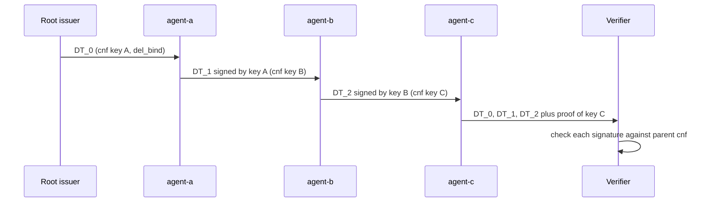
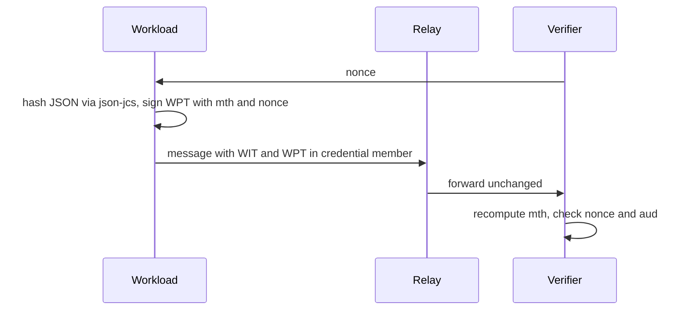
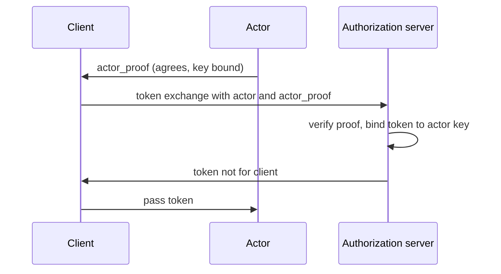
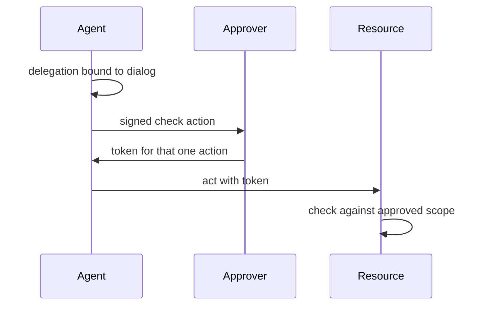

# WIMSE Daily Report (2026-11-16)

Generated at: 2026-11-16T22:07:28+00:00

<!-- insights:start -->
## Briefing

> Two new Cisco drafts landed: delegator-bound delegation chains (each hop signed by the key its parent confirms, no authorization server) and message binding for WPTs (mth claim for non-HTTP transports). The only WG repo change is a small clarification in s2s-protocol.

_Updated 2026-11-16T22:09:24+00:00. Machine-drafted from the sources linked below, which stay authoritative._

### Adds a rule that each child delegation token must be signed by the key its parent confirms, so chains prove who granted each hop offline

`new-draft` · `new-proposal` · first seen 2026-11-16 · [draft-nandakumar-wimse-delegator-bound-chains-00: Delegator-Bound Delegation Chains for AI Agents](https://datatracker.ietf.org/doc/draft-nandakumar-wimse-delegator-bound-chains/00/)

The draft extends Delegation Tokens (draft-asor-wimse-agent-delegation-chain). A root token with del_bind=delegator requires every child to be signed with the key in the parent's cnf, with iss equal to the parent's client_id, so only the root relies on a trust anchor. It also adds an optional per-chain HMAC pseudonym for the principal (sub_kind), rejection of chains where a client_id repeats, audience that can only narrow (aud of a child must be within its parent's), and a ctx claim binding a chain to a dialog or Transaction Token txn. A section maps the rules onto Delegate SD-JWT. The text is truncated in the source, so later sections are not covered here.

**Use cases**

- Agents in different organizations delegating directly to each other, where the final receiver must verify the whole chain without an authorization server.
- A payment service that must confirm each agent in a chain was actually granted authority by the previous agent, and that the chain has no loop.

**Related in other tracks**

- `oauth-wg` / `draft-ietf-oauth-delegate-sd-jwt`: Section 8 maps the same rules onto Delegate SD-JWT, which already chains key-binding JWTs but has no authority comparison rule.
- `oauth-wg` / `draft-ietf-oauth-transaction-tokens`: ctx can carry a Transaction Token txn to bind a chain to a transaction.

### Defines an mth claim so a Workload Proof Token can be bound to a non-HTTP message, plus a verifier nonce and a registry of canonicalization profiles

`new-draft` · `new-proposal` · first seen 2026-11-16 · [draft-nandakumar-wimse-wpt-message-binding-00: Message Binding for Workload Proof Tokens](https://datatracker.ietf.org/doc/draft-nandakumar-wimse-wpt-message-binding/00/)

A WPT today binds the request target and tokens but not the content, and is defined only for HTTP. This draft says a WPT can travel in a message's credential member with aud naming the receiver, and MUST carry mth, a {p, h} object holding a profile name and the SHA-256 of the canonicalized message (credential member excluded). A nonce claim echoes a verifier-supplied value, so freshness does not depend on intermediaries and jti need not be stored beyond the nonce's validity. A new IANA registry of profiles starts with json-jcs (RFC 8785). On HTTP, mth can bind the body, but header fields still need HTTP Message Signatures. The same claims may appear in an SD-JWT KB-JWT.

**Use cases**

- Agent control messages sent over Media over QUIC or WebSocket through relays that terminate TLS, where the receiver needs proof the key holder sent this exact message.
- JSON-RPC over HTTP such as A2A or MCP, where an intermediary may re-serialize the body and byte-level signatures would break.

**Related in other tracks**

- `oauth-wg` / `draft-ietf-oauth-sd-jwt-vc`: The mth and nonce claims can also be used in an SD-JWT Key Binding JWT.

### Announces a Token Exchange extension where an actor signs a proof so the issued token is bound to the actor's key rather than the requesting client's

`mail` · `new-proposal` · first seen 2026-11-16 · [New draft: OAuth 2.0 Token Exchange with Actor-Bound Tokens:](https://mailarchive.ietf.org/arch/msg/wimse/-jp1HV34AzcmNjhxSr9hPSkdZMU/)

In RFC 8693 the requester gets the token, and with DPoP it is bound to that client's key. The proposed draft lets the client name an actor and include the actor's credential. The actor signs an actor_proof agreeing that a token be issued to its key, optionally naming what it agreed to, without contacting the authorization server. The server binds the token to the actor's key and tells the client it is not for it. If an approver narrows the request, the server checks the change only reduces what the actor agreed to. Resource servers are unchanged, and without actor_proof the request is plain RFC 8693. It also applies to ID-JAG assertions and to tokens issued after CIBA approval.

**Use cases**

- An approving agent that needs an access token usable only by the different agent that will perform the action, without holding a usable token itself.

**Related in other tracks**

- `oauth-wg` / `draft-ietf-oauth-identity-assertion-authz-grant`: The message says the same binding works for ID-JAG assertions.

### The same authors announced PACE Authorization, a draft on delegation and per-action approval for agent dialogs built on existing OAuth and WIMSE pieces

`mail` · `new-proposal` · first seen 2026-11-16 · [New draft: PACE Authorization: delegation and action approval for agent dialogs:](https://mailarchive.ietf.org/arch/msg/wimse/9Oo3h5DF81u2k4qrPDFHXxryH-I/)

The announcement describes four steps. Delegate binds a delegation credential to the dialog it opens, with options including OAuth Actor Profile tokens, Transaction Tokens or delegator-bound chains. Ask has a paused agent send a signed check action. Approve has the approver issue an access token for that one action, bound to the performing agent's key, via token exchange or CIBA. Act has the resource check the token against what was approved, such as a payment up to an amount. Revoking a delegation ends dependent dialogs. The message is partly garbled in the archive, and the draft itself is not included, so details are unverified.

**Use cases**

- An agent that needs a human or policy approval before a payment, then must act only within the approved amount.

**Related in other tracks**

- `oauth-wg` / `draft-ietf-oauth-transaction-tokens`: Named as one possible delegation credential.

### The delegator-bound chains announcement drew a review asking for conditions on pseudonym resolution and a note on withdrawing a principal

`mail` · `discussion` · first seen 2026-11-16 · [New draft: Delegator-Bound Delegation Chains for AI Agents: (2 new messages)](https://mailarchive.ietf.org/arch/msg/wimse/fMPFKSpMHoji68UYn5W3bcNh_NE/)

The authors (Suhas/Cullen) announced the draft and asked three things: whether delegator binding belongs in the Delegation Tokens draft as a flag or default, whether it fits the Actor Profile's companion-profile idea, and whether using one key for both signing the next hop and proof of possession is acceptable. Marc replied that the pseudonym and the pairwise-identifier rule look sound, but that issuer resolution of the pseudonym is unconditioned. He asked for text on when and to whom it is resolved, with a record of each resolution. He also asked for a note that withdrawing a principal means revoking every DT_0, with the bound measured from the issuer's decision. He supports making delegator binding a flag in the Delegation Tokens draft.

**Use cases**

- Deployers choosing how to resolve per-chain pseudonyms for audit without creating a sensitive mapping record that is queried freely.

### Announcement of the WPT message-binding draft, asking for review from agent-protocol and WPT people

`mail` · `discussion` · first seen 2026-11-16 · [New draft: Message Binding for Workload Proof Tokens](https://mailarchive.ietf.org/arch/msg/wimse/frclj3SHeVIbbFU8tbt1rhMO3Wo/)

The authors say a WPT currently covers who calls and where but not the request content, and that agents are moving traffic to Media over QUIC, WebSocket and QUIC streams through relays that terminate TLS, so a proof could be lifted onto another message while valid. They summarize the draft: the mth claim, carrying a WPT outside HTTP, a verifier nonce, a registry of canonicalization profiles starting with JSON, body binding on HTTP for JSON-RPC such as A2A and MCP, and use in an SD-JWT KB-JWT. HTTP Message Signatures remain the choice when headers must be protected. The archived text has some gaps.

### A commenter proposes an explanatory paragraph in AIMS Section 10.8 saying what a human confirmation actually meant

`mail` · `discussion` · first seen 2026-11-16 · [draft-ietf-wimse-aims-01, Section 10.8: recording the meaning of the human act](https://mailarchive.ietf.org/arch/msg/wimse/sviwRJYSDP-WF48dUT83xoyTJ5c/)

Andreas Ehstand comments on draft-ietf-wimse-aims-01. He says Section 10.8 binds local user confirmation to an authorization grant, but a later reader still cannot tell what the person did. The person may have been shown an object, checked a stated property, chosen a course of action, or permitted an action within authority already held. He suggests a non-normative paragraph after the local-confirmation text. It would say that records can distinguish these acts, that a record of a check names the property and its outcome, and that a record of a permission names the action and the prior authority relied on. He also suggests a short note in Section 11 separating a system's account of a human act from a record attributable to the person. He says this adds no authorization mechanism and prescribes no record format. He points to his individual drafts draft-ehstand-oversight-acts-00 (observation, check, decision, release) and draft-gilda-audit-agent-audit-record-03 as illustrations. He asks whether the WG would accept such a clarification. No replies or text changes appear in the material.

**Use cases**

- An implementer of an AI agent that asks a human to confirm an action wants audit records to show whether the person checked something or only permitted it.
- A deployer building an audit trail for agent actions under AIMS wants to know whether a stored approval is the system's account or a record attributable to the person.

### A one-line commit clarifies that a CONNECT request's @authority omits a default port

`repo-activity` · `routine` · first seen 2026-11-16 · [1 new commit(s) in ietf-wg-wimse/draft-ietf-wimse-s2s-protocol](https://github.com/ietf-wg-wimse/draft-ietf-wimse-s2s-protocol)

The only material is the commit title, 'Clarify CONNECT @authority omits a default port (#419). (#421)'. It appears to clarify how @authority is formed for CONNECT in the HTTP signature profile, but no diff is provided, so the effect on the wire format cannot be confirmed.

### The AER-1 mapping draft now records a fail-closed denial as not_evaluated when an input was unreachable or stale, as agreed with a reviewer on the list

`mail` · `discussion` · first seen 2026-11-15 · [draft-zambo-aer1-wimse-mapping-01: AER-1 as a candidate format for AIMS Section 11 audit records](https://mailarchive.ietf.org/arch/msg/wimse/1Lm1pnMFKTIDQA0c_0yQUio9k3Q/)

Brennan Zambo announces -03 of draft-zambo-aer1-wimse-mapping, which maps AER-1 receipts to the audit records required by AIMS Section 11. After review by Girish Konda, Section 3 now says that not_evaluated applies whenever an input the decision depended on could not be established, whether it was unreachable or reached but not current, even if a fail-closed rule then denies. decision_reason_detail names that input, and denied is reserved for decisions evaluated on established inputs. The decision reason is committed in the receipt for the audit reader but not returned to the caller, so the error does not become an oracle. The thread also shows the -02 step, which added the committed decision_reason member. The message is truncated, and the author asks the reviewer to confirm that -03 separates the cases as intended.

**Use cases**

- An AIMS deployment whose policy point denies when a revocation or status source does not answer, and whose auditors must tell that apart from a real policy denial.
- A reviewer reconstructing Section 11 audit records who needs to know whether a decision used stale inputs.

### In short, the hackathon organisers published eight reproducible agent call-chain test scenarios and fixed how to run P7 so results compare

`mail` · `discussion` · first seen 2026-11-15 · [IETF 127 Hackathon: WIMSE interop scenarios for agent call chains (2 new messages)](https://mailarchive.ietf.org/arch/msg/wimse/nPDAthCFZZP1OsSsJPKmto0qNdY/)

Ben Le (Redthread Security) shared one JSON file per scenario, P1–P8, each with setup, expected decision, log reason and whether any effect occurred. They cover an unreachable status list, revocation before effect, a widening delegation, a cumulative limit across services, a rewritten request, a tool or build change between hops, an approval display that differs from the executed action (P7), and a bearer-only final hop. Revoked, stale and unavailable status get separate log reasons (status-revoked, status-stale, status-unavailable). For P7, Arun Thallapelly (OmniArx) gave four conditions to reproduce his result: verify at time 1800000000, use the given key, action and request, start with fresh replay state, and use a verifier that holds the action. Ben Le notes that action binding alone would accept R2, so the root receipt signed by the principal's authenticator, left open in Appendix B of the passport draft, matters. He proposes discussing it at the side meeting on 17 November, 18:45–19:45 PT, Plaza A. Marc Miro i Rierola offered a second implementation using a zero-knowledge non-revocation proof instead of a status list. The material is truncated.

**Use cases**

- Run your agent-delegation verifier against P1–P8 to check it fails closed and logs the right reason when a status list is unreachable, stale or revoked.
- Test whether an enforcement point with no request-to-action mapping can catch an approval display that differs from the executed action (P7).
- Compare a status-list revocation design with a zero-knowledge non-revocation design by refusal timing and log reasons (P2).

### Weekly GitHub digest: s2s-protocol closes the server-nonce issue and gets a report of a dangling workload-creds section reference

`mail` · `routine` · first seen 2026-11-15 · [Weekly github digest (WIMSE Weekly GitHub Activity Summary)](https://mailarchive.ietf.org/arch/msg/wimse/mZYP9JeCKECx5uPLLcvsAbthxNg/)

The digest covers the s2s-protocol repository only. A new issue (#422, by kanywst) says that http-signature and wpt point to workload-creds Section 5.1.4, which -03 does not have. Issue #419 (test vectors for draft-ietf-wimse-http-signature-08) received six comments from HUIIIM, kanywst and yaronf. Issue #369 (server generated nonce, labelled draft-ietf-wimse-http-signature) received one comment from yaronf and was closed. One pull request was opened by yaronf, with no title or body shown in the digest. The digest gives no outcome for the nonce issue and no text of the PR, so the effect on the draft cannot be determined from this material.

### The author of draft-hulea-wimse-agent-mandate agreed that the Section 9.5 "expire unused" wording is unsafe and will replace it in -02

`mail` · `substantive` · first seen 2026-11-14 · [draft-hulea-wimse-agent-mandate-01, Section 9.5: tokens that "expire unused"](https://mailarchive.ietf.org/arch/msg/wimse/LSpgfANffv7_btXJjeO6qo3KoIE/)

Claudiu accepts Dmitri's objection that the sentence lets the relying party remove a budget contribution on a condition it has no defined way to observe. The only signal in 10.1, the confirmation of execution, fails in the unsafe direction. If it is lost or late, the budget is under-counted and a later request can pass sum_max although the total exceeds value. Draft -02 will take Dmitri's text with two changes. "Can no longer be accepted" will mean after the token's exp plus max_clock_skew. The statement will identify the access token, which the resource server can do because 10.2 already requires it to reject a second use of the same token. The removal stays distinct from a refund or reversal, which Open Issues lists separately. Claudiu accepts that a denial that was not strictly needed is the right side to err on for a limit.

**Use cases**

- Implementing the budget accounting of draft-hulea-wimse-agent-mandate at a resource server that enforces sum_max across delegated actions.
- Deciding when an unused mandate token's budget contribution may be released, using exp plus max_clock_skew.

### Triage of the candidate queue

- **high** `Diff active WG draft: draft-ietf-wimse-http-signature-08`: The digest shows active work on its test vectors (#419), a closed server-nonce issue (#369) and a new dangling-reference issue (#422).
- **high** `Diff active WG draft: draft-ietf-wimse-mutual-tls-03`: A review proposes key-pair authentication text and says WGLC looks possible.
- **high** `Diff active WG draft: draft-ietf-wimse-workload-creds-03`: It is a core draft in the hackathon scenario, so spec ambiguities may be reported against it.
- **high** `Review related draft: draft-asor-wimse-agent-delegation-chain-03`: The delegator-bound chains draft extends its Delegation Tokens format and asks whether binding belongs in it.
- **high** `Review related draft: draft-hulea-wimse-agent-mandate-01`: Author agreed Section 9.5 is unsafe and will change budget-release semantics in -02.
- **high** `Review related draft: draft-nandakumar-wimse-delegator-bound-chains-00`: New draft adding signer-key binding, pseudonyms and audience attenuation to delegation chains, with live list review today.
- **high** `Review related draft: draft-nandakumar-wimse-wpt-message-binding-00`: New draft extending WPT to non-HTTP messages with the mth claim and a profile registry.
- **high** `Review related draft: draft-sweeney-wimse-credential-delegation-02`: The thread names it as the basis for a final-hop hackathon scenario with a working implementation.
- **high** `Review related draft: draft-thaha-wimse-agent-evidence-binding-03`: Authors agreed to reword step 4 and the act-claim statement in the next revision.
- **low** `Diff active WG draft: draft-ietf-wimse-identifier-04`: The only review comment is a one-phrase terminology nit.

<!-- insights:end -->

## Snapshot

- Active WG drafts: 8
- Related drafts: 22
- Mailing-list posts scanned: 40
- Tracked GitHub repos: 6

## Active WG Drafts

| Draft | Date | Title |
| --- | --- | --- |
| draft-ietf-wimse-aims-01 | 2026-11-02 | AI Identity Management System |
| draft-ietf-wimse-workload-creds-03 | 2026-10-30 | WIMSE Workload Credentials |
| draft-ietf-wimse-workload-identity-practices-08 | 2026-10-30 | Workload Identity Practices |
| draft-ietf-wimse-mutual-tls-03 | 2026-10-24 | Workload Authentication Using Mutual TLS |
| draft-ietf-wimse-identifier-04 | 2026-10-23 | Workload Identifier |
| draft-ietf-wimse-http-signature-08 | 2026-10-20 | WIMSE Workload-to-Workload Authentication with HTTP Signatures |
| draft-ietf-wimse-wpt-02 | 2026-08-27 | WIMSE Workload Proof Token |
| draft-ietf-wimse-arch-08 | 2026-07-06 | Workload Identity in a Multi System Environment (WIMSE) Architecture |

## Recent Related Drafts

| Draft | Date | Title |
| --- | --- | --- |
| draft-nandakumar-wimse-delegator-bound-chains-00 | 2026-11-16 | Delegator-Bound Delegation Chains for AI Agents |
| draft-nandakumar-wimse-wpt-message-binding-00 | 2026-11-16 | Message Binding for Workload Proof Tokens |
| draft-hulea-wimse-agent-mandate-01 | 2026-11-01 | Verifiable Mandates for Agents Acting Across Administrative Domains |
| draft-thaha-wimse-agent-evidence-binding-03 | 2026-11-01 | Evidence Binding for AI Agent Credentials |
| draft-reddy-wimse-oauth-dialog-binding-00 | 2026-10-30 | Binding Agent Dialogs to WIMSE and OAuth Credentials |
| draft-sweeney-wimse-credential-delegation-02 | 2026-10-30 | Credential Delegation Protocol for AI Agents in Multi-System Environments |
| draft-durga-wimse-ctx-isolation-00 | 2026-10-29 | Cryptographic Separation of Untrusted Data-Plane Context from Control-Plane Tool Invocations in Autonomous AI Agents |
| draft-jackson-wimse-evaluation-05 | 2026-10-28 | Verifier-Side Evaluation Semantics for Delegated Authority Chains |
| draft-asor-wimse-agent-delegation-chain-03 | 2026-10-27 | Verifiable Attenuated Delegation for AI Agent Chains |
| draft-ni-wimse-ai-agent-identity-04 | 2026-10-27 | WIMSE Applicability for AI Agents |

## Mailing List Topics

- ai-agent: 2

## Recent GitHub Activity

| Repository | Latest Commit |
| --- | --- |
| ietf-wg-wimse/draft-ietf-wimse-s2s-protocol | 2026-11-16T19:11:17Z |
| ietf-wg-wimse/draft-ietf-wimse-arch | 2026-11-02T22:05:03Z |
| ietf-wg-wimse/draft-ietf-wimse-workload-identity-practices | 2026-10-30T09:50:30Z |
| ietf-wg-wimse/draft-ietf-wimse-identifier | 2026-10-23T15:16:50Z |
| ietf-wg-wimse/ietf-wg-wimse.github.io | 2026-10-07T19:43:41Z |
| ietf-wg-wimse/admin | 2024-03-17T22:59:45Z |

## Top Deep-Dive Candidates

- [7] Diff active WG draft: draft-ietf-wimse-aims-01
- [7] Diff active WG draft: draft-ietf-wimse-http-signature-08
- [7] Diff active WG draft: draft-ietf-wimse-mutual-tls-03
- [7] Diff active WG draft: draft-ietf-wimse-workload-creds-03
- [6] Review related draft: draft-asor-wimse-agent-delegation-chain-03
- [6] Review related draft: draft-durga-wimse-ctx-isolation-00
- [6] Review related draft: draft-hulea-wimse-agent-mandate-01
- [6] Review related draft: draft-jackson-wimse-evaluation-05
- [6] Review related draft: draft-lee-wimse-local-tool-call-proof-01
- [6] Review related draft: draft-nandakumar-wimse-delegator-bound-chains-00

