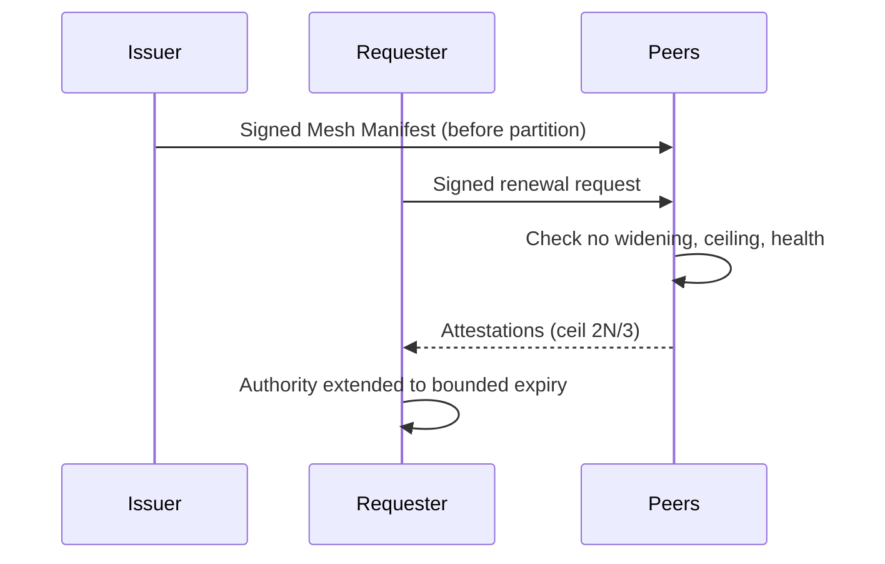
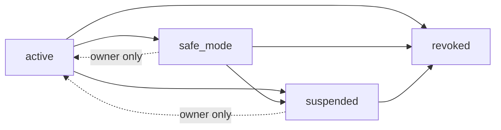
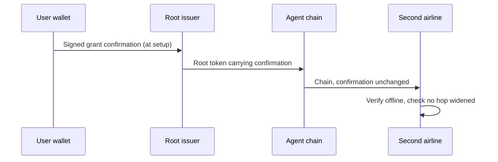

# WIMSE Daily Report (2026-11-18)

Generated at: 2026-11-18T07:33:10+00:00

<!-- insights:start -->
## Briefing

> No draft text changed. The most substantive thread is on the WIMSE list: AIMS delegation context, where the participants agreed a transcribed identifier needs a signed audit record at the transcribing server. A large interop matrix for the IETF 127 hackathon B_CHAIN flow was also reported.

_Updated 2026-11-18T07:34:29+00:00. Machine-drafted from the sources linked below, which stay authoritative._

### Hackathon: an external interop matrix reports the two-domain B_CHAIN flow passing in all 12,288 published substitutions

`mail` · `discussion` · first seen 2026-11-18 · [IETF 127 Hackathon: WIMSE interop scenarios for agent call chains](https://mailarchive.ietf.org/arch/msg/wimse/BwGCvOXBxqAVBqOG_prlM3nwZUg/)

Jacob Stewart reported a WIMSE interop matrix of 161,370 execution IDs: 151,069 passed, 182 failed, 10,119 blocked. It covers WIC/mTLS, WIT with WPT, and WIT with HTTP Message Signatures bindings. The two-domain B_CHAIN success path passed all 12,288 published substitutions across 27 role bindings and 94 directional handoffs. Each run checks that the original Domain A transaction token stays in Domain A, the transaction ID survives scope narrowing, and the File Tool verifies the WPT binding to both the WIT and the narrowed transaction token before permitting one protected read. Alexander replies that he will record this in the hackathon repository as a separate external run, outside their own totals. He asks Jacob to confirm the wording and how to be named, and to supply a commit-pinned revision. He also says P7 need not stay blocked, since a verifier that holds the action can run the Appendix A vectors.

**Use cases**

- Implementers of WIT/WPT or HTTP Message Signatures bindings who want to compare their peers against a public interop matrix.
- Teams building multi-hop agent call chains across two trust domains that need to check transaction token containment.

**Related in other tracks**

- `oauth-wg` / `draft-ietf-oauth-transaction-tokens`: The B_CHAIN flow checks that a Domain A transaction token stays in its domain and keeps its transaction ID when scope is narrowed.

### PACE Authorization thread: one reply on what the delegation root must carry, and a list-etiquette complaint about the poster

`mail` · `discussion` · first seen 2026-11-18 · [New draft: PACE Authorization: delegation and action approval for agent dialogs: (2 new messages)](https://mailarchive.ietf.org/arch/msg/wimse/INsYufjtYsijqhJNn-01dG7ogqU/)

Blake Morrison replied on the PACE Authorization draft that, without a wallet, they favour option 2. It only beats option 3 if the root records the passkey tap at the user's own provider, when it happened, and the grant the user was viewing at that moment. The next revision would need to tie the grant to that moment. Two open problems remain: the same grant spent at two airlines, and wallet trust. A separate message from another participant objects to the posting style: cross-posting to several lists and no quoted history. They suggest it may be an AI-assisted autoresponder and ask Blake to reconsider. The options themselves are not defined in the material, so the substance is thin.

### AIMS thread: a transcribed identifier's old-to-new mapping goes in the transcribing server's signed audit record, not in the token

`mail` · `discussion` · first seen 2026-11-18 · [Subject: AIMS-00: multi-hop delegation context across agent, tool and resource boundaries](https://mailarchive.ietf.org/arch/msg/wimse/SHso1Zyz_O4N_fiIhRoh_i8IgZA/)

Kieran confirms Marc's reading of the AIMS delegation-context rules. The delegated principal must stay the same, but not necessarily the same bytes. Within one trust domain the value stays identical at every hop. Across a trust domain a transcribed value is acceptable if the transcription is recorded. The mapping (old value, new value, server identity) belongs in the transcribing server's own audit record, signed and fixed at transcription time. It should not travel in the token across the boundary, since that would hand the original identifier back to the receiving domain and defeat the correlation limit. A signed record can be checked by an auditor, while a retained mapping can only be requested. Marc plans to suggest two changes on PR #176: record the mapping in the audit record rather than retain it, and let the value differ only where a request crosses a trust domain. They also agree an input is refused at or past the instant its validity ends. The boundary wording and the 21 test vectors are left with their authors.

**Use cases**

- Deployments where an agent call crosses trust domains and the subject identifier is remapped to limit correlation.
- Auditors who need to verify after the fact how a delegated subject was mapped between domains.

### The architecture draft now defines issuer and trust anchor, and warns against sharing signing keys or agent identities

`draft-revision` · `substantive` · first seen 2026-11-17 · [draft-ietf-wimse-arch-09: Workload Identity in a Multi System Environment (WIMSE) Architecture](https://author-tools.ietf.org/iddiff?url1=draft-ietf-wimse-arch-08&url2=draft-ietf-wimse-arch-09)

Trust domain is redefined as an administrative scope and identity namespace, analogous to a Kerberos realm, with one or more authorized issuers. New terms Issuer, Trust Anchor and Relying Party are added. Relying parties MUST associate each trust domain with its authorized issuers and trust anchors, and MUST validate a credential only with the anchors for the domain named in its workload identifier, with the mapping obtained securely. Two new tables describe issuer/trust anchor cardinalities and signing key sharing variants (for example ML-DSA alongside an elliptic-curve key). A new Section 4.5 Trust Domain Separation says a signing key shared across trust domains lets one compromise forge credentials for all of them, and different issuer names do not restore separation. In the AI intermediary section, distinct agents that need separate audit, revocation or policy SHOULD NOT share a workload identity, and per-hop re-binding now also covers trust boundaries. The introduction and several definitions were condensed. The diff is truncated, so later sections are not covered.

**Use cases**

- A platform that runs one central credential service issuing WITs for several trust domains and must decide whether to use one signing key or one per domain.
- An agent platform where many logical agents run under one workload credential and need per-agent audit or revocation.
- A relying party that must configure which issuers and trust anchors are accepted per trust domain, including during an ML-DSA migration.

**Related in other tracks**

- `oauth-wg` / `draft-ietf-oauth-transaction-tokens`: The architecture draft cites it as its example of passing security context along a call chain.
- `oauth-wg` / `draft-ietf-oauth-identity-chaining`: The cross-domain scenario in the architecture draft refers to it for token issuance.

### A new experimental draft lets a workload extend its credential via peer quorum when its issuer is unreachable

`new-draft` · `new-proposal` · first seen 2026-11-17 · [draft-chandra-wimse-partition-tolerant-renewal-00: Extend-Only, Threshold-Attested Authority Renewal for Partitioned Agent Meshes](https://datatracker.ietf.org/doc/draft-chandra-wimse-partition-tolerant-renewal/00/)

The draft defines extend-only renewal for a workload whose credential is near expiry while its issuer is unreachable. Before a partition the issuer signs a Mesh Manifest naming at least 5 members, a total-extension ceiling, a scope ceiling and a validity window. During the partition the workload broadcasts a signed renewal request. Each peer independently checks that it does not widen scope or exceed the ceiling, and checks its own observation of the requester's health. Once ceil(2N/3) of the N peers attest (N at least 4), the authority is treated as extended, and multi-round extensions are hash-linked into a chain. It states that revocation during a partition is not enforceable until the partition heals, and that it is not a consensus protocol. The text provided is truncated, so the later sections were not seen.

**Use cases**

- Edge or air-gapped agent meshes that must keep running when the central credential issuer is unreachable.
- Deployments that need a bounded, auditable fallback instead of long-lived credentials.

### A new experimental draft proposes a durable agent identifier with a tighten-only runtime state machine

`mail` · `new-proposal` · first seen 2026-11-17 · [New I-D: draft-sogomonian-aiid-00 (Autonomous Agent Identity and Runtime Control Status)](https://mailarchive.ietf.org/arch/msg/wimse/3b_KjKBN2xzYAspj9rUIJcSU1pQ/)

draft-sogomonian-aiid-00 proposes an aiid://namespace/id identifier bound to an accountable owner. It defines four states: active, safe_mode, suspended and revoked. A Monitor can only tighten the state, only the owner can loosen it, and revoked is terminal. Relying parties check status through OAuth token introspection and Token Status Lists, with rollback protection, and agents emit signed action receipts recording their effective state. It replaces the author's earlier combined draft, and the access-network material is now an optional gateway profile. The post asks for comments on fit with WIMSE workload identity.

**Use cases**

- Operators who need to put a running agent into safe mode and have downstream relying parties see that before acting.

**Related in other tracks**

- `oauth-wg` / `draft-ietf-oauth-status-list`: AIID uses Token Status Lists to publish agent state for relying parties.

### An author asks the WIMSE list to review two agent drafts on separating untrusted data-plane context from tool calls

`mail` · `new-proposal` · first seen 2026-11-17 · [Review Request: draft-durga-wimse-ctx-isolation &amp; draft-durga-agenttrust-trace-verification (-01) + Conformance Test Vectors](https://mailarchive.ietf.org/arch/msg/wimse/_M2PawMyfwrErBVI9mQJjmaeNGk/)

Raghuvar Karthik Durga requests review of draft-durga-wimse-ctx-isolation and draft-durga-agenttrust-trace-verification (-01), plus test vectors and a 100-scenario benchmark. The stated problem is that agents build tool parameters while reasoning over untrusted retrieved or peer content, so indirect prompt injection can make an authenticated workload a confused deputy. The proposed answer is a cryptographic taint-lineage witness. Feedback is requested on the ctx_isolation_witness structure, RFC 8785 JCS canonicalization and policy_manifest_sha256 binding. No technical discussion yet.

**Use cases**

- Agent platforms worried that prompt-injected content could drive tool calls made under a valid workload identity.

### IETF 127 hackathon thread: agent call-chain interop scenarios are refined, and one asks for a P8 rerun or a mocked label

`mail` · `discussion` · first seen 2026-11-17 · [IETF 127 Hackathon: WIMSE interop scenarios for agent call chains](https://mailarchive.ietf.org/arch/msg/wimse/K2UmfplxhXtGxnNrDlv6hPCM2Qs/)

Ben Le's scenario set P1 to P8 covers an unreachable status list, revocation before effect, widening delegation, cumulative limits, request rewriting, tool changes, approval display mismatch and a bearer-only third-party final hop. Each expectation is labelled by its basis (-00, planned -01, test policy or another draft), and revocation, stale cache and unavailable status have separate log reasons. For P7, Arun gave four details for reproducibility, such as the fixed clock 1800000000, and reported that V5 is accepted and R2 refused as display-mismatch. Kieran says the P8 row reports Cred 4/4 PASS although the executor returned fixed outcomes and no Cred code ran. He asks for a rerun or a mocked label. A side meeting was set for Tuesday 17 November. The message is truncated.

**Use cases**

- Teams building agent delegation or approval implementations who want shared test scenarios and reproducible results.
- Implementers checking fail-closed handling when a revocation status source is unreachable.

### The PACE Authorization author proposes letting the user's wallet or identity provider confirm a delegated grant once at setup

`mail` · `discussion` · first seen 2026-11-17 · [New draft: PACE Authorization: delegation and action approval for agent dialogs:](https://mailarchive.ietf.org/arch/msg/wimse/OaOUOJEjFAAeLJz_USe9D2-qsFs/)

In reply to Blake, Suhas agrees that nothing in the chain is signed by the principal, since the root token usually comes from an authorization server, and that checkpoints do not help when the user is asleep. The proposal for the next revision is to have the principal confirm the grant (for example up to $800, aisle seat, until a set time) once, and carry that confirmation unchanged in the root token. There are three options: a wallet signing with an SD-JWT credential, used fresh each time to avoid linkability; the user's own identity provider; or today's behaviour where the agent platform's authorization server asserts it. Open questions are airline trust in a bank or wallet issuer, whether the identity-provider route is strong enough, batch issuance as a SHOULD, and standing-grant lifetime.

**Use cases**

- A travel-booking agent chain where a second airline must verify the user really approved the spending limit.
- Agent platforms that want user-signed grants without exposing a linkable user identifier to each relying party.

**Related in other tracks**

- `oauth-wg` / `draft-ietf-oauth-sd-jwt-vc`: Option 1 has the wallet sign the grant with an SD-JWT credential issued to the user.

### A public WIMSE interop matrix reports 151,069 passes out of 161,370 runs, with some cases blocked on missing verifier bindings

`mail` · `discussion` · first seen 2026-11-17 · [IETF 127 Hackathon: WIMSE interop scenarios for agent call chains (2 new messages)](https://mailarchive.ietf.org/arch/msg/wimse/P_5LBMyFwLGsNJr0PEVV573wVvg/)

Jacob Stewart reported an interop matrix covering direct workload calls, multi-hop flows, credential acquisition, token exchange, delegation, and status and policy checks. There were 151,069 passes, 182 failures and 10,119 blocked cases. Bindings cover WIC/mTLS, WIT with WPT, and WIT with HTTP Message Signatures. Blocked cases need Redthread or OmniArx bindings that were unavailable. The two-domain B_CHAIN suite passed all 12,288 substitutions, checking that the Domain A transaction token stays in Domain A, the transaction ID survives scope narrowing, and the File Tool verifies WPT binding to both the WIT and the narrowed token. In a reply, Arun said the P7 scenario needs no OmniArx binding, since its inputs are published in draft-thallapelly-oasnt-02 Appendix A. He said any verifier that holds the action can run it.

**Use cases**

- Implementers can use the public results browser to find which peer combinations of WIT, WPT and HTTP signature bindings interoperate.
- Authors of multi-domain delegation flows can reuse the B_CHAIN substitutions as test cases.

**Related in other tracks**

- `oauth-wg` / `draft-ietf-oauth-transaction-tokens`: The B_CHAIN suite checks that a Domain A transaction token stays in Domain A and that the transaction ID survives scope narrowing.

### Feedback on the WPT message-binding draft asks how its hash behaves when a gateway rewrites the authority

`mail` · `discussion` · first seen 2026-11-17 · [New draft: Message Binding for Workload Proof Tokens](https://mailarchive.ietf.org/arch/msg/wimse/ZC-4gmGfFfj8EEK0JxAx_qduOCo/)

The thread starts from Nandakumar and Cullen's announcement of draft-nandakumar-wimse-wpt-message-binding. As described in the announcement, it adds an mth claim ({p: profile, h: hash}) binding a WPT to the message content under a named canonicalization profile, and defines carrying a WPT outside HTTP with aud and a verifier-supplied nonce. It also defines a registry of canonicalization profiles and allows mth on HTTP requests, for example for JSON-RPC protocols such as A2A and MCP. The announcement text is partly garbled in the source. Shameer Thaha replies that his drafts digest the method, path, query and body but omit scheme and authority because gateways rewrite them. He asks whether mth covers the authority and whether his HTTP form could be a registry profile.

**Use cases**

- Agent traffic over Media over QUIC or WebSocket through TLS-terminating relays, where a proof must not be replayable on another message.
- MCP or A2A calls behind a gateway that re-serializes JSON or rewrites Host.

### A reviewer asks whether the first hop of a PACE delegation chain could be signed with the user's own key

`mail` · `discussion` · first seen 2026-11-17 · [New draft: PACE Authorization: delegation and action approval for agent dialogs:](https://mailarchive.ietf.org/arch/msg/wimse/_29W4iILZNWqFIbYP5tCS3uXKHY/)

Replying to the authors of the PACE Authorization draft, Blake gives a scenario: a user tells an agent to book a flight under $800, and the agent later rebooks with a second airline. Section 3.3 lets the second airline check that no hop raised the limit, but Section 6 says the agent's approval only shows the agent agreed. Blake asks whether the first hop could be signed with the user's own key (Section 6.3) so the second airline can see the user set the limit. It is a question, with no answer in the message.

**Use cases**

- Agent delegation where a downstream service must verify a human-set limit rather than an agent's claim.

### Triage of the candidate queue

- **high** `Diff active WG draft: draft-ietf-wimse-aims-01`: The AIMS thread is settling transcription and audit-record rules, with a PR #176 change proposed.
- **high** `Diff active WG draft: draft-ietf-wimse-arch-09`: -09 adds Issuer/Trust Anchor definitions, a Trust Domain Separation section and a SHOULD NOT on shared agent identities.
- **high** `Diff active WG draft: draft-ietf-wimse-http-signature-08`: The digest shows active work on its test vectors (#419), a closed server-nonce issue (#369) and a new dangling-reference issue (#422).
- **high** `Diff active WG draft: draft-ietf-wimse-workload-creds-03`: The IPR poll to its authors started today, which suggests the draft is moving toward publication.
- **high** `Review related draft: draft-asor-wimse-agent-delegation-chain-03`: The delegator-bound chains draft extends its Delegation Tokens format and asks whether binding belongs in it.
- **high** `Review related draft: draft-hulea-wimse-agent-mandate-01`: Author agreed Section 9.5 is unsafe and will change budget-release semantics in -02.
- **high** `Review related draft: draft-nandakumar-wimse-delegator-bound-chains-00`: New draft adding signer-key binding, pseudonyms and audience attenuation to delegation chains, with live list review today.
- **high** `Review related draft: draft-nandakumar-wimse-wpt-message-binding-00`: Announced today and already drawing questions on authority hashing behind gateways and registry profiles.
- **high** `Review related draft: draft-sweeney-wimse-credential-delegation-02`: The thread names it as the basis for a final-hop hackathon scenario with a working implementation.
- **low** `Review related draft: draft-thaha-wimse-agent-evidence-binding-03`: Its authors engaged in two threads today, but only through short comments, with no new text in this material.

<!-- insights:end -->

## Snapshot

- Active WG drafts: 8
- Related drafts: 23
- Mailing-list posts scanned: 40
- Tracked GitHub repos: 6

## Active WG Drafts

| Draft | Date | Title |
| --- | --- | --- |
| draft-ietf-wimse-arch-09 | 2026-11-16 | Workload Identity in a Multi System Environment (WIMSE) Architecture |
| draft-ietf-wimse-aims-01 | 2026-11-02 | AI Identity Management System |
| draft-ietf-wimse-workload-creds-03 | 2026-10-30 | WIMSE Workload Credentials |
| draft-ietf-wimse-workload-identity-practices-08 | 2026-10-30 | Workload Identity Practices |
| draft-ietf-wimse-mutual-tls-03 | 2026-10-24 | Workload Authentication Using Mutual TLS |
| draft-ietf-wimse-identifier-04 | 2026-10-23 | Workload Identifier |
| draft-ietf-wimse-http-signature-08 | 2026-10-20 | WIMSE Workload-to-Workload Authentication with HTTP Signatures |
| draft-ietf-wimse-wpt-02 | 2026-08-27 | WIMSE Workload Proof Token |

## Recent Related Drafts

| Draft | Date | Title |
| --- | --- | --- |
| draft-chandra-wimse-partition-tolerant-renewal-00 | 2026-11-17 | Extend-Only, Threshold-Attested Authority Renewal for Partitioned Agent Meshes |
| draft-nandakumar-wimse-delegator-bound-chains-00 | 2026-11-16 | Delegator-Bound Delegation Chains for AI Agents |
| draft-nandakumar-wimse-wpt-message-binding-00 | 2026-11-16 | Message Binding for Workload Proof Tokens |
| draft-hulea-wimse-agent-mandate-01 | 2026-11-01 | Verifiable Mandates for Agents Acting Across Administrative Domains |
| draft-thaha-wimse-agent-evidence-binding-03 | 2026-11-01 | Evidence Binding for AI Agent Credentials |
| draft-reddy-wimse-oauth-dialog-binding-00 | 2026-10-30 | Binding Agent Dialogs to WIMSE and OAuth Credentials |
| draft-sweeney-wimse-credential-delegation-02 | 2026-10-30 | Credential Delegation Protocol for AI Agents in Multi-System Environments |
| draft-durga-wimse-ctx-isolation-00 | 2026-10-29 | Cryptographic Separation of Untrusted Data-Plane Context from Control-Plane Tool Invocations in Autonomous AI Agents |
| draft-jackson-wimse-evaluation-05 | 2026-10-28 | Verifier-Side Evaluation Semantics for Delegated Authority Chains |
| draft-asor-wimse-agent-delegation-chain-03 | 2026-10-27 | Verifiable Attenuated Delegation for AI Agent Chains |

## Mailing List Topics

- ai-agent: 2

## Recent GitHub Activity

| Repository | Latest Commit |
| --- | --- |
| ietf-wg-wimse/draft-ietf-wimse-arch | 2026-11-16T23:24:56Z |
| ietf-wg-wimse/draft-ietf-wimse-s2s-protocol | 2026-11-16T19:11:17Z |
| ietf-wg-wimse/draft-ietf-wimse-workload-identity-practices | 2026-10-30T09:50:30Z |
| ietf-wg-wimse/draft-ietf-wimse-identifier | 2026-10-23T15:16:50Z |
| ietf-wg-wimse/ietf-wg-wimse.github.io | 2026-10-07T19:43:41Z |
| ietf-wg-wimse/admin | 2024-03-17T22:59:45Z |

## Top Deep-Dive Candidates

- [7] Diff active WG draft: draft-ietf-wimse-aims-01
- [7] Diff active WG draft: draft-ietf-wimse-http-signature-08
- [7] Diff active WG draft: draft-ietf-wimse-mutual-tls-03
- [7] Diff active WG draft: draft-ietf-wimse-workload-creds-03
- [6] Review related draft: draft-asor-wimse-agent-delegation-chain-03
- [6] Review related draft: draft-chandra-wimse-partition-tolerant-renewal-00
- [6] Review related draft: draft-durga-wimse-ctx-isolation-00
- [6] Review related draft: draft-hulea-wimse-agent-mandate-01
- [6] Review related draft: draft-jackson-wimse-evaluation-05
- [6] Review related draft: draft-lee-wimse-local-tool-call-proof-01

