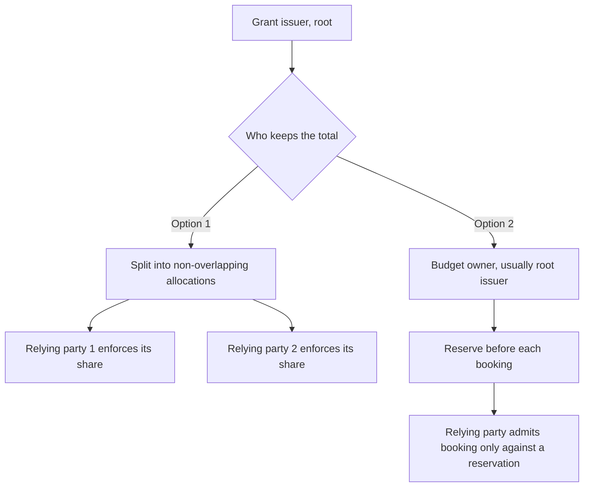
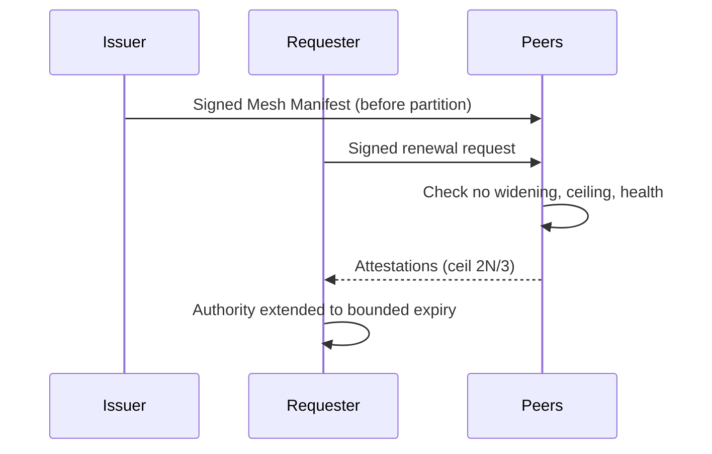
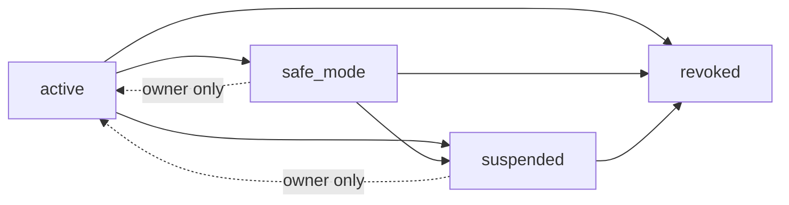

# WIMSE Daily Report (2026-11-19)

Generated at: 2026-11-19T07:29:26+00:00

<!-- insights:start -->
## Briefing

> No draft text changed. The most notable item is a new individual draft, draft-molas-agent-principal-refs-00, which compares agent principal-reference designs. The other item is an IPR poll on WIMSE Workload Credentials, with no IPR disclosed so far.

_Updated 2026-11-19T07:30:55+00:00. Machine-drafted from the sources linked below, which stay authoritative._

### New draft draft-molas-agent-principal-refs-00 compares principal references in agent delegation; the thread asks who enforces a total limit

`mail` · `new-proposal` · first seen 2026-11-19 · [New draft: PACE Authorization: delegation and action approval for agent dialogs:](https://mailarchive.ietf.org/arch/msg/wimse/bTn4phN88WAkmVkkUywGQieqwcM/)

Marc (MintID) announced draft-molas-agent-principal-refs-00. It states six properties of the principal reference that a delegation root carries and evaluates five current drafts against them, delegator-bound chains among them. It defines no limits. In the thread about an $800 budget spread over several airline bookings, Marc gives two ways to keep the total. In the first, the grant issuer splits the budget into non-overlapping allocations, one per relying party. In the second, one budget owner, naturally the root issuer, reserves against the total before each booking. Neither gives a common limit across roots that did not agree to one. The second lets the owner see which bookings draw on the budget. Correlating the principal across relying parties to add up spend would undo unlinkability from per-chain pseudonyms or a pairwise sub. The two forms are conformance cases 5a and 5b in the AAIF Identity and Trust group.

**Use cases**

- An agent holds a delegated grant with a spending cap and books with several unrelated relying parties, such as airlines. The deployer must decide who enforces the total.
- A deployer wants to keep delegation roots unlinkable across relying parties with pairwise subs or per-chain pseudonyms, and still wants a spending limit.

### Authors of the WIMSE Workload Credentials draft confirm they know of no IPR restrictions

`mail` · `routine` · first seen 2026-11-19 · [IPR Restrictions on WIMSE Credentials](https://mailarchive.ietf.org/arch/msg/wimse/jP5h2uj8J7Xwsad5B8lsyGBZ2Eg/)

This is part of the chairs' IPR poll on the WIMSE Workload Credentials draft. Brian Campbell and Arndt each replied that they know of no IPR restrictions. The poll was started by Justin Richer on 17 November. No technical content is involved.

### In short, a new informational draft gives reproducible test vectors for the WIMSE HTTP Message Signatures protocol, including 23 negative cases

`new-draft` · `new-proposal` · first seen 2026-11-18 · [draft-miao-wimse-http-signature-test-vectors-00: Test Vectors for the WIMSE HTTP Message Signatures Protocol](https://datatracker.ietf.org/doc/draft-miao-wimse-http-signature-test-vectors/00/)

The draft defines no new protocol behavior. It records 6 positive and 23 negative vectors for draft-ietf-wimse-http-signature, plus 3 non-judged observations where the base spec's text, read literally, does not support a pass/fail judgment. Test keys (Ed25519 and ES256) are published in full and derived from fixed seeds, with a fixed verification clock (T0=1795000000, verify at T0+60, expires = created+300). Positive vectors give the full RFC 9421 signature base. Each negative vector is a single mutation mapped to a quoted normative requirement, such as missing @query coverage, Content-Digest mismatch, a keyid or alg parameter present, two signatures carrying the WIMSE tag, wimse-aud differing only by URI normalization, a wrong wimse-req-nonce, or processing before the WIT is validated. Failures are expected to surface as HTTP 400 with the wimse-signature-invalid problem type. The set was earlier posted as issue #419 and on Zenodo, and reproduced by independent implementers. The text provided is truncated, so the observations were not seen.

**Use cases**

- An implementer of the WIMSE S2S HTTP signature scheme checking a verifier against rejection cases such as wimse-aud normalization or nonce mismatch.
- A library author wanting a deterministic, byte-reproducible signature base to regression-test Ed25519 and ES256 handling.

### Hackathon: an external interop matrix reports the two-domain B_CHAIN flow passing in all 12,288 published substitutions

`mail` · `discussion` · first seen 2026-11-18 · [IETF 127 Hackathon: WIMSE interop scenarios for agent call chains](https://mailarchive.ietf.org/arch/msg/wimse/BwGCvOXBxqAVBqOG_prlM3nwZUg/)

Jacob Stewart reported a WIMSE interop matrix of 161,370 execution IDs: 151,069 passed, 182 failed, 10,119 blocked. It covers WIC/mTLS, WIT with WPT, and WIT with HTTP Message Signatures bindings. The two-domain B_CHAIN success path passed all 12,288 published substitutions across 27 role bindings and 94 directional handoffs. Each run checks that the original Domain A transaction token stays in Domain A, the transaction ID survives scope narrowing, and the File Tool verifies the WPT binding to both the WIT and the narrowed transaction token before permitting one protected read. Alexander replies that he will record this in the hackathon repository as a separate external run, outside their own totals. He asks Jacob to confirm the wording and how to be named, and to supply a commit-pinned revision. He also says P7 need not stay blocked, since a verifier that holds the action can run the Appendix A vectors.

**Use cases**

- Implementers of WIT/WPT or HTTP Message Signatures bindings who want to compare their peers against a public interop matrix.
- Teams building multi-hop agent call chains across two trust domains that need to check transaction token containment.

**Related in other tracks**

- `oauth-wg` / `draft-ietf-oauth-transaction-tokens`: The B_CHAIN flow checks that a Domain A transaction token stays in its domain and keeps its transaction ID when scope is narrowed.

### PACE Authorization thread: one reply on what the delegation root must carry, and a list-etiquette complaint about the poster

`mail` · `discussion` · first seen 2026-11-18 · [New draft: PACE Authorization: delegation and action approval for agent dialogs: (2 new messages)](https://mailarchive.ietf.org/arch/msg/wimse/INsYufjtYsijqhJNn-01dG7ogqU/)

Blake Morrison replied on the PACE Authorization draft that, without a wallet, they favour option 2. It only beats option 3 if the root records the passkey tap at the user's own provider, when it happened, and the grant the user was viewing at that moment. The next revision would need to tie the grant to that moment. Two open problems remain: the same grant spent at two airlines, and wallet trust. A separate message from another participant objects to the posting style: cross-posting to several lists and no quoted history. They suggest it may be an AI-assisted autoresponder and ask Blake to reconsider. The options themselves are not defined in the material, so the substance is thin.

### AIMS thread: a transcribed identifier's old-to-new mapping goes in the transcribing server's signed audit record, not in the token

`mail` · `discussion` · first seen 2026-11-18 · [Subject: AIMS-00: multi-hop delegation context across agent, tool and resource boundaries](https://mailarchive.ietf.org/arch/msg/wimse/SHso1Zyz_O4N_fiIhRoh_i8IgZA/)

Kieran confirms Marc's reading of the AIMS delegation-context rules. The delegated principal must stay the same, but not necessarily the same bytes. Within one trust domain the value stays identical at every hop. Across a trust domain a transcribed value is acceptable if the transcription is recorded. The mapping (old value, new value, server identity) belongs in the transcribing server's own audit record, signed and fixed at transcription time. It should not travel in the token across the boundary, since that would hand the original identifier back to the receiving domain and defeat the correlation limit. A signed record can be checked by an auditor, while a retained mapping can only be requested. Marc plans to suggest two changes on PR #176: record the mapping in the audit record rather than retain it, and let the value differ only where a request crosses a trust domain. They also agree an input is refused at or past the instant its validity ends. The boundary wording and the 21 test vectors are left with their authors.

**Use cases**

- Deployments where an agent call crosses trust domains and the subject identifier is remapped to limit correlation.
- Auditors who need to verify after the fact how a delegated subject was mapped between domains.

### In short, the author announces the test-vector draft to the WIMSE list, asks for more negative cases and verification results, and offers to edit it

`mail` · `discussion` · first seen 2026-11-18 · [New draft: draft-miao-wimse-http-signature-test-vectors-00 — test vectors for the S2S HTTP signature scheme](https://mailarchive.ietf.org/arch/msg/wimse/V3Coqv_8g1tHFl7nV2gq-Lppf5o/)

The announcement describes 29 vectors (6 positive, 23 negative) and 3 observation items, with a machine-readable anchor layer so implementations can consume the set directly. The author says the emphasis is on negative cases where implementations most often diverge, naming expiry windows, @authority normalization and caller-reference reuse. The set is also on Zenodo (v4) and was earlier raised as issue #419. The author asks for additional negative cases and independent verification results, and volunteers to serve as editor if the WG finds the document useful.

### In short, an implementer argues that the offline-attenuated agent-token drafts already agree on much of the wire format and lists the few forks left

`mail` · `discussion` · first seen 2026-11-18 · [Implementation report: convergence across the offline-attenuated agent-token drafts (niyikiza / asor / fane) (2 new messages)](https://mailarchive.ietf.org/arch/msg/wimse/zFrXzOgjgybe9xQ2TrVTyb7Z7uU/)

Cleiton Augusto Correa Bezerra reports an independent implementation of draft-niyikiza-oauth-attenuating-agent-tokens that reproduces its Appendix A vectors byte for byte, and compares it with asor-wimse-agent-delegation-chain and fane-opena2a-aap. The three agree on authority in RFC 9396 authorization_details, fail-closed handling of unknown types, Ed25519 as baseline, PoP via cnf, and rejecting RFC 8693's nested act claim. niyikiza and asor are near wire-identical on chain linkage: par_hash is the base64url SHA-256 of the parent's JWS Signing Input, with del_depth and del_max_depth. Open: whether the parent's signature octets are in the hashed input (asor-00 leaves this slightly open). Real forks: offline-derived chains versus broker-mediated RFC 8693 exchange (fane), and constraint vocabulary, where only niyikiza gives a full algebra. They offer shared test vectors, not a new draft. Kamin Chung adds that a receipt assembled after execution cannot show that what ran is what the person confirmed.

**Use cases**

- Agent platforms deciding between offline-derived delegation chains and broker-mediated token exchange for sub-agent delegation.
- Implementers of MCP tool-call authorization who need interoperable par_hash and del_depth handling across drafts.

### In short, the IETF 127 hackathon team published a repo with WIMSE interop scenarios, PCAP traces and a Wireshark dissector that others can test against

`mail` · `routine` · first seen 2026-11-18 · [Hackathon results - website you can explore](https://mailarchive.ietf.org/arch/msg/wimse/LzzNtpzX0jzim9cEqlQWBgihSR8/)

The team reports substantial testing of WIMSE scenarios, done in the AI2II project, an approach where coding agents from different model families build the test peers, checkers and reviews. Everything is on GitHub with a browsable scenario site, PCAP files and a Wireshark dissector. They invite others to run their implementations against the scenarios and contribute use cases or results by pull request or issue. Code and documents are under Apache-2.0 or MIT, and partner traces keep their owners' terms. The authors suggest the main take-away is a repo participants can use to check interoperability over time. No protocol text changes.

### The architecture draft now defines issuer and trust anchor, and warns against sharing signing keys or agent identities

`draft-revision` · `substantive` · first seen 2026-11-17 · [draft-ietf-wimse-arch-09: Workload Identity in a Multi System Environment (WIMSE) Architecture](https://author-tools.ietf.org/iddiff?url1=draft-ietf-wimse-arch-08&url2=draft-ietf-wimse-arch-09)

Trust domain is redefined as an administrative scope and identity namespace, analogous to a Kerberos realm, with one or more authorized issuers. New terms Issuer, Trust Anchor and Relying Party are added. Relying parties MUST associate each trust domain with its authorized issuers and trust anchors, and MUST validate a credential only with the anchors for the domain named in its workload identifier, with the mapping obtained securely. Two new tables describe issuer/trust anchor cardinalities and signing key sharing variants (for example ML-DSA alongside an elliptic-curve key). A new Section 4.5 Trust Domain Separation says a signing key shared across trust domains lets one compromise forge credentials for all of them, and different issuer names do not restore separation. In the AI intermediary section, distinct agents that need separate audit, revocation or policy SHOULD NOT share a workload identity, and per-hop re-binding now also covers trust boundaries. The introduction and several definitions were condensed. The diff is truncated, so later sections are not covered.

**Use cases**

- A platform that runs one central credential service issuing WITs for several trust domains and must decide whether to use one signing key or one per domain.
- An agent platform where many logical agents run under one workload credential and need per-agent audit or revocation.
- A relying party that must configure which issuers and trust anchors are accepted per trust domain, including during an ML-DSA migration.

**Related in other tracks**

- `oauth-wg` / `draft-ietf-oauth-transaction-tokens`: The architecture draft cites it as its example of passing security context along a call chain.
- `oauth-wg` / `draft-ietf-oauth-identity-chaining`: The cross-domain scenario in the architecture draft refers to it for token issuance.

### A new experimental draft lets a workload extend its credential via peer quorum when its issuer is unreachable

`new-draft` · `new-proposal` · first seen 2026-11-17 · [draft-chandra-wimse-partition-tolerant-renewal-00: Extend-Only, Threshold-Attested Authority Renewal for Partitioned Agent Meshes](https://datatracker.ietf.org/doc/draft-chandra-wimse-partition-tolerant-renewal/00/)

The draft defines extend-only renewal for a workload whose credential is near expiry while its issuer is unreachable. Before a partition the issuer signs a Mesh Manifest naming at least 5 members, a total-extension ceiling, a scope ceiling and a validity window. During the partition the workload broadcasts a signed renewal request. Each peer independently checks that it does not widen scope or exceed the ceiling, and checks its own observation of the requester's health. Once ceil(2N/3) of the N peers attest (N at least 4), the authority is treated as extended, and multi-round extensions are hash-linked into a chain. It states that revocation during a partition is not enforceable until the partition heals, and that it is not a consensus protocol. The text provided is truncated, so the later sections were not seen.

**Use cases**

- Edge or air-gapped agent meshes that must keep running when the central credential issuer is unreachable.
- Deployments that need a bounded, auditable fallback instead of long-lived credentials.

### A new experimental draft proposes a durable agent identifier with a tighten-only runtime state machine

`mail` · `new-proposal` · first seen 2026-11-17 · [New I-D: draft-sogomonian-aiid-00 (Autonomous Agent Identity and Runtime Control Status)](https://mailarchive.ietf.org/arch/msg/wimse/3b_KjKBN2xzYAspj9rUIJcSU1pQ/)

draft-sogomonian-aiid-00 proposes an aiid://namespace/id identifier bound to an accountable owner. It defines four states: active, safe_mode, suspended and revoked. A Monitor can only tighten the state, only the owner can loosen it, and revoked is terminal. Relying parties check status through OAuth token introspection and Token Status Lists, with rollback protection, and agents emit signed action receipts recording their effective state. It replaces the author's earlier combined draft, and the access-network material is now an optional gateway profile. The post asks for comments on fit with WIMSE workload identity.

**Use cases**

- Operators who need to put a running agent into safe mode and have downstream relying parties see that before acting.

**Related in other tracks**

- `oauth-wg` / `draft-ietf-oauth-status-list`: AIID uses Token Status Lists to publish agent state for relying parties.

### Triage of the candidate queue

- **high** `Diff active WG draft: draft-ietf-wimse-aims-01`: The AIMS thread is settling transcription and audit-record rules, with a PR #176 change proposed.
- **high** `Diff active WG draft: draft-ietf-wimse-arch-09`: -09 adds Issuer/Trust Anchor definitions, a Trust Domain Separation section and a SHOULD NOT on shared agent identities.
- **high** `Diff active WG draft: draft-ietf-wimse-http-signature-08`: The digest shows active work on its test vectors (#419), a closed server-nonce issue (#369) and a new dangling-reference issue (#422).
- **high** `Diff active WG draft: draft-ietf-wimse-workload-creds-03`: The IPR poll to its authors started today, which suggests the draft is moving toward publication.
- **high** `Review related draft: draft-asor-wimse-agent-delegation-chain-03`: Discussed as near wire-identical to niyikiza on par_hash and del_depth, with an open question on signature octets in the hash.
- **high** `Review related draft: draft-hulea-wimse-agent-mandate-01`: Author agreed Section 9.5 is unsafe and will change budget-release semantics in -02.
- **high** `Review related draft: draft-miao-wimse-http-signature-test-vectors-00`: New draft with 29 vectors and 3 observations on spec ambiguity in draft-ietf-wimse-http-signature.
- **high** `Review related draft: draft-nandakumar-wimse-wpt-message-binding-00`: Announced today and already drawing questions on authority hashing behind gateways and registry profiles.
- **high** `Review related draft: draft-sweeney-wimse-credential-delegation-02`: The thread names it as the basis for a final-hop hackathon scenario with a working implementation.
- **low** `Review related draft: draft-thaha-wimse-agent-evidence-binding-03`: Its authors engaged in two threads today, but only through short comments, with no new text in this material.

<!-- insights:end -->

## Snapshot

- Active WG drafts: 8
- Related drafts: 24
- Mailing-list posts scanned: 40
- Tracked GitHub repos: 6

## Active WG Drafts

| Draft | Date | Title |
| --- | --- | --- |
| draft-ietf-wimse-arch-09 | 2026-11-16 | Workload Identity in a Multi System Environment (WIMSE) Architecture |
| draft-ietf-wimse-aims-01 | 2026-11-02 | AI Identity Management System |
| draft-ietf-wimse-workload-creds-03 | 2026-10-30 | WIMSE Workload Credentials |
| draft-ietf-wimse-workload-identity-practices-08 | 2026-10-30 | Workload Identity Practices |
| draft-ietf-wimse-mutual-tls-03 | 2026-10-24 | Workload Authentication Using Mutual TLS |
| draft-ietf-wimse-identifier-04 | 2026-10-23 | Workload Identifier |
| draft-ietf-wimse-http-signature-08 | 2026-10-20 | WIMSE Workload-to-Workload Authentication with HTTP Signatures |
| draft-ietf-wimse-wpt-02 | 2026-08-27 | WIMSE Workload Proof Token |

## Recent Related Drafts

| Draft | Date | Title |
| --- | --- | --- |
| draft-miao-wimse-http-signature-test-vectors-00 | 2026-11-18 | Test Vectors for the WIMSE HTTP Message Signatures Protocol |
| draft-chandra-wimse-partition-tolerant-renewal-00 | 2026-11-17 | Extend-Only, Threshold-Attested Authority Renewal for Partitioned Agent Meshes |
| draft-nandakumar-wimse-delegator-bound-chains-00 | 2026-11-16 | Delegator-Bound Delegation Chains for AI Agents |
| draft-nandakumar-wimse-wpt-message-binding-00 | 2026-11-16 | Message Binding for Workload Proof Tokens |
| draft-hulea-wimse-agent-mandate-01 | 2026-11-01 | Verifiable Mandates for Agents Acting Across Administrative Domains |
| draft-thaha-wimse-agent-evidence-binding-03 | 2026-11-01 | Evidence Binding for AI Agent Credentials |
| draft-reddy-wimse-oauth-dialog-binding-00 | 2026-10-30 | Binding Agent Dialogs to WIMSE and OAuth Credentials |
| draft-sweeney-wimse-credential-delegation-02 | 2026-10-30 | Credential Delegation Protocol for AI Agents in Multi-System Environments |
| draft-durga-wimse-ctx-isolation-00 | 2026-10-29 | Cryptographic Separation of Untrusted Data-Plane Context from Control-Plane Tool Invocations in Autonomous AI Agents |
| draft-jackson-wimse-evaluation-05 | 2026-10-28 | Verifier-Side Evaluation Semantics for Delegated Authority Chains |

## Mailing List Topics

- ai-agent: 2
- http-signature: 1

## Recent GitHub Activity

| Repository | Latest Commit |
| --- | --- |
| ietf-wg-wimse/draft-ietf-wimse-arch | 2026-11-16T23:24:56Z |
| ietf-wg-wimse/draft-ietf-wimse-s2s-protocol | 2026-11-16T19:11:17Z |
| ietf-wg-wimse/draft-ietf-wimse-workload-identity-practices | 2026-10-30T09:50:30Z |
| ietf-wg-wimse/draft-ietf-wimse-identifier | 2026-10-23T15:16:50Z |
| ietf-wg-wimse/ietf-wg-wimse.github.io | 2026-10-07T19:43:41Z |
| ietf-wg-wimse/admin | 2024-03-17T22:59:45Z |

## Top Deep-Dive Candidates

- [7] Diff active WG draft: draft-ietf-wimse-aims-01
- [7] Diff active WG draft: draft-ietf-wimse-http-signature-08
- [7] Diff active WG draft: draft-ietf-wimse-mutual-tls-03
- [7] Diff active WG draft: draft-ietf-wimse-workload-creds-03
- [6] Review related draft: draft-asor-wimse-agent-delegation-chain-03
- [6] Review related draft: draft-chandra-wimse-partition-tolerant-renewal-00
- [6] Review related draft: draft-durga-wimse-ctx-isolation-00
- [6] Review related draft: draft-hulea-wimse-agent-mandate-01
- [6] Review related draft: draft-jackson-wimse-evaluation-05
- [6] Review related draft: draft-lee-wimse-local-tool-call-proof-01

