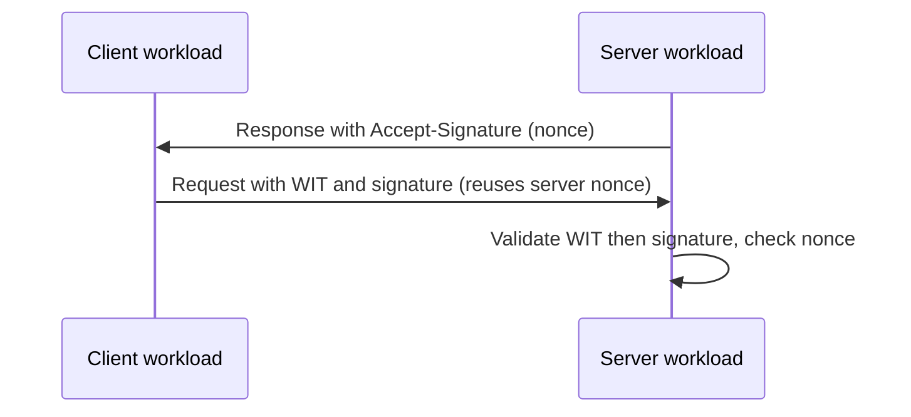
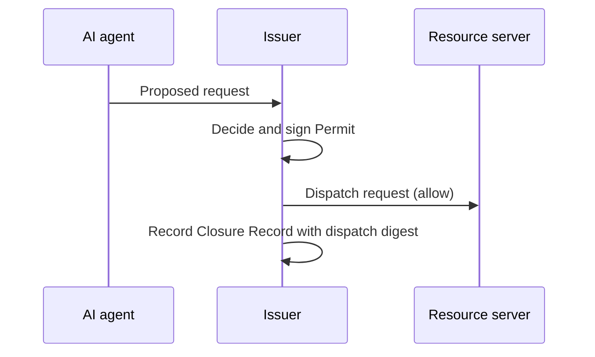
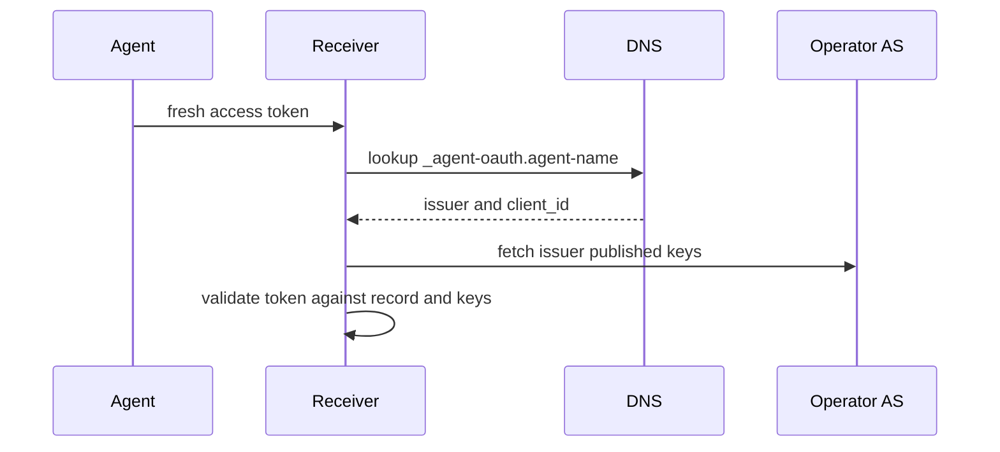
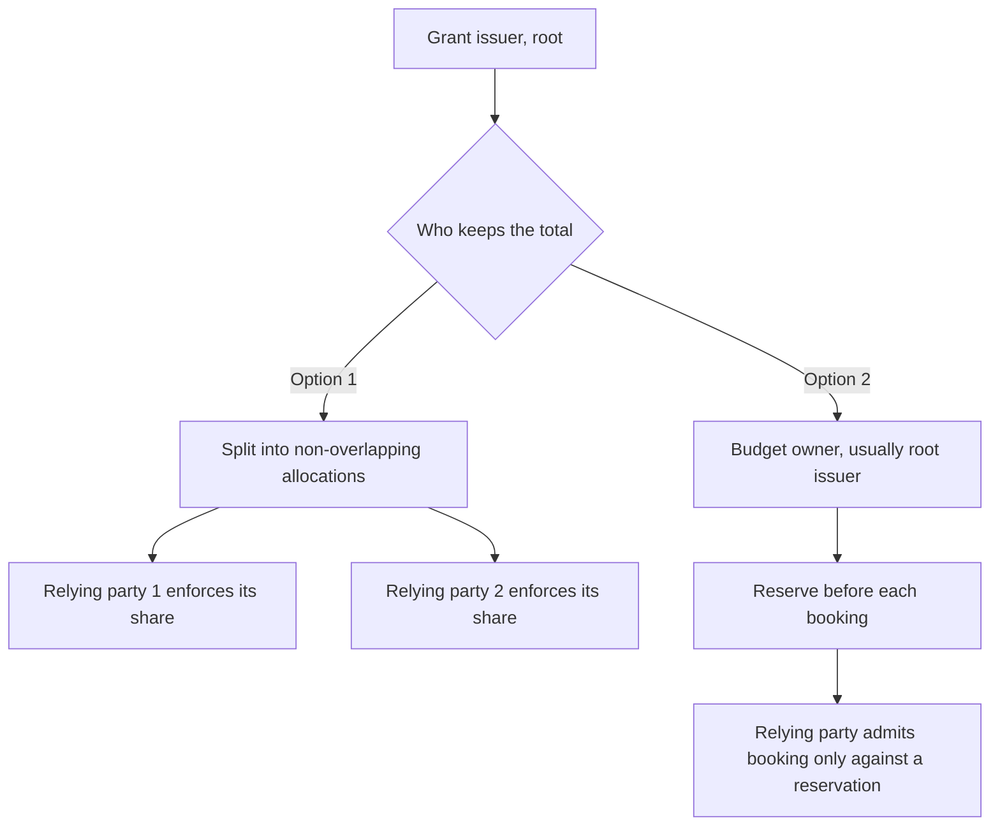

# WIMSE Daily Report (2026-11-21)

Generated at: 2026-11-21T19:19:23+00:00

<!-- insights:start -->
## Briefing

> draft-ietf-wimse-http-signature-09 is mostly editorial, with one small behaviour change: a client may reuse a server-generated nonce from Accept-Signature. Alongside it, the munoz authorization-evidence draft was rewritten to build on the WG's AIMS draft.

_Updated 2026-11-21T07:15:03+00:00. Machine-drafted from the sources linked below, which stay authoritative._

### The HTTP signature draft lets a client use a server-supplied nonce from Accept-Signature, and fixes wording and cross-references

`draft-revision` · `substantive` · first seen 2026-11-21 · [draft-ietf-wimse-http-signature-09: WIMSE Workload-to-Workload Authentication with HTTP Signatures](https://author-tools.ietf.org/iddiff?url1=draft-ietf-wimse-http-signature-08&url2=draft-ietf-wimse-http-signature-09)

The one behavioural change is that a request may now carry a server-generated nonce taken from Accept-Signature (RFC 9421 Section 5.1) in place of a client-generated one, provided it meets the same uniqueness and entropy rules (at least 64 bits, 96 recommended). The other changes clarify text. For CONNECT, @authority follows RFC 9421 (lowercased host, default port omitted), so it may differ from the request target. The introduction now explains that a signature with a WIT authenticates the caller end to end across multiple TLS hops. The example nonces are noted as below the entropy floor. Cross-references to workload-creds are corrected (WIT validation is now Section 5.1.3, the architecture reference Section 1.1), and references are updated to workload-creds-03, arch-09 and mutual-tls-03. The implementation status entry now notes that its coverage is as per version -08.

**Use cases**

- A server that issues Accept-Signature with a nonce and wants clients to reuse it so it can track replay on its side.
- An implementer using a CONNECT proxy who must compute @authority with the default port omitted, even when the request target includes the port.

### The authorization-evidence draft is retargeted from an individual draft to the WG's AIMS draft and narrows its claims about what a Permit proves

`draft-revision` · `substantive` · first seen 2026-11-21 · [draft-munoz-wimse-authorization-evidence-02: Signed Authorization-Evidence Records for AI Agent Actions Using WIMSE Workload Identity](https://author-tools.ietf.org/iddiff?url1=draft-munoz-wimse-authorization-evidence-01&url2=draft-munoz-wimse-authorization-evidence-02)

The draft now builds on draft-ietf-wimse-aims-01, which it says was adopted by the WG in September 2026 as the successor to draft-klrc-aiagent-auth, instead of the earlier individual draft. It still defines how a signed Permit records a pre-execution authorization decision, with a paired Closure Record for a dispatched allow that has a request-body commitment. The abstract and Section 11 crosswalk are reworded so that a Permit covers only part of the AIMS audit minimum, and deployments must retain other evidence such as risk state and the cause of remediation. SPIFFE and wimse subject typing moves from MUST to SHOULD, and the draft adds related-work discussion (AuthZEN, other evidence drafts including draft-thaha-wimse-agent-evidence-binding). The diff is truncated, so later sections were not seen.

**Use cases**

- An operator of AI agents who must satisfy the AIMS Section 11 audit requirement and wants a signed record of each allow, deny or challenge decision.
- A policy decision point team using AuthZEN that wants to preserve the original decision, including a denial with an approval workflow.

**Related in other tracks**

- `openid` / `openid/authzen`: The draft cites AuthZEN as the common interface between a resource server and an external policy decision point.
- `oauth-wg` / `draft-ietf-oauth-transaction-tokens`: The draft has a section on linking Permits to Transaction Tokens.

### One commit in the s2s-protocol repo: the editorial fixes that went into http-signature-09

`repo-activity` · `routine` · first seen 2026-11-21 · [1 new commit(s) in ietf-wg-wimse/draft-ietf-wimse-s2s-protocol](https://github.com/ietf-wg-wimse/draft-ietf-wimse-s2s-protocol)

A single commit, "HTTP-Sig editorial fixes (#417, #420, #422)", merged on 2026-11-20. Its issue numbers match the -09 change log entries on the introduction, the illustrative example nonces and the workload-creds cross-references. Only the commit title is available, with no diff.

### A reply to a draft-ietf-wimse-aims-01 question proposes a DNS-based pointer so unrelated parties can check an agent's status

`mail` · `discussion` · first seen 2026-11-20 · [AIMS question: checking agent status from outside the trust domain](https://mailarchive.ietf.org/arch/msg/wimse/A9BmP2ORAS19NSKgV_IqiAqPjXk/)

A thread asked whether draft-ietf-wimse-aims-01 should cover status checks by a party with no relationship to the issuer, allow a pointer from an identifier to its status source in Section 6, and cover transfer of an agent between accountable parties. The reply points to an individual draft, draft-shankarlingam-oauth-agent-dns-link. In it the agent presents a fresh access token for its OAuth client, and the receiver validates it against a DNS record at _agent-oauth.&lt;agent-name&gt; and the issuer's published keys. The record names the issuer and client_id, so it points to the operator's authorization server as the status authority. Revocation is done by disabling the client, and receivers bound the rejection delay using token age, DNS and key caching, and clock skew. The author admits there is no public history of past status, and offers to propose Section 6 text. The original poster also disclosed a pending patent application. The third question, on transfer between accountable parties, was not answered in this message.

**Use cases**

- A bank needs to confirm that an AI agent acting for a customer is still authorized by its operator, with no prior trust relationship with the operator.
- An AIMS implementer wants a standard way to find the authoritative status source from an agent identifier.

**Related in other tracks**

- `oauth-wg` / `draft-ietf-oauth-status-list`: Also addresses publishing revocation status for tokens or credentials; the thread's proposal instead uses DNS and the operator's AS as the status source.

### The author of draft-molas-agent-principal-refs-00 explains how a public agent registry would be graded against properties P5 and P6

`mail` · `discussion` · first seen 2026-11-20 · [draft-molas-agent-principal-refs-00 - public registry as a case? (3 new messages)](https://mailarchive.ietf.org/arch/msg/wimse/k1ywYY7Ib2dBilB2KSDYRhuSZqM/)

A participant running a public agent registry (a code, a date, active or revoked status, free lookup without an account) asked how it would be evaluated in draft-molas-agent-principal-refs-00. The author replied that P6 can be met if the withdrawal event and the time from it to the status change are stated, with the bound running from the event. They distinguished per-agent status from the principal's standing, meaning whether the accountable party behind the agent is still accepted. A registry carrying the second separately is the case that none of the five evaluated drafts bounds. On P5, a lookup by code sends a per-record value, so P5 is not met on that path. P5 is not a disqualifier, since properties are graded individually. If the lookup were the only status path, the grade would be Prevents. Publishing the whole list or a commitment to it would let a relying party avoid naming a record. The author evaluates only Internet-Drafts, so a deployment would need to be described in a draft before it is listed in Appendix A of -01. A third message suggests a SCITT (RFC 9943) Trust Registry could help, and links an article.

**Use cases**

- A registry operator wants to know whether a lookup-by-code design would pass privacy properties such as P5 in the evaluation.
- A draft author deciding whether to publish a registry description as an Internet-Draft so it can be evaluated.

### Joe Salowey states he knows of no IPR on four WIMSE drafts past last call; Justin Richer forwarded it to the list

`mail` · `routine` · first seen 2026-11-20 · [IPR declarations](https://mailarchive.ietf.org/arch/msg/wimse/HAxOOzAN-8rWDfzBtbvrJt4tTq4/)

Justin Richer forwarded to the list, for the public record, a private note from Joseph Salowey. Salowey found no additional IPR queries for other drafts. He stated that he does not know of any IPR pertaining to draft-ietf-wimse-workload-creds, draft-ietf-wimse-mutual-tls, draft-ietf-wimse-identifier and draft-ietf-wimse-http-signature, which he describes as past last call. This is a process record only and changes no protocol text.

### The AER-1 mapping for AIMS audit records reached -03: a fail-closed denial on an unestablished input is now recorded as not_evaluated

`mail` · `substantive` · first seen 2026-11-19 · [draft-zambo-aer1-wimse-mapping-01: AER-1 as a candidate format for AIMS Section 11 audit records](https://mailarchive.ietf.org/arch/msg/wimse/DnZC2EjOyi076-ogRKA4J9jrIXc/)

Thread between the author of draft-zambo-aer1-wimse-mapping and a reviewer. In -02 a committed decision_reason member distinguished "denied" from "not_evaluated". The reviewer pointed out that a fail-closed policy point still runs and denies when a status source does not answer, and that an input reached but stale was not covered. In -03 (Section 3), "not_evaluated" applies whenever an input the decision depended on could not be established, whether unreachable or not current, even if a fail-closed rule denies. decision_reason_detail names that input, and "denied" is kept for decisions evaluated on established inputs. The reason is committed for the audit reader and not returned to the caller, so the error does not become an oracle. The reviewer confirmed -03 separates the cases.

**Use cases**

- An AIMS deployment whose policy point denies when a revocation or status source is down and must later show auditors that the denial was not a real policy evaluation.
- A verifier of audit logs that needs to tell policy denials from fail-closed outages when reconstructing Section 11 events.

**Related in other tracks**

- `oauth-wg` / `draft-ietf-oauth-status-list`: The status inputs whose unavailability or staleness triggers not_evaluated are of the kind a status list provides, though the message does not name it.

### New draft draft-molas-agent-principal-refs-00 compares principal references in agent delegation; the thread asks who enforces a total limit

`mail` · `new-proposal` · first seen 2026-11-19 · [New draft: PACE Authorization: delegation and action approval for agent dialogs:](https://mailarchive.ietf.org/arch/msg/wimse/bTn4phN88WAkmVkkUywGQieqwcM/)

Marc (MintID) announced draft-molas-agent-principal-refs-00. It states six properties of the principal reference that a delegation root carries and evaluates five current drafts against them, delegator-bound chains among them. It defines no limits. In the thread about an $800 budget spread over several airline bookings, Marc gives two ways to keep the total. In the first, the grant issuer splits the budget into non-overlapping allocations, one per relying party. In the second, one budget owner, naturally the root issuer, reserves against the total before each booking. Neither gives a common limit across roots that did not agree to one. The second lets the owner see which bookings draw on the budget. Correlating the principal across relying parties to add up spend would undo unlinkability from per-chain pseudonyms or a pairwise sub. The two forms are conformance cases 5a and 5b in the AAIF Identity and Trust group.

**Use cases**

- An agent holds a delegated grant with a spending cap and books with several unrelated relying parties, such as airlines. The deployer must decide who enforces the total.
- A deployer wants to keep delegation roots unlinkable across relying parties with pairwise subs or per-chain pseudonyms, and still wants a spending limit.

### A practitioner asks whether draft-ietf-wimse-aims-01 should cover status checks and accountable-party transfer for agents across trust domains

`mail` · `discussion` · first seen 2026-11-19 · [AIMS question: checking agent status from outside the trust domain](https://mailarchive.ietf.org/arch/msg/wimse/AUUcqnfZO9c5WXckMA3dNhJp8lE/)

Jaromir Zly says revocation in AIMS (short-lived credentials in Section 8, introspection in 10.3, signals in 11) assumes the verifier has a relationship with the issuer. He gives a case where bank, customer and agent operator are in different trust domains. He asks three questions: whether a status check by an unrelated party (active or revoked, since when) is in scope; whether the draft could allow a pointer from the identifier to where its status can be looked up, since Section 6 puts the identifier registry out of scope; and whether moving an agent to another accountable party is covered, since he found only retirement in Section 6. He describes his own public registry (AIBSN) as background and discloses a pending patent application. No answers appear in this message.

**Use cases**

- A relying party such as a bank that must verify whether an agent acting for a customer is still authorized, without any trust relationship with the agent operator.
- A deployer who must prove when an agent authorization was revoked for liability purposes.

**Related in other tracks**

- `oauth-wg` / `draft-ietf-oauth-status-list`: Addresses publishing revocation status that unrelated verifiers can check, the kind of mechanism the question is about, though the message does not mention it.

### PACE Authorization thread: who keeps a spending total across relying parties is answered with an allocator or a ledger

`mail` · `discussion` · first seen 2026-11-19 · [New draft: PACE Authorization: delegation and action approval for agent dialogs:](https://mailarchive.ietf.org/arch/msg/wimse/IFO_WULHQKHZDVdVwKWc_V_fIRQ/)

Using an $800 travel budget with several airlines as the example, Marc Miro i Rierola gives two ways to keep the total without the airlines learning more about the user. The issuer splits the total into non-overlapping allocations per relying party, or one budget owner reserves against the total before each booking. Neither gives a common limit across roots that did not agree, and correlating the principal across airlines would undo unlinkability. He announced draft-molas-agent-principal-refs-00, which states six properties of a principal reference and evaluates five drafts against them. Niki Niyikiza replies that asor -03 Section 9.4 already describes an allocator or ledger and separates per-action max from totals (max_lifetime, max_subtree), with enforcement points denying when they cannot see the total (Section 4.2). PACE would still need to name the total and the allocator or ledger. Rebooking needs a share returned first, so the allocator must be reachable, which a wallet that signed the root usually is not. He linked a comparison on what must be remembered and who shares it.

**Use cases**

- An agent granted a total spending limit that is used at several independent merchants, where someone must enforce the cumulative cap.
- A deployer choosing between pre-split allocations and a reservation service for budgeted delegation.

### The AAT author replies to an implementation report: asor -03 now matches AAT -02 on par_hash, but del_max_depth is counted differently

`mail` · `discussion` · first seen 2026-11-19 · [Implementation report: convergence across the offline-attenuated agent-token drafts (niyikiza / asor / fane)](https://mailarchive.ietf.org/arch/msg/wimse/NIGoNNBqfgDfIs-MvDSFKy9QAY0/)

Niki Niyikiza (Tenuo) responds to an implementation report on the offline-attenuated agent-token drafts. Some open items are already settled: asor -03 hashes the parent's JWS Signing Input for par_hash, the same bytes as AAT -02, with the signature outside the hash, and asor has typed constraints with narrowing rules (Sections 4.2, 4.3). Shared claim names are deliberate, and asor Section 10 asks for one registry entry per name. Both drafts use del_max_depth but count depth differently, so the same value can pass in one and fail in the other. AAT builds on OAuth with an AS issuing the root token, usable alongside transaction tokens and identity chaining. A side-by-side comparison of narrowing rules for AAT -02, asor -03 and hulea -01 with test cases was published. AAT -02 changed the alg name to Ed25519 and made typ required, and has a 229-case test suite. A quoted message argues a receipt assembled after execution cannot show that what ran is what the person confirmed.

**Use cases**

- An implementer supporting both AAT and asor tokens who must reconcile del_max_depth semantics before accepting chains from either.
- A team upgrading an earlier AAT implementation that will fail on the Ed25519 alg name and required typ in -02.

**Related in other tracks**

- `oauth-wg` / `draft-ietf-oauth-transaction-tokens`: AAT is said to be usable alongside transaction tokens.
- `oauth-wg` / `draft-ietf-oauth-identity-chaining`: AAT is said to be usable alongside identity chaining.

### Authors of the WIMSE Workload Credentials draft confirm they know of no IPR restrictions

`mail` · `routine` · first seen 2026-11-19 · [IPR Restrictions on WIMSE Credentials](https://mailarchive.ietf.org/arch/msg/wimse/jP5h2uj8J7Xwsad5B8lsyGBZ2Eg/)

This is part of the chairs' IPR poll on the WIMSE Workload Credentials draft. Brian Campbell and Arndt each replied that they know of no IPR restrictions. The poll was started by Justin Richer on 17 November. No technical content is involved.

### Triage of the candidate queue

- **high** `Diff active WG draft: draft-ietf-wimse-arch-09`: -09 adds Issuer/Trust Anchor definitions, a Trust Domain Separation section and a SHOULD NOT on shared agent identities.
- **high** `Diff active WG draft: draft-ietf-wimse-http-signature-08`: The digest shows active work on its test vectors (#419), a closed server-nonce issue (#369) and a new dangling-reference issue (#422).
- **high** `Diff active WG draft: draft-ietf-wimse-http-signature-09`: -09 lets a client reuse a server-generated nonce from Accept-Signature, a behaviour change worth a diff.
- **high** `Diff active WG draft: draft-ietf-wimse-workload-creds-03`: The IPR poll to its authors started today, which suggests the draft is moving toward publication.
- **high** `Review related draft: draft-asor-wimse-agent-delegation-chain-03`: Cited as settling par_hash and totals handling, with a del_max_depth counting difference against AAT.
- **high** `Review related draft: draft-miao-wimse-http-signature-test-vectors-00`: New draft with 29 vectors and 3 observations on spec ambiguity in draft-ietf-wimse-http-signature.
- **high** `Review related draft: draft-nandakumar-wimse-wpt-message-binding-00`: Announced today and already drawing questions on authority hashing behind gateways and registry profiles.
- **high** `Review related draft: draft-sweeney-wimse-credential-delegation-02`: The thread names it as the basis for a final-hop hackathon scenario with a working implementation.
- **low** `Review related draft: draft-hulea-wimse-agent-mandate-01`: Only appears as a column in a side-by-side comparison; no change discussed.
- **low** `Review related draft: draft-thaha-wimse-agent-evidence-binding-03`: Its authors engaged in two threads today, but only through short comments, with no new text in this material.

<!-- insights:end -->

## Snapshot

- Active WG drafts: 8
- Related drafts: 24
- Mailing-list posts scanned: 40
- Tracked GitHub repos: 6

## Active WG Drafts

| Draft | Date | Title |
| --- | --- | --- |
| draft-ietf-wimse-http-signature-09 | 2026-11-20 | WIMSE Workload-to-Workload Authentication with HTTP Signatures |
| draft-ietf-wimse-arch-09 | 2026-11-16 | Workload Identity in a Multi System Environment (WIMSE) Architecture |
| draft-ietf-wimse-aims-01 | 2026-11-02 | AI Identity Management System |
| draft-ietf-wimse-workload-creds-03 | 2026-10-30 | WIMSE Workload Credentials |
| draft-ietf-wimse-workload-identity-practices-08 | 2026-10-30 | Workload Identity Practices |
| draft-ietf-wimse-mutual-tls-03 | 2026-10-24 | Workload Authentication Using Mutual TLS |
| draft-ietf-wimse-identifier-04 | 2026-10-23 | Workload Identifier |
| draft-ietf-wimse-wpt-02 | 2026-08-27 | WIMSE Workload Proof Token |

## Recent Related Drafts

| Draft | Date | Title |
| --- | --- | --- |
| draft-munoz-wimse-authorization-evidence-02 | 2026-11-20 | Signed Authorization-Evidence Records for AI Agent Actions Using WIMSE Workload Identity |
| draft-miao-wimse-http-signature-test-vectors-00 | 2026-11-18 | Test Vectors for the WIMSE HTTP Message Signatures Protocol |
| draft-chandra-wimse-partition-tolerant-renewal-00 | 2026-11-17 | Extend-Only, Threshold-Attested Authority Renewal for Partitioned Agent Meshes |
| draft-nandakumar-wimse-delegator-bound-chains-00 | 2026-11-16 | Delegator-Bound Delegation Chains for AI Agents |
| draft-nandakumar-wimse-wpt-message-binding-00 | 2026-11-16 | Message Binding for Workload Proof Tokens |
| draft-hulea-wimse-agent-mandate-01 | 2026-11-01 | Verifiable Mandates for Agents Acting Across Administrative Domains |
| draft-thaha-wimse-agent-evidence-binding-03 | 2026-11-01 | Evidence Binding for AI Agent Credentials |
| draft-reddy-wimse-oauth-dialog-binding-00 | 2026-10-30 | Binding Agent Dialogs to WIMSE and OAuth Credentials |
| draft-sweeney-wimse-credential-delegation-02 | 2026-10-30 | Credential Delegation Protocol for AI Agents in Multi-System Environments |
| draft-durga-wimse-ctx-isolation-00 | 2026-10-29 | Cryptographic Separation of Untrusted Data-Plane Context from Control-Plane Tool Invocations in Autonomous AI Agents |

## Mailing List Topics

- http-signature: 1

## Recent GitHub Activity

| Repository | Latest Commit |
| --- | --- |
| ietf-wg-wimse/draft-ietf-wimse-s2s-protocol | 2026-11-20T22:45:12Z |
| ietf-wg-wimse/draft-ietf-wimse-arch | 2026-11-16T23:24:56Z |
| ietf-wg-wimse/draft-ietf-wimse-workload-identity-practices | 2026-10-30T09:50:30Z |
| ietf-wg-wimse/draft-ietf-wimse-identifier | 2026-10-23T15:16:50Z |
| ietf-wg-wimse/ietf-wg-wimse.github.io | 2026-10-07T19:43:41Z |
| ietf-wg-wimse/admin | 2024-03-17T22:59:45Z |

## Top Deep-Dive Candidates

- [7] Diff active WG draft: draft-ietf-wimse-aims-01
- [7] Diff active WG draft: draft-ietf-wimse-http-signature-09
- [7] Diff active WG draft: draft-ietf-wimse-mutual-tls-03
- [7] Diff active WG draft: draft-ietf-wimse-workload-creds-03
- [6] Review related draft: draft-asor-wimse-agent-delegation-chain-03
- [6] Review related draft: draft-chandra-wimse-partition-tolerant-renewal-00
- [6] Review related draft: draft-durga-wimse-ctx-isolation-00
- [6] Review related draft: draft-hulea-wimse-agent-mandate-01
- [6] Review related draft: draft-jackson-wimse-evaluation-05
- [6] Review related draft: draft-lee-wimse-local-tool-call-proof-01

