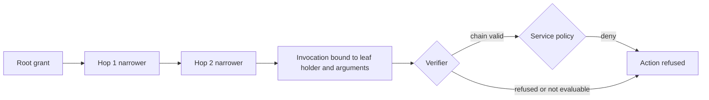
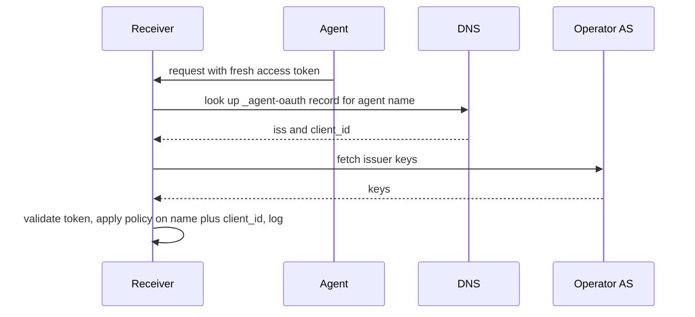
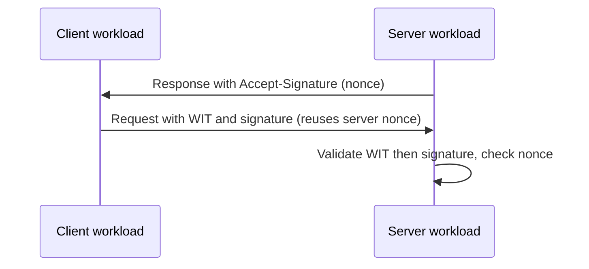
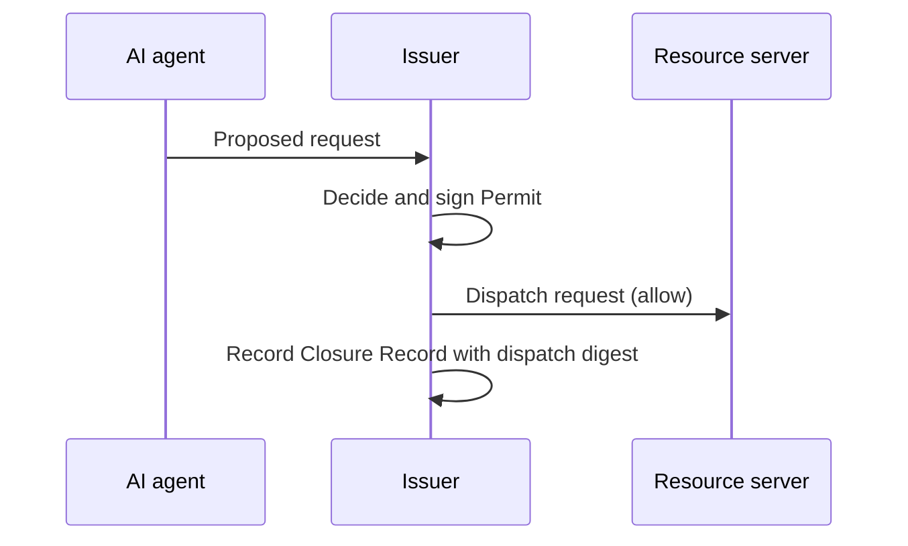
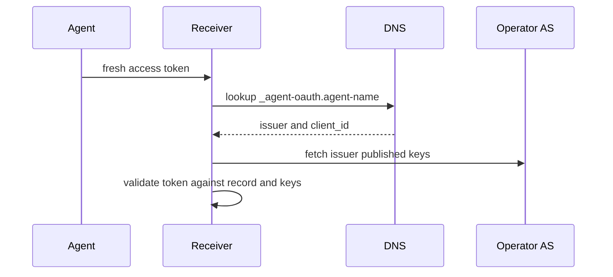

# WIMSE Daily Report (2026-11-22)

Generated at: 2026-11-22T06:53:32+00:00

<!-- insights:start -->
## Briefing

> No draft text changed in this run. The substantive thread is the AIMS (draft-ietf-wimse-aims-01) discussion on checking agent status from outside the issuer's trust domain, plus a proposed multi-hop delegation example for AIMS issue #86.

_Updated 2026-11-22T06:55:18+00:00. Machine-drafted from the sources linked below, which stay authoritative._

### An individual draft's reference verifier and test vectors were offered as input to the AIMS multi-hop delegation example

`mail` · `new-proposal` · first seen 2026-11-22 · [Test vectors for multi-hop delegation properties (AIMS issue #86)](https://mailarchive.ietf.org/arch/msg/wimse/gE_bXOgLhl-vVNEfYvXVj5-ehLM/)

Karthik Rampalli published a reference verifier and 27 byte-level test cases (28 presentations) for draft-rampalli-pedigree-01, on offline attenuated delegation for AI agents. He ties them to AIMS issue #86, where AIMS is to state delegation-chain properties and other specs define mechanisms. The vectors check that authority narrows per hop, each hop is bound to its parent, depth and linkage are verified, and the invocation is bound to the leaf holder and its arguments. Refusals on known facts are reported separately from cases the verifier could not evaluate, and both stop the action. In the lead case, all hops are valid but the service still denies under its own policy. It is an individual draft; Token Status List resolution, real WPT verification, Cedar evaluation and ID-JAG root mapping are not yet implemented. He asks whether these properties match what the AIMS example should show.

**Use cases**

- Authors of the AIMS multi-hop example checking which delegation properties a worked example should demonstrate.
- Implementers of agent-to-agent delegation who want executable cases for narrowing, parent binding and argument binding.

**Related in other tracks**

- `oauth-wg` / `draft-ietf-oauth-status-list`: The author lists Token Status List resolution as not yet implemented in the vectors.
- `oauth-wg` / `draft-ietf-oauth-identity-assertion-authz-grant`: The author lists the ID-JAG root mapping as not yet implemented.

### A thread on whether a public registry or SCITT log can meet the privacy and revocation-delay properties in draft-molas-agent-principal-refs-00

`mail` · `discussion` · first seen 2026-11-22 · [draft-molas-agent-principal-refs-00 - public registry as a case? (7 new messages)](https://mailarchive.ietf.org/arch/msg/wimse/L9vkb92fE28f29-1UInvI8_RTrQ/)

Marc Miro i Rierola explained that P5 requires a status request not to carry a value naming the record, so a relying party working from a list or log entries fetched the same way for everyone meets it, while fetching one entry by receipt location or code does not. P6 asks for a stated number, the time from withdrawal to refusal by a conforming relying party, not just real-time. Dick Brooks argued for a SCITT-based trust registry judged by under 500 ms, real-time accuracy, and one round trip, and described a high-speed cache kept in sync at registration. Marc replied that pre-fetched status meets those factors and that a cache reflecting the ledger can state the P6 number. He also said a draft needs no minimum set of sections to be graded on P5 and P6, that the document does not prefer one record or two for agent status and principal standing, and that -01 is planned for 1 December. Jaromir Zly is considering an individual draft.

**Use cases**

- A relying party choosing between fetching a whole status list or log in advance and querying a registry per identifier, given the privacy cost of naming the record.
- A registry operator that must state how long after a revocation a conforming relying party will refuse.

### Discussion of how a verifier with no tie to the issuer can check agent status and transfers, with a DNS-record option proposed for AIMS Section 6

`mail` · `discussion` · first seen 2026-11-22 · [AIMS question: checking agent status from outside the trust domain (2 new messages)](https://mailarchive.ietf.org/arch/msg/wimse/QLo3LzO4UBSe-zoJN9wU_S9wnC8/)

Jaromir Zly asked whether draft-ietf-wimse-aims-01 should cover status checks by unrelated parties, allow an identifier to point to a status source (Section 6), and cover transferring an agent to another accountable party. Sriram Shankarlingam pointed to his individual draft draft-shankarlingam-oauth-agent-dns-link: a _agent-oauth record under the agent name holds iss and client_id, and a receiver validates a fresh access token against it. He said an extra status-source key could be added because receivers ignore unknown keys, but he would not define it in that draft. Transfer is done by the domain owner updating iss and client_id, with the delay bounded by the receiver's cache lifetime, and the record alone cannot tell a legitimate transfer from a hijack. Mitigations are policy keyed on agent name plus client identifier, and receiver logging. Both sides accepted mechanism-neutral Section 6 wording that requires each status source to state its start event and maximum delay. Zly also disclosed a pending patent application. No AIMS text changed.

**Use cases**

- A bank or other relying party that must confirm an AI agent's authorization is still active without having a relationship with the agent operator's authorization server.
- An operator moving an agent to a new issuer and client, where receivers need to know how long the old issuer's tokens remain accepted.

### A new non-WG mailing list, LEAK, has been created to discuss automated rotation of API keys

`mail` · `routine` · first seen 2026-11-22 · [New Non-WG Mailing List: leak (Limit Exposure of API Keys)](https://mailarchive.ietf.org/arch/msg/wimse/nYivxREheGt3jeHVyuVjkNVICwA/)

A WIMSE participant forwarded the IETF Secretariat announcement of the non-WG list leak@ietf.org (Limit Exposure of API Keys), in the ART area. Its stated purpose is to discuss automated rotation of API keys as harm mitigation and to give guidance for the long tail of API servers moving to safer options. No technical content beyond the announcement.

### The HTTP signature draft lets a client use a server-supplied nonce from Accept-Signature, and fixes wording and cross-references

`draft-revision` · `substantive` · first seen 2026-11-21 · [draft-ietf-wimse-http-signature-09: WIMSE Workload-to-Workload Authentication with HTTP Signatures](https://author-tools.ietf.org/iddiff?url1=draft-ietf-wimse-http-signature-08&url2=draft-ietf-wimse-http-signature-09)

The one behavioural change is that a request may now carry a server-generated nonce taken from Accept-Signature (RFC 9421 Section 5.1) in place of a client-generated one, provided it meets the same uniqueness and entropy rules (at least 64 bits, 96 recommended). The other changes clarify text. For CONNECT, @authority follows RFC 9421 (lowercased host, default port omitted), so it may differ from the request target. The introduction now explains that a signature with a WIT authenticates the caller end to end across multiple TLS hops. The example nonces are noted as below the entropy floor. Cross-references to workload-creds are corrected (WIT validation is now Section 5.1.3, the architecture reference Section 1.1), and references are updated to workload-creds-03, arch-09 and mutual-tls-03. The implementation status entry now notes that its coverage is as per version -08.

**Use cases**

- A server that issues Accept-Signature with a nonce and wants clients to reuse it so it can track replay on its side.
- An implementer using a CONNECT proxy who must compute @authority with the default port omitted, even when the request target includes the port.

### The authorization-evidence draft is retargeted from an individual draft to the WG's AIMS draft and narrows its claims about what a Permit proves

`draft-revision` · `substantive` · first seen 2026-11-21 · [draft-munoz-wimse-authorization-evidence-02: Signed Authorization-Evidence Records for AI Agent Actions Using WIMSE Workload Identity](https://author-tools.ietf.org/iddiff?url1=draft-munoz-wimse-authorization-evidence-01&url2=draft-munoz-wimse-authorization-evidence-02)

The draft now builds on draft-ietf-wimse-aims-01, which it says was adopted by the WG in September 2026 as the successor to draft-klrc-aiagent-auth, instead of the earlier individual draft. It still defines how a signed Permit records a pre-execution authorization decision, with a paired Closure Record for a dispatched allow that has a request-body commitment. The abstract and Section 11 crosswalk are reworded so that a Permit covers only part of the AIMS audit minimum, and deployments must retain other evidence such as risk state and the cause of remediation. SPIFFE and wimse subject typing moves from MUST to SHOULD, and the draft adds related-work discussion (AuthZEN, other evidence drafts including draft-thaha-wimse-agent-evidence-binding). The diff is truncated, so later sections were not seen.

**Use cases**

- An operator of AI agents who must satisfy the AIMS Section 11 audit requirement and wants a signed record of each allow, deny or challenge decision.
- A policy decision point team using AuthZEN that wants to preserve the original decision, including a denial with an approval workflow.

**Related in other tracks**

- `openid` / `openid/authzen`: The draft cites AuthZEN as the common interface between a resource server and an external policy decision point.
- `oauth-wg` / `draft-ietf-oauth-transaction-tokens`: The draft has a section on linking Permits to Transaction Tokens.

### One commit in the s2s-protocol repo: the editorial fixes that went into http-signature-09

`repo-activity` · `routine` · first seen 2026-11-21 · [1 new commit(s) in ietf-wg-wimse/draft-ietf-wimse-s2s-protocol](https://github.com/ietf-wg-wimse/draft-ietf-wimse-s2s-protocol)

A single commit, "HTTP-Sig editorial fixes (#417, #420, #422)", merged on 2026-11-20. Its issue numbers match the -09 change log entries on the introduction, the illustrative example nonces and the workload-creds cross-references. Only the commit title is available, with no diff.

### A reply to a draft-ietf-wimse-aims-01 question proposes a DNS-based pointer so unrelated parties can check an agent's status

`mail` · `discussion` · first seen 2026-11-20 · [AIMS question: checking agent status from outside the trust domain](https://mailarchive.ietf.org/arch/msg/wimse/A9BmP2ORAS19NSKgV_IqiAqPjXk/)

A thread asked whether draft-ietf-wimse-aims-01 should cover status checks by a party with no relationship to the issuer, allow a pointer from an identifier to its status source in Section 6, and cover transfer of an agent between accountable parties. The reply points to an individual draft, draft-shankarlingam-oauth-agent-dns-link. In it the agent presents a fresh access token for its OAuth client, and the receiver validates it against a DNS record at _agent-oauth.&lt;agent-name&gt; and the issuer's published keys. The record names the issuer and client_id, so it points to the operator's authorization server as the status authority. Revocation is done by disabling the client, and receivers bound the rejection delay using token age, DNS and key caching, and clock skew. The author admits there is no public history of past status, and offers to propose Section 6 text. The original poster also disclosed a pending patent application. The third question, on transfer between accountable parties, was not answered in this message.

**Use cases**

- A bank needs to confirm that an AI agent acting for a customer is still authorized by its operator, with no prior trust relationship with the operator.
- An AIMS implementer wants a standard way to find the authoritative status source from an agent identifier.

**Related in other tracks**

- `oauth-wg` / `draft-ietf-oauth-status-list`: Also addresses publishing revocation status for tokens or credentials; the thread's proposal instead uses DNS and the operator's AS as the status source.

### The author of draft-molas-agent-principal-refs-00 explains how a public agent registry would be graded against properties P5 and P6

`mail` · `discussion` · first seen 2026-11-20 · [draft-molas-agent-principal-refs-00 - public registry as a case? (3 new messages)](https://mailarchive.ietf.org/arch/msg/wimse/k1ywYY7Ib2dBilB2KSDYRhuSZqM/)

A participant running a public agent registry (a code, a date, active or revoked status, free lookup without an account) asked how it would be evaluated in draft-molas-agent-principal-refs-00. The author replied that P6 can be met if the withdrawal event and the time from it to the status change are stated, with the bound running from the event. They distinguished per-agent status from the principal's standing, meaning whether the accountable party behind the agent is still accepted. A registry carrying the second separately is the case that none of the five evaluated drafts bounds. On P5, a lookup by code sends a per-record value, so P5 is not met on that path. P5 is not a disqualifier, since properties are graded individually. If the lookup were the only status path, the grade would be Prevents. Publishing the whole list or a commitment to it would let a relying party avoid naming a record. The author evaluates only Internet-Drafts, so a deployment would need to be described in a draft before it is listed in Appendix A of -01. A third message suggests a SCITT (RFC 9943) Trust Registry could help, and links an article.

**Use cases**

- A registry operator wants to know whether a lookup-by-code design would pass privacy properties such as P5 in the evaluation.
- A draft author deciding whether to publish a registry description as an Internet-Draft so it can be evaluated.

### Joe Salowey states he knows of no IPR on four WIMSE drafts past last call; Justin Richer forwarded it to the list

`mail` · `routine` · first seen 2026-11-20 · [IPR declarations](https://mailarchive.ietf.org/arch/msg/wimse/HAxOOzAN-8rWDfzBtbvrJt4tTq4/)

Justin Richer forwarded to the list, for the public record, a private note from Joseph Salowey. Salowey found no additional IPR queries for other drafts. He stated that he does not know of any IPR pertaining to draft-ietf-wimse-workload-creds, draft-ietf-wimse-mutual-tls, draft-ietf-wimse-identifier and draft-ietf-wimse-http-signature, which he describes as past last call. This is a process record only and changes no protocol text.

### Triage of the candidate queue

- **high** `Diff active WG draft: draft-ietf-wimse-aims-01`: Two threads this run target AIMS: a Section 6 status-pointer and transfer question, and the issue #86 multi-hop example.
- **high** `Diff active WG draft: draft-ietf-wimse-arch-09`: -09 adds Issuer/Trust Anchor definitions, a Trust Domain Separation section and a SHOULD NOT on shared agent identities.
- **high** `Diff active WG draft: draft-ietf-wimse-http-signature-08`: The digest shows active work on its test vectors (#419), a closed server-nonce issue (#369) and a new dangling-reference issue (#422).
- **high** `Diff active WG draft: draft-ietf-wimse-http-signature-09`: -09 lets a client reuse a server-generated nonce from Accept-Signature, a behaviour change worth a diff.
- **high** `Diff active WG draft: draft-ietf-wimse-workload-creds-03`: The IPR poll to its authors started today, which suggests the draft is moving toward publication.
- **high** `Review related draft: draft-asor-wimse-agent-delegation-chain-03`: Cited as settling par_hash and totals handling, with a del_max_depth counting difference against AAT.
- **high** `Review related draft: draft-miao-wimse-http-signature-test-vectors-00`: New draft with 29 vectors and 3 observations on spec ambiguity in draft-ietf-wimse-http-signature.
- **high** `Review related draft: draft-nandakumar-wimse-wpt-message-binding-00`: Announced today and already drawing questions on authority hashing behind gateways and registry profiles.
- **low** `Review related draft: draft-hulea-wimse-agent-mandate-01`: Only appears as a column in a side-by-side comparison; no change discussed.
- **low** `Review related draft: draft-thaha-wimse-agent-evidence-binding-03`: Its authors engaged in two threads today, but only through short comments, with no new text in this material.

<!-- insights:end -->

## Snapshot

- Active WG drafts: 8
- Related drafts: 24
- Mailing-list posts scanned: 40
- Tracked GitHub repos: 6

## Active WG Drafts

| Draft | Date | Title |
| --- | --- | --- |
| draft-ietf-wimse-http-signature-09 | 2026-11-20 | WIMSE Workload-to-Workload Authentication with HTTP Signatures |
| draft-ietf-wimse-arch-09 | 2026-11-16 | Workload Identity in a Multi System Environment (WIMSE) Architecture |
| draft-ietf-wimse-aims-01 | 2026-11-02 | AI Identity Management System |
| draft-ietf-wimse-workload-creds-03 | 2026-10-30 | WIMSE Workload Credentials |
| draft-ietf-wimse-workload-identity-practices-08 | 2026-10-30 | Workload Identity Practices |
| draft-ietf-wimse-mutual-tls-03 | 2026-10-24 | Workload Authentication Using Mutual TLS |
| draft-ietf-wimse-identifier-04 | 2026-10-23 | Workload Identifier |
| draft-ietf-wimse-wpt-02 | 2026-08-27 | WIMSE Workload Proof Token |

## Recent Related Drafts

| Draft | Date | Title |
| --- | --- | --- |
| draft-munoz-wimse-authorization-evidence-02 | 2026-11-20 | Signed Authorization-Evidence Records for AI Agent Actions Using WIMSE Workload Identity |
| draft-miao-wimse-http-signature-test-vectors-00 | 2026-11-18 | Test Vectors for the WIMSE HTTP Message Signatures Protocol |
| draft-chandra-wimse-partition-tolerant-renewal-00 | 2026-11-17 | Extend-Only, Threshold-Attested Authority Renewal for Partitioned Agent Meshes |
| draft-nandakumar-wimse-delegator-bound-chains-00 | 2026-11-16 | Delegator-Bound Delegation Chains for AI Agents |
| draft-nandakumar-wimse-wpt-message-binding-00 | 2026-11-16 | Message Binding for Workload Proof Tokens |
| draft-hulea-wimse-agent-mandate-01 | 2026-11-01 | Verifiable Mandates for Agents Acting Across Administrative Domains |
| draft-thaha-wimse-agent-evidence-binding-03 | 2026-11-01 | Evidence Binding for AI Agent Credentials |
| draft-reddy-wimse-oauth-dialog-binding-00 | 2026-10-30 | Binding Agent Dialogs to WIMSE and OAuth Credentials |
| draft-sweeney-wimse-credential-delegation-02 | 2026-10-30 | Credential Delegation Protocol for AI Agents in Multi-System Environments |
| draft-durga-wimse-ctx-isolation-00 | 2026-10-29 | Cryptographic Separation of Untrusted Data-Plane Context from Control-Plane Tool Invocations in Autonomous AI Agents |

## Mailing List Topics

- http-signature: 1

## Recent GitHub Activity

| Repository | Latest Commit |
| --- | --- |
| ietf-wg-wimse/draft-ietf-wimse-s2s-protocol | 2026-11-20T22:45:12Z |
| ietf-wg-wimse/draft-ietf-wimse-arch | 2026-11-16T23:24:56Z |
| ietf-wg-wimse/draft-ietf-wimse-workload-identity-practices | 2026-10-30T09:50:30Z |
| ietf-wg-wimse/draft-ietf-wimse-identifier | 2026-10-23T15:16:50Z |
| ietf-wg-wimse/ietf-wg-wimse.github.io | 2026-10-07T19:43:41Z |
| ietf-wg-wimse/admin | 2024-03-17T22:59:45Z |

## Top Deep-Dive Candidates

- [7] Diff active WG draft: draft-ietf-wimse-aims-01
- [7] Diff active WG draft: draft-ietf-wimse-http-signature-09
- [7] Diff active WG draft: draft-ietf-wimse-mutual-tls-03
- [7] Diff active WG draft: draft-ietf-wimse-workload-creds-03
- [6] Review related draft: draft-asor-wimse-agent-delegation-chain-03
- [6] Review related draft: draft-chandra-wimse-partition-tolerant-renewal-00
- [6] Review related draft: draft-durga-wimse-ctx-isolation-00
- [6] Review related draft: draft-hulea-wimse-agent-mandate-01
- [6] Review related draft: draft-jackson-wimse-evaluation-05
- [6] Review related draft: draft-lee-wimse-local-tool-call-proof-01

