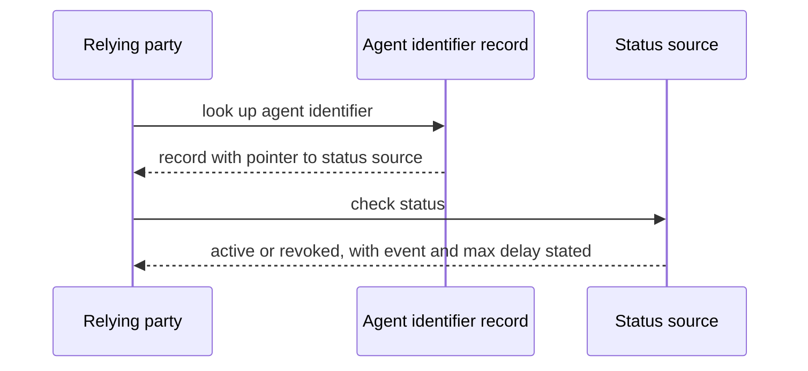
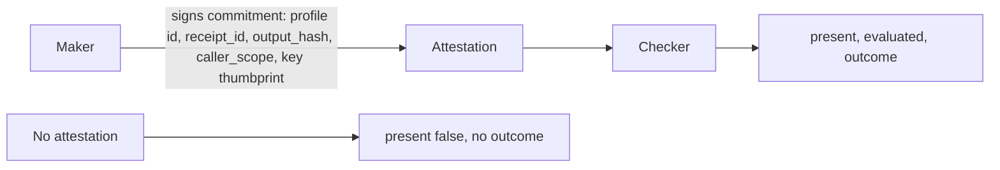
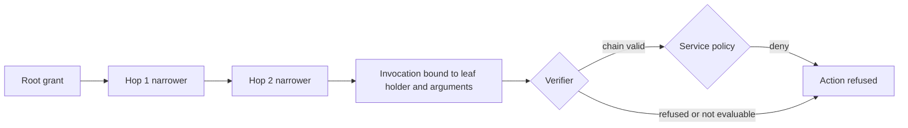
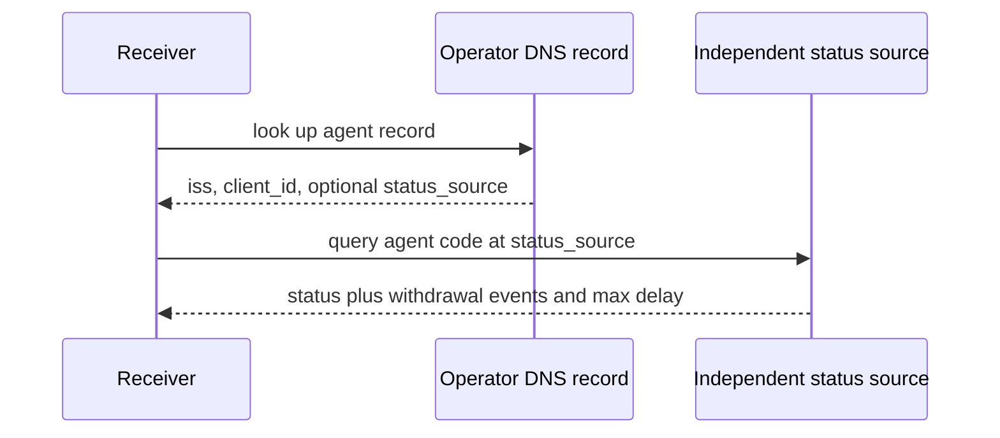
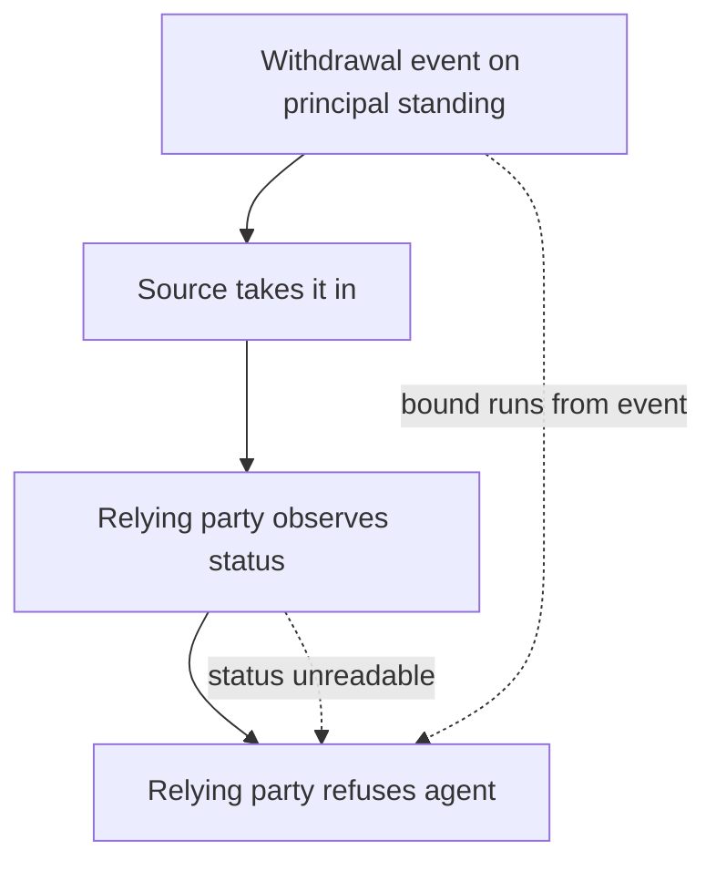
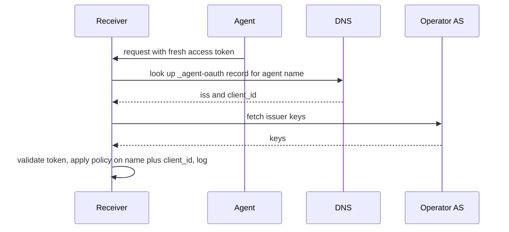
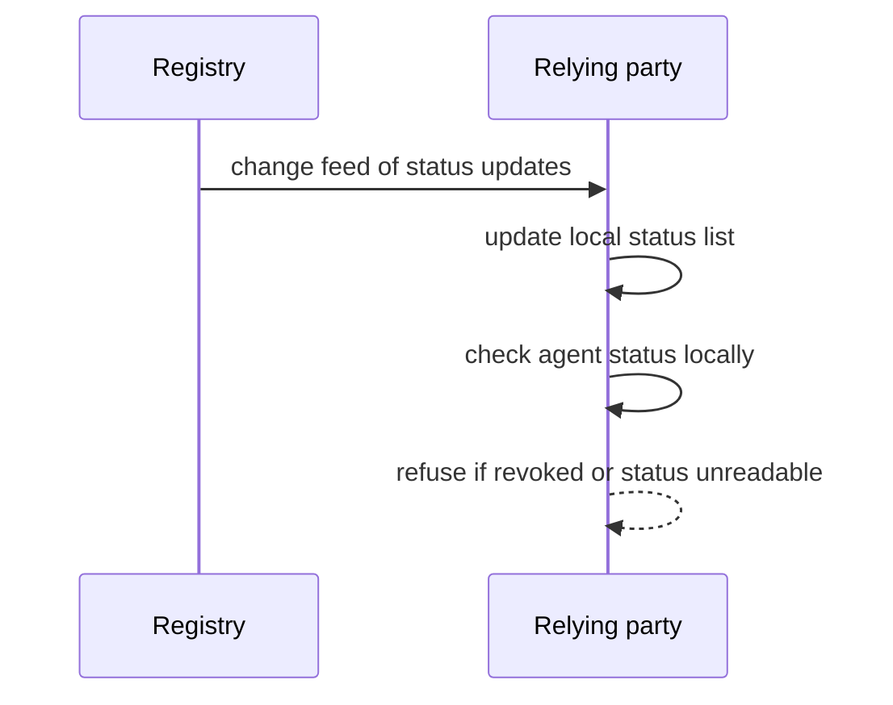

# WIMSE Daily Report (2026-11-23)

Generated at: 2026-11-23T07:42:52+00:00

<!-- insights:start -->
## Briefing

> No WG draft diffs this run, only four mailing-list threads. The most substantive one is on agent status: how an AIMS identifier could point to a status source, with each source stating its revocation delay. The rest is self-promotion of individual drafts.

_Updated 2026-11-23T07:44:45+00:00. Machine-drafted from the sources linked below, which stay authoritative._

### The AER-1 attribution profile now fixes one JSON string-escaping rule so commitments hash identically across languages

`mail` · `substantive` · first seen 2026-11-23 · [New draft: an attribution profile for AER-1 receipts (draft-zambo-aer1-attribution-profile-00)](https://mailarchive.ietf.org/arch/msg/wimse/HZixEiDAKLcIwtmTd1GtIBDUpaA/)

The author reports a new revision of draft-zambo-aer1-attribution-profile (the message says -01, though the subject says -00). Review found that Section 4 fixed member order, whitespace and no-normalization but not string escaping, so a non-ASCII caller_scope such as café gives different bytes and digests in Python's escaped form versus JavaScript's literal UTF-8. Section 4 now inherits the escaping rule of Section 7.1 of the base AER-1 draft. A new Appendix B gives a positive known-answer vector: the commitment, its canonical bytes, the digest, and a public JWK with the signature.

**Use cases**

- An implementer producing AER-1 attestation commitments in both Python and JavaScript services who needs identical digests for non-ASCII scope values.
- A verifier checking signatures over commitments that wants a known-answer vector to test its canonicalization.

### A thread on draft-molas-agent-principal-refs-00 compares public agent registries on latency, freshness and round trips

`mail` · `discussion` · first seen 2026-11-23 · [draft-molas-agent-principal-refs-00 - public registry as a case?](https://mailarchive.ietf.org/arch/msg/wimse/ZAgrZUWeAxNKGcuivc7yvPs8Vbc/)

Dick Brooks argues that a trust registry must meet three requirements: average response under 500 ms, current real-time status from SCITT ledger content, and one network round trip. He says locally stored data trades accuracy for speed. Jaromir (AIBSN) replies that the lookup returns status at request time, took 38 ms on average over 100 European lookups, and needs one HTTPS GET. He says the local-copy option in Section 7.6 of draft-zly-aibsn-agent-status is a proposal next to the live lookup, and will be clarified in -01. Dick adds that SAG-CTR uses a failover cache flushed every N minutes. These are self-reported measurements, and the material is truncated.

**Use cases**

- A relying party choosing between live status lookups and a locally cached status list for agent identities.
- An implementer of a trust registry weighing cache flush intervals against stale revocation data.

**Related in other tracks**

- `oauth-wg` / `draft-ietf-oauth-status-list`: A cached status list with changes fed to relying parties is the same trade-off, though the thread does not cite it.

### Two authors agree to draft mechanism-neutral AIMS Section 6 text letting an identifier point to a status source with a stated revocation delay

`mail` · `discussion` · first seen 2026-11-23 · [AIMS question: checking agent status from outside the trust domain](https://mailarchive.ietf.org/arch/msg/wimse/f2ezo_l0SvWfdPyhGlDUa2mplLg/)

Sriram Shankarlingam and Jaromir (AIBSN) agree to propose neutral wording for AIMS Section 6: an identifier can point to a status source, and each source states the event its delay is measured from and the maximum delay before a relying party refuses, as in Marc's P6. No field or registry is to be named. Sriram also reports -03 of draft-shankarlingam-oauth-agent-dns-link with a Change of Issuer section: the domain owner updates client_id (and iss) in the link record, receivers use the new values from the next uncached lookup, so old-client tokens stop being accepted within the cache lifetime. The record cannot show whether the owner made the change. Policy keyed on agent name plus client identifier, and logging of the client identifier at each verification, limit the impact. Earlier quoted text describes draft-zly-aibsn-agent-status with an optional status_source entry. The material is truncated.

**Use cases**

- An AIMS editor deciding how Section 6 should refer to external agent status sources.
- A receiver that resolves an agent name through DNS and must handle the operator moving to a new OAuth client or issuer.
- A deployer who needs evidence of agent revocation held outside the operator's trust domain.

**Related in other tracks**

- `oauth-wg` / `draft-ietf-oauth-status-list`: Also a way to publish revocation status for a credential or identifier, though the thread does not mention it.

### The author of draft-li-rttp-iqa-addressing points to three gaps in AIMS and offers their own draft's vectors as existing work

`mail` · `discussion` · first seen 2026-11-23 · [AIMS: three underserved areas, with existing work](https://mailarchive.ietf.org/arch/msg/wimse/hMKTKADxtaotoIMByw6e570Tjq4/)

The author names three areas they see as underserved in the AIMS draft: a vocabulary for policy outcomes (Section 10.4), freshness when the verifier is offline (Section 9.2.3 limitations), and offline-verifiable evidence artifacts for Sections 11 and 13. For each they cite sections of their own draft: a closed five-value refusal set with priority order, an in-band lease with a cached-lease offline mode, and a 128-octet attestation envelope with a byte-exact test vector. They state they are not asking AIMS to adopt or reference anything, only pointing to existing work and public conformance vectors. No response is in the material.

### In short, a new individual draft adds an optional signed attribution to AER-1 receipts, so a third party can tell who made the record

`mail` · `new-proposal` · first seen 2026-11-22 · [New draft: an attribution profile for AER-1 receipts (draft-zambo-aer1-attribution-profile-00)](https://mailarchive.ietf.org/arch/msg/wimse/-4du6HkeVluCVdJbnpenPJQ4ex0/)

draft-zambo-aer1-attribution-profile-00 binds an AER-1 receipt to its maker, which the base receipt leaves open. The attestation is optional, and a receipt without one stays conformant. When present, the maker signs a five-member commitment: the profile identifier, receipt_id, output_hash, caller_scope and the RFC 7638 key thumbprint, using Ed25519 or ES256, with no PKI, registry or permission step. A checker reports present, evaluated and outcome, where the outcome is attributed, attribution failed or not checked. A missing attestation has no outcome and must not be reported as failed or not checked. The author claims over 159,000 public receipts and publishes a conformance corpus. This is the author's description, not an independent evaluation.

**Use cases**

- An auditor who needs to know which agent or service produced a stored tool-call result
- A verifier that must handle receipts with and without attribution without treating missing attribution as an error

### An individual draft's reference verifier and test vectors were offered as input to the AIMS multi-hop delegation example

`mail` · `new-proposal` · first seen 2026-11-22 · [Test vectors for multi-hop delegation properties (AIMS issue #86)](https://mailarchive.ietf.org/arch/msg/wimse/gE_bXOgLhl-vVNEfYvXVj5-ehLM/)

Karthik Rampalli published a reference verifier and 27 byte-level test cases (28 presentations) for draft-rampalli-pedigree-01, on offline attenuated delegation for AI agents. He ties them to AIMS issue #86, where AIMS is to state delegation-chain properties and other specs define mechanisms. The vectors check that authority narrows per hop, each hop is bound to its parent, depth and linkage are verified, and the invocation is bound to the leaf holder and its arguments. Refusals on known facts are reported separately from cases the verifier could not evaluate, and both stop the action. In the lead case, all hops are valid but the service still denies under its own policy. It is an individual draft; Token Status List resolution, real WPT verification, Cedar evaluation and ID-JAG root mapping are not yet implemented. He asks whether these properties match what the AIMS example should show.

**Use cases**

- Authors of the AIMS multi-hop example checking which delegation properties a worked example should demonstrate.
- Implementers of agent-to-agent delegation who want executable cases for narrowing, parent binding and argument binding.

**Related in other tracks**

- `oauth-wg` / `draft-ietf-oauth-status-list`: The author lists Token Status List resolution as not yet implemented in the vectors.
- `oauth-wg` / `draft-ietf-oauth-identity-assertion-authz-grant`: The author lists the ID-JAG root mapping as not yet implemented.

### In short, an AIBSN author and the AIMS author agree on a mechanism-neutral Section 6 pointer from an agent identifier to an independent status source

`mail` · `discussion` · first seen 2026-11-22 · [AIMS question: checking agent status from outside the trust domain](https://mailarchive.ietf.org/arch/msg/wimse/643-IcKVBQSPa6e9Sw0FyfXMPe4/)

Sriram Shankarlingam says the _agent-oauth record already allows extra keys that receivers must ignore, so a status-source pointer could be added without breaking receivers, but it belongs in the document defining the status source. Jaromir Zly then defines an optional status_source entry in Section 7.10 of draft-zly-aibsn-agent-status. A record or an AIMS identifier can point to an independent source and the agent's code there, and the source must say which events withdraw a record and how long it takes. On transfer to a new issuer, Sriram says the domain owner updates iss and client_id, tokens from the old issuer stop being accepted when the receiver's cached record expires, and a paragraph will be added in the next revision. A legitimate transfer cannot be told from a hijack by the record alone. Receivers apply policy on agent name plus client identifier and log both. Sriram would accept Section 6 wording that stays mechanism neutral and requires each source to state the starting event and maximum delay, as in P6.

**Use cases**

- An operator publishing an agent name in DNS that also wants a public, third-party status record for disputes
- A receiver handling an agent whose operator changed authorization server or issuer

### In short, Songbo Bu's two P6 suggestions will go into draft-molas-agent-principal-refs-01: a per-path withdrawal table and a fail-closed test

`mail` · `discussion` · first seen 2026-11-22 · [draft-molas-agent-principal-refs: two suggestions on P6 from Songbo Bu](https://mailarchive.ietf.org/arch/msg/wimse/AyrwD5fB3oS8tF14xYx84NRpnEQ/)

Marc Molas relays two off-list suggestions from Songbo Bu. First, P6 is recorded per withdrawal path, with principal standing in its own row. Each row states the withdrawal event, when the source takes it in, and when the relying party observes it, and the bound runs from the event, because a fresh signed observation does not show how quickly the source took in the withdrawal. Second, a test for that row: keep the agent and its token valid, change only the principal's standing, and check that a conforming relying party refuses within the stated bound, including when it cannot read the status. Both will be credited to Bu in -01, planned for 1 December. -01 will also list draft-bu-agentproto-security-principal-binding among the drafts not evaluated, with no grade implied.

**Use cases**

- Testing that a relying party stops accepting an agent when only the principal's standing changes
- Writing a revocation SLA that starts at the withdrawal event rather than at the observation

### A thread on whether a public registry or SCITT log can meet the privacy and revocation-delay properties in draft-molas-agent-principal-refs-00

`mail` · `discussion` · first seen 2026-11-22 · [draft-molas-agent-principal-refs-00 - public registry as a case? (7 new messages)](https://mailarchive.ietf.org/arch/msg/wimse/L9vkb92fE28f29-1UInvI8_RTrQ/)

Marc Miro i Rierola explained that P5 requires a status request not to carry a value naming the record, so a relying party working from a list or log entries fetched the same way for everyone meets it, while fetching one entry by receipt location or code does not. P6 asks for a stated number, the time from withdrawal to refusal by a conforming relying party, not just real-time. Dick Brooks argued for a SCITT-based trust registry judged by under 500 ms, real-time accuracy, and one round trip, and described a high-speed cache kept in sync at registration. Marc replied that pre-fetched status meets those factors and that a cache reflecting the ledger can state the P6 number. He also said a draft needs no minimum set of sections to be graded on P5 and P6, that the document does not prefer one record or two for agent status and principal standing, and that -01 is planned for 1 December. Jaromir Zly is considering an individual draft.

**Use cases**

- A relying party choosing between fetching a whole status list or log in advance and querying a registry per identifier, given the privacy cost of naming the record.
- A registry operator that must state how long after a revocation a conforming relying party will refuse.

### Discussion of how a verifier with no tie to the issuer can check agent status and transfers, with a DNS-record option proposed for AIMS Section 6

`mail` · `discussion` · first seen 2026-11-22 · [AIMS question: checking agent status from outside the trust domain (2 new messages)](https://mailarchive.ietf.org/arch/msg/wimse/QLo3LzO4UBSe-zoJN9wU_S9wnC8/)

Jaromir Zly asked whether draft-ietf-wimse-aims-01 should cover status checks by unrelated parties, allow an identifier to point to a status source (Section 6), and cover transferring an agent to another accountable party. Sriram Shankarlingam pointed to his individual draft draft-shankarlingam-oauth-agent-dns-link: a _agent-oauth record under the agent name holds iss and client_id, and a receiver validates a fresh access token against it. He said an extra status-source key could be added because receivers ignore unknown keys, but he would not define it in that draft. Transfer is done by the domain owner updating iss and client_id, with the delay bounded by the receiver's cache lifetime, and the record alone cannot tell a legitimate transfer from a hijack. Mitigations are policy keyed on agent name plus client identifier, and receiver logging. Both sides accepted mechanism-neutral Section 6 wording that requires each status source to state its start event and maximum delay. Zly also disclosed a pending patent application. No AIMS text changed.

**Use cases**

- A bank or other relying party that must confirm an AI agent's authorization is still active without having a relationship with the agent operator's authorization server.
- An operator moving an agent to a new issuer and client, where receivers need to know how long the old issuer's tokens remain accepted.

### In short, a thread on whether a public agent registry (AIBSN) can meet P1 to P6 of draft-molas-agent-principal-refs-00, centred on cache versus live status

`mail` · `discussion` · first seen 2026-11-22 · [draft-molas-agent-principal-refs-00 - public registry as a case? (5 new messages)](https://mailarchive.ietf.org/arch/msg/wimse/WI8HdSgosASESG2vXCTmY_PsfWo/)

Dick Brooks sets three requirements for a trust registry: under 500 ms on average, real-time accuracy from the SCITT ledger, and a single network round trip. He says a local copy trades accuracy for speed. Marc Molas replies that a relying party holding a pre-fetched status list answers locally with no round trip, and the registry does not learn which object is checked. He adds that P6 asks for a number, the time from the withdrawal to the moment a conforming relying party refuses, not for real-time. Jaromir Zly (AIBSN) posts draft-zly-aibsn-agent-status, with a Section 8 self-assessment saying P5 and P6 are not met today, and a Section 7.6 proposal for a local status copy fed by a change feed. He measures lookups at 38 ms on average, 45 ms at the 95th percentile. Marc plans to list the draft in Appendix A of -01 on 1 December 2026, and notes that P6 in Section 3.6 measures up to the moment the relying party refuses, so a bound counted from the registry's receipt of a notification does not fit the test.

**Use cases**

- A relying party deciding whether to keep a local copy of an agent status list or query a registry on every request
- A registry operator that must state how long a revocation takes to reach relying parties

### In short, the weekly digest shows s2s-protocol issues on http-signature and wpt closed, and a closed arch issue on AI agent identity

`mail` · `routine` · first seen 2026-11-22 · [Weekly github digest (WIMSE Weekly GitHub Activity Summary)](https://mailarchive.ietf.org/arch/msg/wimse/SoIEBI6zibYWiMOeqOIsvfehExM/)

In draft-ietf-wimse-arch, issue #139 (token scopes do not create per-agent identity, so separate workload identities are required) received a comment and was closed. In s2s-protocol, four issues were closed: #422 (http-signature and wpt point to workload-creds Section 5.1.4, which -03 does not have), #420 (note that sample nonces in the HTTP-Sig examples are illustrative and below the entropy floor), #417 (Kathleen's editorial comments on HTTP-Sig) and #419 (test vectors for http-signature-08). Pull request #424, addressing Justin's review, got a comment, and two further s2s-protocol PRs and one in workload-identity-practices were opened. The digest does not show the resulting text changes.

### Triage of the candidate queue

- **high** `Diff active WG draft: draft-ietf-wimse-aims-01`: The AIMS Section 6 status-source wording is under discussion on the list, with an offer to draft text.
- **high** `Diff active WG draft: draft-ietf-wimse-arch-09`: Arch issue #139 on AI intermediaries and per-agent identity was commented on and closed this week.
- **high** `Diff active WG draft: draft-ietf-wimse-http-signature-09`: Digest shows closed s2s-protocol issues on http-signature: test vectors, nonce note, editorial comments, and a broken workload-creds reference.
- **high** `Diff active WG draft: draft-ietf-wimse-workload-creds-03`: The IPR poll to its authors started today, which suggests the draft is moving toward publication.
- **high** `Review related draft: draft-asor-wimse-agent-delegation-chain-03`: Cited as settling par_hash and totals handling, with a del_max_depth counting difference against AAT.
- **high** `Review related draft: draft-miao-wimse-http-signature-test-vectors-00`: New draft with 29 vectors and 3 observations on spec ambiguity in draft-ietf-wimse-http-signature.
- **high** `Review related draft: draft-nandakumar-wimse-wpt-message-binding-00`: Announced today and already drawing questions on authority hashing behind gateways and registry profiles.
- **low** `Review related draft: draft-hulea-wimse-agent-mandate-01`: Only appears as a column in a side-by-side comparison; no change discussed.
- **low** `Review related draft: draft-thaha-wimse-agent-evidence-binding-03`: Its authors engaged in two threads today, but only through short comments, with no new text in this material.

<!-- insights:end -->

## Snapshot

- Active WG drafts: 8
- Related drafts: 24
- Mailing-list posts scanned: 40
- Tracked GitHub repos: 6

## Active WG Drafts

| Draft | Date | Title |
| --- | --- | --- |
| draft-ietf-wimse-http-signature-09 | 2026-11-20 | WIMSE Workload-to-Workload Authentication with HTTP Signatures |
| draft-ietf-wimse-arch-09 | 2026-11-16 | Workload Identity in a Multi System Environment (WIMSE) Architecture |
| draft-ietf-wimse-aims-01 | 2026-11-02 | AI Identity Management System |
| draft-ietf-wimse-workload-creds-03 | 2026-10-30 | WIMSE Workload Credentials |
| draft-ietf-wimse-workload-identity-practices-08 | 2026-10-30 | Workload Identity Practices |
| draft-ietf-wimse-mutual-tls-03 | 2026-10-24 | Workload Authentication Using Mutual TLS |
| draft-ietf-wimse-identifier-04 | 2026-10-23 | Workload Identifier |
| draft-ietf-wimse-wpt-02 | 2026-08-27 | WIMSE Workload Proof Token |

## Recent Related Drafts

| Draft | Date | Title |
| --- | --- | --- |
| draft-munoz-wimse-authorization-evidence-02 | 2026-11-20 | Signed Authorization-Evidence Records for AI Agent Actions Using WIMSE Workload Identity |
| draft-miao-wimse-http-signature-test-vectors-00 | 2026-11-18 | Test Vectors for the WIMSE HTTP Message Signatures Protocol |
| draft-chandra-wimse-partition-tolerant-renewal-00 | 2026-11-17 | Extend-Only, Threshold-Attested Authority Renewal for Partitioned Agent Meshes |
| draft-nandakumar-wimse-delegator-bound-chains-00 | 2026-11-16 | Delegator-Bound Delegation Chains for AI Agents |
| draft-nandakumar-wimse-wpt-message-binding-00 | 2026-11-16 | Message Binding for Workload Proof Tokens |
| draft-hulea-wimse-agent-mandate-01 | 2026-11-01 | Verifiable Mandates for Agents Acting Across Administrative Domains |
| draft-thaha-wimse-agent-evidence-binding-03 | 2026-11-01 | Evidence Binding for AI Agent Credentials |
| draft-reddy-wimse-oauth-dialog-binding-00 | 2026-10-30 | Binding Agent Dialogs to WIMSE and OAuth Credentials |
| draft-sweeney-wimse-credential-delegation-02 | 2026-10-30 | Credential Delegation Protocol for AI Agents in Multi-System Environments |
| draft-durga-wimse-ctx-isolation-00 | 2026-10-29 | Cryptographic Separation of Untrusted Data-Plane Context from Control-Plane Tool Invocations in Autonomous AI Agents |

## Mailing List Topics

- http-signature: 1

## Recent GitHub Activity

| Repository | Latest Commit |
| --- | --- |
| ietf-wg-wimse/draft-ietf-wimse-s2s-protocol | 2026-11-20T22:45:12Z |
| ietf-wg-wimse/draft-ietf-wimse-arch | 2026-11-16T23:24:56Z |
| ietf-wg-wimse/draft-ietf-wimse-workload-identity-practices | 2026-10-30T09:50:30Z |
| ietf-wg-wimse/draft-ietf-wimse-identifier | 2026-10-23T15:16:50Z |
| ietf-wg-wimse/ietf-wg-wimse.github.io | 2026-10-07T19:43:41Z |
| ietf-wg-wimse/admin | 2024-03-17T22:59:45Z |

## Top Deep-Dive Candidates

- [7] Diff active WG draft: draft-ietf-wimse-aims-01
- [7] Diff active WG draft: draft-ietf-wimse-http-signature-09
- [7] Diff active WG draft: draft-ietf-wimse-mutual-tls-03
- [7] Diff active WG draft: draft-ietf-wimse-workload-creds-03
- [6] Review related draft: draft-asor-wimse-agent-delegation-chain-03
- [6] Review related draft: draft-chandra-wimse-partition-tolerant-renewal-00
- [6] Review related draft: draft-durga-wimse-ctx-isolation-00
- [6] Review related draft: draft-hulea-wimse-agent-mandate-01
- [6] Review related draft: draft-jackson-wimse-evaluation-05
- [6] Review related draft: draft-lee-wimse-local-tool-call-proof-01

